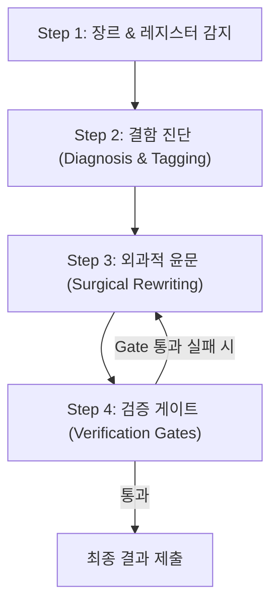

# 한국어 AI 티 윤문 스킬 (Humanize Korean Skill)

AI(ChatGPT, Claude, Gemini 등)가 생성한 한글 텍스트에서 반복 관찰되는 기계적 패턴(번역투, 관용구, 대칭 대구, 리듬 균일성, 불필요한 장식 등)을 진단하고, 인간 필자가 직접 고심하며 쓴 듯한 자연스러운 리듬과 호흡으로 정밀 윤문(Humanize)하는 스킬이다.

단일 진실 원천(SSOT):
- 분류 체계: [references/taxonomy.md](file:///c:/Users/baesh/Projects/Idsh-obsidian-garden/.agent/skills/humanize/references/taxonomy.md) (Korean AI-Tell Taxonomy v2.0)
- 윤문 처방: [references/playbook.md](file:///c:/Users/baesh/Projects/Idsh-obsidian-garden/.agent/skills/humanize/references/playbook.md) (Rewriting Playbook)
- Fast 룰북: [quick-rules.md](file:///c:/Users/baesh/Projects/Idsh-obsidian-garden/.agent/skills/humanize/quick-rules.md) (표층 신호 54선 빠른 참조)

---

## 0. 대원칙 (The 7 Prime Directives)

윤문 작업 시 다음 7대 원칙을 철저히 준수한다:

1. **의미 불변 (Fidelity)**: 사실, 수치, 고유명사, 날짜, 인과관계, 핵심 주장은 글자 단위로 보존한다. 의미가 모호하다고 해서 없는 내용을 임의로 지어내거나 추론해 덧붙이지 않는다.
2. **톤앤매너 유지 (Tone Match)**: 원문의 격식 체계(합쇼체/해요체/해라체)와 장르 레지스터를 엄격히 유지한다. 원문을 임의로 다른 문체나 장르로 변형하지 않는다.
3. **국소성 (Locality)**: 문장 전체를 새로 작성하지 않는다. AI 티가 드러난 특정 어구(span)만 외과적으로 정밀 타격하여 고친다.
4. **자연성 우선, 완벽성 차순 (Naturalness > Perfection)**: 과하게 문학적이거나 화려한 수사로 포장하지 않는다. 평범한 실제 인간 필자의 중간값 호흡과 자연스러움을 목표로 한다.
5. **근거 기반 (Span-Grounded)**: 진단에서 결함으로 지목된 구간만 수정한다. 문제가 없는 자연스러운 구간은 건드리지 않는다.
6. **과윤문 경고 (Over-Polish Alarm)**: 전체 문장의 50% 이상이 바뀌면 원문의 논리와 사실이 훼손될 위험이 높다. 정상 편집률(Levenshtein 거리 5~30%) 내에서 작업하며, 50% 초과 시 즉시 변경을 보수화한다.
7. **빼기 전용 (Removal-Only)**: 윤문은 "AI 티를 덜어내는 작업"이다. 처방집에 나온 단어나 멋진 표현을 원문에 없던 자리에 억지로 심지 않는다. 원문의 생생한 구어 표현('-했-' → '-하였-' 금지)이나 고유 어조를 억지로 격식화하지 않는다.

---

## 1. 심각도 체계 및 핵심 패턴 맵

### 심각도 정의
- **S1 (결정적 / Critical)**: 한 번만 나와도 "100% AI 글"이라고 의심받는 시그니처. **무조건 즉시 박멸**.
- **S2 (강함 / High)**: 1~2회는 인간도 쓸 수 있으나, 한 문서에 3회 이상 밀집되면 AI 냄새를 풍김. **밀도 기반 분산 및 제거**.
- **S3 (약함 / Low)**: 단독으로는 문제없으나 중첩 시 기계적 인상을 줌. **리듬 조정 시 참고**.

### 핵심 패턴 요약 및 처방

| 카테고리 | 코드 | 대표 패턴 및 증상 | 심각도 | 핵심 처방 |
|---|---|---|:---:|---|
| **A. 번역투** | `A-1` | "~에 대하여/대해서" 남발 (문단 3회+) | S1 | 목적격 조사("~을/를") 직결 또는 주제 조사("~은/는") |
| | `A-2` | 수단·경로를 모두 "~를 통해"로 통일 | S2 | "~로", "~해서", "~하여"로 분산 |
| | `A-3` | "~에 있어(서)" | S1 | "~에서", "~을 볼 때", "~할 때" |
| | `A-6` | "~에 기반하여", "~을 바탕으로" 남발 | S2 | "~로", "~를 토대로", "~를 보고" |
| | `A-7` | "가지고 있다" (have 직역) | S1 | 형용사/동사로 환원 ("영향을 가지고 있다" → "영향을 미친다") |
| | `A-8` | 이중 피동 ("~되어지다", "~지게 되다") | S1 | 단일 피동 또는 능동 ("판단되어진다" → "판단된다") |
| | `A-9` | "~에 의해" 피동문 | S2 | 행위자를 주어로 능동문화 ("AI에 의해 생성" → "AI가 생성한") |
| | `A-10`| "~할 수 있다" 4회 이상 연속 반복 | S2 | 서법 왜곡(단정) 없이 "~할 여지가 있다", "~하기도 한다"로 분산 |
| | `A-16`| 문맥에 맞지 않는 대명사 ("그것은", "그녀는") | S1 | 대명사 생략 또는 대상 명사 직접 지칭 |
| | `A-18`| 3중 이상 관형절 좌향 수식 ("~하고 ~하는 ~한 N") | S2 | 쉼표로 앞 절을 먼저 끊어 서술 |
| | `A-19`| 이중 조사 결합 ("-에서의", "-으로의", "-로부터의") | S2 | 단일 조사 ("-에서", "-으로", "-에서 나온") |
| **B. 영어/약어** | `B-1` | 한국어 뒤 불필요한 원어 괄호 병기 | S2 | 괄호 병기 삭제 ("파인튜닝(fine-tuning)" → "파인튜닝") |
| | `B-2` | 한국어 대체 가능한 일회성 영어 jargon | S2 | 자연스러운 한국어 전문 용어로 전환 |
| **C. 서식/구조** | `C-1` | 기계적 병렬 열거 ("첫째, 둘째, 셋째") | S2 | 접속사 삭제 후 맥락 중심의 서사형 문단 연결 |
| | `C-5` | 이모지 남발 (🚀, 💡, ✨, 📌 등) | S1 | 전문 문서/에세이/보고서에서는 100% 삭제 |
| | `C-8` | 대칭 대구 공식 ("A인가, B인가") | S1 | 담백한 평서문이나 단문 질문으로 환원 |
| | `C-10`| 콜론 부제 헤딩 ("X: Y의 새로운 지평") | S2 | 문장형 또는 구체적 과업 중심 헤딩으로 전환 |
| | `C-11`| 연결어미 바로 뒤 쉼표 ("~하였으며, ") | S1 | 연결어미 뒤 쉼표 삭제 ("~하였으며 ") |
| **D. 관용구** | `D-1` | 상투적 결산 ("결론적으로", "따라서", "이를 통해") | S1 | 접속사 삭제 후 본문 사실로 즉시 진입 |
| | `D-2` | 의의 과장 ("중요한 이정표", "새로운 지평을 열다") | S1 | 과장 형용사 삭제, 구체적 성과 수치/팩트로 대체 |
| | `D-4` | AI 메타 해설 ("주목할 만하다", "눈여겨볼 필요가") | S1 | 메타 해설 삭제 ("X에 주목할 만하다" → "X가 두드러진다") |
| | `D-5` | 의인화된 추상 주어 ("이 보고서는 제안한다") | S2 | 인간 행위자 주어로 환원 ("저자들은 ~ 제안한다") |
| | `D-14`| 진부한 비유 ("양날의 검", "나침반", "마중물") | S2 | 상투적 비유 삭제, 구체적 장단점/기제 직설 |
| **E. 리듬/어미**| `E-1` | 문장 길이가 40~50자로 균일 (장문·단문 결여) | S2 | 핵심 단문(15~25자)과 호흡 있는 복문(60~80자) 교차 |
| | `E-2` | 동일 종결어미 3회 이상 연속 ("~했습니다" 연타) | S2 | 연결어미, 명사형 종결, 도치 등을 활용해 어미 파쇄 |
| | `E-7` | 문단 간 경어법 혼용 (존댓말과 반말 섞임) | S2 | 문서 전체 청자 경어법을 단일 레지스터로 통일 |
| **F. 과도한수식**| `F-1` | 정도부사 남발 ("매우", "상당히", "대단히", "극히") | S2 | 부사 삭제 또는 구체적 정량 데이터 제시 |
| | `F-4` | 한자어 접미사 체인 ("-성", "-적", "-화" 남발) | S2 | 한 문서 12회 이하로 억제, 고유 한국어 서술어로 치환 |
| **G. Hedging** | `G-1` | 과도한 완곡 어미 ("~것으로 보여진다") | S2 | 단정 왜곡 없이 "~로 보인다", "~로 추정된다"로 정제 |
| **H. 접속사** | `H-1` | 문장마다 "그러나", "또한", "한편" 문두 배치 | S2 | 접속사 70% 이상 삭제 (한국어는 문맥으로 연결) |
| | `H-3` | 지시대명사 문두 남발 ("이는 ~", "이러한 ~") | S2 | 앞 절과 합치거나 구체적 대상 명시 |
| **I. 형식명사** | `I-1` | "~인 것이다", "~할 수 있는 것이다" 남발 | S2 | "~이다", "~한다"로 간결화 |
| | `I-4` | "~할 필요가 있다", "~해야 한다" 결말 공식 | S2 | 당위 문장을 문단 앞으로 옮기거나 구체적 행동으로 서술 |

전체 80+ 세부 패턴의 상세 스펙은 [references/taxonomy.md](file:///c:/Users/baesh/Projects/Idsh-obsidian-garden/.agent/skills/humanize/references/taxonomy.md)를 참조한다.

---

## 2. 작업 절차 (Step-by-Step Workflow)

사용자가 텍스트 윤문을 요청하거나 파일 경로를 전달하면 다음 4단계를 순서대로 밟는다.

### Step 1: 장르 및 레지스터 감지 (Genre & Register Detection)
- 텍스트의 첫 1~2문단을 읽고 다음 장르 중 하나로 판정한다:
  1. **자기소개서 / 취업 에세이**: 겸양과 주체적 행동성 공존, 격식체("-습니다"), 과한 Hype 지양, 생생한 시행착오 중심.
  2. **보고서 / 기획서 / 제안서**: 간결성, 개조식과 줄글의 조화, 수치와 팩트 중심, 이모지 배제.
  3. **칼럼 / 에세이**: 필자의 개성 있는 호흡, 문학적 비유와 사유 허용, 기계적 헤딩/불릿 배제.
  4. **기술 블로그 / 설명문**: 기술 고유명사 보존, 친절한 어조, 기계적 넘버링 지양.
- 청자 경어법(합쇼체, 해요체, 해라체)을 확인하고 전체 문서의 통일 기준을 수립한다.

### Step 2: 결함 진단 (Diagnosis & Tagging)
- 원문을 스캔하여 표층 및 구조적 결함을 태깅한다:
  - **S1 패턴**: 발견 즉시 치환 대상 확정 (`A-1`, `A-3`, `A-7`, `A-8`, `A-16`, `C-5`, `C-8`, `C-11`, `D-1~D-4`).
  - **S2 패턴**: 문서/문단 내 빈도를 카운트하여 임계값(한 문단 3회 이상, 동일 어미 3회 연속 등)을 초과한 것 선별.
  - **리듬 분석**: 문장 길이가 지나치게 일정하거나, 쉼표가 기계적으로 박혀 있는지 확인.
- 빠른 모드일 때는 [quick-rules.md](file:///c:/Users/baesh/Projects/Idsh-obsidian-garden/.agent/skills/humanize/quick-rules.md)를 참조하고, 심층 검토일 때는 [references/taxonomy.md](file:///c:/Users/baesh/Projects/Idsh-obsidian-garden/.agent/skills/humanize/references/taxonomy.md)의 기준을 적용한다.

### Step 3: 외과적 윤문 (Surgical Rewriting)
- **국소적 치환**: 진단된 span만 조준하여 수정한다.
- **문장 리듬 조성**:
  - 단문(15~30자)과 복문(50~80자)을 섞어 읽는 맛을 낸다.
  - 마침표(`.`)로 과감하게 끊고, 불필요한 접속부사("또한", "그리고", "한편")를 덜어낸다.
  - 종결어미의 연속성을 깨뜨린다 (`~했습니다` → `~했고` / `~한 결과였습니다` / `~하기 때문입니다`).
- **가운뎃점(·) 및 AI 서식 정제**:
  - 가운뎃점은 쉼표, 슬래시, 공백, 접속사('및', '와/과')로 전환.
  - `**라벨**: 설명` 식의 챗봇 요약형 구조를 자연스러운 줄글 호흡으로 전환.

### Step 4: 사후 검증 게이트 (Verification Gates)
윤문 완료 후 다음 5대 게이트를 자체 검증한다:

- [ ] **[Gate 1: S1 잔존 제로]**: A-1(밀집), A-3, A-7, A-8, A-16, C-5, C-8, C-11, D-1~D-4 잔존이 0건인가?
- [ ] **[Gate 2: 불변 영역 보존]**: Do-NOT 리스트(수치, 단위, 고유명사, 서법)가 100% 온전히 유지되었는가?
- [ ] **[Gate 3: 편집 거리 적정성]**: Levenshtein 수정률이 5%~30% 사이인가? (50% 초과 시 과윤문 경보)
- [ ] **[Gate 4: 어미 및 리듬 다양성]**: 동일한 종결어미가 3회 이상 연속되지 않는가?
- [ ] **[Gate 5: 톤앤매너 일관성]**: 경어법 레지스터가 처음부터 끝까지 흐트러짐 없는가?

---

## 3. 어휘 대체 위험 구역 (Do-NOT List)

아래 항목들은 문체상 어색해 보이더라도 **손대면 사실이나 의미가 왜곡되므로 원형을 엄격히 보존**한다:

1. **전문 고유명사 / 기술 스택 / 제품명**: `LLM`, `QLoRA`, `Transformer`, `S&P 500`, `Docker`, `PyTorch` 등.
2. **수치, 단위, 날짜**: `33.46%`, `2026년 10월`, `150ms`, `500만 건` 등 사실 데이터.
3. **직접 인용문**: 큰따옴표(`"..."`) 안에 들어 있는 발언, 인터뷰, 공식 인용문.
4. **법률 / 규정 / 공고 조문**: 법령 조항 및 시험/공고 필수 명시 문구.
5. **서법(Epistemic Modality / 당위·헤지)의 성격**:
   - 원문이 **추측/유보**(`~일 가능성이 있다`)로 쓴 것을 **단정**(`~이다`)으로 바꾸지 않는다.
   - 원문이 **당위/요구**(`~해야 한다`)로 쓴 것을 **기완료 사실**(`~하고 있다`)로 바꾸지 않는다.
   - *처방 원칙*: 서법 자체의 의미는 유지하되, 반복되는 표현 방식과 위치만 재배치한다 (예: 당위 문장을 문단 결말에서 앞부분으로 이동).

---

## 4. 장르별 실전 팁

### A. 자기소개서 / 지원서 (Job Application)
- **주의점**: 채용팀의 AI 검사 솔루션이 가장 민감하게 반응하는 문서.
- **핵심 제거 대상**: 가운뎃점(·), 기계적 나열("첫째/둘째"), `**제목**: 내용` 콜론 요약 구조, "중요한 이정표", "새로운 지평".
- **지향점**: 화려한 수식 대신 "담백한 사실 첫 문장 → 구체적 오류/한계 마주침 → 원인 진단 및 해결책 전환(Pivot) → 정량 성과 및 기준선(Baseline) 제시".
- *참조*: 자기소개서 특화 지침은 [cover-letter 스킬](file:///c:/Users/baesh/Projects/Idsh-obsidian-garden/.agent/skills/cover-letter/SKILL.md)과 연계하여 적용한다.

### B. 기술 블로그 및 아티클 (Tech Blog)
- **주의점**: 과도한 영어 병기("파인튜닝(Fine-tuning)")와 번역서 특유의 만연체 피동문 제거.
- **핵심 제거 대상**: "가지고 있다", "~에 있어", "이를 통해", 1문단 1이모지.
- **지향점**: 엔지니어링 인과관계("A 문제를 해결하기 위해 B 구조를 택했고, 그로 인해 C 결과를 얻었다") 중심 서술.

### C. 비즈니스 보고서 / 제안서 (Business Report)
- **주의점**: 감정적 수식어(Hype)와 모호한 시간 표현 제거.
- **핵심 제거 대상**: "매우 획기적인", "향후 중장기적으로", "새로운 패러다임".
- **지향점**: 수치와 팩트 기반 두괄식 문장, 간결한 명사형 종결이나 담백한 평서문.

---

## 5. 실행 예시 (CLI & 프롬프트 대응)

사용자가 다음과 같이 요청할 때 즉시 대응한다:

- **"이 글 AI 티 좀 빼줘" / "/humanize"**:
  1. 원문 장르와 레지스터 즉시 파악.
  2. 발견된 주요 결함(S1/S2) 3~4가지를 간략히 짚음 (예: "쉼표 뒤 연결어미 남발, 관용구 '이를 통해' 반복, 동일 종결어미 4회 연속").
  3. 대원칙을 준수한 윤문 본문 제시.
  4. 수정 요약 및 검증 결과(Gate 1~5 충족 여부) 안내.
- **"특정 파일 윤문해줘"**:
  1. `read_file`로 파일 내용 확인.
  2. 윤문본 작성 후 `edit_file` 또는 `write_file`로 반영.
  3. 글자수 변동률과 의미 보존 여부 보고.

