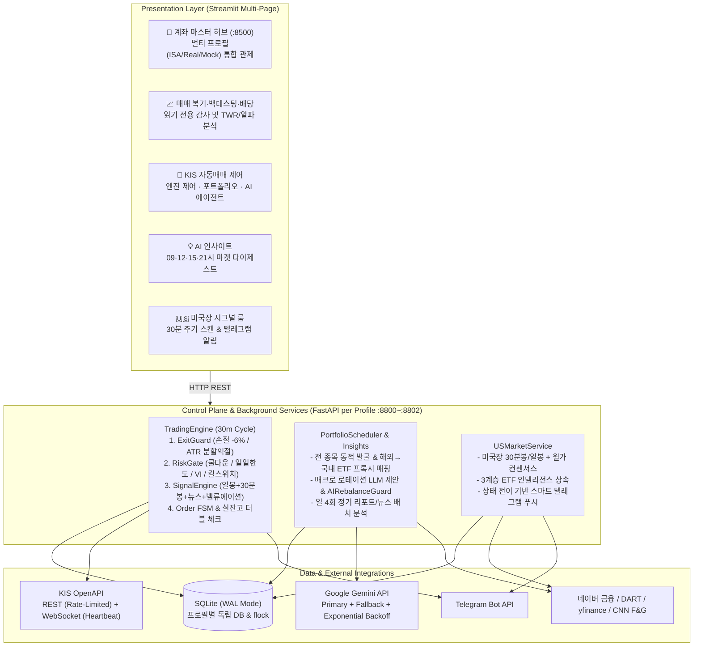

# Finance Jarvis — 경력용 기술 포트폴리오 (Technical Portfolio)

  

> **한국투자증권(KIS) OpenAPI 기반 멀티 계좌 자동매매 엔진 · AI 포트폴리오 에이전트 · 미국장 시그널 룸 · 매매 복기/백테스팅 통합 플랫폼**

> *"돈이 걸린 자동화 시스템을 어떻게 안전하게 설계하고, 실전 운영의 예외 상황을 어떻게 데이터와 코드로 통제할 것인가"*를 증명한 엔드투엔드 파이낸셜 엔지니어링 프로젝트.

  

- **저장소**: https://github.com/Ricepunchb/Finance_Jarvis

- **실행 및 사용 가이드**: [README.md](../README.md)

  

---

  

## 1. 프로젝트 요약 (Executive Summary)

  

| 항목 | 상세 내용 |

|---|---|

| **역할 / 형태** | 1인 전담 (도메인 아키텍처 설계 · 백엔드 엔진 · AI 파이프라인 · 프론트엔드 관제 UI · 실전 운영 및 트러블슈팅) |

| **개발 기간** | 프로토타입 (2025.11~12) → 아키텍처 전면 재설계 및 고도화 (2026.09.19 ~ 2026.10.28, 총 61개 커밋) |

| **기술 스택** | **Backend/Core**: Python 3.12, FastAPI, asyncio, websockets, SQLite (`aiosqlite`), Pydantic **Quant/Data**: pandas, pandas-ta, yfinance, KRX Calendar/Tick Engine **AI/LLM**: Google Gemini API (`google-genai`), 프롬프트 가드레일 & 구조화 출력(Structured Output) **Frontend/Ops**: Streamlit, Plotly, Telegram Bot API, tmux, uv, pytest |

| **외부 연동** | 한국투자증권(KIS) OpenAPI (REST + 실시간 체결통보 WebSocket), 네이버 금융(뉴스·컨센서스·리포트), Yahoo Finance, CNN Fear & Greed Index, Google Gemini |

| **코드 규모** | Python **약 25,500줄** (코어·API·UI·스크립트 약 20,800줄 + 테스트 코드 약 4,700줄) / **단위·통합 테스트 186개 (100% Pass)** |

| **운영 상태** | **실전 일반(`real`) · ISA 절세(`isa`) · 모의투자(`mock`) 3개 계좌 멀티 프로필 동시 상시 운영 중** |

  

### 핵심 구현 시스템 5가지

1. **무중단 자동매매 엔진 ([`core/engine.py`](../core/engine.py))**: 30분 주기로 종목별 손절/트레일링 분할 익절([`core/exit_guard.py`](../core/exit_guard.py)) → 리스크·쿨다운·호가/휴장일 점검([`core/risk.py`](../core/risk.py)) → 다중 시그널 결합([`core/signal_engine.py`](../core/signal_engine.py)) → 주문 의도 상태머신(FSM) 기록 → KIS 주문 및 실잔고 더블 체크([`core/reconciliation.py`](../core/reconciliation.py)) 수행.

2. **AI 포트폴리오 에이전트 & 해외 프록시 매매 ([`core/portfolio_agent.py`](../core/portfolio_agent.py), [`core/proxy_mapping.py`](../core/proxy_mapping.py))**: KOSPI·KOSDAQ 전 종목 및 글로벌 매크로/빅테크 자산을 동적 발굴해 국내 상장 대체 ETF로 자동 변환(Proxy Trading)하고, 결정론적 가드레일([`core/ai_rebalance_guard.py`](../core/ai_rebalance_guard.py))을 통과한 비중 조정안을 제안/자율 반영.

3. **3계층 ETF 인텔리전스 & 정기 AI 인사이트 ([`core/news/etf_mapper.py`](../core/news/etf_mapper.py), [`core/insights.py`](../core/insights.py))**: ETF 성격(단일종목·테마·지수)에 따라 기초자산/앵커 기업의 뉴스 감성과 컨센서스를 라우팅하는 자기학습(Self-Learning) 캐시 매퍼 및 일 4회(09·12·15·21시) 마켓 다이제스트 파이프라인.

4. **매매 복기 · TWR 손익 · 벡터화 백테스팅 대시보드 ([`dashboard.py`](../dashboard.py), [`core/backtest/`](../core/backtest/))**: 판단 시점의 컨텍스트 스냅샷(`context_json`) 복기, 시간가중수익률(TWR) 및 배당 포함 총수익(Total Return) 산출, 슬리피지·수수료·거래세를 반영한 S&P 500 벤치마크 대비 전략 백테스팅.

5. **미국장 30분 시그널 룸 & 멀티 계좌 마스터 허브 ([`core/us_market/`](../core/us_market/), [`pages/0_계좌_마스터.py`](../pages/0_계좌_마스터.py))**: 해외 직투 계좌를 위한 30분 주기 미국장 기술·컨센서스·ATR 손절선 스캔 및 상태 전이 기반 텔레그램 알림, `tmux` 기반 다중 계좌 통합 관제 센터.

  

---

  

## 2. 문제 정의와 엔지니어링 설계 원칙

  

개인이 기술적 지표 몇 개로 매수·매도 스크립트를 짜는 것은 쉽다. 그러나 **실제 자금이 투입되는 24/7 무인 시스템**에서는 전혀 다른 차원의 엔지니어링 문제가 발생한다.

- *"주문을 전송한 직후 프로세스가 죽으면 재시작 시 중복 주문을 어떻게 막을 것인가?"*

- *"복수 계좌(실전·ISA)를 동시에 돌릴 때 증권사 HTS ID 웹소켓 세션 충돌과 체결통보 데드락을 어떻게 해결할 것인가?"*

- *"LLM이 환각 티커를 내뱉거나 배당 방어주를 충동적으로 손절하라고 제안할 때 포트폴리오를 어떻게 방어할 것인가?"*

  

본 프로젝트는 수익률 알고리즘 이전에 **"실패했을 때 시스템이 어떻게 안전하게 동작할 것인가(Fail-Safe Design)"**를 최우선으로 설계했다.

  

### 5대 설계 원칙

1. **손실 제한 동작의 절대 우선권**: 손절과 트레일링 청산은 재주문 쿨다운, 일일 손실 한도, 웹소켓 지연 게이트보다 항상 먼저 평가되고 제한을 우회한다.

2. **추측 금지와 명시적 정지 (`UNKNOWN` & Kill-Switch)**: 주문 체결 여부가 모호하거나 단시간 내 연속 주문 거부가 발생하면 추측해서 재주문하지 않고 즉시 격리·정지한다.

3. **신뢰 경계 밖의 AI (Deterministic Guardrails over LLM)**: LLM 출력은 후보군 제약 → 정량 한도 검사(`AIRebalanceGuard`) → 승인/자율반영 워크플로의 3중 결정론적 코드 검증을 통과해야만 효력을 갖는다.

4. **보조 의존성 격리 (Graceful Degradation)**: 네이버 뉴스, Gemini API, yfinance 등 외부 데이터 소스가 장애를 일으켜도 해당 시그널만 제외 후 재정규화하여 코어 매매·손절 루프는 멈추지 않는다.

5. **완전한 감사 가능성 (Auditability & Replay)**: 모든 매매 판단과 리밸런싱 제안은 판단 시점의 지표·뉴스·리스크 스냅샷을 DB에 영속화하여 사후에 100% 재현·복기할 수 있어야 한다.

  

---

  

## 3. 시스템 아키텍처 (System Architecture)

  

  

---

  

## 4. 핵심 엔지니어링 설계 및 구현 상세

  

### 4.1 멱등성 없는 증권사 API를 위한 주문 의도 상태머신(Order Intent FSM)과 실잔고 더블 체크

- **배경**: KIS 주문 API는 멱등성 키(Idempotency Key)를 지원하지 않는다. 주문 POST 요청 직후 네트워크 타임아웃이나 프로세스 재시작이 발생하면 체결 여부를 알 수 없어 이중 주문 위험에 노출된다.

- **해결 ([`core/reconciliation.py`](../core/reconciliation.py), [`core/engine.py`](../core/engine.py))**:

  1. 주문 전송 전 `order_intents` 테이블에 고유 의도 레코드를 선기록(`PENDING` → `SUBMITTED`)하고, 주문 API(POST)는 자동 재시도 대상에서 제외했다(조회 GET만 지수 백오프 재시도).

  2. 프로세스 기동 시 미결 의도를 KIS 당일 체결내역과 비교하되, **`kis_order_no`(한국투자증권 채번 주문번호) 1:1 매칭을 최우선 수행**하고 없을 때만 시각·종목·수량 퍼지 매칭(Fuzzy Match)을 수행한다. 매칭 후보가 2건 이상이면 추측하지 않고 `UNKNOWN` 상태로 전환해 해당 종목의 자동 주문을 잠근다.

  3. **실잔고 더블 체크**: 체결통보 WebSocket 수신 즉시 KIS 실잔고 API를 재조회해 로컬 DB 포지션과 동기화하고, 매 30분 사이클 종료 시점마다 2차 REST 대조를 수행해 고아 포지션(Orphan Position)이나 유령 보유분(0% 잔고)을 자동으로 정리(`finish_symbol_removal`)한다.

  

### 4.2 계좌 성격별 맞춤 매매 전략: 추세 레짐(Trend Regime) 스윙 & ISA 적립식 모드

- **추세 레짐 기반 칼날잡기 방지 ([`core/signal_engine.py`](../core/signal_engine.py))**: 일봉(30%)·30분봉(50%)·뉴스 감성(20%)·밸류에이션(20%)을 결합하되, 확정적 하락 추세(`SMA20 < SMA60` 및 현재가 `< SMA20`)에서는 단기 반등 신호가 나와도 신규 스윙 매수와 분할 온보딩 매수를 차단한다.

- **추세 연동 50% 분할 익절 (Scale-Out, [`core/exit_guard.py`](../core/exit_guard.py))**: 평단 대비 `-6%` 손절 시 5일간 재진입을 금지(`STOP_LOSS_COOLDOWN_DAYS=5`)하여 연속 손절을 막고, 상승 추세(`is_uptrend=True`) 종목은 트레일링 폭(2.5×ATR%)을 1.5배 넓혀주며 익절 발동 시 **50%만 분할 매도**해 잔여 물량으로 추세 끝까지 수익을 극대화한다.

- **ISA 절세 계좌 적립식 모드 (`accumulation_mode`)**: 장기 모아가는 계좌에서는 단기 기술적 하락 시그널에 의한 스윙 매도를 차단해 바닥 털림을 방지하고, 극단적 패닉셀(시그널 강도 0.85 이상)이 아닌 한 분할 적립을 지속하도록 계좌별 전략을 분리했다.

  

### 4.3 AI 포트폴리오 에이전트와 해외 종목 국내 ETF 대리 매매 (Proxy Trading)

- **전 종목 동적 발굴 & 해외 프록시 변환 ([`core/discovery.py`](../core/discovery.py), [`core/proxy_mapping.py`](../core/proxy_mapping.py))**: 고정 대형주 대신 KOSPI·KOSDAQ 전 종목 마스터와 5개 소스(모멘텀·리포트·뉴스·저평가·테마) 및 글로벌 자산 시드를 스캔한다. 발굴된 해외 유망 종목(`NVDA`, `GOOGL`, `GLD`, `TLT` 등)은 [`data/overseas_proxy_map.json`](../data/overseas_proxy_map.json)을 통해 국내 상장 대체 ETF(예: `ACE 구글밸류체인액티브`, `KODEX 골드선물(H)`)로 자동 매핑되어 환전이나 해외 양도세 부담 없이 국내/ISA 계좌에서 글로벌 매크로 로테이션을 수행한다.

- **결정론적 가드레일 ([`core/ai_rebalance_guard.py`](../core/ai_rebalance_guard.py))**:

  - 후보 숏리스트 밖의 환각(Hallucination) 티커 원천 차단 및 KIS 실재성·호가 검증.

  - 총 회전율 20%, 종목당 비중 변화 10%p, 편입·제외 각 2종목 초과 시 **임의 보정하지 않고 제안 전체를 반려(Reject)**하여 감사 무결성 유지.

  - 맥쿼리인프라 등 배당·방어주에 대한 충동적 손절 제한 프롬프트 룰 적용 및 고득점 신규 발굴 종목(`score >= 0.45`)에 대한 7일 삭제 쿨다운 예외 허용(`DISCOVERY` 트리거).

  

### 4.4 3계층 ETF 인텔리전스 라우팅 & 자기학습(Self-Learning) 캐시

- **문제**: 단일 종목 레버리지/인컴 ETF(예: `TSLW`, `NVDY`)나 테마 ETF(예: `SOXL`, `SMH`, `OZEM`)는 ETF 자체 티커로 뉴스나 애널리스트 목표가를 검색하면 데이터가 없거나 무의미한 시황만 수집되어 LLM API 호출이 낭비되고 시그널이 왜곡됐다.

- **해결 ([`core/news/etf_mapper.py`](../core/news/etf_mapper.py), [`core/us_market/client.py`](../core/us_market/client.py))**:

  1. **`SINGLE_STOCK` 계층**: 기초자산 주식(예: `TSLW` → `TSLA`)의 뉴스 감성과 월가 컨센서스 목표가 상승여력을 100% 상속.

  2. **`THEMATIC` 계층**: 핵심 구성 앵커 기업들(예: `SMH` → `NVDA`, `TSM`, `AVGO`)의 컨센서스와 뉴스 감성을 가중 평균하여 집계.

  3. **`BROAD_INDEX` 계층**: 시장 지수·단기채(`SPY`, `QQQ`, `SCHD`, `SGOV`)는 개별 뉴스 호출을 생략하고 매크로·기술 지표에 집중.

  4. **자기학습 분류기**: 미등록 신규 티커 등장 시 단어 경계(Word Boundary) 및 `quoteType` 검증으로 일반 주식을 방어한 뒤, Gemini로 ETF 계층과 앵커 티커를 자동 판별해 [`data/etf_intelligence_map.json`](../data/etf_intelligence_map.json)에 영구 캐싱한다.

  5. **뉴스 캐시 최적화 ([`core/news/sentiment.py`](../core/news/sentiment.py))**: 72시간 초과 구문 뉴스는 LLM 호출 없이 중립(0.0) 처리하고, 언론사 간 복제 기사는 제목 토큰 자카드 유사도(Jaccard Similarity ≥ 0.65)로 교차 캐싱하여 API 비용을 절감했다.

  

### 4.5 멀티 계좌 프로필 격리 및 마스터 관제 허브

- [`core/profile_manager.py`](../core/profile_manager.py)를 통해 `isa`(:8800/:8501), `real`(:8801/:8502), `mock`(:8802/:8503) 계좌를 각각 독립된 SQLite DB, 독립 토큰 캐시(`kis_token_<profile>.json`), 독립 `flock` 파일 락, 독립 `tmux` 세션으로 완전 격리했다.

- 통합 관제 센터([`pages/0_계좌_마스터.py`](../pages/0_계좌_마스터.py), `:8500`)에서 전 계좌의 프로세스 생존 여부, 총자산·수익률, 킬스위치 상태를 실시간 모니터링하고 원클릭으로 기동·정지·재시작을 제어한다.

  

---

  

## 5. 실전 운영 및 복기 기반 트러블슈팅 (Production Troubleshooting)

  

단위 테스트만으로는 절대 발견할 수 없었던 **실전/모의투자 장중 운영 및 3일간의 로그·복기 전수 감사**를 통해 해결한 대표적 엔지니어링 사례들이다.

  

### 사례 1. 멀티 계좌 구동 시 웹소켓 세션 충돌과 Staleness 게이트 데드락 해결

- **현상**: 실전(`real`)과 절세(`isa`) 계좌를 동시에 띄우자 동일 HTS ID에 대한 KIS 웹소켓 중복 연결로 세션이 끊기거나, 장중 체결이 없는 유휴 시간에 웹소켓이 `stale`(120초 무응답)로 판정되어 신규 매수가 영구 차단되는 데드락 발생.

- **원인**: KIS 웹소켓은 표준 프로토콜 `ping/pong` 프레임 대신 자체 JSON 텍스트(`PINGPONG`)를 주고받으며, 체결이 없으면 아무 패킷도 보내지 않는다. 또한 동일 HTS ID로 복수 프로세스가 웹소켓을 열면 기존 연결이 강제 종료된다.

- **해결 ([`core/websocket_client.py`](../core/websocket_client.py), [`core/risk.py`](../core/risk.py))**:

  1. KIS `PINGPONG` JSON 수신 시 동일 페이로드를 즉시 Echo 전송하고, 연결 유지 중 30초 주기의 자체 하트비트(`_HEARTBEAT_INTERVAL_SEC=30`)를 갱신해 유휴 시간 staleness 오탐을 제거했다.

  2. 주 계좌(`real`)만 실시간 웹소켓을 사용하고 보조 계좌(`isa`, `mock`)는 `ENABLE_WEBSOCKET=False`로 설정해 REST 체결 대조 모드로 동작하도록 분리하여 HTS ID 충돌을 원천 해결했다.

  3. 설령 웹소켓이 비정상일 때도 신규 매수만 차단할 뿐 **보유 종목의 손절/트레일링 평가는 정상 통과**하도록 게이트를 분리했다.

  

### 사례 2. 83사이클(3일) 동안 특정 2종목만 거래 신호가 0건이었던 '조용한 기아(Starvation)' 버그

- **발견**: 에러 로그는 단 한 줄도 없었으나, 매매 복기 대시보드에서 특정 2종목이 3일 내내 시그널 강도가 임계값(0.5)을 넘지 못한 것을 발견.

- **원인**: 모의투자 초당 1건 호출 제한 때문에 30분봉 백필을 사이클당 3종목으로 제한했는데, 이미 캐시가 충분한 앞 순서 종목들도 예산을 차감하고 있었다. 결과적으로 리스트 뒤쪽 두 종목은 영구적으로 30분봉(가중치 50%)을 받지 못해 수학적으로 매수 임계값을 넘을 수 없었다.

- **해결 ([`core/intraday.py`](../core/intraday.py))**: 실제로 API 호출을 통해 백필을 수행한 종목만 예산을 차감하는 `BackfillBudget` 객체를 도입해 기아 현상을 해소했다. **"조용히 아무것도 안 하는 버그는 로그가 아니라 복기 데이터에서만 보인다"**는 교훈을 얻었다.

  

### 사례 3. 백테스팅 초기 `-10.45%` 손실 원인의 정량적 규명과 `+33.46%` 흑자 전환

- **현상**: 초기 스윙 알고리즘을 6개월 백테스트하자 S&P 500 ETF 대비 크게 뒤처지는 `-10.45%` 손실과 35회의 과도한 손절이 발생.

- **원인 분석**:

  1. 하락 추세(`SMA20 < SMA60`) 중인 종목을 손절 직후 "가격이 싸졌다(RSI 과매도)"는 이유로 다음 날 즉시 재매수하여 **연쇄 손절 루프**에 빠짐.

  2. 한화시스템·고려아연 등 주당 가격이 높은 종목이 1회 주문 한도나 온보딩 분할 수량 계산에서 `0주`로 버림 처리되어 상승장 주도주 편입이 누락됨.

  3. 상승 추세 종목이 일간 노이즈(-5% 트레일링)에 전량 조기 청산되어 대세 상승분을 놓침.

- **해결**: ① **손절 후 5일 재진입 쿨다운**, ② **SMA20/60 추세 레짐 필터(역추세 매수 차단)**, ③ **고가주 최소 1주 보장 로직**, ④ **상승 추세 시 트레일링 폭 1.5배 확대 및 50% 분할 익절(Scale-Out)**을 도입.

- **결과**: 손절 횟수가 **35회 → 10회로 71.4% 감소**하고, 동일 기간 9개 복합 자산군 누적 수익률 **`+33.46%` (S&P 500 ETF 대비 `+27.67%p` 초과 수익, 샤프 지수 `2.03`)** 달성.

  

### 사례 4. 다중 프로필 토큰 만료, KRX 호가단위(Tick Size) 거부, 서머타임 오탐 등 실전 예외 방어

- **다중 프로필 토큰 자가 복구 ([`core/kis_client.py`](../core/kis_client.py))**: 프로필별 토큰 캐시에 `app_key` 해시를 함께 기록해 설정 변경 시 오염을 막고, 장중 토큰 만료 오류 응답 시 즉시 캐시를 무효화하고 재발급·재시도하는 Self-Healing 래퍼 구현.

- **KRX 호가단위 및 영업일 캘린더 정합성 ([`core/utils/tick_size.py`](../core/utils/tick_size.py), [`core/utils/krx_calendar.py`](../core/utils/krx_calendar.py))**: 가격대별 KRX 호가단위(1원~1,000원) 미정렬로 인한 주문 거부를 막기 위해 주문 전 틱 정렬을 강제하고, 대체공휴일·연말 휴장일을 반영한 KRX 영업일 캘린더 검증 추가.

- **서드파티 `pandas_ta` CCI 수식 버그 적발 ([`core/indicators.py`](../core/indicators.py))**: 대시보드 원시 지표 검증 중 `pandas_ta` 3.0.6의 `cci()`가 괄호 누락으로 값을 수백 배 부풀리는 버그를 발견하여 직접 구현한 수식으로 대체.

  

---

  

## 6. 정량적 검증 및 백테스팅 성과 (Verification & Metrics)

  

### 6.1 테스트 커버리지 (186 Tests, 100% Pass)

- 주문 의도 상태머신 및 `kis_order_no` 대조, 손절/트레일링 분할 익절, AI 가드레일 한도 검사, 3계층 ETF 자기학습 매퍼, 웹소켓 하트비트/데드락 방지, TWR 수익률 및 배당금 합산, KRX 호가단위/휴장일, 미국장 시그널 룸 등 **총 186개 단위·통합 테스트 상시 통과**.

  

### 6.2 벡터화 백테스팅 엔진 ([`core/backtest/`](../core/backtest/)) 성과

- **시뮬레이션 조건**: 슬리피지(`0.05%`), 매매 수수료(`0.015%`), 증권거래세(`0.18%`) 실질 차감 및 미래 참조 편향(Look-ahead Bias) 완전 배제.

- **6개월 백테스트 (9개 이종 자산군 복합 포트폴리오)**:

  - **누적 수익률**: **`+33.46%`** (벤치마크 TIGER 미국S&P500 `+5.79%` 대비 **`+27.67%p` 알파**)

  - **위험 조정 수익**: **샤프 지수(Sharpe Ratio) `2.03`**, **소티노 지수(Sortino Ratio) `2.39`**, **손익비 `5.21`**

- **1년 장기 백테스트**:

  - **누적 수익률**: **`+101.14%`** (벤치마크 `+11.92%` 대비 **`+89.22%p` 알파**), **샤프 지수 `1.96`**, **승률 `61.5%`**

  

---

  

## 7. 개발 타임라인 (Development Roadmap)

  

| 시기 | 단계 | 주요 엔지니어링 마일스톤 |

|---|---|---|

| **2025.11~12** | Prototype | Streamlit + yfinance 포트폴리오 뷰어, 로컬 LLM 뉴스 감성, 기초 기술 지표 실험 |

| **2026.09.19** | Phase 0~1 | **안전 코어 재설계**: 주문 의도 FSM, 시작 시 체결 대조(`reconciliation`), 단일 인스턴스 `flock`, 킬스위치, FastAPI 분리 |

| **2026.09.21** | Phase 2~3 | Gemini 뉴스 감성 분석(중복 병합·시간 감쇠), `AIRebalanceGuard`, 판단 스냅샷 로깅, 해외주식 TR 연동 |

| **2026.09.22~23** | Phase 4~5 | **스윙 엔진 전환**: 1분봉→30분봉 집계, 손절/트레일링 우선 루프, 펀더멘털 밸류에이션, AI 포트폴리오 에이전트 및 퀀트 지표(Sharpe/Sortino/Beta/MDD) |

| **2026.09.25~10.01** | Replay & Audit | **매매 복기 대시보드 구축**: 분봉 백필 기아 버그 수정, KOSPI·KOSDAQ 전 종목 5대 소스 동적 발굴, ATR 트레일링 고도화 |

| **2026.10.01~06** | Quant & Multi-Hub | **백테스팅 & 멀티 계좌 확장**: S&P 500 벤치마크 백테스터, 추세 레짐 + 50% 분할 익절(`+33.46%` 달성), 체결 실잔고 더블 체크, 배당 Total Return, 해외→국내 ETF 프록시 매매, `isa`/`real`/`mock` 마스터 관제 허브(:8500) |

| **2026.10.15~23** | Global & Insights | **미국장 시그널 룸 & 3계층 ETF 라우팅**: 30분 주기 미국장 스캔 및 60% 강도 필터 텔레그램 알림, 3계층 ETF 감성/컨센서스 상속, 일 4회(09·12·15·21시) 정기 인사이트 배치, KRX 호가/캘린더/TWR 정합성 패치 |

| **2026.10.26~28** | Self-Learning & Stability | **자기학습 & 무중단 안정화**: 웹소켓 하트비트 및 멀티 프로필 WS/REST 분리로 데드락 해제, 매크로 로테이션 라이브 연결, 미등록 ETF Gemini 자동 분류·캐싱, 고득점 발굴 종목 쿨다운 예외 및 유령 잔고 자동 정리 |

  

---

  

## 8. AI-Native 엔지니어링 프로세스 (AI 페어 프로그래밍 협업 방식)

  

본 프로젝트는 **엔지니어가 도메인 아키텍트이자 테크 리드(Tech Lead)로서 설계·검증을 주도**하고, **AI 에이전트(Antigravity)를 고밀도 구현 및 분석 파트너로 활용**하여 1인 개발로 약 2.5만 줄 규모의 프로덕션급 금융 시스템을 완성한 AI-Native 엔지니어링 사례다.

  

1. **실패 모드 정의와 아키텍처 통제 (Human-Led Architecture)**:

   - AI에게 막연히 "자동매매 만들어줘"라고 지시하면 예외 처리가 없는 해피 패스(Happy-path) 코드만 생성된다.

   - 엔지니어가 직접 *"멱등성 없는 주문 복구", "동일 HTS ID 멀티 계좌 웹소켓 충돌", "단일종목 ETF의 기초자산 컨센서스 상속"* 등 구체적인 금융 도메인 제약과 상태머신을 설계하여 제시했다.

2. **실전 로그 감사와 가설 검증 루프 (Log-Driven Debugging)**:

   - 장중 발생하는 KIS 고유 에러 코드(`EGW00201` 초당 제한, `EGW00215` 원장 제한, `PINGPONG` 패킷 규격)와 3일간의 운영 로그를 엔지니어가 수집·분석해 원인을 특정하고, 이를 재현하는 단위 테스트(186개)를 먼저 작성해 회귀를 원천 차단했다.

3. **프롬프트가 아닌 시스템 코드로 AI를 통제 (Code over Prompt)**:

   - LLM의 환각이나 과도한 포트폴리오 회전율을 프롬프트 튜닝에만 의존하지 않고, [`AIRebalanceGuard`](../core/ai_rebalance_guard.py)와 단어 경계/티커 검증기 같은 결정론적 파이썬 가드레일 계층으로 감싸 프로덕션 안정성을 확보했다.

  

---

  

## 9. 이력서 요약 문구 & 기술 면접 Q&A 가이드

  

### 9.1 이력서 프로젝트 요약 불릿 (Resume Bullet Points)

- **무중단 멀티 계좌 자동매매 엔진 설계 및 운영 (Python 3.12, FastAPI, asyncio, SQLite)**

  - KIS OpenAPI(REST/WebSocket) 기반 30분 주기 스윙/적립식 하이브리드 트레이딩 시스템 구축 및 실전·ISA·모의 3개 계좌 독립 프로세스(`tmux`/`flock`) 상시 운영.

  - 멱등성 키를 지원하지 않는 증권사 주문 API 환경에서 **주문 의도 상태머신(Order Intent FSM)과 `kis_order_no` 1:1 대조 및 체결 즉시 실잔고 더블 체크 파이프라인**을 구현하여 프로세스 재시작 시 중복 주문 0건 보장.

  - 복수 계좌 동시 구동 시 발생하는 HTS ID 웹소켓 세션 충돌 및 장중 유휴 시간 staleness 데드락을 **프로필별 WS/REST 하이브리드 분리 및 30초 주기 KIS `PINGPONG` 하트비트 에코**로 해결.

- **데이터 기반 퀀트 백테스팅 및 매매 전략 최적화 (Vectorized Backtester)**

  - 슬리피지(0.05%), 매매 수수료(0.015%), 증권거래세(0.18%)를 실질 차감하는 백테스팅 엔진 구축 및 TWR(시간가중수익률)·배당 포함 Total Return 분석 대시보드 개발.

  - 초기 `-10.45%` 손실 전략의 실패 원인을 복기 데이터로 분석해 **손절 후 5일 쿨다운, SMA20/60 추세 레짐 필터, ATR 기반 50% 분할 익절(Scale-Out)**을 도입함으로써 손절 횟수를 **71.4% 절감(35회→10회)**하고 **6개월 누적 `+33.46%`(S&P 500 대비 `+27.67%p` 알파, 샤프 지수 `2.03`)** 달성.

- **LLM 기반 AI 포트폴리오 에이전트 및 3계층 ETF 인텔리전스 파이프라인 (Gemini API)**

  - KOSPI·KOSDAQ 전 종목 동적 발굴 및 해외 유망 종목의 **국내 상장 대체 ETF 자동 매핑(Proxy Trading)**을 통해 국내 절세 계좌(ISA)에서 글로벌 매크로 로테이션 구현.

  - 회전율 20%·종목당 비중 변화 10%p 초과 시 제안을 전면 반려하는 결정론적 가드레일(`AIRebalanceGuard`)로 LLM 환각 및 과잉 매매 차단.

  - ETF를 단일종목·테마·광범위지수 3계층으로 자동 분류해 기초자산/앵커 기업의 뉴스 감성과 월가 컨센서스를 상속하는 **자기학습(Self-Learning) ETF 인텔리전스 매퍼** 및 제목 자카드 유사도(≥0.65) 기반 뉴스 교차 캐싱으로 API 비용 최적화.

  

### 9.2 1분 자기소개 / 프로젝트 피칭 스크립트

> "저는 한국투자증권 OpenAPI와 Gemini LLM을 결합해 국내 실전·ISA 멀티 계좌 자동매매 엔진과 미국장 시그널 모니터링 플랫폼인 **Finance Jarvis**를 설계·개발하고 직접 운영하고 있습니다.

> 이 프로젝트에서 가장 집중한 것은 **'돈이 걸린 시스템이 실패했을 때 어떻게 안전하게 동작할 것인가'**였습니다. 멱등성이 없는 증권사 API에서 이중 주문을 막기 위해 주문 의도 상태머신(FSM)과 실잔고 더블 체크 파이프라인을 구축했고, 다중 계좌 운영 중 발생한 웹소켓 세션 충돌과 데드락을 하트비트 에코와 WS/REST 프로필 분리로 해결했습니다.

> 또한 모든 판단 컨텍스트를 스냅샷으로 기록하는 복기 대시보드와 실전 거래비용을 반영한 백테스팅 엔진을 통해, 초기 `-10.45%` 손실 전략의 연쇄 손절 문제를 추세 레짐 필터와 50% 분할 익절로 개선하여 6개월 `+33.46%`(샤프 2.03, S&P 500 대비 `+27.67%p` 알파)의 정량적 성과를 달성했습니다. 총 2.5만 줄의 코드와 186개의 자동화 테스트로 검증된 실전 파이낸셜 엔지니어링 경험을 보유하고 있습니다."

  

### 9.3 기술 면접 예상 질문 & 핵심 답변 포인트

| 예상 질문 | 핵심 답변 포인트 |

|---|---|

| **Q1. 주문 전송 직후 서버가 죽으면 재시작 시 중복 주문을 어떻게 막나요?** | KIS API는 멱등성 키가 없으므로 주문 전 SQLite `order_intents`에 의도를 선기록하고 주문 POST는 재시도하지 않습니다. 재시작 시 `reconciliation` 단계에서 `kis_order_no` 1:1 매칭 및 퍼지 매칭을 수행하되, 후보가 2개 이상이라 모호하면 추측하지 않고 `UNKNOWN` 상태로 멈춰 이중 주문을 원천 차단합니다. |

| **Q2. 금융 시스템에 LLM을 도입할 때 환각(Hallucination)이나 오판 위험은 어떻게 통제했나요?** | LLM을 신뢰 경계 밖에 두었습니다. ① 사전 검증된 발굴 숏리스트 내의 종목만 선택 가능하게 제한하고, ② `AIRebalanceGuard`에서 회전율 20%·비중변화 10%p 한도 위반 시 임의 보정 대신 제안 전체를 반려하며, ③ 뉴스 감성 단독(가중치 20%)으로는 매수 임계값(0.5)을 넘을 수 없도록 설계했습니다. |

| **Q3. 실전 운영 중 겪은 가장 까다로운 인프라/네트워크 버그는 무엇이었나요?** | 두 가지입니다. 첫째는 30분봉 백필 예산이 이미 캐시된 앞쪽 종목에 소모되어 뒤쪽 종목이 3일간 거래 신호를 못 받은 '기아(Starvation) 버그'로, 에러 로그가 없어 복기 대시보드 데이터 분석으로 잡아냈습니다. 둘째는 멀티 계좌 구동 시 KIS 웹소켓 HTS ID 충돌과 유휴 시간 staleness 데드락으로, 30초 `PINGPONG` 에코 하트비트와 프로필별 WS/REST 모드 분리로 해결했습니다. |

| **Q4. ETF 종목 분석 시 일반 개별 주식과 어떤 차이를 두었나요?** | `TSLW`나 `SOXL` 같은 ETF는 자체 티커로 뉴스나 컨센서스를 조회하면 유효한 데이터가 없습니다. 이를 해결하기 위해 ETF를 `SINGLE_STOCK`(기초자산 100% 상속), `THEMATIC`(상위 앵커 기업 가중평균), `BROAD_INDEX`(개별 뉴스 생략) 3계층으로 나누고, 미등록 ETF는 Gemini로 자동 분류해 로컬 JSON에 자기학습 캐싱하는 라우팅 아키텍처를 구현했습니다. |

| **Q5. 백테스팅 결과를 실제 시장에서도 신뢰할 수 있는 근거는 무엇인가요?** | 단순 종가 시뮬레이션이 아니라 매 거래마다 슬리피지(0.05%), 왕복 수수료(0.015%), 국내 증권거래세(0.18%)를 차감했고, 미래 참조 편향(Look-ahead Bias)을 차단했습니다. 또한 단일 종목 과최적화를 피하기 위해 반도체·방산·인프라·지수 ETF 등 9개 이종 자산군에 동일 파라미터를 일괄 적용해 6개월 샤프 2.03, 1년 알파 +89.22%p를 검증했습니다. |