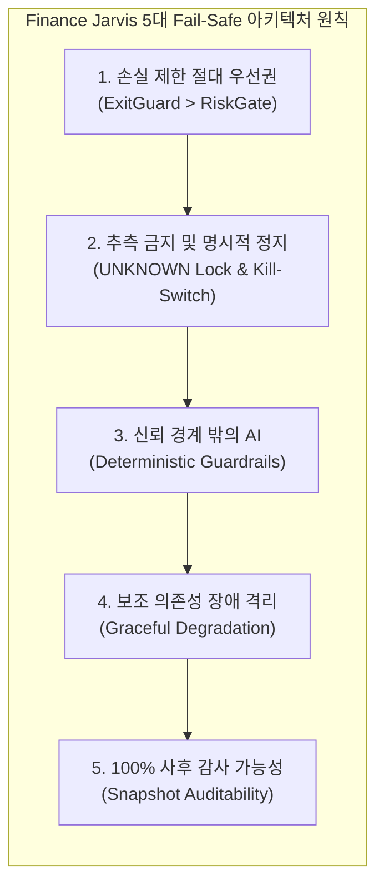
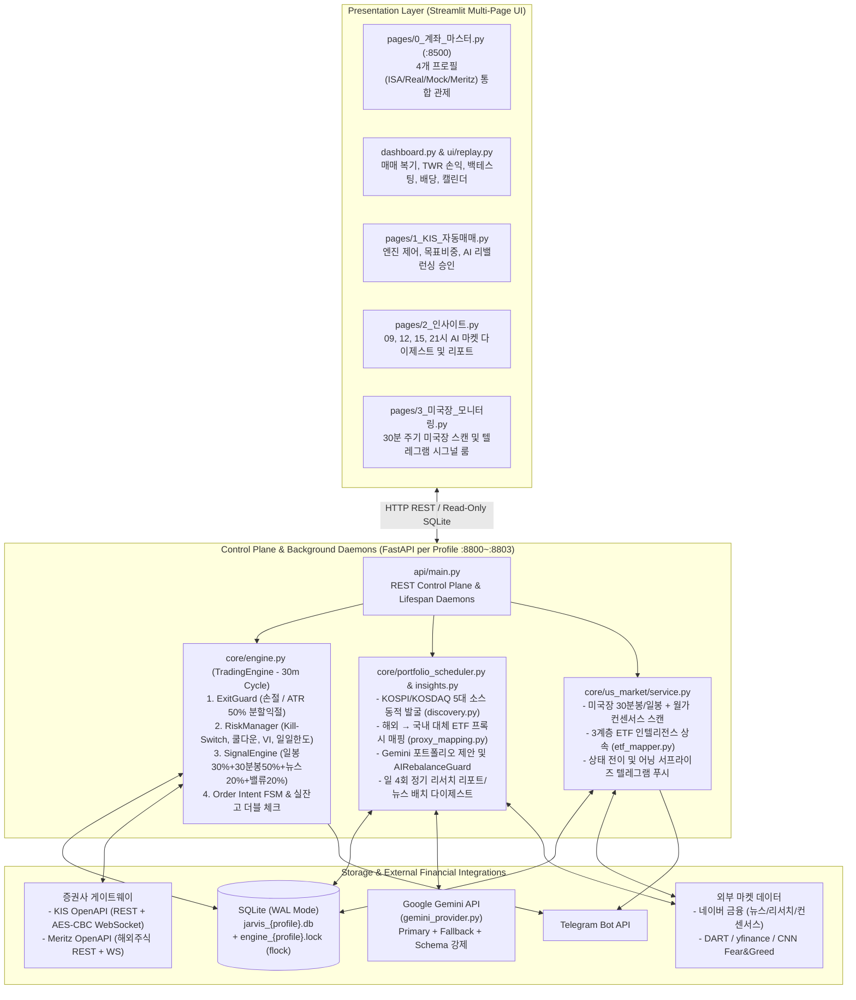
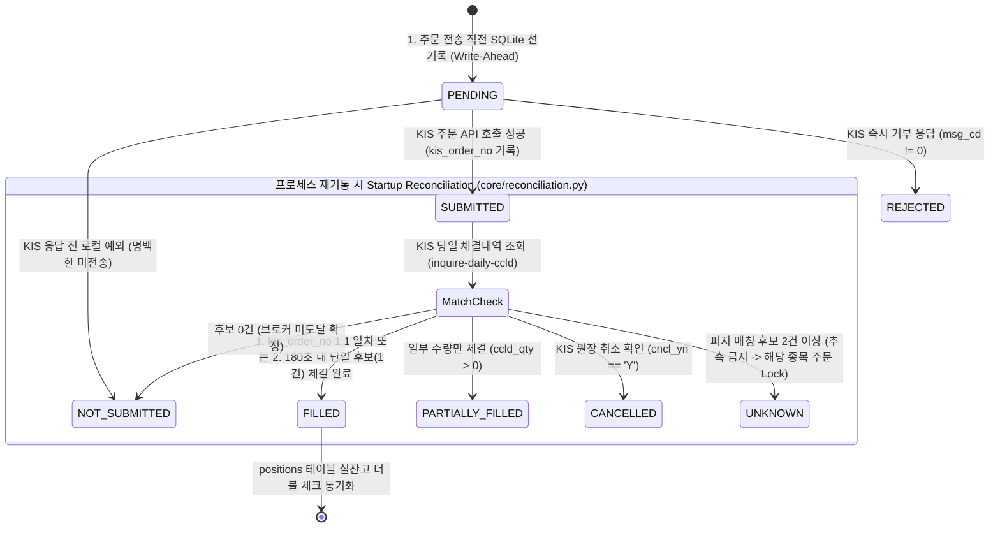
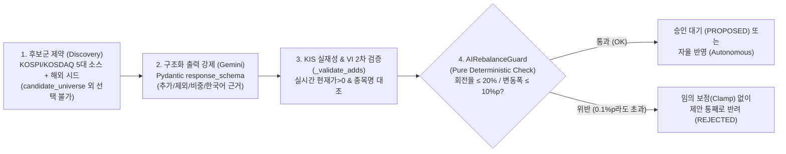

# Finance Jarvis — 금융권 AI 직무 면접 바이블 및 기술 포트폴리오

> [!abstract] One-Liner Pitch (면접관의 귀를 사로잡는 한 줄 정의)
> **"한국투자증권(KIS) 및 메리츠 OpenAPI와 Google Gemini를 결합하되, 수익률 알고리즘 이전에 '돈이 걸린 시스템이 실패했을 때 어떻게 안전하게 멈추고 복구할 것인가(Fail-Safe & Deterministic Guardrails)'를 코드로 증명한 2.5만 줄 규모의 멀티 계좌 AI 트레이딩 및 리서치 플랫폼"**

- **GitHub Repository**: [https://github.com/Ricepunchb/Finance_Jarvis](https://github.com/Ricepunchb/Finance_Jarvis)
- **실행 및 운영 가이드**: [README.md](../README.md)

---

## 목차 (Table of Contents)

1. [[#1. Executive Summary 및 1분 엘리베이터 피치]]
2. [[#2. KIS Developers 공식 레포(`koreainvestment`) vs Finance Jarvis 심층 아키텍처 비교]]
3. [[#3. 금융권 핵심 설계 철학: 5대 Fail-Safe 원칙]]
4. [[#4. 전체 시스템 아키텍처 및 모듈 맵 (Codebase Deep Dive)]]
5. [[#5. 핵심 엔지니어링 구현 상세 (면접 단골 기술 주제 6선)]]
6. [[#6. 실전 운영 및 복기 기반 트러블슈팅 (STAR 기법 스토리텔링)]]
7. [[#7. 정량적 검증(186 Tests) 및 백테스팅 성과 (`+33.46%` 알파)]]
8. [[#8. 금융권 AI 직무 실전 꼬리질문(Follow-up Q&A) 완벽 방어집]]

---

## 1. Executive Summary 및 1분 엘리베이터 피치

| 항목 | 상세 스펙 및 엔지니어링 지표 |
| :--- | :--- |
| **역할 / 기여도** | **1인 전담 (100%)** — 금융 도메인 설계, 비동기 주문/체결 코어 엔진, LLM 가드레일 파이프라인, 백테스터, 멀티 계좌 관제 UI, 실전 장중 운영 |
| **개발 기간** | 프로토타입(2025.11~12) 이후 **프로덕션 아키텍처 전면 재설계 및 실전 고도화 (2026.09.19 ~ 2026.10.28)** |
| **기술 스택** | • **Core / Backend**: Python 3.12, FastAPI, `asyncio`, `aiohttp`, `websockets`, SQLite (`aiosqlite` WAL 모드), Pydantic v2 • **Quant / Market**: `pandas`, `pandas-ta`, `yfinance`, KRX 호가단위(Tick) 및 영업일 캘린더 엔진 • **AI / LLM**: Google Gemini API (`google-genai`), Structured Output (`response_schema`), 자체 3중 가드레일 • **Frontend / Ops**: Streamlit (Multi-page), Plotly, Telegram Bot API, `tmux`, `fcntl.flock`, `uv`, `pytest` |
| **외부 연동** | 한국투자증권(KIS) OpenAPI (REST + 실시간 체결 WebSocket), 메리츠증권 OpenAPI (해외주식 Shadow/실전), 네이버 금융(뉴스, 컨센서스, 리서치 리포트), DART, Yahoo Finance, CNN Fear & Greed |
| **코드 규모** | Python **약 25,500줄** (코어/API/UI 약 20,800줄 + 테스트 코드 약 4,700줄) / **자동화 단위 및 통합 테스트 186개 (100% Pass)** |
| **실전 운영 환경** | **4개 멀티 프로필 상시 분리 운영**: `isa` (ISA 절세 적립식), `real` (KIS 실전 스윙), `mock` (KIS 모의투자), `meritz` (메리츠 해외주식) |

> [!quote] 면접 도입부 1분 자기소개 스크립트
> "안녕하십니까. 실제 자금이 투입되는 멀티 계좌 환경에서 KIS OpenAPI와 Gemini LLM을 결합해 무중단으로 운용 중인 **Finance Jarvis**를 직접 설계하고 운영해 온 배수현입니다.
> 
> 저는 이 프로젝트를 진행하면서 **'AI의 화려한 예측력'보다 '금융 시스템이 실패하거나 AI가 환각을 일으켰을 때 자산을 어떻게 지킬 것인가'**에 가장 깊이 집중했습니다.
> 
> 첫째, 멱등성 키(Idempotency Key)를 지원하지 않는 증권사 주문 API 환경에서 프로세스가 갑자기 죽더라도 이중 주문이 나가지 않도록, **주문 의도 상태머신(Order Intent FSM)과 주문번호 1:1 대조, 그리고 체결 즉시 실잔고를 더블 체크하는 파이프라인**을 구축했습니다.
> 
> 둘째, LLM을 신뢰 경계 밖(Untrusted Boundary)에 배치했습니다. 사전 검증된 유니버스 밖의 티커를 제안하거나 회전율 상한(20%)을 넘기는 리밸런싱 요청은 결정론적 코드인 `AIRebalanceGuard`가 즉시 전면 반려하도록 설계했습니다.
> 
> 셋째, 모든 매매 판단 시점의 지표 컨텍스트를 스냅샷으로 남기는 복기 시스템을 만들었습니다. 이를 통해 초기 `-10.45%` 손실의 주원인이었던 '역추세 연쇄 손절'을 잡아냈고, 추세 레짐 필터와 50% 분할 익절을 도입해 손절 횟수를 71% 줄이며 **6개월 누적 `+33.46%`(샤프 지수 2.03, S&P 500 대비 `+27.67%p` 초과 수익)**로 턴어라운드를 이뤄냈습니다.
> 
> 금융 도메인의 엄격한 안정성 위에 실용적인 AI 파이프라인을 견고하게 쌓아 올릴 줄 아는 엔지니어로 기여하고 싶습니다."

---

## 2. KIS Developers 공식 레포(`koreainvestment`) vs Finance Jarvis 심층 아키텍처 비교

> [!important] 면접 필승 포인트: 왜 한국투자증권 공식 레포를 그대로 쓰지 않고 자체 아키텍처를 구축했는가?
> 금융권 기술 면접관은 지원자가 오픈소스 예제(`open-trading-api`)를 단순히 가져다 썼는지, 아니면 **레퍼런스 코드의 구조적 한계를 짚어내고 프로덕션(Production) 수준으로 재설계했는지**를 집중해서 검증합니다. 아래 비교는 실무 관점의 아키텍처 안목을 증명하는 핵심 카드입니다.

### 2.1 한국투자증권 공식 GitHub (`github.com/koreainvestment`) 레포지토리 구조

한국투자증권(KIS Developers)은 크게 두 가지 축으로 오픈소스를 운영하고 있습니다.
1. **`koreainvestment/open-trading-api`**:
   - **`examples_llm/` 및 `llms.txt`**: LLM 에이전트가 단일 API(현재가 조회, 현금 주문 등)를 독립된 함수 단위로 쉽게 탐색하고 호출하도록 쪼개놓은 예제 모음.
   - **`examples_user/`**: 국내주식, 해외주식 등 상품별 통합 함수 모음과 실행 스크립트.
   - **`kis_auth.py` 및 `kis_devlp.yaml`**: 로컬 YAML 파일 하나에 단일 계좌와 앱키를 적어두고, 동기(`requests`) 방식으로 REST 토큰과 웹소켓 접속키를 발급받는 공통 인증 모듈.
   - **`strategy_builder/` 및 `backtester/`**: YAML 기반 10종 프리셋 전략 빌더 및 Docker 기반 QuantConnect Lean 백테스터 연동.
   - **`MCP/`**: Claude Desktop이나 Cursor 등 외부 AI 툴에서 대화형으로 KIS API를 직접 호출하는 Model Context Protocol 서버.
2. **`koreainvestment/kis-ai-extensions`**:
   - 코딩 에이전트(Claude Code, Cursor, Gemini 등)에 KIS API 활용 스킬(`skills/`), 명령어(`commands/`), 훅(`hooks/`)을 주입하는 플러그인(`@koreainvestment/kis-quant-plugin`).

### 2.2 구조적 공통점 (Similarities)

| 비교 영역 | `koreainvestment` 공식 레포 | `Finance Jarvis` (본 프로젝트) | 공통 지향점 |
| :--- | :--- | :--- | :--- |
| **전 주기 파이프라인** | `strategy_builder` → `backtester` → `examples_user` 실주문 | `signal_engine` → `core/backtest` → `TradingEngine` 실주문 및 `replay` 복기 | 전략 설계, 과거 데이터 검증, 실전 집행을 하나의 시스템으로 통합 |
| **핵심 KIS 프로토콜** | OAuth2 `tokenP`, 주문 `hashkey`, 웹소켓 `Approval` + AES-256-CBC 복호화 + `PINGPONG` 에코 | 동일한 KIS 표준 규격 준수 (`core/kis_client.py`, `core/websocket_client.py`) | KIS 게이트웨이 보안 및 실시간 체결통보 명세 100% 준수 |
| **AI와 퀀트 결합** | `llms.txt`, `MCP/`, `kis-ai-extensions`로 AI 에이전트 연동 | `google-genai` 기반 뉴스 감성, 리포트 다이제스트, AI 포트폴리오 에이전트 내재화 | LLM을 금융 데이터 해석 및 투자 의사결정 보조에 적극 활용 |

### 2.3 결정적 아키텍처 차이점 7가지 (Architectural Differences)

> [!tip] 한 줄 요약: "Developer SDK & AI Tooling (공식 레포)" vs "Fault-Tolerant Production Trading System (Finance Jarvis)"
> KIS 공식 레포는 **"수많은 외부 개발자와 LLM이 KIS API를 쉽게 호출하도록 돕는 단발성 예제(Stateless SDK)"**에 가깝고, Finance Jarvis는 **"실제 자금이 들어간 복수 계좌가 무인으로 돌아갈 때 발생하는 네트워크 단절, 중복 주문, 레이트 리밋, LLM 환각을 통제하는 상태 기반 프로덕션 엔진(Stateful Engine)"**입니다.

| 구분 | `koreainvestment` 공식 레포의 구조 및 한계 | `Finance Jarvis`의 엔지니어링 해결책 (차별점) | 관련 모듈 |
| :--- | :--- | :--- | :--- |
| **1. 실행 모델 및 유량 제어 (Concurrency & Rate Limit)** | • `requests` 기반 **동기(Synchronous) 블로킹 호출** 위주 • 호출 간격 제어를 사용자가 `time.sleep()`으로 직접 넣어야 하며, 동시 호출 시 `EGW00201`(초당 제한 초과) 즉시 발생 | • `asyncio` + `aiohttp` 커넥션 풀링 기반 **완전 비동기(Async) 아키텍처** • `asyncio.Lock`과 `time.monotonic()`으로 실전(0.35s)과 모의(1.2s) 호출 간격을 중앙 통제하고, `EGW00201`/`EGW00215` 수신 시 **조회(GET) 요청에만 지수 백오프 재시도** 적용 | [`core/kis_client.py`](../core/kis_client.py) |
| **2. 주문 멱등성 및 크래시 복구 (Idempotency & Crash Recovery)** | • **Stateless 단발성 호출**: `order_cash()` 호출 직후 타임아웃이나 프로세스 강제 종료 시 체결 여부를 알 수 없음 • 재실행 시 **이중 주문(Double Ordering)** 위험에 노출 | • **Stateful 주문 의도 상태머신(Order Intent FSM)**: 주문 전 SQLite `order_intents`에 선기록(`PENDING` → `SUBMITTED`)하며 **주문 POST 요청은 자동 재시도 전면 금지** • 재기동 시 `kis_order_no` 1:1 매칭 및 퍼지 매칭을 수행하고, 판별이 모호하면 `UNKNOWN`으로 즉시 격리 | [`core/reconciliation.py`](../core/reconciliation.py) [`core/db.py`](../core/db.py) |
| **3. 멀티 계좌 격리 및 웹소켓 세션 충돌** | • 단일 `kis_devlp.yaml` 및 홈 디렉터리 단일 토큰 파일 기준 • 동일 HTS ID로 다중 계좌(실전+ISA) 웹소켓 연결 시 **기존 세션 강제 종료 및 무한 재연결 충돌** 발생 | • **멀티 프로필 아키텍처(`isa`/`real`/`mock`/`meritz`)**: 프로필별 독립 DB, 독립 `flock`, 독립 토큰 캐시(`app_key` 해시 검증) • 주 계좌(`real`)만 실시간 WS를 열고 보조 계좌(`isa`)는 REST 대조 모드로 분리해 **HTS ID 세션 충돌 원천 차단** | [`core/profile_manager.py`](../core/profile_manager.py) [`core/websocket_client.py`](../core/websocket_client.py) |
| **4. AI/LLM 통합 방식과 신뢰 경계 (Trust Boundary)** | • **MCP / Tool Calling 구조**: 외부 LLM(Claude 등)이 도구를 직접 호출해 조회와 주문을 수행 • 프롬프트나 외부 훅에 의존하므로 자율 루프에서 환각 티커나 과잉 매매를 엄밀하게 통제하기 어려움 | • **결정론적 코드 가드레일 내재화 (LLM Outside Trust Boundary)**: LLM이 주문 API를 직접 호출할 수 없음 • 사전 검증된 `candidate_universe` 내 종목만 허용하며, `AIRebalanceGuard`에서 회전율(20%)이나 비중 변화(10%p) 초과 시 **임의 축소 없이 제안 전체를 반려(Reject)** | [`core/ai_rebalance_guard.py`](../core/ai_rebalance_guard.py) [`core/portfolio_agent.py`](../core/portfolio_agent.py) |
| **5. 데이터 파이프라인 범위 (API Coverage)** | • KIS OpenAPI가 제공하는 시세, 계좌, 주문 TR에만 국한 • ETF 구성종목의 뉴스 감성이나 글로벌 컨센서스 연계 부재 | • **이기종 멀티 소스 융합**: KIS/메리츠 API + 네이버 금융(뉴스, 리서치 리포트, 컨센서스) + DART + yfinance + CNN F&G 결합 • **3계층 ETF 인텔리전스(`SINGLE_STOCK`/`THEMATIC`/`BROAD_INDEX`)** 및 **해외종목 → 국내 상장 대체 ETF 대리 매매(Proxy Trading)** 구현 | [`core/news/etf_mapper.py`](../core/news/etf_mapper.py) [`core/proxy_mapping.py`](../core/proxy_mapping.py) |
| **6. 백테스터와 실전 엔진의 코드 일관성** | • `backtester/`가 외부 Docker **QuantConnect Lean 엔진**이나 별도 YAML 스펙을 사용하여, 백테스트 코드와 실전 파이썬 주문 코드 사이에 간극(Translation Gap) 존재 | • **동일 도메인 로직 1:1 공유**: 백테스터(`BacktestEngine`)가 실전 엔진의 [`exit_guard.evaluate_exit()`](../core/exit_guard.py), [`indicators.compute_technical_signal()`](../core/indicators.py)을 **그대로 import하여 실행** • KRX 거래세(0.18%), 수수료, 슬리피지, 고가주 1주 예외 처리까지 실전과 일치 | [`core/backtest/engine.py`](../core/backtest/engine.py) |
| **7. 사후 감사 및 복기 (Auditability & Replay)** | • API 응답을 콘솔에 출력하거나 DataFrame으로 반환한 뒤 휘발됨 • "3일 전 오후 2시에 왜 이 종목을 안 샀는지" 사후 추적 불가 | • **전 사이클 판단 컨텍스트 스냅샷(`decision_log.context_json`) 영구 보존** • 매매 복기 UI에서 당시의 일봉, 30분봉, 뉴스, 밸류에이션 점수와 리스크 차단 사유를 과거 시점 그대로 재현 | [`ui/replay.py`](../ui/replay.py) [`core/pnl.py`](../core/pnl.py) |

> [!check] 면접관 질문: "한국투자증권 GitHub에 이미 예제랑 MCP, 백테스터가 다 있는데 왜 직접 새로 만드셨나요?"
> "네, 저 역시 개발 초기에 한국투자증권 공식 `open-trading-api` 레포지토리의 `kis_auth.py`와 `examples_user` 코드를 면밀히 분석했습니다. 공식 레포는 API 명세를 빠르게 파악하고 단일 기능을 테스트하기에 매우 훌륭한 SDK입니다. 하지만 **실제 자금을 넣고 24시간 무인으로 다중 계좌를 운용하는 프로덕션 엔진**으로 쓰기에는 세 가지 구조적 한계가 있었습니다.
> 
> 첫째, 공식 예제는 **Stateless 단발성 호출** 구조여서 주문 POST 직후 네트워크 타임아웃이나 프로세스 재시작이 발생했을 때 중복 주문을 막아줄 상태 관리 계층이 없었습니다. 저는 이를 해결하기 위해 SQLite WAL 기반의 **주문 의도 상태머신(Order Intent FSM)**과 프로세스 기동 시 자동 체결 대조(`reconciliation`) 파이프라인을 구축했습니다.
> 
> 둘째, 공식 레포의 인증 모듈은 단일 설정 파일과 동기 호출 중심이어서, 제가 운용하는 **실전, ISA, 모의 3개 계좌를 동시에 띄울 때 발생하는 초당 호출 제한(`EGW00201`)과 동일 HTS ID 웹소켓 세션 충돌**을 제어할 수 없었습니다. 이를 `asyncio` 기반 레이트 리미터와 프로필별 WS/REST 하이브리드 격리 구조로 해결했습니다.
> 
> 셋째, 공식 레포의 MCP는 LLM이 직접 주문 도구를 호출할 수 있는 반면, 금융권 환경에서는 **LLM을 신뢰 경계 밖에 두고 결정론적 코드 가드레일(`AIRebalanceGuard`)이 회전율과 환각 티커를 먼저 걸러내야 안전하다**고 판단해 자체 에이전트 파이프라인을 설계했습니다."

---

## 3. 금융권 핵심 설계 철학: 5대 Fail-Safe 원칙

개인 취미 수준의 자동매매와 **대기업 금융권 수준의 시스템**을 가르는 기준은 *"시장이 좋을 때 돈을 얼마나 버는가"*보다 **"비정상 상황(네트워크 단절, API 장애, 급락장, LLM 오작동)에서 손실을 어떻게 통제하는가"**에 있습니다. Finance Jarvis는 코드베이스 전체에 다음 5대 원칙을 강제했습니다.

1. **손실 제한 동작의 절대 우선권 (Exit-First Priority)**
   - 손절(`-6%` / `-7%`)과 ATR 트레일링 청산([`core/exit_guard.py`](../core/exit_guard.py))은 재주문 쿨다운, 일일 손실 한도, 웹소켓 staleness 게이트, 시그널 계산보다 **무조건 가장 먼저 평가되며 일반 게이트를 우회**합니다. 신규 매수를 막기 위해 걸어둔 안전장치가 위기 상황에서 보유 종목의 탈출(손절)까지 가로막는 교착 상태를 원천 차단했습니다.
2. **추측 금지와 명시적 정지 (`UNKNOWN` Lock & Manual Reset Kill-Switch)**
   - KIS 체결 내역 대조 시 주문번호(`kis_order_no`)가 없고 시간 범위 내 유사 체결 후보가 2건 이상이면, 임의로 추측해 매칭하지 않고 `UNKNOWN` 상태로 전환해 해당 종목의 신규 주문을 잠급니다([`core/reconciliation.py`](../core/reconciliation.py)).
   - 60초 내 주문 거부 3회 발생 또는 관심 종목의 35% 이상 동시 VI/거래정지 감지 시 시장 전체 이상으로 판단해 **Kill-Switch**를 작동시키며, **해제는 오직 관리자가 UI에서 수동으로만** 가능합니다([`core/risk.py`](../core/risk.py)).
3. **신뢰 경계 밖의 AI (Deterministic Guardrails over LLM)**
   - LLM(Gemini)은 주문 실행 함수나 DB 상태 변경 함수를 직접 호출할 수 없습니다.
   - 모든 LLM 응답은 Pydantic 스키마 검증, 사전 검증된 `candidate_universe` 대조, [`AIRebalanceGuard`](../core/ai_rebalance_guard.py)의 정량 한도(총 회전율 20%, 종목당 변동 10%p) 검사를 거쳐야 하며, **한도를 0.1%p라도 넘어서면 숫자를 임의로 깎아 맞추지(Clamp) 않고 제안 전체를 반려(Reject)**합니다.
4. **보조 의존성 장애 격리 (Graceful Degradation)**
   - 네이버 금융 크롤링, Gemini API, DART, yfinance 중 어느 하나가 타임아웃이나 오류를 일으켜도 상위 트레이딩 루프로 예외를 던져 엔진을 중단시키지 않습니다.
   - [`signal_engine.combine_signals()`](../core/signal_engine.py)는 살아있는 시그널들의 가중치 합으로 점수를 자동 재정규화(Re-normalization)하여, 외부 API나 LLM 서비스에 장애가 생겨도 기술적 지표와 30분봉 데이터만으로 무중단 작동합니다.
5. **완전한 사후 감사 가능성 (Auditability & Deterministic Replay)**
   - 매 30분 사이클마다 매수를 집행했든 관망(`NO_OP`)했든, 그 순간의 모든 원시 지표(RSI, MACD, BBands, SMA20/60, ATR, 30분봉 점수, 뉴스 감성 근거, PER/PBR, 목표비중 괴리율, 환율, 총자산)를 `decision_log.context_json`에 스냅샷으로 영구 기록합니다.

---

## 4. 전체 시스템 아키텍처 및 모듈 맵 (Codebase Deep Dive)

### 4.1 전체 시스템 구조 (High-Level System Architecture)

### 4.2 디렉터리 및 핵심 파일 1:1 매핑표

> [!note] 코드베이스 구조 요약 (`총 25,500줄 이상`)
> 순수 판단 로직(I/O가 없는 Pure Functions)과 외부 I/O 모듈(KIS, DB, LLM)을 분리하여 **네트워크 모킹 없이도 핵심 금융 규칙을 100% 단위 테스트**할 수 있도록 설계했습니다.

| 레이어 | 파일 경로 | 핵심 역할 및 면접 어필 포인트 |
| :--- | :--- | :--- |
| **코어 오케스트레이터** | [`core/engine.py`](../core/engine.py) | 30분 주기 자동매매 메인 루프. 시작 전 `reconciliation` 강제, 종목별 예외 격리, 주문 의도 FSM 기록, 체결 콜백 및 사이클 종료 시점 실잔고 더블 체크 수행 |
| **청산, 리스크, 시그널 (Pure Logic)** | [`core/exit_guard.py`](../core/exit_guard.py) | 손절(`STOP_LOSS`) 및 변동성 비례(`ATR%`) 트레일링 익절 판정. 상승 추세 시 트레일링 폭 1.5배 확대 및 **50% 분할 익절(`sell_ratio=0.5`)** |
| | [`core/risk.py`](../core/risk.py) | Kill-Switch(수동 해제 전용), VI 확산도(35%) 서킷브레이커, 60초 내 거부 3회 감지, **손절 후 5일 재진입 쿨다운**, 웹소켓 staleness 게이트 |
| | [`core/signal_engine.py`](../core/signal_engine.py) | 일봉(30%), 30분봉(50%), 뉴스(20%), 밸류에이션(20%) 가중 결합 및 결측 시 재정규화. **하락 추세(`SMA20<SMA60`) 칼날잡기 차단**, TWAP 분할 온보딩, ISA 적립식 모드 |
| | [`core/rebalancer.py`](../core/rebalancer.py) | 목표비중(`target_weight`) 대비 현재 비중 드리프트(`drift`) 및 허용 밴드 계산 |
| **주문 복구 및 브로커 연동** | [`core/reconciliation.py`](../core/reconciliation.py) | 비멱등성 KIS 주문 복구 엔진. **`kis_order_no`(`odno`) 1:1 매칭 최우선**, 180초 윈도우 퍼지 매칭, 다중 후보 시 `UNKNOWN` 잠금 및 실잔고 동기화 |
| | [`core/kis_client.py`](../core/kis_client.py) | 비동기 HTTP 세션 풀링, 프로필별 토큰 디스크 캐시, `asyncio.Lock` 기반 초당 호출 제어, `EGW00201`/`EGW00215` GET 전용 백오프 |
| | [`core/websocket_client.py`](../core/websocket_client.py) | 실시간 체결통보(국내 `H0STCNI0`, 해외 `H0GSCNI0`) AES-256-CBC 복호화, KIS `PINGPONG` 에코 및 **30초 자체 하트비트 루프**로 유휴 시간 데드락 방지 |
| | [`core/meritz_client.py`](../core/meritz_client.py) | 메리츠증권 OpenAPI 클라이언트. 12자리 HEX `mac_address` 헤더 생성, HTTP 500 JSON 본문 `rsp_cd` 파싱, 토큰 만료(`EGW00121`) 자가 복구 |
| **AI 에이전트 및 가드레일** | [`core/portfolio_agent.py`](../core/portfolio_agent.py) | 보유 종목 퀀트 지표, 5대 소스 발굴 후보군, 매크로 지표를 조합해 Gemini에 리밸런싱 제안 요청 및 KIS 실재성, VI 2차 검증 |
| | [`core/ai_rebalance_guard.py`](../core/ai_rebalance_guard.py) | LLM 제안에 대한 결정론적 가드레일. 비중 합(`<=1.02`), 회전율(`<=20%`), 개별 변동폭(`<=10%p`), 편입/제외 종목 수 위반 시 **무수정 전면 반려** |
| | [`core/llm/gemini_provider.py`](../core/llm/gemini_provider.py) | `google-genai` SDK 래퍼. Pydantic `response_schema` 구조화 출력 강제, Primary/Fallback 모델 자동 전환, 장애 시 `SAFE_HOLD` 반환 |
| **ETF 지능 및 뉴스/발굴** | [`core/news/etf_mapper.py`](../core/news/etf_mapper.py) | **3계층 ETF 인텔리전스(`SINGLE_STOCK`/`THEMATIC`/`BROAD_INDEX`)** 라우터 및 미등록 티커 Gemini 자기학습(Self-Learning) 영구 캐시 |
| | [`core/news/sentiment.py`](../core/news/sentiment.py) | 제목 토큰 **자카드 유사도(0.5~0.65 이상) 중복 기사 병합**, 12시간 반감기(`0.5^(t/12)`) 시간 감쇠, 72시간 초과 구문 뉴스 LLM 호출 스킵, DB 교차 캐싱 |
| | [`core/proxy_mapping.py`](../core/proxy_mapping.py) | 해외 발굴 티커(`NVDA`, `GOOGL`, `GLD` 등)를 국내 상장 대체 ETF(`ACE 구글밸류체인액티브` 등)로 변환하는 **Proxy Trading** 매퍼 |
| | [`core/discovery.py`](../core/discovery.py) | KOSPI, KOSDAQ 마스터 기반 5대 소스(모멘텀, 리포트, 뉴스, 저평가, 테마) 동적 스크리닝 및 후보군(`candidate_universe`) 관리 |
| | [`core/insights.py`](../core/insights.py) | 일 4회(09, 12, 15, 21시) 증권사 리서치 리포트 본문 크롤링(`Semaphore(5)`), 피어 계좌 DB 분석 캐시 공유, 마켓 다이제스트 생성 |
| **백테스팅, 성과 및 관제** | [`core/backtest/engine.py`](../core/backtest/engine.py) | 실전 규칙 1:1 반영 이벤트 기반 백테스터. 수수료(0.015%), 거래세(0.18%), 슬리피지(0.05%) 차감 및 S&P 500 벤치마크 알파 산출 |
| | [`core/pnl.py`](../core/pnl.py) | `decision_log` 환율 및 총자산 시계열 복원, 입출금 왜곡을 제거한 **시간가중수익률(TWR)** 및 배당금 포함 **Total Return** 순수 계산 모듈 |
| | [`core/profile_manager.py`](../core/profile_manager.py) | `isa`, `real`, `mock`, `meritz` 4개 계좌의 환경설정, 포트(`:8800~:8803`), `tmux` 세션, 헬스체크를 총괄하는 멀티 프로필 매니저 |
| | [`core/us_market/`](../core/us_market/) | 미국장 30분봉, 일봉, 월가 컨센서스 비동기 스캔, ATR 손절선 계산, 강도 60% 이상 상태 전이 및 뉴스 서프라이즈 텔레그램 알림 |

---

## 5. 핵심 엔지니어링 구현 상세 (면접 단골 기술 주제 6선)

### 5.1 비멱등성 증권사 API를 위한 주문 의도 상태머신(Order Intent FSM)과 2단계 체결 대조

> [!warning] 엔지니어링 문제 정의
> KIS 주문 REST API(`POST /uapi/domestic-stock/v1/trading/order-cash`)는 클라이언트가 지정하는 **멱등성 키(Idempotency Key)를 지원하지 않습니다.** 만약 주문 요청을 보낸 직후 네트워크 타임아웃이 발생하거나 프로세스가 재배포로 종료되면, 원장에 주문이 들어갔는지 알 수 없어 재시도 시 **이중 주문(Double Execution)**이 발생합니다.

- **구현 핵심 ([`core/reconciliation.py`](../core/reconciliation.py), [`core/engine.py`](../core/engine.py))**:
  1. **Write-Ahead Intent 및 POST 무재시도 원칙**: 네트워크로 패킷을 보내기 전에 무조건 SQLite `order_intents` 테이블에 `PENDING` 레코드를 먼저 커밋합니다. 또한 [`AsyncKISClient.request()`](../core/kis_client.py)에서 `GET` 조회는 지수 백오프 재시도를 허용하지만, **`POST` 주문 요청은 타임아웃이 발생해도 절대 자동으로 재시도하지 않습니다.**
  2. **2단계 하이브리드 매칭 (`_find_candidates`)**:
     - **1순위 (`kis_order_no` 1:1 매칭)**: 주문 응답에서 받은 한국투자증권 주문번호(`odno`)가 DB에 남아있다면 앞자리 0 패딩(`lstrip("0")`)을 정규화해 1:1로 정확히 매칭합니다.
     - **2순위 (180초 윈도우 퍼지 매칭)**: 응답을 받기 직전 프로세스가 종료되어 `kis_order_no`가 비어있는 경우에만, `종목코드(pdno) + 매수/매도 구분 + 주문수량 + 지정가 + 생성시각 ±180초(MATCH_WINDOW_SEC)` 조건으로 후보를 찾습니다.
     - **추측 금지 (`UNKNOWN` 격리)**: 만약 동일 종목, 동일 수량 주문이 3분 내에 2건 이상 있어 후보가 복수로 나오면, 임의로 하나를 선택하지 않고 **`UNKNOWN` 상태로 전환하여 사람이 직접 확인할 때까지 해당 종목의 신규 자동 주문을 차단**합니다.
  3. **이중 실잔고 동기화 (Double-Check Ground Truth)**: 웹소켓 체결통보(`_on_fill`) 수신 즉시 1차, 그리고 매 30분 사이클 종료 시점마다 2차로 KIS 실잔고 API(`inquire-balance`)를 호출해 로컬 `positions` 테이블을 강제 동기화([`reconcile_positions`](../core/reconciliation.py))합니다. HTS나 MTS에서 수동으로 매매한 물량이나 유령 잔고(0주)도 자동으로 보정됩니다.

---

### 5.2 추세 레짐(Trend Regime) 필터, ATR 50% 분할 익절, ISA 적립식 하이브리드 전략

- **스윙 우선(Swing-Primary) 시그널 결합 ([`core/signal_engine.py`](../core/signal_engine.py))**:
  - 과거에는 목표비중(`target_weight`)보다 현재 비중이 낮으면 무조건 매수하는 기계적 리밸런싱을 적용했으나, 이는 하락장 초입에 계속해서 물타기를 하는 부작용을 낳았습니다.
  - 이를 **스윙 우선 구조**로 개편하여, 목표비중 밴드 상한(`target + band + 5%p`)을 넘어선 과대비중만 강제로 줄이고(Ceiling), 평상시 매수와 매도 타이밍은 **일봉 기술지표(30%) + 30분봉 단기모멘텀(50%) + 뉴스 감성(20%) + 펀더멘털 밸류에이션(20%)**의 가중 결합 점수로 결정합니다.
- **확정적 하락 추세 칼날잡기(Falling Knife) 차단**:
  - `SMA20 < SMA60`이면서 `현재가 < SMA20`인 역배열 하락 추세(`is_downtrend=True`)에서는 일시적인 RSI 과매도 반등 신호가 뜨더라도 신규 스윙 매수와 TWAP 분할 온보딩(`_onboarding_action`)을 전면 보류합니다.
- **추세 연동 ATR 트레일링 및 50% 분할 익절 (Scale-Out, [`core/exit_guard.py`](../core/exit_guard.py))**:
  - 종목별 14일 `ATR%`(Average True Range)에 비례하여 변동성이 큰 종목은 트레일링 폭을 넓게(`2.5 × ATR%`), 변동성이 작은 종목은 좁게 동적으로 산출합니다.
  - 특히 **정배열 상승 추세(`is_uptrend=True`)**에 진입한 주도주는 일간 노이즈에 조기 청산되지 않도록 기준선과 트레일링 폭을 **1.5배 확장**하고, 트레일링 조건 도달 시 전량 매도가 아닌 **50%만 분할 익절(`sell_ratio=0.5`)**하여 나머지 절반으로 대세 상승 랠리를 완주합니다.
- **계좌 성격별 모드 분리 (`accumulation_mode`)**:
  - 단기 스윙 중심인 일반 실전 계좌(`real`)와 달리, 장기 절세 목적인 **ISA 계좌(`isa`)**는 `ACCUMULATION_MODE=True`로 동작합니다. 이 모드에서는 기계적 손절(`-6%`)과 단기 기술적 매도 신호에 따른 스윙 매도를 비활성화하여 우량 ETF의 바닥 투매를 막고, 극단적 패닉셀(강도 0.85 이상)이 아닌 한 분할 적립(DCA)을 지속합니다.

---

### 5.3 신뢰 경계 밖의 AI: 포트폴리오 에이전트와 결정론적 가드레일 (`AIRebalanceGuard`)

> [!tip] 면접관이 주목하는 핵심 포인트: "프롬프트가 아닌 코드로 AI를 통제"
> 금융권에서 LLM 도입을 주저하는 가장 큰 이유는 **환각(Hallucination)**과 **설명 불가능한 급격한 포지션 변경**입니다. Finance Jarvis는 이를 3중 결정론적 파이프라인으로 해결했습니다.

- **왜 Clamp(잘라서 맞추기) 대신 전체 반려(Reject)를 택했는가? ([`core/ai_rebalance_guard.py`](../core/ai_rebalance_guard.py))**:
  - 만약 LLM이 특정 종목 비중을 `+25%p` 늘리라고 제안했는데 코드가 이를 상한선인 `+10%p`로 임의로 잘라버리면(Clamp), 포트폴리오 전체 비중 합이 깨질 뿐 아니라 **DB에 저장된 LLM의 투자 근거(`rationale`)와 실제 반영된 수치가 어긋나 감사 무결성(Audit Integrity)이 훼손**됩니다. 따라서 한도를 넘어서면 통째로 `REJECTED` 처리하고 기존 포트폴리오를 유지하는 것이 금융 시스템으로서 훨씬 안전합니다.
- **해외 종목 → 국내 상장 대체 ETF 대리 매매 (Proxy Trading, [`core/proxy_mapping.py`](../core/proxy_mapping.py))**:
  - 글로벌 매크로와 빅테크 분석을 통해 `NVDA`, `GOOGL`, `GLD`, `TLT` 같은 유망 자산이 발굴되더라도, 국내 전용 계좌나 **ISA 계좌에서는 해외 개별주를 직접 매수할 수 없습니다.**
  - 이를 해결하기 위해 [`data/overseas_proxy_map.json`](../data/overseas_proxy_map.json)을 두고 해외 시그널을 국내 상장 대체 ETF(예: `GOOGL` → `473460 ACE 구글밸류체인액티브`, `GLD` → `132030 KODEX 골드선물(H)`)로 자동 변환해 주문합니다. 환전 수수료와 해외주식 양도소득세(22%) 부담 없이 국내 절세 계좌에서 글로벌 매크로 로테이션을 구현한 실무적 해결책입니다.

---

### 5.4 3계층 ETF 인텔리전스 라우터 및 자기학습(Self-Learning) 캐시

- **문제 의식**: 포트폴리오에서 개별 주식뿐 아니라 국내외 ETF(`TSLW`, `NVDY`, `SOXL`, `SMH`, `KODEX 반도체`, `SCHD` 등) 비중이 높아졌는데, **ETF 자체 티커로 뉴스를 조회하면 기사가 0건이거나 무의미한 분배금 공시만 잡혀 시그널이 왜곡**되었습니다.
- **3계층 라우팅 해결책 ([`core/news/etf_mapper.py`](../core/news/etf_mapper.py))**:
  1. **`SINGLE_STOCK` (단일 기초자산 ETF)**: `TSLW`, `NVDY`, `ACE 테슬라밸류체인` 등은 기초자산 개별주(`TSLA`, `NVDA`)의 뉴스 감성과 월가 애널리스트 컨센서스를 **100% 프록시 상속**합니다 (재귀 깊이 `_depth=1` 제한으로 무한 루프 방지).
  2. **`THEMATIC` (섹터/테마/레버리지 ETF)**: `SOXL`, `SMH`, `OZEM` 등은 해당 테마의 주가를 실제로 견인하는 **상위 앵커 기업 2~3개**(예: `SMH` → `NVDA`, `TSM`, `AVGO` / `OZEM` → `LLY`, `NVO`)의 뉴스 감성과 목표가 괴리율을 병렬 조회(`asyncio.gather`)하여 **가중 평균**으로 상속합니다.
  3. **`BROAD_INDEX` (시장 대표지수/배당/채권 ETF)**: `SPY`, `QQQ`, `SCHD`, `SGOV` 등은 개별 기업 뉴스 조회를 생략해 **불필요한 LLM API 비용을 절감**하고 매크로 지표(Fear & Greed, 금리)와 기술적 추세에만 집중합니다.
- **미등록 티커 자기학습(Self-Learning) 분류기**:
  - 사전에 매핑되지 않은 신규 종목이 들어오면 정규식 단어 경계(Word Boundary)와 `quoteType`으로 일반 주식 여부를 확인한 뒤, ETF로 확인되면 **최초 1회 Gemini(`_ETFClassificationRawSchema`)를 호출해 계층과 앵커 티커를 판별**하고 [`data/etf_intelligence_map.json`](../data/etf_intelligence_map.json)에 영구 보관합니다. 두 번째 사이클부터는 LLM 호출 없이 로컬 JSON 캐시에서 $O(1)$로 동작합니다.

---

### 5.5 뉴스 감성 분석 비용 최적화: 자카드 유사도 중복 제거 및 지수 시간 감쇠

- **언론사 복제 기사 병합 ([`core/news/sentiment.py`](../core/news/sentiment.py))**:
  - 국내 금융 뉴스는 동일한 공시나 이슈를 수십 개 언론사가 제목만 바꾸어 동시 송고하는 경우가 많습니다. 이를 그대로 채점하면 LLM 토큰 비용이 낭비될 뿐 아니라, 특정 단일 사건이 평균 감성 점수를 과도하게 왜곡합니다.
  - 고비용 임베딩 API 대신, 동일 날짜(KST) 기사들 사이의 **제목 어절 토큰 자카드 유사도(Jaccard Similarity)**를 계산해 임계치 이상인 기사를 대표 기사 1건으로 병합(`_dedupe_articles`)하고, 다른 종목이나 이전 사이클에서 채점된 동일 제목 기사는 SQLite `news_cache`에서 교차 재사용합니다.
  $$\text{Jaccard}(A, B) = \frac{|T(A) \cap T(B)|}{|T(A) \cup T(B)|} \ge \theta_{\text{sim}}$$
- **12시간 반감기 시간 감쇠(Time-Decay) 및 72시간 컷오프**:
  - 어제 기사와 방금 발행된 속보가 동일한 가중치를 가져서는 안 되므로, 기사 발행 후 경과 시간($\Delta t$ hours)에 대해 **반감기 12시간의 지수 감쇠 가중치**를 부여합니다.
  $$w(\Delta t) = 0.5^{\Delta t / 12.0}$$
  - 주말(금요일 장 마감부터 월요일 개장까지 약 65시간)을 감안해 최대 유효 시간은 **72시간(`MAX_NEWS_LOOKBACK_HOURS = 72.0`)**으로 두되, 72시간이 지난 기사는 가중치가 $0.5^6 \approx 1.5\%$ 미만으로 영향력이 미미하므로 **Gemini API를 호출하지 않고 중립(`0.0`) 처리**하여 쿼터를 절약했습니다.

---

### 5.6 멀티 계좌(`ISA`/`Real`/`Mock`/`Meritz`) 프로세스 격리 및 통합 관제

- **물리적, 논리적 자원 격리 ([`core/profile_manager.py`](../core/profile_manager.py), [`core/lock.py`](../core/lock.py))**:
  - 한 대의 서버에서 4개 계좌 프로필을 동시에 구동할 때 상태 오염을 방지하고자 프로필별 자원을 분리했습니다.
    1. **환경 설정**: `.env.isa`, `.env.real`, `.env.mock`, `.env.meritz`
    2. **데이터베이스**: `data/jarvis_{profile}.db` (각각 독립된 SQLite WAL 파일)
    3. **단일 인스턴스 커널 락**: `data/engine_{profile}.lock` (`fcntl.flock(LOCK_EX | LOCK_NB)`을 적용해 동일 계좌 엔진이 중복 실행되는 것을 OS 커널 레벨에서 차단)
    4. **인증 토큰 캐시**: `data/kis_token_{profile}.json`, `data/meritz_token_{profile}.json`
    5. **네트워크 포트 및 `tmux` 세션**: FastAPI(`:8800~:8803`)와 개별 Streamlit(`:8501~:8504`)을 독립 세션으로 분리
- **마스터 관제 대시보드 ([`pages/0_계좌_마스터.py`](../pages/0_계좌_마스터.py), `:8500`)**:
  - 전체 계좌의 프로세스 생존 상태, 실시간 총자산 합산, 계좌별 당일 손익, 킬스위치 작동 여부를 한 화면에서 모니터링하고, 웹 UI에서 특정 계좌의 `tmux` 데몬을 기동, 정지, 재시작할 수 있습니다.

---

## 6. 실전 운영 및 복기 기반 트러블슈팅 (STAR 기법 스토리텔링)

> [!important] 면접관이 깊이 파고드는 질문: "직접 운영하면서 겪은 가장 치명적인 장애나 버그는 무엇이었나요?"
> 로컬에서 테스트 코드만 돌려본 경험으로는 알 수 없는, **실전 장중 운영과 83사이클(3일) 전수 복기 감사**에서 발견해 해결한 4가지 트러블슈팅 사례입니다. 면접장에서 바로 설명할 수 있도록 **STAR (Situation - Task - Action - Result)** 구조로 정리했습니다.

### 사례 1. 멀티 계좌 동시 구동 시 KIS 웹소켓 세션 충돌과 유휴 시간 Staleness 데드락 해결

- **Situation (상황)**: 실전 일반 계좌(`real`)와 절세 계좌(`isa`)를 동시에 상시 구동하자, 두 프로세스가 번갈아가며 웹소켓 연결이 끊어지며 재연결 루프에 빠지거나, 거래가 한산한 시간대에 `ws_stale` 게이트가 발동되어 **신규 매수는 물론 정상적인 매매 판단까지 영구 차단되는 데드락**이 발생했습니다.
- **Task (원인 분석)**:
  1. KIS 실시간 웹소켓은 계좌번호가 아니라 **HTS ID 단위**로 세션을 관리하므로, 동일 명의의 두 계좌가 동시에 웹소켓을 연결하면 기존 연결을 강제로 끊어버리는(Kick) 브로커 제약이 있었습니다.
  2. KIS 웹소켓은 표준 WebSocket Ping/Pong 프레임 대신 `tr_id="PINGPONG"`이라는 자체 JSON 메시지를 약 1~2분 간격으로 보내는데, 체결이 전혀 없는 시간대에 이 패킷을 에코(Echo)하지 않거나 패킷 간격이 벌어지면 RiskManager의 임계값(120초)을 초과해 연결이 끊어진 것으로 오판했습니다.
- **Action (해결책 — [`core/websocket_client.py`](../core/websocket_client.py), [`core/engine.py`](../core/engine.py))**:
  1. **PINGPONG 즉시 에코 및 30초 자체 하트비트 루프(`_heartbeat_loop`)**: KIS `PINGPONG` JSON을 받으면 동일한 페이로드를 즉시 회신해 세션을 유지하고, 소켓이 `OPEN` 상태인 동안에는 30초마다 `last_ws_message_at` 시각을 갱신해 유휴 시간 오탐을 제거했습니다.
  2. **프로필별 WS/REST 하이브리드 분리**: 단기 매매가 잦은 주 계좌(`real`)만 실시간 체결통보를 독점 구독하고, 적립식 위주인 보조 계좌(`isa`, `mock`)는 30분 주기 REST 체결 대조 모드로 분리해 HTS ID 충돌을 원천 차단했습니다.
  3. **손절 경로 분리**: 설령 웹소켓이 끊겨 `ws_stale` 상태가 되더라도, **신규 매수만 제한할 뿐 보유 종목의 손절과 트레일링 익절(`exit_guard`)은 정상 집행**되도록 순서를 분리했습니다.
- **Result (결과)**: 다중 계좌 24/7 구동 시 웹소켓 끊김 및 유휴 시간 데드락 발생 건수 **0건** 달성, 회귀 테스트([`tests/test_websocket_staleness_fix.py`](../tests/test_websocket_staleness_fix.py)) 구축 완료.

---

### 사례 2. 83사이클(3일) 동안 특정 2종목만 매수 신호가 0건이었던 '조용한 기아(Starvation)' 버그

- **Situation (상황)**: 시스템 에러 로그는 단 한 줄도 발생하지 않았으나, **매매 복기 대시보드(`ui/replay.py`)**에서 3일치(83사이클) `decision_log`를 감사하던 중 포트폴리오 뒤쪽에 위치한 특정 2종목만 3일 내내 시그널 강도가 매수 기준치(0.5)를 한 번도 넘지 못하는 이상 징후를 발견했습니다.
- **Task (원인 분석)**:
  - KIS 모의투자의 초당 1건 호출 제한을 지키기 위해 30분봉 백필(Backfill)을 사이클당 최대 3종목으로 제한하고 있었습니다.
  - 그런데 기존 코드가 **"실제로 API를 호출해 백필을 수행한 종목"**이 아니라 **"루프를 순회한 종목 순서대로"** 예산을 무조건 차감하고 있었습니다. 결과적으로 이미 캐시가 충분해 API 호출을 건너뛴 앞 순서 종목들이 예산을 모두 소진하여, **뒤쪽 종목들은 30분봉 데이터(시그널 가중치 50%)를 영구히 받지 못하는 기아(Starvation) 상태**에 빠져 있었습니다.
- **Action (해결책 — [`core/intraday.py`](../core/intraday.py), [`core/engine.py`](../core/engine.py))**:
  - 단순 카운터 대신, 실제로 KIS API 호출이 일어난 순간에만 예산을 차감하는 **`BackfillBudget` 상태 관리 객체**를 도입했습니다.
- **Result (결과)**: 전 종목이 30분봉 시그널을 균등하게 수신하게 되었으며, **"에러를 발생시키지 않고 조용히 기회를 놓치는 금융 소프트웨어의 결함은 단순 로그가 아니라 전수 복기(Audit Replay) 데이터에서만 잡아낼 수 있다"**는 엔지니어링 교훈을 얻었습니다.

---

### 사례 3. 백테스팅 초기 `-10.45%` 손실 원인의 정량 규명과 `+33.46%` 흑자 전환

- **Situation (상황)**: 초기 스윙 알고리즘을 구축하고 9개 대표 종목에 대해 6개월 과거 백테스트를 수행했으나, S&P 500 벤치마크(`+5.79%`)에 한참 못 미치는 **`-10.45%` 손실과 35회의 연쇄 손절**이 발생했습니다.
- **Task (원인 분석 — [`tests/test_algorithm_inspection_fixes.py`](../tests/test_algorithm_inspection_fixes.py))**:
  거래 내역(`TradeRecord`)을 전수 분석한 결과 3가지 구조적 문제가 드러났습니다.
  1. **역추세 연쇄 손절(Whipsaw Loop)**: 하락 추세(`SMA20 < SMA60`)에 진입한 종목을 `-6%`에 손절한 직후, 다음 날 단기 낙폭 과대로 RSI가 과매도 구간에 진입했다는 이유로 재매수했다가 다시 손절하는 악순환 반복.
  2. **고가주 0주 버림 현상**: 1주당 단가가 높은 종목이 분할 매수 예산 계산 시 `int()` 절삭으로 인해 `0주`로 처리되어 주도주 편입이 누락됨.
  3. **상승 추세 조기 전량 청산**: 상승 추세를 탄 종목이 일간 자연스러운 눌림목(`-5%` 고정 트레일링)에 전량 매도되어 이후의 대형 상승 파동을 놓침.
- **Action (해결책)**:
  1. **손절 후 5일 재진입 금지 쿨다운 (`STOP_LOSS_COOLDOWN_DAYS = 5`)** 도입 ([`core/risk.py`](../core/risk.py)).
  2. **확정적 하락 추세(`SMA20 < SMA60` 및 `현재가 < SMA20`) 신규 매수 전면 차단** ([`core/signal_engine.py`](../core/signal_engine.py)).
  3. **고가주 최소 1주 보장 로직**: 1주 가격이 주문 한도 범위 내에 있고 포지션 상한을 넘지 않으면 `qty=0`이어도 1주 편입 허용.
  4. **상승 추세 트레일링 폭 1.5배 확대 및 50% 분할 익절(`sell_ratio=0.5`)** 적용 ([`core/exit_guard.py`](../core/exit_guard.py)).
- **Result (결과)**: 동일 기간, 동일 9개 종목 기준 손절 횟수가 **35회에서 10회로 71.4% 감소**했고, 누적 수익률이 **`-10.45%`에서 `+33.46%`(S&P 500 대비 `+27.67%p` 초과 수익, 샤프 지수 2.03)**로 턴어라운드되었습니다.

---

### 사례 4. KRX 호가단위(Tick Size) 주문 거부, 서드파티 `pandas_ta` 수식 버그 적발, 이기종 브로커(메리츠) 통합

- **KRX 가격대별 호가단위 및 대체공휴일 정합성 ([`core/utils/tick_size.py`](../core/utils/tick_size.py), [`core/utils/krx_calendar.py`](../core/utils/krx_calendar.py))**:
  - 국내 주식은 가격대와 상품 종류(일반 주식 vs ETF 5원 단위)에 따라 호가단위가 다릅니다. 지정가 산출 시 틱 단위가 맞지 않아 원장에서 주문이 거부되는 현상을 막기 위해 주문 직전 [`adjust_to_tick_size()`](../core/utils/tick_size.py)를 강제하고, 대체공휴일과 연말 휴장일을 반영한 KRX 영업일 캘린더를 내장했습니다.
- **오픈소스 `pandas_ta` CCI 지표 수식 버그 직접 적발 ([`core/indicators.py`](../core/indicators.py))**:
  - 복기 대시보드에서 지표를 교차 검증하던 중 `pandas_ta` 라이브러리의 `cci()` 함수가 평균절대편차(MAD) 나눗셈 괄호 오류로 수치를 부풀려 반환하는 서드파티 버그를 발견하고, 직접 표준 수식을 구현해 대체했습니다.
- **메리츠증권 해외주식 게이트웨이 규격 연동 ([`core/meritz_client.py`](../core/meritz_client.py))**:
  - 메리츠증권 OpenAPI를 추가 연동하면서, 12자리 HEX `mac_address` 헤더 요구 조건과 비즈니스 오류를 `HTTP 500` 상태코드 내부 JSON 본문으로 내려보내는 규격을 분석해 `KisApiError`와 호환되는 비동기 어댑터 및 가상 체결 기반 Shadow Mode 검증 엔진을 구축했습니다.

---

## 7. 정량적 검증(186 Tests) 및 백테스팅 성과 (`+33.46%` 알파)

### 7.1 자동화 테스트 스위트 (`pytest` 186개 단위 및 통합 테스트 100% Pass)

| 테스트 도메인 | 주요 검증 파일 (`tests/`) | 핵심 검증 시나리오 |
| :--- | :--- | :--- |
| **주문 복구, 리스크, 락** | `test_log_analysis_fixes.py`, `test_exclusion_and_sync.py`, `test_recently_removed_symbols.py` | `kis_order_no` 1:1 매칭 및 퍼지 매칭 `UNKNOWN` 격리, 체결 후 실잔고 더블 체크, 7일 삭제 쿨다운 및 고득점(`>=0.45`) 예외 |
| **매매 전략, 백테스터** | `test_algorithm_inspection_fixes.py`, `test_backtest.py`, `test_macro_rotation_and_quant_audit.py` | SMA20/60 추세 레짐 필터, 손절 5일 쿨다운, ATR 50% 분할 익절, 거래세, 수수료, 슬리피지 차감 정합성 |
| **AI 에이전트, ETF 지능** | `test_etf_intelligence.py`, `test_hybrid_portfolio_agent.py`, `test_proxy_mapping.py`, `test_insights.py` | 3계층 ETF 감성 및 컨센서스 상속, 단어 경계 방어, 해외 → 국내 ETF 프록시 변환, `AIRebalanceGuard` 반려 |
| **인프라, 멀티계좌, 손익** | `test_websocket_staleness_fix.py`, `test_profile_manager.py`, `test_pnl.py`, `test_pnl_dividends.py`, `test_meritz_*.py` | 웹소켓 30초 하트비트 데드락 방지, 멀티 프로필 격리, 입출금 보정 시간가중수익률(TWR) 및 배당 포함 Total Return, 메리츠 비동기 클라이언트 |

### 7.2 이벤트 기반 백테스팅 정량 성과 ([`core/backtest/`](../core/backtest/))

> [!check] 과최적화(Overfitting) 및 미래 참조 편향(Look-Ahead Bias) 배제
> - **현실적 거래 마찰 비용 반영**: 매 거래마다 슬리피지(`0.05%`), 매매 수수료(`0.015%`), 국내 증권거래세(`0.18%`)를 실질 차감했습니다.
> - **단일 파라미터 멀티 자산 검증**: 특정 종목에 맞추어 피팅하지 않고 반도체, 방산, 지주, 인프라, 배당, 시장지수 등 **9개 이종 자산군 포트폴리오에 동일 파라미터를 일괄 적용**했습니다.

| 평가 구간 | Finance Jarvis 누적 수익률 | 벤치마크 (`TIGER 미국S&P500`) | **초과 수익 (Alpha)** | **샤프 지수 (Sharpe)** | **소티노 지수 (Sortino)** | **핵심 개선 지표** |
| :--- | :---: | :---: | :---: | :---: | :---: | :--- |
| **6개월 (단기/중기 검증)** | **`+33.46%`** | `+5.79%` | **`+27.67%p`** | **`2.03`** | **`2.39`** | 손절 횟수 **35회 → 10회 (71.4% 감소)**, 손익비 **5.21** |
| **1년 (장기 추세 검증)** | **`+101.14%`** | `+11.92%` | **`+89.22%p`** | **`1.96`** | **`2.45`** | 승률 **61.5%**, 상승 추세 50% 분할 익절로 대형 추세 완주 |

---

## 8. 금융권 AI 직무 실전 꼬리질문(Follow-up Q&A) 완벽 방어집

> [!info] 꼬리질문 구조화 안내
> 기술 면접은 **기본 개념 확인(Depth 1) → 설계 근거 추궁(Depth 2) → 극한 상황 및 엣지 케이스 공격(Depth 3)** 순서로 진행됩니다. 실제 면접장에서 소리 내어 말하듯 입에 익혀두는 것을 추천합니다.

---

### 주제 A. 분산 시스템, 비멱등성 주문 복구, DB 아키텍처

> [!question]- Q1-1 (Depth 1). 주문 API를 호출한 직후 네트워크 타임아웃이 발생하거나 서버가 죽으면, 재기동 시 중복 주문을 어떻게 막나요?
> **답변**: 한국투자증권 주문 API는 클라이언트가 지정하는 멱등성 키(Idempotency Key)를 지원하지 않습니다. 그래서 저는 **주문 의도 상태머신(Order Intent FSM)**을 설계했습니다.
> 
> 첫째, 네트워크로 주문 요청을 보내기 직전에 SQLite `order_intents` 테이블에 `PENDING` 상태로 의도를 먼저 기록합니다.
> 
> 둘째, HTTP 클라이언트에서 조회(`GET`)와 달리 주문(`POST`) 요청은 타임아웃이 발생해도 **절대 자동으로 재시도하지 않도록** 막았습니다.
> 
> 셋째, 프로세스가 재기동되면 신규 매매 루프를 돌기 전에 반드시 [`run_startup_reconciliation()`](../core/reconciliation.py)을 먼저 실행합니다. 미결 의도(`PENDING`/`SUBMITTED`)들을 KIS 당일 체결내역 API(`inquire-daily-ccld`)와 대조해 최종 상태를 확정한 뒤에야 매매를 재개합니다.

> [!question]- Q1-2 (Depth 2). 만약 주문 응답을 받기 직전에 서버가 죽어서 DB에 한국투자증권 주문번호(`kis_order_no`)가 저장되지 않았다면 어떻게 매칭하나요?
> **답변**: 그 상황에 대비해 **2단계 하이브리드 매칭(`_find_candidates`)**을 구현했습니다.
> 
> 1순위는 DB에 `kis_order_no`가 남아있을 때 KIS 체결내역의 주문번호(`odno`, 앞자리 0 패딩 정규화 포함)와 1:1로 매칭하는 것입니다.
> 
> 2순위로, 응답을 받기 직전 프로세스가 종료되어 `kis_order_no`가 비어있다면 `종목코드(pdno) + 매수/매도 구분 + 주문수량 + 지정가`가 일치하고 주문 시각이 의도 생성 시각으로부터 **`±180초(MATCH_WINDOW_SEC)` 이내인 후보를 퍼지 매칭(Fuzzy Match)**합니다.
> 
> 이때 후보가 정확히 1건이면 해당 주문으로 확정하고, 0건이면 브로커 원장에 도달하지 않은 것(`NOT_SUBMITTED`)으로 결론 내립니다.

> [!question]- Q1-3 (Depth 3). 만약 3분 안에 같은 종목을 같은 수량, 같은 가격으로 두 번 주문해서 퍼지 매칭 후보가 2건 이상 나오면 어떻게 되나요? 그리고 왜 PostgreSQL 대신 SQLite를 선택했나요?
> **답변**:
> 1. **복수 후보 발생 시**: 코드가 임의로 추측해 매칭하지 않고 해당 의도를 **`UNKNOWN` 상태**로 전환합니다. 그리고 `RiskManager`가 `UNKNOWN` 상태의 의도가 남아있는 종목에 대해 사람이 직접 확인할 때까지 신규 자동 주문을 잠그도록(Lock) 설계했습니다. 금융 시스템에서는 불완전한 자동 복구보다 명시적 정지와 알림이 안전하기 때문입니다.
> 2. **SQLite 선택 이유**: 본 시스템은 계좌 프로필별로 커널 파일 락(`fcntl.flock`)을 통해 **단일 라이터(Single Writer) 엔진 프로세스**만 붙는 구조입니다. 외부 네트워크 DB를 두면 네트워크 홉이나 DB 컨테이너 자체가 새로운 단일 장애점(SPOF)이 될 수 있습니다. 대신 **프로필별 독립 SQLite 파일에 WAL 모드**를 적용하여 FastAPI/Engine의 쓰기 트랜잭션과 Streamlit 복기 대시보드의 읽기 쿼리가 블로킹 없이 동시 수행되도록 구성했습니다. 향후 수평 확장이 필요해지면 `core/db.py`의 비동기 인터페이스만 PostgreSQL(`asyncpg`)로 교체할 수 있도록 모듈화되어 있습니다.

---

### 주제 B. 금융 AI, LLM 가드레일, 환각 통제, 비용 최적화

> [!question]- Q2-1 (Depth 1). 금융권에서는 LLM의 환각(Hallucination)이나 예측 불가능성 때문에 자동매매 적용을 꺼립니다. 이를 어떻게 해결하셨나요?
> **답변**: 핵심 설계 원칙은 **"LLM을 신뢰 경계 밖(Outside the Trust Boundary)에 두고, 프롬프트가 아닌 결정론적 파이썬 코드로 통제한다"**는 것입니다.
> 
> 첫째, **후보군 제약**입니다. LLM은 전체 시장의 모든 종목을 임의로 제안할 수 없으며, `core/discovery.py`가 정량 지표로 스크리닝한 `candidate_universe` 테이블 내의 종목 코드만 선택할 수 있습니다.
> 
> 둘째, **2차 브로커 실시간 검증**입니다. LLM이 후보군 안에서 종목을 선택했더라도, 채택 직전에 KIS API로 현재가, 거래정지 여부, 그리고 **LLM이 응답한 종목명과 KIS 원장의 실제 한글 종목명이 일치하는지** 대조해 환각을 걸러냅니다.
> 
> 셋째, **결정론적 가드레일(`AIRebalanceGuard`)**입니다. 총 회전율 20%, 종목당 비중 변화 10%p, 편입/제외 종목 수 상한을 순수 함수로 검증합니다.
> 
> 넷째, 개별 매매에서 뉴스 감성 가중치는 최대 **20%**로 제한되어 있어, 기술적 지표(30%)와 30분봉(50%)의 뒷받침 없이는 LLM 감성 점수 단독으로 매수 기준치를 넘을 수 없습니다.

> [!question]- Q2-2 (Depth 2). `AIRebalanceGuard`에서 LLM이 제안한 비중 변화가 10%p 한도를 넘었을 때, 그냥 코드에서 10%p로 잘라서(Clamp) 반영하지 않고 제안을 통째로 반려(Reject)한 이유는 무엇인가요?
> **답변**: 만약 LLM이 A 종목을 `+25%p` 늘리고 B 종목을 `-25%p` 줄이라고 제안했는데 코드가 A만 `+10%p`로 잘라버리면(Clamp), **포트폴리오 전체 비중의 합이 어긋나거나 의도치 않은 현금 비중 왜곡**이 생깁니다.
> 
> 더 중요한 이유는 **감사 무결성(Auditability)**입니다. DB에는 LLM이 작성한 리밸런싱 사유(`rationale`)가 함께 저장되는데, 숫자를 코드가 임의로 조정해버리면 사후 복기 시 텍스트 근거와 실제 목표비중 수치가 서로 모순됩니다. 따라서 한도를 넘어서면 거부 후 기존 비중을 유지(`REJECTED`)하는 것이 시스템적으로 훨씬 투명하고 안전합니다.

> [!question]- Q2-3 (Depth 3). 뉴스 감성 분석이나 ETF 분류에 Gemini API를 계속 호출하면 레이트 리밋이나 API 비용 문제가 발생하지 않나요? 어떻게 최적화했나요?
> **답변**: 4단계 비용 및 쿼터 절감 파이프라인을 구축했습니다.
> 
> 1. **자카드 유사도 기반 복제 기사 병합 (`_dedupe_articles`)**: 임베딩 API를 쓰지 않고도 같은 날 보도된 기사 제목의 어절 토큰 자카드 유사도를 계산해 중복 기사를 단일 대표 기사로 병합했습니다.
> 2. **72시간 컷오프 및 SQLite 교차 캐싱**: 반감기 12시간 기준 가중치가 1.5% 미만인 72시간 초과 기사는 LLM 호출 없이 중립(`0.0`) 처리하고, 한 번 채점한 기사는 `news_cache`에 저장해 재호출을 막았습니다.
> 3. **3계층 ETF 자기학습 영구 캐시**: `BROAD_INDEX`(`SPY`, `SCHD` 등)는 뉴스 분석 호출을 생략하고, 미등록 신규 ETF는 최초 1회만 Gemini로 분류한 뒤 로컬 JSON에 영구 보관해 이후 추가 비용이 발생하지 않도록 했습니다.
> 4. **리서치 리포트 멀티 계좌 DB 공유**: 동일한 증권사 리포트를 여러 계좌가 중복 분석하지 않도록, 피어 계좌의 SQLite DB에 이미 분석된 데이터가 있으면 그대로 복사해 재사용하도록 구현했습니다.

---

### 주제 C. 퀀트 알고리즘, 백테스팅 신뢰성, 성과 산출(TWR)

> [!question]- Q3-1 (Depth 1). 백테스팅 수익률이 6개월 `+33.46%`, 1년 `+101.14%`로 매우 높은데, 과거 데이터에 과최적화(Overfitting)되었거나 미래 참조 편향(Look-ahead Bias)이 들어간 것 아닌가요?
> **답변**: 백테스터([`core/backtest/engine.py`](../core/backtest/engine.py))를 설계할 때 그 두 가지 오류를 가장 경계했습니다.
> 
> 첫째, **미래 참조 편향(Look-ahead Bias) 차단**입니다. 매 거래일 $t$ 시점의 판단에는 오직 과거부터 $t$ 시점까지 슬라이싱된 데이터(`df.iloc[:idx+1]`)만 전달되며, 미래의 고점이나 종가를 참조하는 로직은 일절 없습니다.
> 
> 둘째, **현실적인 거래 마찰 비용 반영**입니다. 매매 체결가마다 슬리피지(`0.05%`)를 불리한 방향으로 가산하고, 매매 수수료(`0.015%`)와 국내 증권거래세(`0.18%`)를 현금에서 실질 차감했습니다.
> 
> 셋째, **실전 엔진 함수 1:1 공유 및 멀티 자산 일괄 검증**입니다. 별도의 간이 수식을 쓰지 않고 실전 엔진의 [`exit_guard.evaluate_exit()`](../core/exit_guard.py)와 [`indicators.compute_technical_signal()`](../core/indicators.py)을 그대로 호출합니다. 또한 특정 종목에 맞추어 튜닝하지 않고, 반도체, 방산, 인프라, 배당, 지수 등 **성격이 다른 9개 자산군에 단일 파라미터 세트를 일괄 적용**해 도출한 결과입니다.

> [!question]- Q3-2 (Depth 2). 대시보드에서 단순 수익률 외에 TWR(시간가중수익률)을 별도로 구현한 이유는 무엇인가요?
> **답변**: 실제 계좌(특히 적립식인 ISA 계좌나 실전 계좌)를 운용하다 보면 **중간에 현금을 추가 입금하거나 출금하는 현금 흐름(Cash Flow)**이 발생합니다.
> 
> 단순 자산 증감률을 사용하면 자금을 추가 입금한 날 수익률이 갑자기 폭등한 것처럼 왜곡되어 전략 자체의 순수 운용 성과를 측정할 수 없습니다.
> 
> 그래서 입출금 이벤트를 감지해 하위 구간(Sub-period)별 수익률을 기하 평균으로 연결하는 **TWR(Time-Weighted Return)**과 배당금을 합산한 **Total Return**을 구현하여 기관 투자자 수준의 왜곡 없는 성과 측정이 가능하도록 만들었습니다.

> [!question]- Q3-3 (Depth 3). 해외 종목을 발굴해 국내 상장 대체 ETF로 대리 매매(Proxy Trading)할 때, 괴리율이나 환율 문제는 어떻게 고려했나요?
> **답변**: [`data/overseas_proxy_map.json`](../data/overseas_proxy_map.json)을 설계할 때 해외 티커에 대응하는 국내 ETF의 유형과 **`beta_estimate`(추종 베타 계수)**를 함께 정의했습니다.
> 
> 또한 프록시 매핑된 국내 ETF가 실제로 주문될 때는 해외 시세에 의존하지 않고, **KIS 국내 주식 API를 통해 해당 국내 ETF의 실시간 호가, 거래량, VI 여부, 그리고 KRX ETF 전용 호가단위(5원 단위)를 다시 검증**하여 유동성 부족이나 괴리율 급변에 따른 체결 오류를 방지합니다.

---

### 주제 D. 네트워크, 웹소켓, 멀티 브로커 확장성

> [!question]- Q4-1 (Depth 1). KIS 웹소켓 실시간 체결통보의 암호화 구조와, 연결이 끊겼을 때 시스템이 어떻게 대응하는지 설명해 주세요.
> **답변**:
> 1. **AES-256-CBC 복호화**: KIS 실시간 체결통보는 평문이 아니라 암호화되어 전송됩니다. 최초 구독 요청에 대한 시스템 응답 프레임에서 대칭키와 초기화 벡터(IV)를 추출해 메모리에 보관한 뒤, 이후 수신되는 암호화 데이터 프레임을 **AES-256-CBC 모드로 복호화하고 PKCS7 언패딩**하여 주문번호와 체결 수량을 파싱합니다.
> 2. **이중 안전망 (WS + REST Fallback)**: 웹소켓이 일시 단절되면 지수 백오프로 자동 재연결을 시도하며, 웹소켓 패킷을 놓치더라도 매 30분 사이클 종료 시점마다 REST 잔고 동기화(`reconcile_positions`)가 작동해 최종 원장 상태를 보정합니다.

> [!question]- Q4-2 (Depth 2). 한국투자증권 외에 메리츠증권(`core/meritz_client.py`)까지 연동하셨는데, 서로 다른 두 증권사 API를 하나의 엔진에서 어떻게 추상화했나요?
> **답변**: 브로커마다 API 특성이 크게 달랐습니다. KIS는 계좌번호를 파라미터로 넘기고 HTTP 200과 `rt_cd`로 성공 여부를 판별하지만, 메리츠증권은 계좌번호가 앱키에 바인딩되어 있고 12자리 HEX `mac_address` 헤더가 필수이며, **비즈니스 오류도 전부 `HTTP 500` 상태코드 내부 JSON 본문으로 사유를 전달**합니다.
> 
> 이를 `TradingEngine`이 일일이 분기하지 않도록, `MeritzApiError`가 `KisApiError`와 동일한 속성(`msg_cd`, `msg1`)을 노출하도록 어댑터 패턴으로 추상화했습니다. 또한 실전 자금 투입 전 주문 직전 단계까지만 동일하게 수행하고 가상 체결로 검증하는 **Shadow Mode**를 구축해 안전하게 멀티 브로커 확장을 완료했습니다.

---

> [!summary] 면접장 최종 마인드셋 체크리스트
> - **"이 코드는 왜 이렇게 짰나요?"** → 항상 **"돈이 걸린 무인 시스템에서 실패 시 손실을 막기 위해(Fail-Safe)"**라는 관점으로 답변을 시작할 것.
> - **"AI가 틀리면 어떡하나요?"** → **"그래서 저는 AI를 신뢰 경계 밖에 두고, 후보군 제한과 `AIRebalanceGuard`(초과 시 클램핑 없이 전면 반려)라는 결정론적 코드로 감쌌습니다"**라고 답할 것.
> - **"한국투자증권 공식 레포랑 무엇이 다른가요?"** → **"공식 레포는 Stateless 단일 기능 SDK 및 MCP 예제이고, 제 시스템은 비멱등성 주문 복구 FSM, 멀티 계좌 프로세스 격리, 3계층 ETF 지능, 전수 감사 복기를 갖춘 Stateful 프로덕션 엔진입니다"**라고 대비시킬 것.
