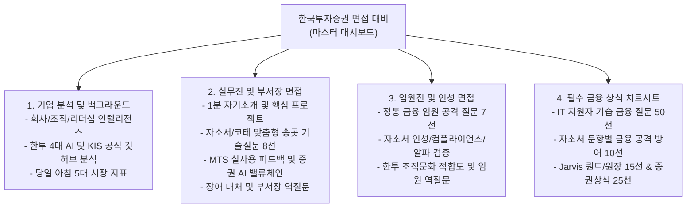

# 한국투자증권 면접 대비 마스터 대시보드

> [!info] 면접 핵심 개요
> - **면접 일시**: 2026.11.18(수) **08:35까지 집합** (최소 08:15까지 여의도역 및 본사 인근 도착 권장)
> - **면접 장소**: 한국투자증권 여의도 본사 2층 자양회의실
> - **지원 직무**: IT/Digital - AI/디지털/정보보호 (신입 5급)
> - **면접 성격**: 부서장 및 실무 팀장(다대일 15분 또는 다대다 30분) + 정통 금융 임원 배석
> - **준비물**: 단정한 정장(자켓, 넥타이, 정장 구두 필수), **신분증(주민등록증, 운전면허증, 유효기간 내 여권 중 택1)** 지참
> - **관련 지원 문서**: [[한국투자증권 2026 하반기]] | [[한국투자증권 2026 하반기 자소서]] | [[Finance Jarvis 테크 포폴]] | [[내 포트폴리오 아이템 정리]]

---

## 1. 체계적 면접 대비 4대 분할 노트 바로가기

효율적이고 집중적인 면접 대비를 위해 노트를 분야별로 분리했습니다. 상황에 맞게 노트를 클릭해 학습하세요.

| 문서명 | 주요 내용 및 활용 시점 | 바로가기 링크 |
|---|---|:---:|
| **실무진 및 부서장 면접** | • 1분 자기소개 및 직무 역량(Adele, 코오롱, Jarvis) • 자소서/코테 송곳 질문 8선(FSM, 과최적화, RAG, 가드레일) • 한투 앱(MTS) AI 서비스 분석 및 초개인화 개선 제안 • 장애 발생 시 엔지니어 대처 및 부서장 역질문 | [[한국투자증권 면접 - 실무진 및 부서장]] |
| **임원진 및 인성 면접** | • 여의도 정통 금융 임원 특화 공격 질문 7선 • 자소서 5번 불로소득/컴플라이언스, 6번 홍콩 요트 일기 • 성격 장단점(조약돌), 워라밸 vs 성과보상, 임원 역질문 | [[한국투자증권 면접 - 임원진 및 인성]] |
| **필수 금융 상식 치트시트** | • **IT 지원자 기습 금융 질문 50선 완벽 방어** • 자소서 문항별 금융 꼬투리 공격 10선(PI/WM, 4시간 리밸런싱, 규제 등) • Jarvis 원장/퀀트 15선 + 증권사 핵심 25선 + 10초 즉답 매트릭스 | [[한국투자증권 면접 - 필수 금융 상식 및 도메인 치트시트]] |
| **기업 분석 및 백그라운드** | • 김남구 회장 AI 철학 및 CDO 김관식 상무, 이재성 상무보 • 한투 4대 AI(코비, AIR, 알피, OpenAPI 에이전트) • **KIS Developers 공식 레포 3종 심층 분석** • 2026 상반기 영업익 2조, 자기자본 13조(업계 1위) | [[한국투자증권 면접 - 기업 분석 및 백그라운드]] |

---

## 2. 면접장 1분 자기소개 및 One-Liner 피칭

> [!quote] 1분 자기소개 (입으로 소리 내어 연습)
> "안녕하십니까. 한국투자증권에서 증권업의 미래를 개척할 준비가 된 AI 네이티브 빌더, 배수현입니다.
> 
> 최근 AI의 급격한 발전으로 자산이 직접 움직이는 금융 현장에서도 AI 활용 역량이 핵심 경쟁력이 되고 있습니다.
> 
> 저 역시 이러한 변화에 주목해 한국투자증권의 OpenAPI를 활용한 자동 투자 엔진과 시장 분석 에이전트를 직접 구축했습니다. 단순히 AI에 의존하는 것이 아니라, 안전 가드와 멱등성 파이프라인까지 설계했으며, 6개월간의 백테스팅에서 S&P 500 ETF 대비 27%p의 초과 수익을 기록했습니다.
> 
> 이 경험을 통해 AI가 증권업의 새로운 경쟁력을 만들어낼 것이라는 확신을 얻었습니다.
> 한국투자증권이 선도하는 AI 투자 에이전트 생태계에서, 직접 서비스를 구축하고 활용해 본 선행 사용자의 시각과 탄탄한 엔지니어링 역량을 바탕으로 고객과 회사 모두에게 실질적인 가치를 제공하는 금융 AI 서비스를 만들어가겠습니다. 감사합니다."

---

## 3. 면접관별 핵심 방어 전략 요약

### 실무진 / 부서장 면접 (기술 및 엔지니어링 신뢰성)
- **핵심 프레임**: *"AI의 화려한 예측력보다 '돈이 걸린 시스템이 실패했을 때 어떻게 안전하게 멈추고 스스로 복구되는가'를 코드로 증명한 엔지니어"*
- **필살기 키워드**:
  - `주문 의도 FSM (Write-Ahead & UNKNOWN 락)`
  - `결정론적 가드레일 (AIRebalanceGuard, 0.1%p 초과 시 클램핑 없이 전면 반려)`
  - `소티노 지수 2.39 & 손익비 5.21 (하방 리스크 통제 알파)`
  - `KIS Developers .kis.yaml & kis-prod-guard 훅 일치성`

### 임원진 면접 (금융 마인드셋 및 인성/태도)
- **정석 방어 3단 공식**:
  1. **선(先) 겸손 및 현업 존중**: *"개인의 실험과 현업 프로의 세계는 깊이와 책임의 무게가 완전히 다름을 잘 알고 있습니다."*
  2. **중(中) 정량적 팩트 제시**: 기관급 리스크 지표(소티노, MDD, ATR) 및 회계 지표(ROE 듀폰 분석, EV/EBITDA, FCF)로 답변.
  3. **후(後) 리스크 통제와 현업 보좌로 귀결**: *"내 기술 자존심보다 현업 선배님들이 믿고 쓸 수 있는 가장 안전한 무기를 만들어드리겠습니다."*
- **김남구 회장 인재상 연결**:
  - 자존심보다 결과 중시, 안 되면 빠르게 피벗하는 사람.
  - 낭중지추의 송곳 대신 주머니를 찢지 않는 묵직하고 매끄러운 조약돌.
  - 안주할 곳이 아닌 매일 치열하게 성장하는 격전지로서의 한국투자증권.

---

## 4. 면접 당일(11/18) 아침 최종 체크리스트

- [ ] **도착 시간**: 08:35까지 여의도 본사 2층 자양회의실 도착 (08:15 인근 도착)
- [ ] **복장 및 준비물**: 정장(자켓, 타이, 구두), **신분증(주민등록증/운전면허증/여권)**
- [ ] **출근길 5대 시장 지표 암기 (지하철에서 최종 확인)**:
  - [ ] 코스피 / 코스닥 전일 종가
  - [ ] 간밤 S&P 500 / 나스닥 마감 수치 및 등락 이유
  - [ ] 원/달러 환율 (백 원 단위 이하 정확한 수치)
  - [ ] 한국은행 기준금리 & 미 연준(Fed) 기준금리 상단/하단
  - [ ] 미 국채 10년물 금리 & 한국 국고채 10년물 금리
- [ ] **답변 호흡**: 한 번에 40초(3~4문장)를 넘기지 말 것! 결론부터 또렷하게 말하고 면접관의 눈을 보며 꼬리질문을 유도할 것.
- [ ] **핵심 키워드 입에 붙이기**: `코비(MY AI)`, `AIR(1.8만 종목)`, `OpenAPI as AI Strategy(.kis.yaml / kis-prod-guard)`, `사내 에이전틱 AI(알피/RAG)`, `소티노 지수(2.39) 및 손익비(5.21)`, `의사결정은 사람이, 에이전트는 안전한 보좌(Human-in-the-Loop)`, `매끄러운 조약돌 같은 빌더`.
