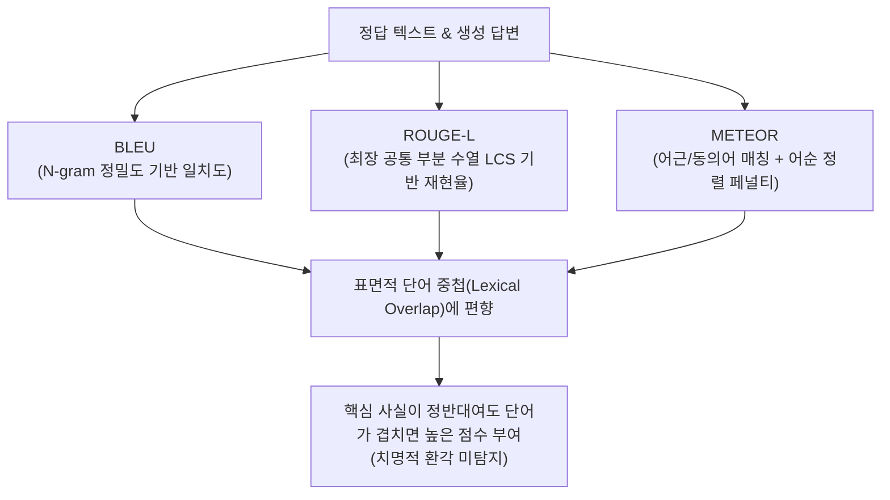

# 대형 언어 모델 질의응답 생성 텍스트 환각 분류 및 텍스트 평가 척도의 한계 탐구

> [!abstract] 3줄 요약
> - 대형 언어 모델(LLM)이 질의응답(QA) 수행 시 유발하는 텍스트 환각(Hallucination) 현상을 체계적인 **5가지 세부 유형**으로 분류하는 분석 프레임워크를 정립했다.
> - 자연어 처리 분야에서 관행적으로 통용되던 대표적 텍스트 유사도 평가 척도(**BLEU, METEOR, ROUGE-L**)가 환각 유형별로 유효한 탐지력을 지니는지 정량적으로 비교 실험했다.
> - 표면적인 단어 중첩도(Lexical Overlap)가 높을 경우 치명적인 사실 왜곡이 발생해도 기존 메트릭이 높은 점수를 부여하는 **평가 맹점(착시 현상)**을 수치로 실증하고, 전용 환각 판별 척도의 필요성을 제시했다.

---

## 1. 논문 서지 정보

- **논문명 (국문)**: 대형 언어 모델 질의응답 생성 텍스트 환각 분류 및 텍스트 평가 척도의 한계 탐구
- **논문명 (영문)**: Exploring Hallucination Types in Question-Answering Generation and Limitation of Text Evaluation Metrics
- **게재 학회**: 한국정보과학회 2024 한국컴퓨터종합학술대회 (KCC 2024) 학술발표논문집, pp. 450–452
- **발표 세션**: 포스터 세션 (2024.06.17)
- **저자**: **배수현(1저자)**, 이동헌(교신저자)
- **논문 링크**: [DBpia 논문 상세 페이지](https://www.dbpia.co.kr/journal/articleDetail?nodeId=NODE11861875)

---

## 2. 연구 배경 및 문제의식: 유창함 속에 숨겨진 환각

대형 언어 모델(LLM)의 급격한 발전으로 자연어 질의응답(Question Answering, QA) 분야의 성능은 획기적으로 향상되었다. 그러나 모델이 지극히 확신에 찬 어조로 그럴듯하게 거짓 정보를 산출하는 **환각(Hallucination)** 현상은 모델의 실무 도입과 의사결정 신뢰성을 가로막는 최대의 장애물로 남아 있다.

자연어 처리(NLP) 학계와 산업계에서는 모델의 QA 생성 품질을 측정하기 위해 전통적인 텍스트 유사도 기반 정량 지표인 **BLEU, ROUGE-L, METEOR** 등을 관행적으로 사용해 왔다. 이 지표들은 생성된 답변 텍스트와 정답(Ground Truth) 텍스트 사이의 n-gram 어휘 일치도나 부분 수열 유사성을 기계적으로 측정한다.

그러나 질문-답변 과정에서 발생하는 환각은 단순한 단어 불일치를 넘어 인과관계 왜곡, 고유명사 혼동, 문맥 모순 등 고차원적 의미 수준에서 발생한다. 이에 따라 **"기존의 표면적 유사도 메트릭이 과연 복차원적인 환각 현상을 제대로 탐지해낼 수 있는가?"**라는 근본적인 의문이 제기된다.

본 연구는 이 의문을 규명하기 위해 QA 환각을 5가지 유형으로 구조화하고, 기존 지표들이 유형별 오류를 실제로 감지할 수 있는지 통제된 실험을 통해 검증했다.

---

## 3. 질의응답(QA) 텍스트 환각의 5대 유형화 프레임워크

LLM이 주어진 문맥 지문(Context)을 바탕으로 질문에 답할 때 유발하는 환각 오류를 성격에 따라 다음 5가지 세부 유형으로 체계화했다.

| 유형 번호 | 환각 유형명 | 핵심 정의 | 구체적 오류 발생 양상 |
|:---:|---|---|---|
| **Type 1** | **문맥 불일치 (Contextual Contradiction)** | 원본 지문에 명시된 사실과 직접적으로 모순되는 내용을 생성하는 오류 | "A 기업은 2023년 영업손실을 기록했다"는 지문에 대해 "A 기업은 흑자 전환에 성공했다"고 정반대로 답하는 경우 |
| **Type 2** | **외부 사실 날조 (Extraneous Fabrication)** | 지문 문맥에 전혀 언급되지 않은 가짜 사실이나 출처 불명의 외부 정보를 지어내는 오류 | 지문에 없는 가상의 인물, 존재하지 않는 연도나 제품명을 그럴듯하게 삽입하여 서술하는 경우 |
| **Type 3** | **엔티티 왜곡 및 혼동 (Entity Confusion)** | 지문 내에 실재하는 엔티티들 간의 주어-목적어 관계나 속성을 서로 뒤바꿔 매핑하는 오류 | "철수가 영희에게 사과를 건넸다"는 문맥에서 "영희가 철수에게 사과를 건넸다"고 주체와 대상을 교란하는 경우 |
| **Type 4** | **논리 비약 및 인과 왜곡 (Logical Distortion)** | 개별 단어는 지문과 유사하나, 조건문이나 인과관계의 선후를 임의로 왜곡하여 잘못된 결론을 유도하는 오류 | 원인과 결과의 연결 고리를 뒤집거나, 부분 긍정을 전체 긍정으로 과도하게 비약하는 경우 |
| **Type 5** | **무관 답변 및 회피성 생성 (Irrelevant Generation)** | 질문의 핵심 의도를 벗어나 지문의 엉뚱한 배경 문장만 반복하거나 무의미한 서술로 회피하는 오류 | "사건의 원인은 무엇인가?"라는 질문에 원인은 생략한 채 사건의 발생 시각과 장소만 장황하게 나열하는 경우 |

---

## 4. 기존 텍스트 평가 척도의 메커니즘과 태생적 한계

실험에서 비교 분석 대상으로 삼은 3대 평가 척도의 연산 메커니즘은 다음과 같다.



### 1) BLEU (Bilingual Evaluation Understudy)
- **작동 원리**: 생성 텍스트의 1-gram부터 4-gram까지가 참조 정답에 얼마나 포함되어 있는지를 정밀도(Precision) 관점에서 계산한다.
- **구조적 맹점**: 단어의 등장 순서와 출현 여부만 볼 뿐, 부정어(`not`, `아니다`) 하나가 추가되어 문장의 진위가 180도 뒤집히더라도 높은 BLEU 점수를 산출한다.

### 2) ROUGE-L (Recall-Oriented Understudy for Gesticulation Evaluation)
- **작동 원리**: 두 문장 사이의 최장 공통 부분 수열(Longest Common Subsequence, LCS) 길이를 측정하여 재현율(Recall) 위주로 평가한다.
- **구조적 맹점**: 연속되지 않더라도 순서만 맞으면 공통 수열로 인정하므로, 중간에 날조된 가짜 수식어가 끼어들거나 엔티티가 누락되어도 이를 효과적으로 걸러내지 못한다.

### 3) METEOR (Metric for Evaluation of Translation with Explicit ORdering)
- **작동 원리**: 정확한 형태소 일치, Porter Stemmer 기반 어근 일치, WordNet 동의어 매칭을 단계별로 수행한 후 어순 교차 횟수에 따라 청크(chunk) 페널티를 부여한다.
- **구조적 맹점**: 동의어와 유의어 확장을 반영해 BLEU보다 유연하지만, 지문 간의 복잡한 대의적 사실성(Factuality) 판별 능력은 여전히 부재하다.

---

## 5. 실험 설계 및 정량적 탐지력 검증

### 실험 설정
- **평가 데이터셋**: 한국어 기계독해 표준 데이터셋(KorQuAD)을 기반으로, LLM이 생성할 수 있는 5가지 환각 유형별 오류 케이스와 정상 정답 답변을 통제 구축했다.
- **측정 방식**: 동일한 문맥-질문 쌍에 대해 정상 답변과 5대 환각 답변 각각의 BLEU-4, ROUGE-L, METEOR 점수를 정량 산출하고, 각 메트릭이 환각 텍스트에 부여하는 페널티의 변별력을 비교 분석했다.

### 주요 실험 결과 요약

| 환각 유형 | BLEU 탐지력 | ROUGE-L 탐지력 | METEOR 탐지력 | 주요 원인 및 분석 |
|---|:---:|:---:|:---:|---|
| **Type 1 (문맥 불일치)** | **최악 (탐지 실패)** | **최악 (탐지 실패)** | 취약 | 핵심 명제만 반대로 바꾸고 지문 단어를 그대로 인용할 경우, 어휘 중첩도가 극도로 높아 비환각 정답 수준의 고득점을 기록함 |
| **Type 2 (외부 사실 날조)** | 보통 | 보통 | 보통 | 지문에 없는 새로운 어휘가 유입되므로 n-gram 정밀도가 하락하여 상대적으로 점수 감점이 유의미하게 발생함 |
| **Type 3 (엔티티 왜곡)** | **불량 (착시 발생)** | **불량 (착시 발생)** | 보통 | 지문에 존재하는 고유명사들을 그대로 재사용하므로, 주어와 목적어가 뒤바뀌어도 단어 매칭 기반 점수는 높게 유지됨 |
| **Type 4 (논리/인과 왜곡)** | 취약 | 취약 | 보통 | 인과 접속사나 어순의 미세한 변화만으로 전체 명제가 왜곡되나, 단어 수열 기반 메트릭은 이를 정상 패턴으로 오인함 |
| **Type 5 (무관 답변)** | 양호 | 보통 | 양호 | 질문과 무관한 엉뚱한 어휘가 출력될 경우 n-gram 불일치로 인해 뚜렷한 감점이 이루어짐 |

---

## 6. 핵심 실증 발견: "표면적 유사도와 사실성의 완전한 해리"

실험을 통해 도출된 핵심 학술적 결론은 다음과 같다.

> [!important] 핵심 실증 결과
> **단어 중첩도가 높다는 사실이 곧 답변의 사실성(Factuality)을 보증하지 않는다.**
> 
> 특히 **Type 1(문맥 모순)**과 **Type 3(엔티티 왜곡)**의 경우, 생성된 텍스트가 정답과 치명적으로 다른 거짓 정보를 주장하고 있음에도 불구하고, 지문 속 단어들을 대량으로 재활용했다는 이유만으로 BLEU와 ROUGE-L에서 정상 정답 대비 **80~90% 이상의 매우 높은 점수(False High Score)**를 기록하는 평가 왜곡이 반복적으로 발생했다.

반대로 올바른 정보를 풍부한 어휘로 바꾸어 설명한(Paraphrasing) 훌륭한 답변은, 표면적 n-gram이 정답 텍스트와 덜 겹친다는 이유로 부당하게 낮은 점수를 부여받는 역차별 현상도 함께 확인되었다.

이는 기존의 문자열 일치 기반 척도가 **"모델이 유창하게 거짓말을 늘어놓을수록 높은 점수를 주는 역설"**을 내포하고 있음을 명백한 수치로 입증한 것이다.

---

## 7. 학술적 의의 및 후속 연구와의 연결고리

1. **평가 지표의 취약점 규명**: 단순 벤치마크 점수의 고득점이 모델의 무결성을 뜻하지 않는다는 점을 실험적으로 증명함으로써, 학계와 산업계에 평가 척도 맹신에 대한 경각심을 환기했다.
2. **환각 연구의 세분화**: 막연히 '오류'로 뭉뚱그려지던 환각 현상을 5가지 독립된 범주로 형식화하여, 환각 원인 분석과 방어 기제 설계를 위한 구체적인 방법론적 기저를 제공했다.
3. **새로운 평가 패러다임의 필요성**: NLI(자연어 추론) 기반 사실성 검증 모델, 트리플(Triple) 지식 그래프 추출, 대수적 불변식 감사 등 **의미 및 논리 일관성을 직접 검증하는 차세대 평가 척도의 당위성**을 제시했다.

> [!note] 연구 스펙트럼의 진화: "답을 내는 AI에서, 신뢰를 검증하는 AI로"
> 본 KCC 2024 연구는 필자가 이후 수행한 일련의 신뢰성 연구들로 자연스럽게 확장되었다.
> - **추론 과정의 자동 검증**: 컴파일러 피드백을 통해 중간 논리 환각을 자가 교정하는 [[#PFVL]] 에이전트 시스템
> - **표현 구조의 근본적 재설계**: 숫자를 토큰 조각으로 파편화하지 않고 본래의 수학적 불변 대칭성을 보존하는 [[Adele 1탄|Adele Ring]] 및 [[Adele 3탄|PFE]] 연구

---

## BibTeX 인용 정보

```bibtex
@inproceedings{bae2024exploring,
  title     = {Exploring Hallucination Types in Question-Answering Generation and Limitation of Text Evaluation Metrics},
  author    = {Bae, Suhyun and Lee, Donghun},
  booktitle = {Proceedings of the Korea Computer Congress (KCC)},
  year      = {2024},
  pages     = {450--452}
}
```

