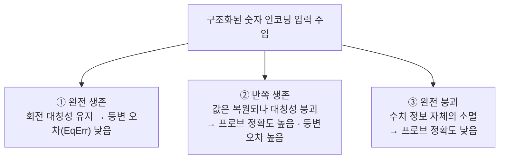
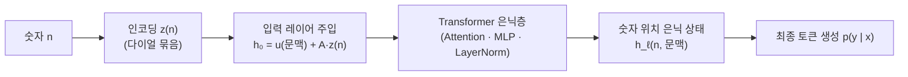

# 구조화된 숫자 임베딩은 LLM 안에서 살아남는가?

> [!abstract] 초록 (3줄 요약)
> - **연구 질문**: FoNE, PFE와 같이 숫자에 수학적 대수 구조를 사전에 내장한 인코딩이, 트랜스포머의 수십 개 은닉층을 통과한 뒤에도 그 변환 대칭성을 유지하는가?
> - **방법론**: ① 정보 복원력(Decodability), ② 대수 구조 보존도(Equivariance), ③ 인과적 활용도(Causal Use)를 **단계별로 분리 측정**하는 구조 감사 프로토콜(*Structure Survival Audit*)을 제안한다.
> - **핵심 결론**: 값 자체는 선형 프로브로 복원되더라도 내부 대수 구조는 완전히 붕괴해 있을 수 있다(해리 현상). 기존 평가 방식(단순 프로브 정확도, 다운스트림 벤치마크 점수)은 이 두 상태를 전혀 구별하지 못한다.

---
## 1. 개요 및 핵심 직관

> [!tip] 다이얼 비유 — 구조 보존과 정보 복원의 괴리
> FoNE은 숫자를 **자릿수 스케일($10^k$)마다 독립된 바늘이 존재하는 시계들의 묶음**으로 표현한다.
> 임의의 수에 $a$를 더하면 모든 바늘은 **정해진 각도만큼 회전**한다. 이것이 바로 "덧셈 = 회전"이라는 대칭 구조다.
>
> 이 시계 묶음이 LLM의 여러 은닉층을 통과할 때 발생할 수 있는 결과는 다음 세 가지 중 하나로 분류된다.
>
> | 결과 분류 | 내부 상태 | 기존 평가 방식이 감지할 수 있는가? |
> |---|---|---|
> | **① 완전 생존** | 다이얼이 온전히 보존되어 **회전 대칭성을 유지함** | ❌ (구조 보존 여부까지는 측정 불가) |
> | **② 반쪽 생존** | **눈금 수치는 읽히나 다이얼이 굳어버림** (값은 복원되나 회전 변환 불가) | ❌ (값만 보므로 ①과 동일하게 착각) |
> | **③ 완전 붕괴** | 다이얼 구조 자체가 은닉층에서 소멸함 | ✅ (프로브 정확도 급락으로 감지 가능) |
>
> **본 연구의 핵심 목표는 기존 평가가 간과해 온 ②번 '반쪽 생존' 상태를 엄밀하게 식별해내는 것이다.**

본 연구가 규명하고자 하는 분석 대상은 입출력의 양 끝단이 아니라, **은닉층을 거치는 동안 중간 상태에서 수학적 구조가 어떻게 변형·소실되는가**에 있다.

---

## 2. 연구 배경 및 선행 연구의 공백

### 2.1 기존 연구: 구조화된 수치 인코딩의 등장

| 인코딩 | 핵심 대수 구조 (기하학적 비유) | 주요 적합 과제 |
|---|---|---|
| [[FoNE]] | 10진 오도미터 — $10^k$ 주기 단위원 다이얼 | 자릿수 분절, 10진 자리올림(carry), $\bmod 10^k$ |
| [[PFE (Prime Fourier Embeddings)]] | 소수별 독립 시계벽 — 각 소수-깊이 $(p,d)$별 다이얼 | $\bmod p$ 모듈러 연산, 중국인의 나머지 정리(CRT), 합성수 분해 |
| [[xVal]] | 1차원 연속 실수선 위의 스칼라 좌표 | 수치 대소 비교, 연속 스케일링, 보간 회귀 |
| [[BitTokens]] | 2진 부동소수점 오도미터 ($\pm 1$ 비트 패턴) | 홀짝성(parity), 비트 단위 비트와이즈 연산, 2진 carry |

이들 인코딩의 공통점은 숫자를 단순 무작위 임베딩이 아닌 **명확한 군(group) 변환 규칙을 따르는 벡터**로 정의한다는 점이다. 예컨대 FoNE의 $k$번째 채널은 다음을 만족한다.

$$z_k(n+a) = R_k(a)\, z_k(n)$$

즉, "$a$를 더하는 산술 연산"은 언제나 "고정된 회전 작용소 $R_k(a)$의 곱"과 일치한다. PFE 역시 각 소수 채널 $(p,d)$에 대해 $z_{p,d}(n+a)=R_{p,d}(a)\,z_{p,d}(n)$이 엄밀히 성립한다.

### 2.2 선행 연구의 한계: 구조 보존 여부 직접 측정의 부재
기존의 모든 수치 표현 평가는 입력단 근처 또는 최종 출력단에 편중되어 있었다.
- **최종 다운스트림 정확도 (출력단)**: 최종 정답 토큰이 일치하는지만 평가
- **은닉 상태 선형 프로브 (입력단 근처)**: 특정 층에서 원래 숫자 값 $n$이 역산되는지만 검증

그러나 "선형 프로브로 $n$의 값을 역산할 수 있다"는 사실과, "덧셈·자리올림 등의 군 변환이 은닉 공간에서 일관된 기하학적 대칭성으로 유지되고 있다"는 명제는 **완전히 별개의 문제**다. 지금까지 심층 신경망 내부에서 이 둘 사이의 괴리를 직접 측정한 연구는 존재하지 않았다.

> [!info] PFE 연구와의 포지셔닝 및 차별점
> PFE 원 논문은 자연어가 배제된 **순수 수치 합성 환경**(단순 모듈러 분류기)에서 소수 채널의 독립적 선택성을 입증했다.
> 본 연구는 그 다음 단계로, **자연어 지시문(instruction), 대명사 참조 해석, 방해 텍스트(distractor), 트랜스포머의 복잡한 문맥화(contextualization)**를 모두 거친 뒤에도 그 대수적 구조가 은닉층에서 살아남는가를 검증한다. 즉, PFE가 미해결 과제로 남겨둔 "비선형 경사하강법이 트랜스포머 은닉 공간에서 대칭 구조를 보존하는가"를 측정 가능한 실험 프로토콜로 구체화한 확장 연구다.

---

## 3. 평가 체계: 3단계 구조 감사 사다리

| 층위 | 감사 명칭 | 핵심 질문 | 평가 도구 |
|---|---|---|---|
| **A단계** | 정보 복원력 (Decodability) | 원래 숫자의 값 자체가 은닉 벡터에 잔존하는가? | 선형 프로브 (Linear Probe) |
| **B단계** | 대수 구조 보존도 (Algebraic Preservation) | 숫자들 **사이의 수학적 변환 관계(대칭성)**가 유지되는가? | 등변 오차 (Equivariance Error) |
| **C단계** | 인과적 활용도 (Causal Use) | 모델이 **실제로 그 보존된 구조를 활용해** 정답을 도출하는가? | 채널 절제 (Ablation) 및 활성 이식 (Patching) |

$$\text{A단계 충족} \;\not\Rightarrow\; \text{B단계 충족} \;\not\Rightarrow\; \text{C단계 충족}$$

학생의 학습 상태에 비유하면 다음과 같다.
- **A단계 (단순 암기)**: 전화번호부의 번호들을 단순히 외운 상태. 값 하나하나는 꺼내어 읽을 수 있으나 규칙성은 없다.
- **B단계 (원리 이해)**: 전화번호 부여 체계의 규칙을 이해한 상태. 새로운 번호가 주어져도 동일한 변환 규칙을 적용할 수 있다.
- **C단계 (실제 적용)**: 시험 문제를 풀 때 실제로 그 대수적 규칙을 사용하여 답을 도출하는 상태. 규칙을 교란하면 정답률이 즉각 하락한다.

---

## 4. 연구 질문 (Research Questions)

> [!question] 최종 연구 질문 (RQ)
> 고정된 구조적 숫자 임베딩이 트랜스포머의 **문맥화(Contextualization) 과정을 거친 후에도, 원래 인코딩이 정의한 덧셈군 대칭 구조를 은닉층에서 보존하는가?**
> 그리고 그렇게 보존된 대수적 구조가 **자연어 조건부 수치 추론의 분포 외(OOD) 일반화 성능에 인과적으로 기여하는가?**

세부 연구 질문들의 통합 구조는 다음과 같다.

| 기존 세부 질문 | 통합된 연구 범위 |
|---|---|
| RQ1. 은닉 공간에 구조적으로 임베딩되는가 | → 최종 RQ 전반부 (대수 구조 보존도 측정) |
| RQ2. 정보는 남되 구조만 소실될 수 있는가 | → 핵심 실증 목표 (정보-구조 해리 현상 규명) |
| RQ3. 어떤 구조가 어떤 연산 과제와 정렬되는가 | → FoNE(10진 구조) vs PFE(소수 구조) 2대 축으로 비교 한정 |

**비교 분석 범위의 한정: FoNE과 PFE.**
두 기법 모두 단위원 "회전($\mathrm{SO}(2)$ 군 작용)"이라는 동일한 수학적 언어를 공유하므로 동일한 잣대로 깊이 있게 비교 검증할 수 있다. xVal, BitTokens, AOE 등 다른 대수 체계를 갖는 인코딩은 토론(Discussion) 섹션에서 일반화 확장 가능성으로 다룬다.

---

## 5. 핵심 주장 (Core Claims)

> [!example] 주장 1: 단순 입력 주입은 구조적 통합을 의미하지 않는다
> 인코딩 벡터를 입력층에 더해주는 것($z(n) \to h_0$)은 정보의 단순 **주입**에 불과하다. 진정한 의미의 대수적 통합 여부는 **수십 개의 은닉층 $\ell$을 통과한 뒤에도 해당 변환 대칭성이 온전히 유지되는가**로 판정해야 한다.

> [!example] 주장 2: 프로브 복원 가능성은 구조 보존을 보장하지 않는다
> 은닉 상태 $h_\ell(n,c)$에서 원래 값 $n$이나 모듈러 잉여류를 선형 프로브로 복원할 수 있다고 해서, 덧셈 등의 군 작용이 은닉 공간에서 일관된 기하학적 변환으로 보존된다는 보장은 없다. 즉, 정보는 읽히되 구조는 죽어 있는 '반쪽 생존' 상태가 실재한다.

> [!example] 주장 3: 인코딩의 우수성은 과제와의 대수적 호환성에 종속된다
> 모든 과제와 문맥에서 절대적으로 우월한 만능 인코딩은 존재하지 않는다. 본 연구의 최종 산출물은 단순한 인코딩별 순위표가 아니라, **인코딩 구조 × 연산 과제 간의 대수적 호환성 지도(Compatibility Map)**다.

---

## 6. 수학적 기초 이론

본 연구의 이론적 목표는 복잡한 신규 정리를 증명하는 것이 아니라, 실험적 감사 지표의 수학적 타당성을 정당화하는 최소한의 표현론적 기초를 제공하는 데 있다.

### 6.1 기본 표기 및 정의
- **군 작용 $G$**: 숫자에 적용 가능한 수학적 변환들의 모임. (예: "$+a$ 평행이동 연산")
- **군 표현 $\rho(g)$**: 해당 변환이 벡터 공간에서 작용하는 구체적인 행렬 작용소. (예: 회전 행렬 $R(a)$)
- **구조화된 인코딩의 정의**: 모든 $g \in G$에 대해 $E(g\cdot n) = \rho(g)E(n)$을 만족하는 매핑.

### 6.2 정리 1: 통역사 조건 (Intertwiner Theorem)

입력 주입 단계를 다음과 같이 정식화하자.

$$h_0(n,c) = u(c) + A z(n)$$

($u(c)$는 문맥 텍스트 임베딩, $A$는 숫자 표현 공간에서 LLM 은닉 공간으로 사상하는 선형 프로젝션 행렬)

> [!important] 정리 1 (정확한 구조 보존을 위한 통역사 조건)
> 프로젝션 행렬 $A$가 단사(injective)일 때, 수치 표현의 군 대칭성이 은닉 공간에 **엄밀하게 보존**되기 위한 필요충분조건은 다음과 같다.
> 1. $A$의 치역(image)이 은닉 공간의 군 작용에 대해 불변 부분공간(invariant subspace)이어야 한다.
> 2. 임의의 $g \in G$에 대해 $A\rho(g) = \pi(g)A$가 성립해야 한다. 즉, $A$는 두 표현 공간 사이의 **인터트와이너(Intertwiner)**여야 한다.

이 정리로부터 다음 세 가지 귀결이 도출된다.
1. $A$가 단사이면 **정보의 손실 없는 전달(복원성)**은 가능하다.
2. 그러나 $A$가 인터트와이너 조건을 만족하지 못하면 **대칭 구조는 은닉 공간에서 필연적으로 왜곡**된다.
3. 따라서 **무작위 가중치로 초기화된 선형 투영 계층(dense projection)은 중립적인 인터페이스가 아니라, 대칭성을 파괴하는 왜곡 연산소**로 작용한다.

> [!example] 명제 2: 선형 프로브 평가의 이론적 맹점
> 단사성을 만족하는 임의의 행렬 $A$는 선형 프로브를 통한 완벽한 값 역산을 보장하지만, $A$가 인터트와이너가 아닐 가능성은 항상 열려 있다.
> 이는 "프로브 정확도가 높다"는 관행적 평가가 모델 내부의 구조적 보존을 결코 보증하지 못함을 증명하는 이론적 근거가 된다.

### 6.3 명제 3: 국소 층별 대칭 병목 측정
비선형 은닉층의 국소 자코비안(Jacobian) 행렬 $J_\ell$이 숫자 변환 작용소와 가환(commute)하지 않을 때 대칭성 붕괴가 발생한다.

$$\Delta_\ell(g;h) = \big\lVert J_\ell(h)\,\pi_\ell(g) - \pi_{\ell+1}(g)\,J_\ell(h) \big\rVert_F$$

- $\Delta_\ell$이 작을수록: 해당 층은 국소적으로 숫자의 대수적 대칭성을 보존함
- $\Delta_\ell$이 클수록: 해당 층이 **구조를 파괴하는 병목 계층(bottleneck layer)**으로 작용함

### 6.4 바닐라 트랜스포머의 구조 보존 한계
Self-Attention(토큰 간 의존적 가중치), 비선형 MLP(ReLU/GELU), LayerNorm, Residual Connection 등 트랜스포머의 표준 구성 요소 중 어느 것도 숫자의 군 작용과 가환하도록 수학적으로 강제되어 있지 않다. 따라서 본 연구는 "트랜스포머가 구조를 보존할 수 있는가 없는가"의 이분법이 아니라, **어떤 조건에서 어느 층까지 구조가 유지되는가를 정량적으로 측정 가능한 영역으로 전환**하는 데 목적이 있다.

---

## 7. 측정 프로토콜: Structure Survival Audit

본 연구의 핵심 방법론적 기여는 새로운 인코딩의 발명이 아니라, 모델 내부를 체계적으로 검증하는 **구조 감사(Audit) 프로토콜**의 정립이다.

### 지표 1: 정보 복원력 점수 ($\mathrm{Dec}_\ell$)
각 은닉층 $\ell$에서 원래 숫자 $n$, 부호, 자릿수 계수, $n \bmod m$, 홀짝성(parity) 등을 판독하는 선형 프로브의 교차 검증 정확도다.
- **통제 조건**: 무작위 임베딩, 숫자 매핑 셔플 대조군, 동일 차원 학습 임베딩, 미관측 수치 분할(held-out).

### 지표 2: 등변 오차 ($\mathrm{EqErr}$) ⭐ 핵심 감사 지표
**사전에 정의된 수학적 회전 법칙과 은닉 상태를 직접 대조하는 측정 기법**:
은닉 상태 벡터를 **원래 인코딩의 좌표계로 역투영하는** 선형 디코더 $D_\ell$을 학습한다.

$$\hat z_\ell(n,c) = D_\ell\, h_\ell(n,c)$$

역투영된 좌표 벡터가 실제 인코딩의 대수적 회전 작용소 $R_k(a)$를 충실히 따르는지 오차를 측정한다.

$$\mathrm{EqErr}_{\ell,k}(a) = \mathbb{E}_{n,c}\Big[\big\lVert D_\ell h_\ell(n+a,c) - R_k(a)\, D_\ell h_\ell(n,c) \big\rVert_2\Big]$$

- **측정의 엄밀성**: 데이터에 맞춰 임의의 사후 행렬을 피팅하는 방식이 아니라, **수학적으로 불변인 본래 인코딩의 회전 행렬**과 직접 비교하므로 우연한 통계적 오버피팅이 원천 차단된다.
- FoNE 검증: $n \mapsto n+a \pmod{10^k}$ 회전 일치성 평가
- PFE 검증: 각 소수-깊이 $(p,d)$ 블록별 $n \mapsto n+a \pmod{p^{d+1}}$ 회전 일치성 평가

### 지표 3: 군 합성 오차 ($\mathrm{CompErr}$)
개별 덧셈 이동이 성립하더라도, 여러 변환들의 합성이 군 연산 법칙($g_1 \circ g_2$)을 만족하는 폐쇄 체계를 이루지 못할 수 있다.

$$\mathrm{CompErr}_\ell(a,b)=\frac{\lVert \hat\pi_\ell(a+b)-\hat\pi_\ell(a)\hat\pi_\ell(b)\rVert_F}{\lVert\hat\pi_\ell(a+b)\rVert_F+\epsilon}$$

### 지표 4: 부분공간 안정성 (Subspace Stability)
자연어 문맥 $c$가 변하더라도 수치 정보가 점유하는 은닉 부분공간 $U_\ell$이 안정적으로 유지되는지를 CKA(Centered Kernel Alignment) 및 주각(Principal Angle)으로 측정한다.
- 부분공간이 지나치게 고정됨: 문맥 텍스트와 융합되지 않는 단순 승객 상태
- 부분공간이 지나치게 요동침: 문맥 노이즈에 의해 수치 대수 구조가 붕괴됨
- **이상적 상태**: 과제와 무관한 문맥 변화에는 불변을 유지하되, 과제 지시어에만 선택적으로 반응

### 지표 5: 인과 구조 활용도 점수 ($\mathrm{CSU}$)

$$\mathrm{CSU} = \frac{\Delta_{\text{과제 관련 채널 제거 시 성능 하락폭}}}{\Delta_{\text{과제 무관 채널 제거 시 성능 하락폭}}+\epsilon}$$

과제에 대수적으로 필요한 채널을 절제했을 때만 성능이 급락하고, 무관한 채널을 절제했을 때는 영향이 없어야 높은 점수를 부여한다.

---

## 8. 실험 설계 및 환경 통제

### 8.1 연구 범위의 엄밀한 축소

| 기존 초기 계획 | 최종 수정 결정 | 축소 사유 |
|---|---|---|
| 5종 인코딩 전체 비교 | **FoNE + PFE 2종 집중** | 인코딩마다 대수 구조가 이질적이므로, "단위원 회전" 체계를 공유하는 두 기법에 집중 |
| 6종 주입 방식 탐색 | **단일 사이드 토큰 인터페이스 고정** | 주입 방식 자체의 튜닝 논문으로 왜곡되는 현상을 방지 |
| 복잡한 표/문서 QA 평가 | 부록으로 격하 | 통제된 인과성 검증에 집중 |
| 대규모 범용 언어 벤치마크 | 최소 핵심 1~2개로 한정 | "수치를 살리려다 언어 능력이 붕괴되는 현상"의 방지 여부만 확인 |

### 8.2 4대 실험 조건
1. **FoNE**: $10^k$ 주기 회전 대칭성 (10진법 과제 대응)
2. **PFE**: 소수별 모듈러 회전 대칭성 (소수 및 CRT 과제 대응)
3. **학습된 벡터 (Learned)**: 대수 구조가 없는 가변 임베딩 (단순 암기 대조군)
4. **무작위 고정 벡터 (Random)**: 구조가 없는 고정 임베딩 (성능 하한선 대조군)

### 8.3 주입 인터페이스: 사이드 토큰 방식
숫자 텍스트는 원본 문자열 스트림에 온전히 유지하고, 인접한 특수 토큰 `<NUM>` 위치에 고정 벡터 $Az(n)$을 주입한다.

$$h_0 = e_{\langle\texttt{NUM}\rangle} + A\,z(n)$$

예시 프롬프트:
> The recorded value is **1024**. `<NUM>` What is its remainder modulo 16?

텍스트 본연의 표현 공간과 수학적 숫자 공간의 상호작용을 가장 직관적으로 관찰할 수 있는 표준 인터페이스다.

### 8.4 평가 벤치마크 구성

**1) 자연어 수치 연산 스위트 (Core)**
- **Decimal 축 (FoNE 정렬 과제)**: 마지막 두 자리 계산, $n \bmod 10^k$, 10진 자리올림 발생 여부 판별 등
- **Prime/CRT 축 (PFE 정렬 과제)**: $(a+b)\bmod p$, $\bmod pq$, CRT 기반 역복원, 자연어 조건부 모듈러 연산 등
- **3단계 문맥 난이도**: 기본 템플릿 → 패러프레이즈 및 노이즈 텍스트 혼합 → 다중 숫자 및 방해 텍스트(distractor) 환경

**2) 3대 OOD 일반화 평가**
- 문장 형태 OOD: 미학습 자연어 패러프레이즈
- 문맥 구조 OOD: 긴 문맥 및 방해 숫자 삽입
- 연산 조합 OOD: 학습 때 분리 학습한 연산들의 신규 합성

**3) 범용 언어 능력 보존 평가**: Perplexity 및 비수치 텍스트 벤치마크 추적.

### 8.5 대상 모델 및 학습 조건
- 사전학습 디코더 전용 트랜스포머 2종: **소형 (~300M–700M)** 1종 + **중형 (~1B–3B)** 1종
- 모델 규모 변화에 따른 현상 재현성 검증에 집중
- controlled continued pretraining 또는 PEFT 방식 적용, 동일 컴퓨팅 예산 및 **시드 3회 이상(seed $\ge$ 3)** 반복 측정.

---

## 9. 실증 목표 및 예상 관측 패턴

### 9.1 정보-구조 해리(Dissociation) 검증 매트릭스
본 연구의 성패를 가르는 핵심 실험 결과 매트릭스다.

| 실험 조건 | 값 복원 프로브 ($\mathrm{Dec}_\ell$) | 대수 구조 보존도 ($\mathrm{EqErr}^{-1}$) | 결과에 대한 이론적 해석 |
|---|---|---|---|
| **Learned / Random 대조군** | **높음** | **낮음** | 값은 단순 암기되었으나, 대수 변환 대칭성은 형성되지 않음 |
| **FoNE + Decimal 과제** | 높음 | **높음** | 10진 대칭 구조가 은닉층에서 안정적으로 생존함 |
| **FoNE + Prime 과제** | 높음 | **낮음** | 값 정보는 보존되었으나 과제 대수와 불일치하여 구조 붕괴 |
| **PFE + Prime 과제** | 높음 | **높음** | 소수별 회전 대칭 구조가 은닉층에서 온전히 생존함 |

### 9.2 핵심 상관관계 검증
$$\text{은닉층 등변 오차(EqErr) 낮음} \;\Longleftrightarrow\; \text{OOD 수치 추론 정확도 높음}$$
모든 인코딩, 층, 시드 전반에서 이 상관관계가 통계적으로 유의미하게 성립할 때, "대수 구조의 내부 생존이 일반화 성능의 직접적 원인이다"라는 주장이 성립한다.

### 9.3 은닉층별 구조 생존 곡선의 3단계 양상
- **초기 층 (Layer 1~4)**: 외부에서 주입된 인코딩 고유의 대칭성이 지배적으로 관측됨
- **중간 층 (Layer 5~16)**: 자연어 문맥 정보와 수치 표현이 결합하는 변곡 구간 (생존과 소실의 갈림길)
- **후기 층 (Layer 17~출력)**: 최종 정답 토큰 생성을 위한 출력 특화 압축으로 대칭 구조의 일부가 변형됨

---

## 10. 인과적 메커니즘 검증 기법

### 1) 관련 채널 vs 무관 채널 선택적 절제 (Ablation)
예컨대 $a+b \bmod 21$ 연산의 경우, $21 = 3 \times 7$이므로 중국인의 나머지 정리에 의해 **오직 $p=3, 7$ 채널만 인과적으로 사용**되어야 한다.
- $p=3, 7$ 소수 채널 강제 차단 $\to$ 모델 성능 급락 관측
- $p=11, 13$ 무관 채널 강제 차단 $\to$ 모델 성능 유지 관측
자연어 문맥 텍스트와 융합된 이후에도 이 대수적 선택성이 온전히 유지되는가를 검증한다.

### 2) 은닉 부분공간 활성 이식 (Activation Patching)
- 정답을 맞힌 입력(Source)의 특정 층 수치 부분공간 벡터를 오답 인스턴스(Target)의 해당 층에 치환 이식한다.
- 수치 부분공간만 치환했을 때 Target의 출력이 Source 값으로 유도되는지를 측정하여, 구조화된 은닉 표현이 **단순한 통계적 상관관계가 아니라 최종 출력 생성을 유발하는 직접적 원인**임을 규명한다.

---

## 11. 세부 가설 체계 (Hypotheses)

> [!tip] H1: 비구조화 대조군은 대수 구조 없이 단순 암기한다
> Learned 및 Random 대조군은 높은 프로브 정확도를 기록하더라도, 등변 오차와 군 합성 오차가 극도로 높으며 OOD 환경에서 급격히 무너질 것이다.

> [!tip] H2: FoNE은 10진 국소 환경에서만 선택적으로 생존한다
> FoNE은 $10^k$ 주기 과제에서는 낮은 등변 오차를 유지하지만, 10과 서로소인 일반 소수 과제($\bmod 7$ 등)에서는 은닉층 초기에 대칭 구조가 붕괴할 것이다.

> [!tip] H3: PFE는 소수 과제에서 인과적 채널 선택성을 발현한다
> PFE는 $\bmod 21$ 등의 과제에서 관련 소수 채널($p=3, 7$)에 선택적으로 주의를 집중하며, 무관 채널의 절제에는 불변을 유지하는 높은 인과 선택도를 보일 것이다.

> [!tip] H4: 최적의 수치 통합은 불변성과 적응성의 균형점(Goldilocks)에 존재한다
> 수치 공간이 텍스트와 전혀 섞이지 않으면 자연어 추론이 불가능해지고, 너무 일찍 무차별 혼합되면 대수 대칭성이 파괴된다. 최적의 모델은 무관한 문맥 변형에는 견고하되 과제 지시어에만 선택적으로 반응할 것이다.

---

## 12. 실험 리스크 관리 및 시나리오 분석

> [!warning] 시나리오 1: 모든 인코딩이 은닉층 초기에 빠르게 붕괴하는 경우
> **이 역시 학술적으로 대단히 가치 있는 결론이다.** "외부 수치 표현을 단순히 주입하는 현행 방식은 트랜스포머의 구조적 통합을 이끌어내지 못한다"는 명확한 반증이 되며, 기존 수치 임베딩 연구들이 입력단 평가에만 매몰되어 있었다는 비판적 시사점을 제공한다.

> [!warning] 시나리오 2: 인코딩 간 벤치마크 점수 차이가 미미한 경우
> 단순 산술 정확도 대신 미관측 모듈러스 외삽, 군 합성 테스트, 인과 절제 민감도 등 대수적 변별 지표를 통해 차이를 규명한다.

> [!warning] 시나리오 3: 특정 인코딩에만 편향된 평가로 비치는 경우
> 10진 과제에는 FoNE, 크기 비교에는 xVal, 이진 비트 연산에는 BitTokens의 강점이 공정하게 반영되도록 벤치마크 균형을 철저히 유지한다.

---

## 13. 주요 시각화 계획 (Figure Plan)

1. **Figure 1**: 문제 정의 개념도 — 은닉층 통과에 따른 3가지 상태 (완전 생존 / 반쪽 생존 / 완전 붕괴)
2. **Figure 2 (대표 그림)**: 은닉층별 **값 복원력(Decodability) vs 구조 보존도(Equivariance) 해리 곡선**
3. **Figure 3**: 인코딩 × 연산 과제 간 대수적 호환성 매트릭스
4. **Figure 4**: 동일 숫자에 대해 자연어 지시문만 변경했을 때의 수치 부분공간 변화 궤적
5. **Figure 5**: 관련 채널과 무관 채널 간의 선택적 인과 절제 대비 차트

---

## 14. 단계별 실행 로드맵

### Phase 1: 정보-구조 해리 현상의 실증 검출 (최우선 과제)
- [ ] 소형 트랜스포머 + 4대 조건 (FoNE / PFE / Learned / Random) 파이프라인 구축
- [ ] 10진 및 소수 연산 벤치마크 및 3단계 문맥 템플릿 적용
- [ ] 층별 선형 프로브, 등변 오차($\mathrm{EqErr}$), 합성 오차($\mathrm{CompErr}$) 측정 완료
- [ ] 검증 기준: 값 복원력과 대수 구조 보존도 간의 유의미한 해리 현상 관측

### Phase 2: 인과적 메커니즘 규명
- [ ] 소수 채널 선택적 절제 실험 (Relevant vs Irrelevant)
- [ ] 수치 부분공간 활성 이식(Activation Patching) 수행
- [ ] 반사실적 수치 치환 테스트

### Phase 3: 규모 확장 및 검증 완료
- [ ] 1B~3B 중형 모델을 통한 스케일 확장 재현
- [ ] 범용 언어 능력 보존 지표(MMLU, Perplexity) 동시 측정

---

## 부록 A — 핵심 용어 정의

| 용어 | 정의 |
|---|---|
| **등변성 (Equivariance)** | 입력 데이터를 수학적으로 변환했을 때 표현 공간의 벡터 역시 정해진 대칭 작용에 따라 변환되는 성질 ($E(g\cdot x) = \rho(g)E(x)$). |
| **복원 가능성 (Decodability)** | 은닉 벡터로부터 원래의 수치 값을 선형 프로브를 통해 역산해낼 수 있는 상태. |
| **인터트와이너 (Intertwiner)** | 두 대수적 표현 공간 사이에서 군 대칭 구조를 손상 없이 보존하는 선형 사상 ($A\rho(g) = \pi(g)A$). |
| **선형 프로브 (Linear Probe)** | 은닉 상태 벡터 위에 덧붙여 특정 속성을 예측하도록 훈련하는 단순 선형 분류/회귀기. |
| **절제 실험 (Ablation)** | 특정 뉴런이나 채널의 활성을 강제로 0으로 비활성화한 뒤 모델의 거동 변화를 관찰하는 기법. |
| **활성 이식 (Activation Patching)** | 한 추론 과정의 내부 활성값을 다른 추론 과정의 동일 위치에 주입하여 인과관계를 입증하는 기법. |
| **중국인의 나머지 정리 (CRT)** | 서로소인 소수들의 모듈러 잉여류 값들을 결합하여 전체 수를 유일하게 복원해내는 정수론 정리. |
| **분포 외 일반화 (OOD)** | 훈련 데이터의 분포 영역을 벗어난 새로운 수치 크기, 템플릿, 연산 조합에 대한 모델의 적응력. |
