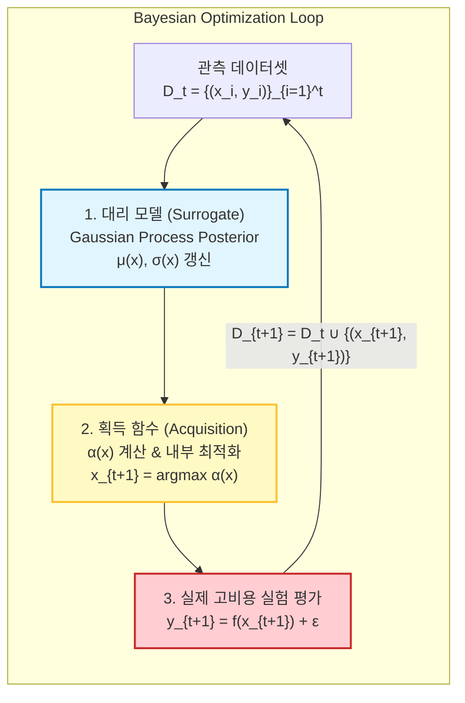

# Bayesian Optimization (베이지안 최적화, BO)

> [!abstract] 핵심 파이프라인 & 3줄 요약
> $$\text{Data } \mathcal{D}_{1:t-1} \xrightarrow{\text{Update}} \text{Surrogate } p(f \mid \mathcal{D}) \xrightarrow{\text{Maximize}} \text{Acquisition } x_t = \arg\max_{x} \alpha(x) \xrightarrow{\text{Expensive Eval}} y_t = f(x_t)$$
> - **한 줄 정의**: 수식 형태를 알 수 없고 기울기($\nabla f$)도 없으며 1회 평가 비용이 매우 비싼 **블랙박스 함수(Black-box Objective) $f(x)$의 전역 최적점(Global Optimum)을 최소한의 실험 횟수로 찾아내는 확률론적 전역 최적화 기법**이다.
> - **두 개의 핵심 기둥**: ① 지금까지 관측한 데이터를 바탕으로 미지의 함수 모양과 불확실성을 추정하는 **대리 모델(Surrogate Model, 주로 [[Gaussian Process]])**, ② "평균이 높은 곳(활용, Exploitation)"과 "안 가봐서 불확실한 곳(탐색, Exploration)"의 균형을 잡아 **다음에 실험할 최적의 좌표 $x_t$를 추천해 주는 획득 함수(Acquisition Function, EI, UCB 등)** 로 구성된다.
> - **대표적 활용처**: 1회 학습에 수일~수주가 걸리는 초거대 모델의 **하이퍼파라미터 튜닝(HPO)**, [[Neural Architecture Search|신경망 구조 탐색(NAS)]], 신약/신소재 분자 합성 실험, 로봇 보행 제어기 게인 탐색 등 실험 비용이 극도로 비싼 모든 엔지니어링 문제의 기본 도구다.

---

## 1. 개요: 왜 경사하강법 대신 베이지안 최적화인가?

일반적인 딥러닝에서는 손실 함수 $\mathcal{L}(\theta)$가 명시적인 수식과 자동 미분(Autograd)으로 주어져 있어, 수백만 번 경사하강법($\theta \leftarrow \theta - \eta \nabla \mathcal{L}$)을 돌린다.
하지만 현실 세계에는 다음과 같은 **"극도로 가혹한 최적화 문제"** 가 넘쳐난다.

$$\max_{x \in \mathcal{X}} f(x)$$

1. **Black-box**: 목적 함수 $f(x)$의 닫힌 수식을 알 수 없다.
2. **Derivative-free**: 기울기 $\nabla f(x)$를 계산할 수 없다 (해석적 미분 불가능).
3. **Extremely Expensive**: $x$ 하나를 평가하는 데 막대한 비용과 시간이 든다.
   - 예: LLM 학습률·배치 크기 $x$를 정하고 모델을 1회 학습시켜 validation loss $f(x)$를 얻는 데 **수억 원과 2주일**이 소요됨.
   - 예: 신약 후보 화합물 구조 $x$를 정하고 시험관에서 세포 반응 $f(x)$를 측정하는 데 **수천만 원**이 소요됨.
4. **Noisy Evaluation**: 관측값 $y = f(x) + \epsilon$에 확률적 잡음(Noise)이 섞여 있다.

> [!tip] 베이지안 최적화의 핵심 철학
> *"실제 함수 $f(x)$를 한 번 평가하는 건 너무 비싸지만, 내 컴퓨터 안에서 확률 통계 모델을 수천 번 계산하는 건 공짜나 다름없다. 그렇다면 **과거의 모든 실험 데이터로 만든 가상의 대리 지도(Surrogate)** 를 띄워두고, **수학적으로 가장 승산이 높은 단 하나의 지점(Acquisition Maximization)** 을 신중하게 골라 다음 실험을 수행하자!"*



---

## 2. 대리 모델 (Surrogate Model): 불확실성을 품은 지도

새로운 지점 $x$에 대해 단순히 예상 점수 하나(점 추정, Point Estimate)만 내는 모델(예: 일반 회귀 신경망)은 BO의 대리 모델로 쓸 수 없다. **"내가 이 영역을 얼마나 잘 알고 있는가(확신), 혹은 얼마나 모르는가(불확실성)"** 를 확률적으로 정량화할 수 있어야 탐색(Exploration)을 계획할 수 있기 때문이다.

### 2.1. 왜 [[Gaussian Process]]가 표준인가?
[[Gaussian Process|가우시안 프로세스(GP)]]는 사후 분포(Posterior)의 **평균 $\mu(x)$** 과 **분산 $\sigma^2(x)$** 을 닫힌 수식(Closed-form)으로 정확하게 뱉어낸다.

$$f(x) \mid \mathcal{D}_t \sim \mathcal{N}\big(\mu_t(x), \, \sigma_t^2(x)\big)$$

- **$\mu_t(x)$ (평균)**: 현재까지의 데이터를 바탕으로 본 가장 그럴듯한 함숫값 $\to$ **활용(Exploitation)** 의 근거.
- **$\sigma_t^2(x)$ (분산)**: 해당 위치의 데이터 결핍으로 인한 인식론적 불확실성(Epistemic Uncertainty) $\to$ **탐색(Exploration)** 의 근거.
  - 관측점 근처: $\sigma_t(x) \approx 0$ (이미 가봤으므로 불확실성 없음).
  - 관측점과 먼 곳: $\sigma_t(x) \approx \text{Prior Variance}$ (안 가본 미지의 땅이므로 불확실성 극대).

### 2.2. 기타 대리 모델과의 비교
| 대리 모델 | 장점 | 단점 | 대표 라이브러리 |
| :--- | :--- | :--- | :--- |
| **[[Gaussian Process\|Gaussian Process (GP)]]** | 해석적 불확실성 계산, 수학적 엄밀성, 적은 샘플($N < 1000$)에서 최강 | 고차원($D > 20$) 취약, 계산 복잡도 $\mathcal{O}(N^3)$ | BoTorch, GPyOpt |
| **TPE (Tree-structured Parzen Estimator)** | 카테고리형/조건부 하이퍼파라미터 지원, 고차원 및 병렬화 우수 | 함수 전체의 불확실성 대신 밀도비 $p(x \mid y)/p(x)$로 간접 추정 | Optuna, Hyperopt |
| **Random Forest (SMAC)** | 이산/연속 혼합 변수 처리 탁월, 이상치에 강건 | 외삽(Extrapolation) 영역에서 불확실성 추정 한계 | SMAC3 |

---

## 3. 획득 함수 (Acquisition Function, $\alpha(x)$)

획득 함수 $\alpha(x)$는 **"다음 $t+1$번째 실험으로 좌표 $x$를 방문했을 때 얻을 수 있는 유용함의 기대치(Utility)"** 를 수치화한 함수다.

### 3.1. 영원한 줄다리기: Exploration vs. Exploitation
- **활용 (Exploitation)**: 현재 모델이 알고 있는 가장 평균 $\mu(x)$이 높은 지점 근처를 집중 공략한다.
  - 위험: 지역 최적점(Local Optimum)의 함정에 빠져 진짜 전역 최고점을 영영 놓칠 수 있다.
- **탐색 (Exploration)**: 아직 가보지 않아 분산 $\sigma(x)$이 가장 큰 허공을 찔러본다.
  - 위험: 이미 답이 안 나올 게 뻔한 쓰레기 영역을 탐색하느라 비싼 예산을 낭비할 수 있다.

---

### 3.2. 대표적인 획득 함수 4총사

현재까지 관측된 최고의 함숫값을 $y^+ = \max_{i=1}^t y_i$라 하자.

#### 1) Probability of Improvement (PI, Kushner 1964)
현재 최고 기록 $y^+$보다 조금이라도 더 나은($\xi \ge 0$ 이상) 값이 나올 확률 자체를 최대화한다.

$$\alpha_{\text{PI}}(x) = P\big(f(x) \ge y^+ + \xi\big) = \Phi\left( \frac{\mu(x) - y^+ - \xi}{\sigma(x)} \right)$$

- $\Phi(\cdot)$: 표준 정규분포의 누적분포함수(CDF).
- **단점**: **개선될 "확률"만 볼 뿐, "얼마나 크게 개선될지(개선의 크기)"는 신경 쓰지 않는다.** $0.0001$만큼 좋아질 확률이 $99\%$인 지점을, $1000$만큼 대박 날 확률이 $90\%$인 지점보다 선호하는 치명적 맹점이 있다.

---

#### 2) Expected Improvement (EI, Mockus 1978 — 현업 표준!)
PI의 맹점을 보완하여, 개선량 $I(x) = \max\big(0, \, f(x) - (y^+ + \xi)\big)$의 **기댓값(Expected Value)** 을 직접 구한다.

$$\alpha_{\text{EI}}(x) = \mathbb{E}\left[ \max\big(0, \, f(x) - (y^+ + \xi)\big) \right]$$

이 식을 $f(x) \sim \mathcal{N}\big(\mu(x), \sigma^2(x)\big)$에 대해 부분적분으로 풀면 다음과 같은 **아름다운 닫힌 해(Analytic Closed-form)** 가 유도된다!

$$\alpha_{\text{EI}}(x) = \begin{cases} \big(\mu(x) - y^+ - \xi\big)\Phi(Z) + \sigma(x)\phi(Z) & \text{if } \sigma(x) > 0 \\ 0 & \text{if } \sigma(x) = 0 \end{cases}$$
$$\text{where } Z = \frac{\mu(x) - y^+ - \xi}{\sigma(x)}$$

- $\phi(\cdot)$: 표준 정규분포의 확률밀도함수(PDF).
- $\Phi(\cdot)$: 표준 정규분포의 누적분포함수(CDF).

> [!important] EI 수식의 기가 막힌 분해 구조
> $$\alpha_{\text{EI}}(x) = \underbrace{\big(\mu(x) - y^+ - \xi\big)\Phi(Z)}_{\text{① Exploitation 항 (평균 우수성)}} + \underbrace{\sigma(x)\phi(Z)}_{\text{② Exploration 항 (불확실성 잠재력)}}$$
> - **$\mu(x)$가 큰 곳**: $Z$가 커져 $\Phi(Z) \to 1$이 되므로 ①번 항이 지배하여 활용에 집중한다.
> - **$\sigma(x)$가 큰 곳**: $\phi(Z)$와 $\sigma(x)$의 곱인 ②번 항이 살아나 탐색을 촉진한다.
> - 하이퍼파라미터 $\xi \ge 0$ (보통 $0.01$): 탐색과 활용의 밸런스를 조절한다 ($\xi$가 클수록 탐색 유도).

---

#### 3) Upper Confidence Bound (GP-UCB, Srinivas et al. 2010)
강화학습의 밴딧(Multi-Armed Bandit) 이론에서 유래한 함수로, **"낙관주의 원칙(Optimism in the Face of Uncertainty)"** 에 기반한다.

$$\alpha_{\text{UCB}}(x) = \mu(x) + \beta_t^{1/2} \sigma(x)$$

- $\beta_t > 0$: $t$번째 스텝의 탐색 가중치 파라미터.
- **장점**: 수식이 직관적이고 튜닝이 쉬우며, Srinivas et al.(2010)에 의해 **누적 후회(Cumulative Regret $R_T$)가 서브리니어(Sub-linear, $\lim_{T \to \infty} R_T / T = 0$)하게 수렴함이 수학적으로 엄밀히 증명**되어 이론가들이 가장 사랑하는 함수다.

---

#### 4) Thompson Sampling (TS)
사후 GP 분포로부터 함수 곡선 하나를 통째로 랜덤 샘플링한 가상 함수 $\tilde{f}(x) \sim \mathcal{GP}$를 뽑고, 그 함수의 최댓점을 고른다.
$$x_{t+1} = \arg\max_{x} \tilde{f}(x)$$
- 확률적(Stochastic) 성질 덕분에 자연스럽게 탐색과 활용이 조화를 이루며, 특히 **여러 점을 동시에 추천받아 병렬 실험(Batch BO)** 을 돌릴 때 매우 유용하다.

---

## 4. 획득 함수를 찾는 '내부 최적화' (Inner Optimization)

여기서 흔히 하는 오해가 있다.
> *"어라? 다음에 갈 점을 찾으려면 $x_{t+1} = \arg\max_x \alpha(x)$를 풀어야 하잖아요. 그럼 또 최적화 문제를 풀어야 하는데 도로 뫼비우스의 띠 아닌가요?"*

**결정적인 차이가 있다!**
- 원래 목적 함수 $f(x)$: **1번 계산에 수백만 원과 며칠**이 걸리는 미지의 블랙박스.
- 획득 함수 $\alpha(x)$: 컴퓨터 메모리 안에서 **0.001초 만에 계산되고 $x$에 대해 완벽히 미분 가능한($\nabla_x \alpha$ 존재)** 수학적 함수!

따라서 $\alpha(x)$의 최댓값을 찾을 때는 컴퓨터 GPU를 갈아 넣어서 **L-BFGS-B, Adam, 다중 출발 경사상승법(Multi-start Gradient Ascent), 혹은 진화 알고리즘(CMA-ES)** 을 수천 번 돌려 1초 만에 전역 최고점을 찾아낼 수 있다.

```text
[실제 환경] -----------------------------------------------> [컴퓨터 시뮬레이션 내부]
고비용 블랙박스 f(x)                                          저비용 해석적 획득함수 α(x)
평가 1회: 수억 원, 2주일                                      평가 1회: 0.0001초, 무료
기울기 없음 (미분 불가)                                       기울기 ∇_x α 완벽 존재 (Autograd)
  ↑                                                            │
  │ (신중하게 1점만 골라 실제 실험)                                │ (수천 번 경사상승법으로 극점 탐색)
  └────────────────── x_{t+1} 결정 ────────────────────────────┘
```

---

## 5. 최신 확장 기법: 현실의 벽을 넘는 BO 기술들

초기 GP-BO는 "입력 변수가 10개 미만이고, 노이즈가 적으며, 한 번에 1개씩 순차 실험"할 때만 잘 돌아갔다. 현대 BO는 이 제약을 극복하기 위해 진화했다.

1. **배치 최적화 (Batch BO / $q$-EI)**:
   - 실제 연구실이나 GPU 클러스터에서는 한 번에 1개가 아니라 8대~64대의 머신을 동시에 돌린다.
   - $q$개의 점 후보군 $(x_1, \dots, x_q)$의 동시 기댓값 $\mathbb{E}[\max(f(x_1), \dots, f(x_q)) - y^+]$을 몬테카를로 재매개변수화 트릭([[Gradient Flow through Sampling]])으로 미분하여 한 번에 $q$개의 실험 배치를 뽑아낸다 (BoTorch의 핵심 기능).
2. **다중 충실도 최적화 (Multi-Fidelity BO / BOHB)**:
   - 100 에포크를 다 돌리는 비싼 평가($f_{\text{high}}$) 대신, **1~5 에포크만 살짝 돌린 저비용 평가($f_{\text{low}}$)** 나 축소된 데이터셋 결과를 활용한다.
   - 저비용 실험 수백 개로 대략적인 가능성을 스캔하고, 유망한 녀석만 골라 풀 트레이닝을 돌려 비용을 $90\%$ 이상 절감한다 (Hyperband + BO = BOHB).
3. **고차원 베이지안 최적화 (High-Dimensional BO / TuRBO)**:
   - 차원이 $D > 20$만 넘어가도 공간 부피가 지수적으로 팽창하여 GP가 전역 탐색에 실패한다(차원의 저주).
   - **TuRBO (Trust Region BO)**: 전체 공간을 뒤지는 대신, 현재 가장 성적이 좋은 점 주변에 **로컬 신뢰 영역(Trust Region 타원체)** 을 설정하고 그 안에서 국소 GP-BO를 돌리며 신뢰 영역을 늘렸다 줄였다(동적 크기 조절) 반복한다.
4. **안전성 제약 최적화 (Safe / Constrained BO)**:
   - 자율주행이나 화학 공장에서는 성능이 좋아도 "온도가 100도를 넘으면 폭발"하는 제약조건 $c(x) \le 0$이 있다.
   - 제약 조건 $c(x)$ 역시 별도의 GP로 모델링하여, $P(c(x) \le 0)$ 확률을 획득 함수에 곱해 **안전성이 보장된 영역 안에서만 최적점을 탐색**한다.

---

## 6. 대표 프레임워크 생태계

| 라이브러리 | 개발 주체 | 기반 백본 | 주요 특징 및 추천 상황 |
| :--- | :--- | :--- | :--- |
| **BoTorch** | Meta | PyTorch / GPyTorch | **현세대 연구/엔지니어링 표준**. Monte-Carlo 획득 함수, 배치($q$-EI), 다목적(Multi-objective), GPU 가속 완벽 지원 |
| **Optuna** | Preferred Networks | Python (NumPy/SciPy) | **가장 대중적인 HPO 도구**. TPE 기반이 기본이며, 빠른 설정, 대시보드 시각화, Pruning(조기종료) 연동 탁월 |
| **Ax (Adaptive Experimentation)** | Meta | BoTorch 래퍼 | A/B 테스트, 생산 시스템 자동 실험 루프 관리에 최적화된 고수준 API |
| **Ray Tune** | Anyscale | 분산 프레임워크 | 수백 대의 분산 노드에서 Optuna/BoTorch 알고리즘을 스케일아웃 실행 |

---

## 7. 한눈에 보는 최적화 알고리즘 비교

| 비교 항목                 | **Grid Search**     | **Random Search**  | **Gradient Descent** | **Bayesian Optimization**            |
| :-------------------- | :------------------ | :----------------- | :------------------- | :----------------------------------- |
| **평가 횟수 예산**          | 극도로 많이 필요 ($k^D$)   | 수백~수천 회            | 수천~수만 회              | **수십 ~ 수백 회 (초소형)**                  |
| **과거 실험 기억**          | 없음 (단순 격자)          | 없음 (완전 독립)         | 이전 1스텝의 모멘텀만 기억      | **과거의 모든 실험 $\mathcal{D}_t$을 축적·학습** |
| **기울기 $\nabla f$ 요구** | 불필요                 | 불필요                | **필수**               | **불필요 (블랙박스)**                       |
| **적합한 비용 영역**         | 1회 평가 비용이 0원에 가까울 때 | 1회 평가 비용이 매우 저렴할 때 | 미분 가능한 수식이 있고 빠를 때   | **1회 평가 비용이 수백만 원 이상일 때**            |

---

## 8. 한 줄 요약

> **Bayesian Optimization = "평가 비용이 극도로 비싼 미지의 블랙박스 함수를 만났을 때, 가우시안 프로세스로 불확실성이 담긴 지도를 그리고, 획득 함수(EI/UCB)로 탐색과 활용의 완벽한 줄타기를 수행하여 최소한의 실험으로 전역 최고점을 낚아채는 베이지안 전략의 극치"**

---
연관 노트: [[Gaussian Process]], [[Gaussian Distribution]], [[Uncertainty_Estimation]], [[Optimizer]], [[Neural Architecture Search]]

