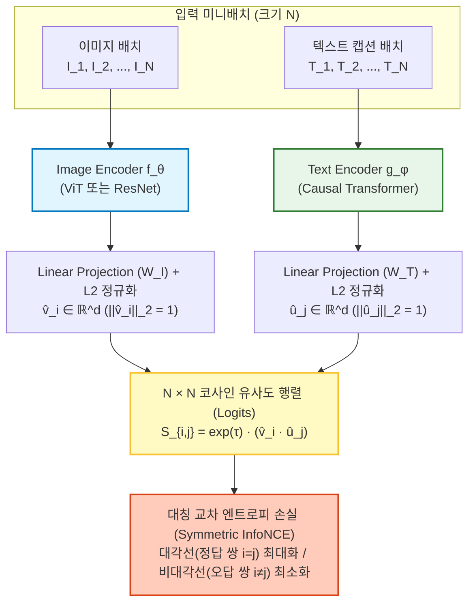

# CLIP (Contrastive Language-Image Pre-training)

> [!abstract] 핵심 파이프라인 & 3줄 요약
> **Image Batch $\{I_i\}_{i=1}^N$ + Text Batch $\{T_i\}_{i=1}^N$ $\xrightarrow{\text{Dual Encoders}}$ Normalized Embeddings ($\hat{v}_i, \hat{u}_i$) $\xrightarrow{\text{Cosine Similarity Matrix}}$ Symmetric InfoNCE Loss**
> - **한 줄 정의**: 인터넷에서 수집한 4억 쌍의 (이미지, 텍스트 캡션) 데이터를 **대조 학습(Contrastive Learning)** 으로 훈련해, 시각 정보와 언어 정보를 **하나의 공유된 초구면(Hypersphere) 벡터 공간에 정렬(Alignment)** 시킨 멀티모달 파운데이션 모델이다.
> - **핵심 패러다임**: 사람이 정해둔 1,000개 고정 클래스(ImageNet) 맞히기에서 벗어나, **자연어 문장 자체를 분류기(Classifier)의 가중치로 실시간 생성**함으로써 처음 보는 개념도 즉시 분류하는 **Zero-shot Transfer** 시대를 열었다.
> - **현대적 위치**: [[VLM]](LLaVA 등)의 기본 눈(Vision Encoder)이자 스테이블 디퓨전(Stable Diffusion)의 텍스트 조건부 가이드 역할을 수행하며, 이후 배치 병목을 해결한 **[[SigLIP]]** 으로 진화했다.

---

## 1. 개요: 왜 기존 컴퓨터 비전은 한계에 부딪혔는가?

2021년 OpenAI가 CLIP을 발표하기 전까지 컴퓨터 비전의 표준 패러다임은 **ImageNet 지도학습**이었다. 즉, 사람이 수작업으로 라벨링한 1,000개의 고정된 카테고리(예: `0번=골든 리트리버`, `1번=페르시안 고양이`, ...)를 원-핫 벡터(One-hot Vector)로 두고 Cross-Entropy로 학습하는 방식이었다.

이 방식에는 세 가지 치명적인 구조적 결함이 있었다.
1. **닫힌 세계 가정 (Closed-set Assumption)**: 학습 때 본 1,000개 클래스 외에 `1001번째 클래스(예: 테슬라 사이버트럭)`가 등장하면 분류 헤드(Linear Classifier)를 처음부터 다시 학습시켜야 한다.
2. **라벨의 의미 증발**: 모델에게 `골든 리트리버(ID: 207)`와 `래브라도 리트리버(ID: 208)`는 그저 서로 직교하는 남남인 숫자 번호일 뿐, 둘 다 '강아지'라는 언어적·의미론적 연결고리가 전혀 없다.
3. **데이터 스케일링 병목**: 사람이 일일이 정답 번호를 매긴 고품질 데이터셋은 수백만 장 수준에서 한계가 온다.

> [!tip] CLIP의 발상: "인터넷에 널린 (사진, 설명글) 4억 쌍을 그대로 문제지로 쓰자!"
> 사진 밑에 달린 설명글(`"해변을 달리는 귀여운 골든 리트리버"`)에서 단어 하나하나를 생성(Captioning)하게 시키면 너무 어려워서 학습이 느리다. 대신 **"배치(Batch) 안에 있는 $N$장의 사진과 $N$개의 문장 중, 원래 짝꿍이었던 $(I_i, T_i)$ 쌍만 골라내는 객관식 짝맞추기(Contrastive Proxy Task)"** 로 문제를 바꾸면 수억 장의 데이터를 초고속으로 학습할 수 있다!

---

## 2. 아키텍처와 텐서 흐름 (Dual-Encoder 구조)

CLIP은 이미지를 처리하는 **Image Encoder $f_\theta$** 와 텍스트를 처리하는 **Text Encoder $g_\phi$** 두 개의 독립된 타워(Dual-Tower)로 구성된다.



### 2.1. 세부 모듈 설계
1. **Image Encoder ($f_\theta$)**:
   - [[ViT]] (예: ViT-B/32, ViT-L/14) 또는 변형된 ResNet을 사용한다.
   - ViT 사용 시, 이미지 패치 시퀀스 맨 앞에 붙은 **`[CLS]` 토큰의 최종 레이어 출력 벡터** $h_i^{\text{img}} \in \mathbb{R}^{D_v}$를 꺼내고, 여기에 LayerNorm과 선형 투영 행렬 $W_I \in \mathbb{R}^{D_v \times d}$를 곱해 공유 임베딩 공간($\mathbb{R}^d$, 보통 $d=512$ 또는 $768$)으로 보낸다.
2. **Text Encoder ($g_\phi$)**:
   - GPT 스타일의 **Causal (Masked) Self-Attention Transformer**를 사용한다.
   - 입력 문장 앞뒤에 `[SOS]`(Start of Sequence)와 **`[EOS]`(End of Sequence)** 토큰을 붙인다. Causal Mask 때문에 오직 맨 마지막 토큰인 **`[EOS]` 토큰만이 문장 전체의 문맥을 다 볼 수 있으므로**, `[EOS]` 위치의 최종 출력 벡터 $h_j^{\text{txt}} \in \mathbb{R}^{D_t}$에 $W_T \in \mathbb{R}^{D_t \times d}$를 곱해 텍스트 대표 벡터로 쓴다.
3. **$L_2$ 정규화 (Unit Hypersphere Projection)**:
   - 두 벡터를 내적할 때 벡터의 크기(Norm)가 결과를 왜곡하지 않도록, 길이를 1로 맞추는 $L_2$ 정규화를 수행한다. 즉 모든 임베딩은 반지름이 1인 $d$차원 구 표면($S^{d-1}$) 위에 놓인다.
   $$\hat{v}_i = \frac{W_I^\top f_\theta(I_i)}{\| W_I^\top f_\theta(I_i) \|_2}, \qquad \hat{u}_j = \frac{W_T^\top g_\phi(T_j)}{\| W_T^\top g_\phi(T_j) \|_2}$$

---

## 3. 수식적 디테일: Symmetric InfoNCE Loss

미니배치 안에 $N$개의 (이미지, 텍스트) 쌍 $\{(I_1, T_1), \dots, (I_N, T_N)\}$이 들어왔다고 하자.
조합 가능한 모든 쌍 $(i, j)$는 총 $N^2$개다. 이 중 대각선 위의 **$N$개 쌍($i=j$)은 정답(Positive Pair)** 이고, 나머지 **$N^2 - N$개 쌍($i \neq j$)은 오답(Negative Pair)** 이다.

### 3.1. 코사인 유사도와 학습 가능한 온도 파라미터 ($\tau$)
$i$번째 이미지와 $j$번째 텍스트 사이의 스케일링된 유사도(Logit) $S_{i,j}$는 다음과 같이 정의된다.

$$S_{i,j} = \frac{\hat{v}_i^\top \hat{u}_j}{\tau} = e^{\tau'} (\hat{v}_i^\top \hat{u}_j)$$

- $\hat{v}_i^\top \hat{u}_j \in [-1, 1]$: 두 단위 벡터의 내적이므로 정확히 **코사인 유사도($\cos \theta_{ij}$)** 다.
- $\tau$ (Temperature): 소프트맥스 분포의 뾰족함(Sharpness)을 조절하는 온도 파라미터다.
  - 기존 대조 학습(SimCLR 등)에서는 $\tau$를 하이퍼파라미터로 고정했으나, **CLIP은 $\tau' = \log(1/\tau)$를 학습 가능한 스칼라 파라미터(Learnable Parameter)로 두고 직접 경사하강법으로 최적화**한다.
  - 단, 학습 불안정(발산)을 막기 위해 스케일 $e^{\tau'}$이 최대 $100$($\tau \ge 0.01$)을 넘지 않도록 클리핑(Clipping)한다.

### 3.2. 양방향 대칭 손실 함수 (Symmetric Cross-Entropy)
CLIP은 **$N$지선다 문제를 두 방향에서 동시에 푼다.**
1. **Image-to-Text ($\mathcal{L}_{\text{I}\to\text{T}}$)**: $i$번째 이미지를 보고, $N$개의 텍스트 후보 중 진짜 내 설명글($j=i$)을 맞히는 확률 최대화 (**행(Row) 방향 Softmax**).
$$\mathcal{L}_{\text{I}\to\text{T}} = -\frac{1}{N} \sum_{i=1}^{N} \log \frac{\exp(\hat{v}_i^\top \hat{u}_i / \tau)}{\sum_{j=1}^{N} \exp(\hat{v}_i^\top \hat{u}_j / \tau)}$$

2. **Text-to-Image ($\mathcal{L}_{\text{T}\to\text{I}}$)**: $i$번째 텍스트를 보고, $N$장의 이미지 후보 중 진짜 내 사진($j=i$)을 맞히는 확률 최대화 (**열(Column) 방향 Softmax**).
$$\mathcal{L}_{\text{T}\to\text{I}} = -\frac{1}{N} \sum_{i=1}^{N} \log \frac{\exp(\hat{v}_i^\top \hat{u}_i / \tau)}{\sum_{j=1}^{N} \exp(\hat{v}_j^\top \hat{u}_i / \tau)}$$

3. **최종 CLIP Loss**: 두 방향의 손실을 절반씩 평균 낸다.
$$\mathcal{L}_{\text{CLIP}} = \frac{1}{2} \left( \mathcal{L}_{\text{I}\to\text{T}} + \mathcal{L}_{\text{T}\to\text{I}} \right)$$

> [!note] PyTorch 의사코드로 보는 경이로운 단순함
> ```python
> # v: [N, d] normalized image embeddings
> # u: [N, d] normalized text embeddings
> logits = (v @ u.T) * torch.exp(t_prime).clamp(max=100.0) # [N, N]
> labels = torch.arange(N, device=logits.device)           # [0, 1, ..., N-1]
> 
> loss_i2t = F.cross_entropy(logits, labels)               # 행 방향 CE
> loss_t2i = F.cross_entropy(logits.T, labels)             # 열 방향 CE
> loss = (loss_i2t + loss_t2i) / 2
> ```

---

## 4. Zero-Shot 분류 메커니즘과 Prompt Ensembling

사전학습이 끝난 CLIP에게 한 번도 학습한 적 없는 새로운 데이터셋(클래스 목록 $C = \{c_1, c_2, \dots, c_K\}$)을 분류하게 시키려면 어떻게 해야 할까?

1. **프롬프트 템플릿 생성**: 단순히 단어 `"dog"`만 넣으면 학습 데이터(주로 문장 형태)와 분포 차이(Distribution Shift)가 생긴다. 따라서 `"A photo of a {class}."` 같은 문장 템플릿에 클래스 이름을 끼워 넣어 $K$개의 문장을 만든다.
2. **즉석 선형 분류기 합성**: $K$개의 문장을 Text Encoder에 통과시켜 정규화된 텍스트 벡터 행렬 $U = [\hat{u}_1, \hat{u}_2, \dots, \hat{u}_K] \in \mathbb{R}^{d \times K}$를 만든다. **이 행렬 $U$가 곧 기존 신경망의 마지막 Linear Classification Head 가중치 행렬 역할을 그대로 대신한다!**
3. **추론**: 테스트 이미지 $I_{\text{test}}$의 벡터 $\hat{v}_{\text{test}}$를 뽑아 가장 내적값이 큰 클래스를 고른다.
$$\hat{y} = \arg\max_{k \in \{1,\dots,K\}} \left( \hat{v}_{\text{test}}^\top \hat{u}_k \right)$$

---

## 5. VLM 및 VLA에서 CLIP을 쓰는 법 (주의점!)

CLIP 원본 논문에서는 이미지를 하나의 벡터($\hat{v}_i$, 즉 `[CLS]` 토큰)로 압축해 텍스트와 대조했다. 하지만 **[[VLM]](LLaVA)이나 [[VLA]](OpenVLA)에서 CLIP을 눈(Vision Encoder)으로 쓸 때는 `[CLS]` 토큰을 버린다!**

- **왜 `[CLS]`를 버릴까?**: `[CLS]` 토큰 하나에 이미지 전체를 욱여넣으면 "사진 왼쪽 위에 빨간 컵이 있고 오른쪽 아래에 포크가 있다"는 세밀한 위치 정보가 상당 부분 증발한다.
- **실제 사용법**: CLIP의 Image Encoder(ViT) 마지막 레이어(또는 끝에서 두 번째 레이어)에서 나오는 **$N_p$개의 패치 토큰 시퀀스 전체(예: $256 \times 1024$)** 를 꺼내어 Connector(MLP)를 거쳐 LLM에 주입한다.
  $$\text{Image} \xrightarrow{\text{CLIP ViT}} [z_{\text{cls}}, \underbrace{z_1, z_2, \dots, z_{256}}_{\text{이 패치 토큰들을 사용!}}] \xrightarrow{\text{MLP}} \text{LLM Input}$$

---

## 6. CLIP의 구조적 한계 (왜 SigLIP과 DINOv2가 필요해졌나?)

CLIP은 혁신적이었지만, 후속 연구들에서 두 가지 명확한 한계가 드러났다.

| 한계점 | 원인 (수식적·구조적 이유) | 해결사로 등장한 모델 |
| :--- | :--- | :--- |
| **1. 초대형 배치 사이즈 강제 (분산학습 병목)** | InfoNCE 수식의 분모 $\sum_{j=1}^N \exp(S_{i,j})$를 계산하려면 오답(Negative)이 수만 개 있어야 학습이 잘 된다(CLIP은 $N=32,768$ 사용). 수백 대의 GPU가 매 스텝마다 모든 임베딩을 서로 교환(All-Gather)하고 $N \times N$ 거대 행렬을 메모리에 올려야 한다. | **[[SigLIP]]**: Softmax를 버리고 **쌍별 Sigmoid Loss**로 바꿔 분모 합산을 아예 없애버림. |
| **2. 공간/기하학적 맹점 (Bag-of-Words 현상)** | 캡션에는 보통 `"강아지와 고양이"`처럼 주요 객체 이름만 적혀 있지, 픽셀 단위의 정밀한 경계선이나 3D 깊이는 적혀 있지 않다. 그 결과 CLIP은 고수준 의미(Semantics)는 잘 알지만 **정밀한 위치, 방향, 개수 세기에는 취약**하다. | **[[DINO]] (DINOv2)**: 텍스트 없이 이미지 패치 간의 자기증류로 학습해 **픽셀 단위의 기하학적 구조**를 완벽히 포착함. |

---

## 7. 한 줄 요약

> **CLIP = "이미지와 텍스트를 같은 구면 공간 위에서 짝맞추기(대칭적 InfoNCE)로 학습시켜, 시각 특징에 '언어적 상식'을 불어넣은 현대 VLM 시대의 일등공신"**

---
연관 노트: [[SigLIP]], [[DINO]], [[ViT]], [[VLM]], [[VLA]]

