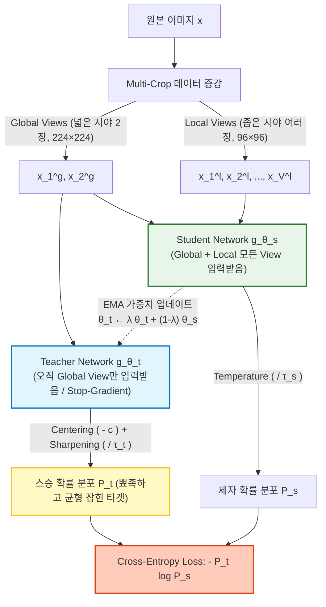

# DINO & DINOv2 (Self-Distillation with No Labels)

> [!abstract] 핵심 파이프라인 & 3줄 요약
> **Single Image $x$ $\xrightarrow{\text{Multi-Crop Augmentation}}$ Global Views ($x^g$) & Local Views ($x^l$) $\xrightarrow{\text{EMA Teacher } g_{\theta_t} \text{ & Student } g_{\theta_s}}$ Self-Distillation Cross-Entropy + iBOT Patch Loss**
> - **한 줄 정의**: 텍스트 캡션이나 사람 손으로 단 라벨을 **단 하나도 쓰지 않고(100% 자기지도학습, Self-Supervised Learning)**, 오직 이미지 자체를 여러 각도로 자른 조각들끼리 **스승(Teacher)-제자(Student) 자기증류(Self-Distillation)** 를 수행해 시각적 본질을 깨우친 Meta AI의 비전 파운데이션 모델이다.
> - **경이로운 창발성(Emergence)**: 누구도 객체의 경계선(Segmentation)이나 3D 깊이(Depth)를 가르쳐주지 않았음에도, 학습이 끝난 [[ViT]]의 어텐션 맵을 찍어보면 **배경과 물체의 윤곽선이 픽셀 단위로 완벽하게 분리**되고 물체의 부위(귀, 코, 손잡이)까지 스스로 정렬된다.
> - **[[VLA]]에서의 결정적 역할**: [[CLIP]]/[[SigLIP]]이 "저건 머그컵이다(의미 파악)"를 담당한다면, **DINOv2는 "머그컵 손잡이가 지금 카메라에서 몇 cm 거리에 어떤 곡률로 꺾여 있는가(3D 공간/기하학 파악)"** 를 담당하여 OpenVLA 등 로봇 모델의 필수 눈으로 쓰인다.

---

## 1. 개요: 왜 CLIP/SigLIP만으로는 부족한가?

[[CLIP]]과 [[SigLIP]]은 이미지와 텍스트 설명글을 대조해 학습한다. 하지만 생각해보자. 인터넷에 사진과 함께 올라온 캡션이 보통 어떻게 생겼는가?
- 캡션 예시: `"오늘 카페에서 마신 맛있는 아메리카노 한 잔 ☕"`
- 이 문장 어디에도 **"컵의 손잡이는 7시 방향을 향하고 있고, 컵 입구의 타원 곡률은 이러하며, 테이블 모서리와 12cm 떨어져 있다"** 같은 픽셀 단위의 기하학적 정보는 적혀 있지 않다!

따라서 텍스트 지도 신호(Language Supervision)에만 의존한 모델은 **"이게 커피잔이다"** 라는 고수준 의미(High-level Semantics)만 남기고, 로봇이 물건을 집거나(Grasping) 3D 공간을 재구성할 때 목숨처럼 중요한 **미세한 위치·방향·깊이·부위별 대응 관계(Fine-grained Spatial Geometry)를 버리는 경향**이 있다.

> [!tip] DINO의 철학: "언어라는 안경을 벗고, 순수하게 이미지의 시각적 구조 자체만 파고들자!"
> 같은 강아지 사진에서 **얼굴만 확대한 조각(Local Crop)** 과 **전신이 다 나온 조각(Global Crop)** 은 똑같은 객체에 속한다. 정답 라벨이 없어도, 전신을 본 스승(Teacher)의 출력 분포를 얼굴만 본 제자(Student)가 똑같이 맞히도록 강제하면, 모델은 살아남기 위해 **물체의 부분(Part)과 전체(Whole)의 기하학적 구조, 배경과 전경의 경계**를 스스로 깨우칠 수밖에 없다.

---

## 2. DINO (v1, 2021) 아키텍처와 수식적 원리

DINO의 이름은 **Self-** **DI**stillation with **NO** labels에서 따왔다. 원래 [[Knowledge Distillation|지식 증류(Knowledge Distillation)]]는 이미 학습된 거대한 스승 모델이 작은 제자 모델을 가르치는 기법이지만, DINO에서는 **구조가 완전히 똑같은 두 [[ViT]]가 학습 도중에 실시간으로 스승과 제자 역할을 나눈다.**

### 2.1. 핵심 수식: 스승과 제자의 확률 분포와 Cross-Entropy
네트워크 $g_\theta$는 백본 $f$ (ViT) 뒤에 3층 MLP와 $L_2$ 정규화, 가중치 정규화 선형층으로 이루어진 **Projection Head $h$** 를 붙여 $K$차원 로짓 벡터(보통 $K = 65,536$)를 출력한다 ($g_\theta = h \circ f$).

제자 네트워크 $g_{\theta_s}$와 스승 네트워크 $g_{\theta_t}$는 각각 온도 파라미터 $\tau_s, \tau_t$를 가진 Softmax를 거쳐 $K$차원 확률 분포 $P_s, P_t$를 만든다.

$$P_s(x)^{(i)} = \frac{\exp\big( g_{\theta_s}(x)^{(i)} / \tau_s \big)}{\sum_{k=1}^{K} \exp\big( g_{\theta_s}(x)^{(k)} / \tau_s \big)}, \qquad P_t(x)^{(i)} = \frac{\exp\big( (g_{\theta_t}(x)^{(i)} - c^{(i)}) / \tau_t \big)}{\sum_{k=1}^{K} \exp\big( (g_{\theta_t}(x)^{(k)} - c^{(k)}) / \tau_t \big)}$$

- 여기서 스승 쪽에만 들어가는 $c \in \mathbb{R}^K$는 붕괴(Collapse)를 막기 위한 **중심 벡터(Center)** 다 (§2.3 참조).

### 2.2. Multi-Crop 전략 (Local-to-Global Correspondence)
한 장의 이미지 $x$로부터 다음과 같이 해상도와 크기가 다른 여러 크롭(View) 집합 $V$를 만든다.
- **Global Views ($\{x_1^g, x_2^g\}$)**: 원본 면적의 $50\% \sim 100\%$를 덮는 큰 조각 2장 ($224 \times 224$).
- **Local Views ($\{x_1^l, \dots, x_M^l\}$)**: 원본 면적의 $5\% \sim 50\%$만 덮는 작은 조각 여러 장 ($96 \times 96$).

**결정적 규칙**: **스승($g_{\theta_t}$)에게는 오직 넓은 시야(Global Views)만 보여주고, 제자($g_{\theta_s}$)에게는 넓은 시야와 좁은 시야(All Views)를 모두 보여준다.** 그리고 서로 다른 뷰 조합에 대해 제자가 스승의 분포를 따라가도록 손실 함수를 정의한다.

$$\mathcal{L}_{\text{DINO}} = \sum_{x \in \{x_1^g, x_2^g\}} \sum_{\substack{x' \in V \\ x' \neq x}} H\big( P_t(x), \, P_s(x') \big) \quad \text{where } H(p, q) = -\sum_{k=1}^{K} p^{(k)} \log q^{(k)}$$

> [!note] 왜 이 수식이 "부분과 전체의 관계"를 학습시키는가?
> 제자($P_s$)는 강아지의 **'귀 끝부분만 잘린 $96\times 96$ 조각($x'$)'** 만 보고도, 스승($P_t$)이 **'강아지 전신과 배경이 다 나온 $224\times 224$ 사진($x$)'** 을 보고 내린 결론을 똑같이 맞혀야 한다. 이를 해내려면 제자는 귀 조각 하나만 보고도 "아, 이건 골든 리트리버의 일부분이구나!"라는 문맥적·기하학적 연결고리를 추론해야만 한다.

---

### 2.3. 최대 난제 해결: 오답(Negative)이 없는데 왜 해가 붕괴(Collapse)하지 않는가?

[[CLIP]] 같은 대조 학습(Contrastive Learning)에서는 오답 쌍(Negative Samples)이 서로를 밀어내기 때문에 모든 출력을 똑같은 상수로 찍는 꼼수(Representation Collapse)를 쓸 수 없다.
하지만 **DINO에는 오답(Negative Sample)이 아예 없다!** 만약 스승과 제자가 담합해서 어떤 이미지가 들어오든 무조건 `[1, 0, 0, ..., 0]`을 출력해 버리면 $\mathcal{L}_{\text{DINO}} = 0$이 되어 학습이 즉시 붕괴한다.

자기지도학습에서 가능한 **두 가지 붕괴 형태**와 DINO가 이를 수학적으로 완벽히 차단한 **3대 방어 기제**는 다음과 같다.

| 붕괴 형태 / 위험 | 현상 설명 | DINO의 방어 기제 (수식) |
| :--- | :--- | :--- |
| **1. 모델 동반 붕괴** | 스승도 제자랑 같이 경사하강법으로 업데이트하면 둘이 손잡고 상수 함수로 수렴함. | **Stop-Gradient + EMA Teacher**: 스승에는 역전파를 끊고(`sg`), 제자 가중치의 **지수이동평균(EMA)** 으로만 천천히 갱신함. $$\theta_t \leftarrow \lambda \theta_t + (1-\lambda)\theta_s \quad (\lambda \approx 0.996 \to 1)$$ |
| **2. Mode Collapse (독점 붕괴)** | 스승이 특정 차원 $k^*$ 하나만 엄청 크게 출력해 항상 원-핫 벡터 $e_{k^*}$로 몰빵됨 (엔트로피 $\to 0$). | **Centering (중심화)**: 스승 로짓에서 배치 평균의 이동평균 $c$를 빼주어($g_{\theta_t}(x) - c$), 특정 차원이 계속 커지면 페널티를 먹여 **균등 분포(Uniform) 쪽으로 밀어냄**. $$c \leftarrow m c + (1-m) \frac{1}{B}\sum_{i=1}^B g_{\theta_t}(x_i)$$ |
| **3. Uniform Collapse (평탄화 붕괴)** | 모든 차원이 똑같이 $1/K$ 확률을 출력해 아무 정보도 담지 않게 됨 (엔트로피 최대). | **Sharpening (예리화)**: 스승의 온도 $\tau_t$를 제자 온도 $\tau_s$보다 훨씬 작게 설정($\tau_t = 0.04 \ll \tau_s = 0.1$)하여 출력 분포를 **강제로 뾰족하게(원-핫에 가깝게) 만듦**. |

> [!tip] Centering과 Sharpening의 절묘한 줄다리기
> - **Centering**은 출력을 평평하게(엔트로피 $\uparrow$) 만들어 **한 차원의 독점을 막고**,
> - **Sharpening**은 출력을 뾰족하게(엔트로피 $\downarrow$) 만들어 **모든 차원이 똑같아지는 것을 막는다.**
> 이 정반대 방향의 두 힘이 완벽한 균형을 이루면서, 오답 샘플이나 배치 간 통신 없이도 $K=65,536$개의 잠재 프로토타입(Prototype) 공간이 골고루 사용된다.

---

## 3. DINOv2 (2023): 픽셀 단위 기하학의 완성

2023년 발표된 **DINOv2**는 기존 DINO(v1)가 이미지 전체를 대표하는 `[CLS]` 토큰에서만 손실을 계산하던 한계를 넘어, **패치(Patch) 단위의 마스크 복원 손실(iBOT)** 과 데이터 정제 파이프라인을 결합해 성능을 극한으로 끌어올렸다.

### 3.1. 이중 목적 함수: Image-level (DINO) + Patch-level (iBOT)
DINOv2의 총 손실 함수는 **전체 이미지 수준**과 **개별 패치 수준**의 자기증류 합이다.

1. **Image-level Objective ($\mathcal{L}_{\text{DINO}}$)**: 기존 DINO와 동일하게 제자와 스승의 **`[CLS]` 토큰** 출력 분포 사이의 Cross-Entropy를 줄인다.
2. **Patch-level Objective ($\mathcal{L}_{\text{iBOT}}$ — Masked Image Modeling)**:
   - 제자에게 들어가는 이미지의 일부 패치들을 임의로 가려서(Masking) 마스크 토큰으로 바꾼다.
   - 스승에게는 가리지 않은 온전한 이미지를 보여준다.
   - 가려진 위치 $i \in \mathcal{M}$에 대해, **제자의 $i$번째 패치 토큰 출력 분포 $P_{s, i}^{\text{patch}}$가 스승의 $i$번째 패치 토큰 출력 분포 $P_{t, i}^{\text{patch}}$를 맞히도록** Cross-Entropy 손실을 부과한다.
   $$\mathcal{L}_{\text{iBOT}} = -\sum_{i \in \mathcal{M}} {P_{t, i}^{\text{patch}}}^\top \log P_{s, i}^{\text{patch}}$$
   - **효과**: `[CLS]` 토큰만 학습할 때보다 **개별 패치 하나하나가 주변 패치와의 기하학적 연속성, 텍스처, 경계선을 훨씬 더 치밀하게 인코딩**하게 된다!

### 3.2. DINOv2의 추가 수학적·시스템적 디테일
- **Sinkhorn-Knopp (SK) Centering**: 기존 이동평균 Centering 대신, 최적 수송(Optimal Transport, SwAV 방식) 알고리즘인 Sinkhorn-Knopp 반복을 통해 배치 내 스승의 출력이 프로토타입들에 정확히 균등 할당되도록 정규화한다.
- **KoLeo (Kozachenko-Leonov) Regularizer**: 배치 안의 이미지 특징 벡터들이 구면 공간에서 서로 너무 뭉치지 않고 골고루 퍼지도록, 가장 가까운 이웃과의 거리에 로그를 취해 최대화하는 미분 가능한 엔트로피 정규화 항을 추가했다.
  $$\mathcal{L}_{\text{KoLeo}} = -\frac{1}{N}\sum_{i=1}^{N} \log \left( \min_{j \neq i} \| \hat{v}_i - \hat{v}_j \|_2 \right)$$
- **Register Tokens (레지스터 토큰 — DINOv2 with Registers)**:
  - 후속 연구(*Vision Transformers Need Registers*, 2024)에서 거대 ViT를 학습시키면 배경처럼 정보가 별로 없는 패치 토큰에 노름(Norm)이 비정상적으로 큰 '쓰레기 전역 정보(Artifact)'가 저장되어 공간 맵을 더럽히는 현상을 발견했다.
  - 이를 해결하기 위해 입력 시퀀스에 출력에는 쓰지 않는 **빈 연습장 토큰(`Register Tokens`, 보통 4개)** 을 추가해 전역 잡동사니 정보를 레지스터가 다 흡수하게 만들었더니, 실제 이미지 패치 토큰들의 어텐션 맵이 유리알처럼 깨끗해졌다.

---

## 4. 왜 VLA(OpenVLA 등)는 SigLIP + DINOv2를 합쳐서 쓰는가?

스탠퍼드의 **OpenVLA**와 그 기반인 **Prismatic VLM** 논문이 증명한 가장 중요한 실험적 발견은 바로 **비전 인코더의 상호보완성(Complementarity)** 이다.

| 특성 비교 | **[[CLIP]] / [[SigLIP]]** (언어 대조 학습) | **DINOv2** (순수 시각 자기증류) |
| :--- | :--- | :--- |
| **학습 신호** | (이미지, 텍스트 캡션) 쌍 | **오직 이미지 내부의 부분-전체 & 패치 복원** |
| **강점 영역** | **What (의미론, Semantics)** "테일러 스위프트 사진", "레드불 캔", 글자 읽기(OCR) | **Where & How (공간 기하학, Geometry)** 물체의 윤곽선, 3D 깊이(Depth), 표면 법선, 부위별 대응(Keypoint Correspondence) |
| **약점 영역** | 물체의 정확한 경계, 방향, 미세한 거리 감각 둔함 | 세상의 고유명사나 추상적·언어적 상식은 모름 |
| **어텐션 맵 형태** | 의미적으로 중요한 일부 영역에만 뭉툭하게 집중 | **물체의 외곽선과 각 부위별로 칼같이 분할됨** |

> [!important] VLA에서의 채널 결합 (Channel-wise Concatenation) 수식
> 로봇이 `"테일러 스위프트 사진 옆에 있는 머그컵의 손잡이를 잡아라"`라는 명령을 수행하려면 **SigLIP의 상식**과 **DINOv2의 3D 공간 감각**이 둘 다 필요하다.
> 따라서 OpenVLA는 입력 이미지 $I$를 두 인코더에 동시에 통과시켜 나온 $M=256$개의 패치 특징을 **토큰 수를 늘리지 않고(LLM 연산량 유지!) 채널(차원) 방향으로 이어 붙여(Concat)** MLP Projector에 넣는다.
> $$Z_{\text{fused}} = \text{Concat}\big( \underbrace{f_{\text{SigLIP}}(I)}_{[256, \, 1152]}, \; \underbrace{f_{\text{DINOv2}}(I)}_{[256, \, 1024]} \big) \in \mathbb{R}^{256 \times 2176} \xrightarrow{\text{MLP}} H_v \in \mathbb{R}^{256 \times 4096}$$

---

## 5. 한 줄 요약

> **DINO & DINOv2 = "라벨도 텍스트도 없이 오직 이미지 조각들 간의 스승-제자 자기증류(Centering+Sharpening)와 패치 복원(iBOT)만으로 물체의 경계선과 3D 기하학적 구조를 스스로 통달한 컴퓨터 비전의 순수 시각 백본"**

---
연관 노트: [[CLIP]], [[SigLIP]], [[ViT]], [[VLA]], [[Knowledge Distillation]]

