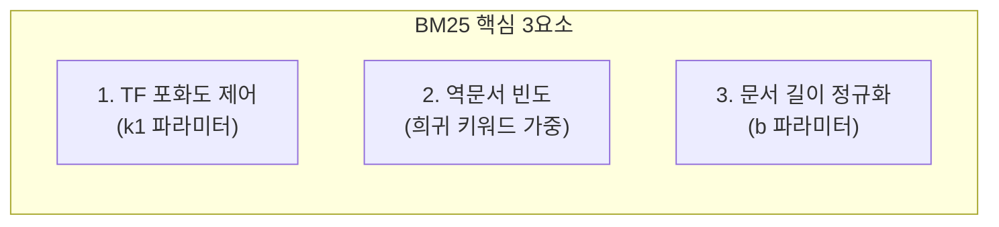
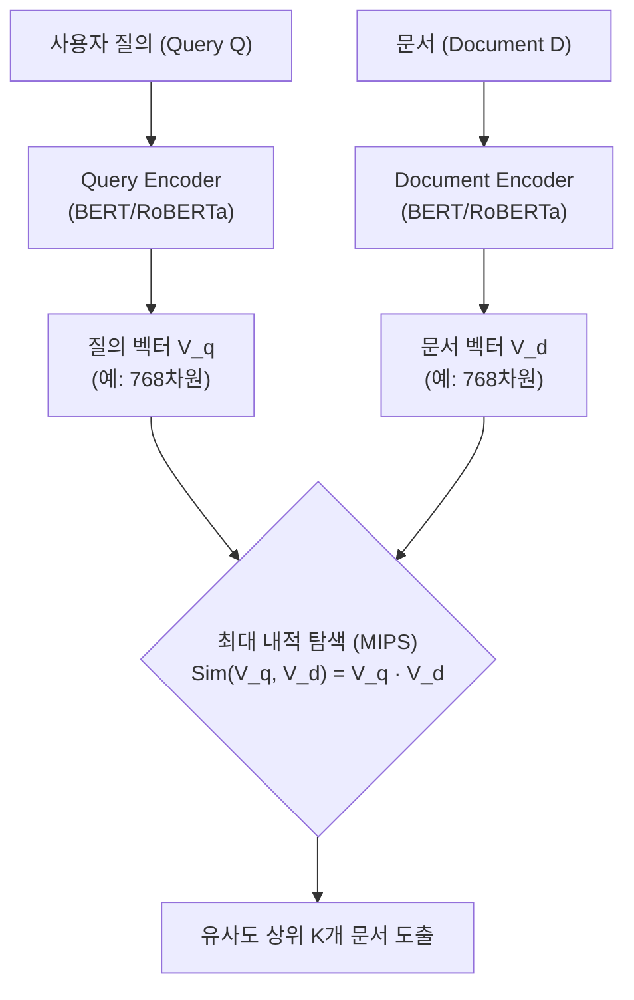
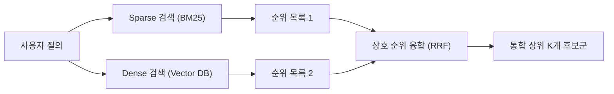

# Retrieval을 위한 임베딩: Sparse vs Dense

> [!abstract] 3줄 요약
> - **Sparse Embedding (희소 임베딩)**: 어휘 빈도 통계를 기반으로 대다수의 차원이 0인 고차원 벡터를 생성하며, 정확한 키워드 매칭(BM25) 및 고유명사 검색에 강하다.
> - **Dense Embedding (밀집 임베딩)**: 트랜스포머 인코더(Bi-encoder)를 통해 문맥과 의미를 저차원(예: 768~1536차원) 실수 공간에 연속적으로 매핑하며, 동의어 및 의미론적 검색에 강하다.
> - **하이브리드 검색 (Hybrid Search)**: 두 방식의 어휘적 갭(Lexical Gap)과 의미 편향(Semantic Drift)을 상호 보완하기 위해 RRF(Reciprocal Rank Fusion) 알고리즘 등으로 결과를 결합하여 사용한다.

---

## 1. Sparse Embedding (희소 표현)

단어(토큰)의 어휘 사전 크기(수만~수십만 차원)에 해당하는 벡터를 구성하되, 실제 문서에 등장하는 단어 위치에만 가중치를 부여하고 나머지는 0으로 채우는 방식이다.

### 1.1. BM25 (Best Matching 25)
전통적인 TF-IDF의 한계를 극복하고 현대 검색 엔진(Elasticsearch, OpenSearch 등)의 기본 랭킹 알고리즘으로 확립된 통계 기반 어휘 매칭 척도다.

$$\text{Score}(D, Q) = \sum_{i=1}^{n} \text{IDF}(q_i) \cdot \frac{f(q_i, D) \cdot (k_1 + 1)}{f(q_i, D) + k_1 \cdot \left(1 - b + b \cdot \frac{|D|}{\text{avgdl}}\right)}$$

- **TF 포화도 제어 ($k_1$)**: 단어 빈도 $f(q_i, D)$가 증가할 때 점수가 선형으로 무한정 증가하지 않고 일정 상한선으로 수렴(포화)하도록 통제한다. (일반적으로 $k_1 \in [1.2, 2.0]$)
- **문서 길이 정규화 ($b$)**: 문서 길이 $|D|$가 전체 평균 문서 길이($\text{avgdl}$)보다 길 경우, 단어가 우연히 많이 등장했을 가능성을 상쇄하기 위해 페널티를 부과한다. ($b \in [0.75]$)
- **IDF (Inverse Document Frequency)**: 전체 말뭉치에 흔하게 등장하는 불용어(the, a, 있다 등)의 영향력을 대폭 깎고, 특정 문서에만 드물게 나타나는 전문 용어나 고유명사에 높은 가중치를 부여한다.

### 1.2. 한계와 진화: SPLADE (Neural Sparse)
- **전통적 BM25의 한계 (Lexical Gap)**:
  - 동의어 미인식: 사용자가 "스마트폰"을 검색했을 때 본문에 "휴대폰"만 적혀 있다면 매칭에 실패한다.
  - 다의어 문맥 무시: "사과(fruit)"와 "사과(apology)"를 동일한 어휘 토큰으로 취급한다.
- **SPLADE (Sparse Lexical and Expansion)**:
  - 언어 모델(BERT 등)의 Masked Language Model 헤드를 이용해 본문에 직접 적혀 있지 않은 관련 동의어까지 예측하여 가중치 벡터에 희소하게 추가(Query/Document Expansion)하는 차세대 신경망 희소 표현법이다.

---

## 2. Dense Embedding (밀집 표현)

문맥 전체의 **의미(Semantics)**를 고정된 차원의 조밀한 실수 벡터 공간으로 사상(mapping)하는 방식이다.

### 2.1. 핵심 아키텍처: Bi-encoder (Twin Tower)

^f0d2cc

Dense Embedding 검색의 표준 아키텍처는 **Bi-encoder**다. 질의와 문서를 각각 독립된 인코더(또는 가중치를 공유하는 샴 네트워크)에 통과시켜 단일 벡터로 인코딩한 후, 두 벡터의 내적(Dot Product)이나 코사인 유사도를 비교한다.

1. **사전 색인(Pre-indexing)의 압도적 효율성**: 수억 건의 문서 벡터($V_d$)를 사전에 계산하여 벡터 데이터베이스(HNSW, IVF 색인)에 적재해둘 수 있다.
2. **실시간 질의 처리**: 사용자의 입력 질의 $Q$가 유입되었을 때 단 한 번의 인코딩으로 $V_q$를 생성한 뒤, 고속 최근접 이웃 탐색(ANN)을 통해 밀리초(ms) 단위로 후보군을 검색한다.

### 2.2. 장점과 취약점
- **장점 (Semantic Retrieval)**:
  - 어휘가 한 단어도 겹치지 않아도 문맥의 의미가 일치하면 정밀하게 탐색한다. ("배고플 때 간편하게 먹는 음식" $\to$ "김밥", "샌드위치" 검색 성공)
  - 다국어 교차 검색(Cross-lingual Retrieval)이 가능하다.
- **취약점 (Semantic Drift & Information Bottleneck)**:
  - **키워드 정확도 하락**: 제품 모델명("Galaxy S24 Ultra"), 법령 조항 번호("제15조 제2항") 등 한 글자만 틀려도 완전히 다른 대상이 되는 정밀 식별에 취약하여 유사 제품("Galaxy S23")을 가져오는 오작동이 발생한다.
  - **정보 병목**: 수백 단어로 구성된 문서를 고정된 768차원 벡터 하나로 압축하는 과정에서 세부적인 수치나 조건문 정보가 희석된다.

---

## 3. 하이브리드 검색 (Hybrid Search) 및 순위 통합

현대 RAG 엔지니어링에서는 단일 방식을 고집하지 않고, Sparse(BM25)의 키워드 매칭력과 Dense(Bi-encoder)의 의미 파악력을 결합한 **하이브리드 검색(Hybrid Search)**을 기본 표준으로 채택한다.

### 3.1. RRF (Reciprocal Rank Fusion) 알고리즘
서로 다른 검색 엔진이 산출하는 점수(BM25 스코어 vs 코사인 유사도)는 점수 스케일과 분포가 전혀 다르므로 단순 가산이 불가능하다. RRF는 점수 수치 대신 **각 검색 결과에서의 '순위(Rank)'만을 기반으로 결합 점수를 계산**하여 스케일 의존성을 제거한다.

$$\text{RRF\_Score}(d) = \sum_{m \in M} \frac{1}{k + r_m(d)}$$

- $M$: 결합할 검색기 집합 (예: Sparse, Dense)
- $r_m(d)$: 검색기 $m$에서 문서 $d$가 기록한 순위 (1-indexed)
- $k$: 순위 가중치 평활화 상수 (통상 $k = 60$ 설정)

어느 한쪽 검색기에서라도 최상위권(Rank 1~3)에 올랐거나, 양쪽 검색기에서 고르게 중상위권을 차지한 문서가 최종 상위권에 배치되어 최적의 재현율(Recall)을 달성한다.

---

## 4. 특성 비교 요약

| 비교 항목 | Sparse Embedding (BM25) | Dense Embedding (Bi-encoder) |
|---|---|---|
| **매칭 메커니즘** | 어휘 일치 (Lexical Matching) | 의미 유사도 (Semantic Matching) |
| **벡터 차원 및 성격** | 초고차원(수만~수십만), 대다수가 0 | 저차원(768~1536), 연속 실수 밀집 |
| **주요 강점** | 고유명사, 부품 번호, 약어, 특수 용어 식별 | 문맥 이해, 동의어/유의어 처리, 자연어 질문 |
| **주요 약점** | 어휘 갭(Lexical Gap), 다의어 분별 불가 | 도메인 외 데이터 성능 저하, 키워드 정밀성 부족 |
| **학습 요구 여부** | 불필요 (말뭉치 통계만으로 즉시 구축) | 대규모 텍스트 쌍 기반 사전학습 및 미세조정 필수 |
| **권장 활용처** | 1차 키워드 필터링, 정밀 고유명사 탐색 | 범용 시맨틱 검색, 자연어 대화형 질의응답 |

