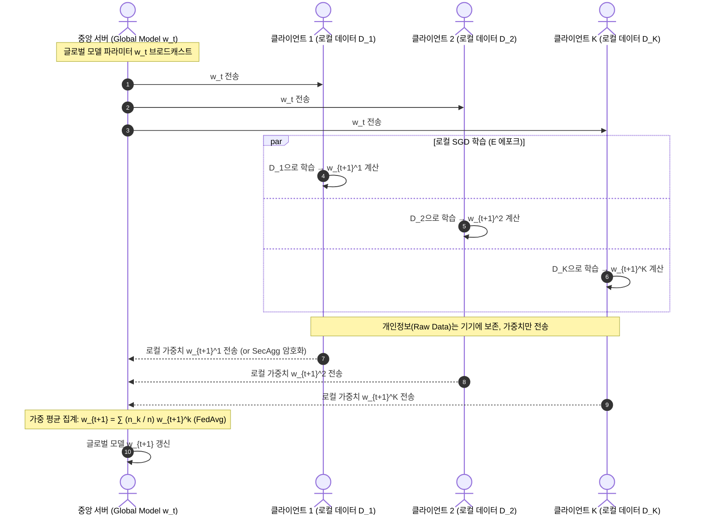
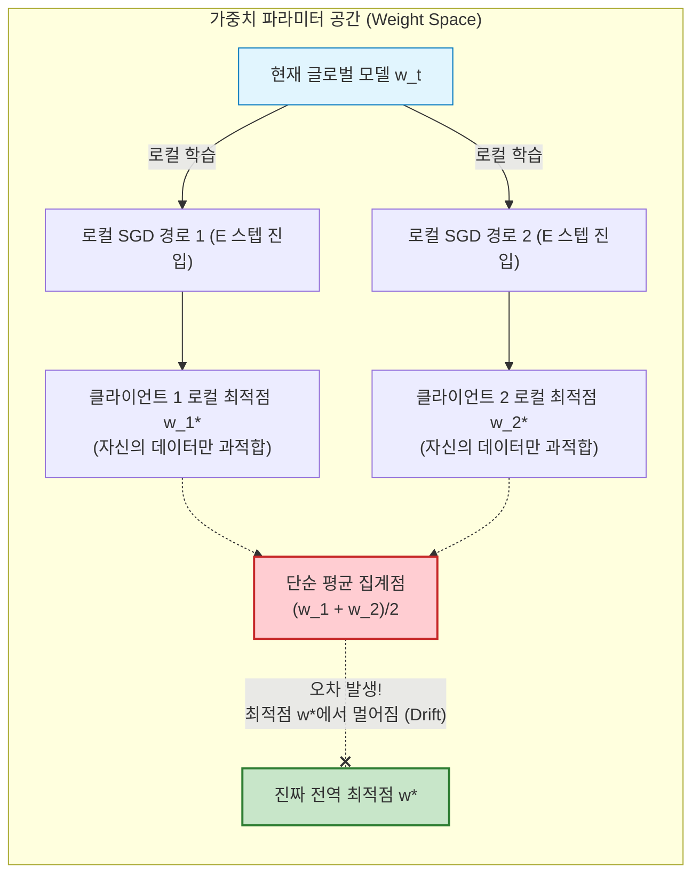
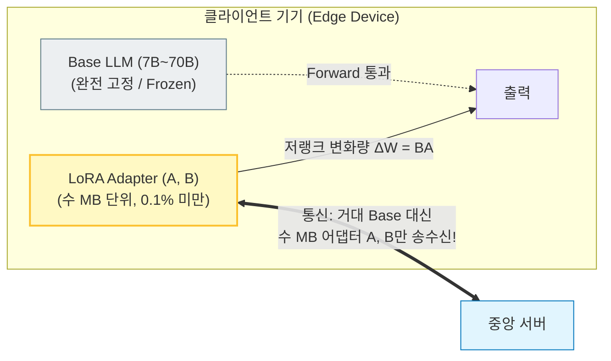

# Federated Learning (연합 학습)

> [!abstract] 핵심 개념 & 3줄 요약
> - **데이터 이동 없는 분산 협업 학습 (Data-Centric Privacy)**: 원시 데이터(Raw data)를 중앙 서버로 전송하지 않고, 사용자의 엣지 디바이스(스마트폰, IoT, 병원 등)에 둔 채 **로컬에서 모델을 학습하고 파라미터(또는 그래디언트) 변화량만 중앙 서버로 전송하여 취합(Aggregation)** 하는 분산 머신러닝 패러다임이다 (McMahan et al., Google 2017).
> - **최대 난제: 통계적 이질성(Non-IID)과 클라이언트 드리프트(Client Drift)**: 각 기기마다 수집되는 데이터 분포 $P_k(x, y)$가 상이하여 로컬 최적점들이 서로 다른 방향을 가리키는 **클라이언트 드리프트** 현상이 발생하며, 이를 제어하기 위해 **FedProx(근접항 제약)**, **SCAFFOLD(제어 변수 분산 감소)**, **FedOpt(서버 적응형 최적화)** 등의 알고리즘이 등장했다.
> - **프라이버시 & LLM 시대의 확장**: 단순 가중치 전송도 그래디언트 역변환 공격(DLG)에 취약할 수 있어 **차분 프라이버시(DP)** 와 **보안 집계(Secure Aggregation)** 가 필수 결합되며, 거대 언어모델 시대에는 통신 비용을 $\frac{1}{1000}$로 절감하는 **FedLoRA(Federated PEFT)** 로 진화하고 있다.

---

## 1. 개요: 데이터 센터 분산 학습 vs 연합 학습

기존 [[분산 GPU 훈련|분산 GPU 훈련(Data Parallelism)]]과 연합 학습(Federated Learning)은 "여러 노드가 힘을 합쳐 모델을 학습한다"는 점은 같지만, **가정하는 환경과 제약 조건이 근본적으로 상반**된다.

| 비교 항목 | **데이터 센터 분산 학습 (Data Parallelism)** | **연합 학습 (Federated Learning)** |
| :--- | :--- | :--- |
| **데이터 위치** | 단일 데이터 센터 내 고속 스토리지 | 전 세계 수천~수백만 대의 **분산 엣지 기기 / 기관** |
| **데이터 분포** | 셔플링을 통해 **IID (독립 동등 분포)** 로 배분 | **극심한 Non-IID** (기기/유저마다 행동 패턴 상이) |
| **통신 환경** | NVLink, InfiniBand (초고속 저지연, 테라비트급) | 상용 Wi-Fi, 4G/5G (불안정, 패킷 손실, 비대칭 대역폭) |
| **클라이언트 신뢰도** | 신뢰 가능한 워커 노드 (노드 이탈 거의 없음) | 비정상 종료, 스트래글러(지연 기기), 악의적 노드 빈번 |
| **핵심 제약 조건** | 계산 속도(FLOPs)와 처리량(Throughput) 극대화 | **통신 병목(Communication Cost)** 및 **프라이버시(Privacy)** |
| **동기화 주기** | 매 미니배치마다 그래디언트 AllReduce | 로컬에서 여러 에포크($E$) 학습 후 **수십~수백 라운드마다 1회 동기화** |

---

## 2. 기본 수식 체계와 FedAvg (Federated Averaging)

### 2.1. 연합 최적화 목적함수
전체 $K$개의 클라이언트가 존재하고, 각 클라이언트 $k$가 $n_k$개의 로컬 데이터셋 $\mathcal{D}_k$를 보유하고 있다고 하자 (총 데이터 수 $n = \sum_{k=1}^K n_k$).
연합 학습의 목표는 **모든 클라이언트의 로컬 목적함수 $F_k(w)$의 데이터 수 비례 가중합을 최소화하는 전역 파라미터 $w$** 를 찾는 것이다:

$$\min_{w \in \mathbb{R}^d} \; f(w) = \sum_{k=1}^K \frac{n_k}{n} F_k(w), \qquad \text{where} \quad F_k(w) = \frac{1}{n_k} \sum_{x \in \mathcal{D}_k} \ell(w; x)$$

### 2.2. FedAvg 알고리즘 (McMahan et al., 2017)
단순한 분산 SGD(FedSGD)는 매 배치마다 통신해야 하므로 엣지 환경에서 불가능하다. **FedAvg**는 각 기기가 통신 없이 **로컬에서 $E$ 에포크 동안 SGD를 여러 스텝 돌린 뒤, 결과 가중치만 서버로 올려 가중 평균**하는 핵심 아이디어를 제시했다.

1. **클라이언트 샘플링**: 통신 라운드 $t$에서 서버는 활성 클라이언트 중 부분집합 $S_t \subseteq [K]$ ($|S_t| = m = C \cdot K$, 통상 $C \in (0, 1]$)를 무작위 선택한다.
2. **서버 $\to$ 클라이언트 배포**: 선택된 클라이언트들에게 현재 글로벌 모델 $w_t$를 전송한다.
3. **로컬 업데이트 (Local SGD)**: 각 클라이언트 $k \in S_t$는 $w_{t, 0}^k = w_t$로 초기화한 후, 로컬 배치 크기 $B$, 학습률 $\eta$로 $E$ 에포크 동안 SGD를 수행한다:
   $$w_{t, \tau+1}^k = w_{t, \tau}^k - \eta \nabla F_k(w_{t, \tau}^k), \qquad \tau = 0, 1, \dots, H-1$$
   (최종 로컬 모델을 $w_{t+1}^k$라 하자.)
4. **서버 취합 (Server Aggregation)**: 서버는 수신된 가중치들을 데이터 크기 비율로 가중 평균하여 다음 글로벌 모델 $w_{t+1}$을 구성한다:
   $$w_{t+1} = \sum_{k \in S_t} \frac{n_k}{n_{S_t}} w_{t+1}^k \quad \left( n_{S_t} = \sum_{k \in S_t} n_k \right)$$

> [!note] 의사 그래디언트(Pseudo-Gradient)와 서버 최적화 관점
> 클라이언트 $k$의 로컬 변화량을 $\Delta_t^k := w_t - w_{t+1}^k$라 두면, 서버 집계식은 다음과 같이 고쳐 쓸 수 있다:
> $$w_{t+1} = w_t - \sum_{k \in S_t} \frac{n_k}{n_{S_t}} \Delta_t^k = w_t - \eta_g \Delta_t \qquad \left(\Delta_t := \sum_{k \in S_t} \frac{n_k}{n_{S_t}} \Delta_t^k, \;\; \eta_g = 1\right)$$
> 즉, $\Delta_t$는 전역 모델이 나아가야 할 **"의사 그래디언트(Pseudo-Gradient)"** 역할을 한다. 여기에 서버 측 모멘텀이나 Adam 업데이트를 얹은 것이 §4.3의 **FedOpt**다!

---

## 3. 핵심 난제: 통계적 이질성(Non-IID)과 클라이언트 드리프트(Client Drift)

데이터가 IID(독립 균일 분포)일 때는 FedAvg가 중앙 집중식 SGD와 유사하게 매우 잘 수렴한다. 하지만 **현실의 데이터는 극단적인 Non-IID**다:
- **라벨 분포 왜곡 (Label Distribution Skew)**: 병원 A는 흉부 질환 데이터만, 병원 B는 소화기 질환 데이터만 보유.
- **특징 분포 왜곡 (Feature Distribution Skew)**: 스마트폰 키보드 예측에서 유저 A는 영문, 유저 B는 한글 입력 위주.

### 3.1. 클라이언트 드리프트 (Client Drift)의 기하학
Non-IID 환경에서는 각 클라이언트의 로컬 목적함수 최소점 $w_k^* = \arg\min F_k(w)$와 전역 최적점 $w^* = \arg\min f(w)$가 **서로 완전히 다른 위치**에 존재한다. 즉,
$$\nabla F_k(w^*) \neq \mathbf{0} \quad \text{even though} \quad \sum_{k=1}^K \frac{n_k}{n} \nabla F_k(w^*) = \mathbf{0}$$

로컬 에포크 $E$가 클수록 각 클라이언트는 전역 최적점 $w^*$ 방향이 아니라 **자신의 편향된 로컬 최적점 $w_k^*$를 향해 깊숙이 이동(Drift)** 한다. 이렇게 서로 다른 방향으로 크게 벌어진 가중치들을 단순히 산술 평균하면:
1. 목적함수 $f(w)$가 급격히 진동하거나 발산한다.
2. 수렴하더라도 전역 최적점이 아닌 **열등한 타협점**에 갇힌다.
3. [[Model Merging]] 관점에서 보았을 때, 너무 멀리 떨어진 두 가중치는 Linear Mode Connectivity(동일 골짜기 Basin)를 벗어나 산봉우리(High Loss Barrier)로 떨어진다!

---

## 4. 클라이언트 드리프트 해결 알고리즘

### 4.1. FedProx: 근접항 제약을 통한 이탈 방지 (Li et al., 2020)
클라이언트가 현재 글로벌 모델 $w_t$로부터 너무 멀리 도망가지 못하도록, 로컬 목적함수에 **$L_2$ 근접 제약(Proximal Term)** 을 추가한다 ([[08. Subgradient & Proximal Methods]] 및 [[06. Duality Theory & KKT Conditions]] 참조):

$$\min_{w} \; h_k(w; w_t) = F_k(w) + \frac{\mu}{2} \|w - w_t\|_2^2$$

- **수학적 역할**: $\mu > 0$ 파라미터가 로컬 손실곡면을 강볼록($\mu$-Strongly Convex)하게 만들어 해의 안정성을 부여하고, 이동 반경을 $\|w - w_t\|_2 \approx \mathcal{O}(1/\mu)$로 구속한다.
- **시스템 이질성(Straggler) 해결**: 기기 성능에 따라 완벽한 $E$ 에포크를 못 채우고 도중에 반환된 부분 학습 결과(Inexact solution)도 이론적으로 수렴성이 보장된다.

### 4.2. SCAFFOLD: 제어 변수(Control Variates)를 통한 드리프트 교정 (Karimireddy et al., 2020)
근접항으로 이동을 억제하는 대신, **"로컬 그래디언트의 방향 자체를 전역 그래디언트 방향으로 직접 교정"** 하는 기법이다. 분산 감소(Variance Reduction) 기법의 아이디어를 연합 학습으로 확장했다.
- 각 클라이언트는 로컬 제어 변수 $c_k$, 서버는 전역 제어 변수 $c = \frac{1}{K}\sum_k c_k$를 유지한다.
- 클라이언트 $k$의 로컬 SGD 업데이트 시 그래디언트에 드리프트 보정 벡터 **$(c - c_k)$** 를 더해준다:
  $$g_k^{\text{corr}}(w) = \nabla F_k(w) - c_k + c$$
- $w = w^*$일 때 $\nabla F_k(w^*) \approx c_k$이고 $c \approx \mathbf{0}$이 되므로, **클라이언트의 로컬 그래디언트가 0이 아니더라도 보정된 그래디언트는 정확히 0이 되어 드리프트 없이 전역 최적점에 안착**한다!
- **단점**: 클라이언트와 서버가 모델 크기 $d$와 동일한 크기의 제어 변수 $c_k, c$를 추가로 저장하고 통신해야 하므로 메모리·통신 오버헤드가 2배가 된다.

### 4.3. FedOpt: 서버 적응형 최적화 프레임워크 (Reddi et al., 2021)
로컬 업데이트 결과로 생성된 의사 그래디언트 $\Delta_t = w_t - \sum_k \frac{n_k}{n} w_{t+1}^k$를 일반 그래디언트처럼 취급하여, **서버 측에서 [[Optimizer|모멘텀(Momentum)이나 Adam]] 알고리즘을 수행**한다.

| 알고리즘 | 서버 업데이트 방식 | 비고 |
| :--- | :--- | :--- |
| **FedAvg** | $w_{t+1} = w_t - \Delta_t$ | $\eta_g = 1$, 모멘텀 없음 |
| **FedAvgM** | $v_{t+1} = \beta v_t + \Delta_t, \quad w_{t+1} = w_t - \eta_g v_{t+1}$ | 서버 모멘텀으로 진동 억제 |
| **FedAdam** | $m_t = \beta_1 m_{t-1} + (1-\beta_1)\Delta_t, \; v_t = \beta_2 v_{t-1} + (1-\beta_2)\Delta_t^2$   $w_{t+1} = w_t - \eta_g \frac{m_t}{\sqrt{v_t} + \epsilon}$ | 좌표별 학습률 적응(희소 파라미터에 강건) |

---

## 5. 프라이버시 보호 및 보안 취약점

> [!warning] "가중치만 공유하면 데이터가 안전하다"는 것은 환상이다!
> 딥러닝 모델의 가중치/그래디언트는 학습 데이터의 정보를 고스란히 담고 있다. 공격자가 서버 가중치 변화량 $\nabla W$를 가로채면, 더미 입력을 역최적화하여 원본 픽셀과 텍스트를 거의 완벽히 복원해내는 **Deep Leakage from Gradients (DLG)** 공격이 가능하다.

이를 원천 차단하기 위해 연합 학습은 아래 두 가지 암호학·통계학적 보호벽을 함께 세운다:

### 5.1. 차분 프라이버시 (Differential Privacy, DP-FedAvg)
각 클라이언트가 전송하기 전, 가중치 변화량에 노이즈를 섞어 **"특정 개인의 데이터가 포함되었는지 여부를 수학적으로 구별 불가능($(\epsilon, \delta)$-DP)"** 하게 만든다 ([[Probability Inequalities]] 참조).
1. **L2 Norm Clipping**: 개별 기기의 영향력을 제한하기 위해 그래디언트 노름을 상한 $S$로 자른다: $\bar{\Delta}_k = \Delta_k / \max\left(1, \frac{\|\Delta_k\|_2}{S}\right)$.
2. **가우시안 노이즈 주입**: $\tilde{\Delta} = \sum_k \bar{\Delta}_k + \mathcal{N}\left(0, \sigma^2 S^2 I\right)$.
- **트레이드오프**: 프라이버시 보장 지수($\epsilon \downarrow$)를 강화할수록 노이즈가 커져 모델 최종 정확도가 하락한다.

### 5.2. 보안 집계 (Secure Aggregation, SecAgg)
서버가 개별 클라이언트의 가중치 $w^k$를 절대 볼 수 없고, 오직 **최종 합산된 $\sum_k w^k$만 볼 수 있도록 하는 다자간 연산(MPC, Shamir's Secret Sharing 기반) 프로토콜**이다.
- 클라이언트 $i$와 $j$ 사이에 공유된 난수 마스크 $r_{i, j} = -r_{j, i}$를 생성하여 자신의 모델에 더해 전송한다:
  $$y_i = w^i + \sum_{j > i} r_{i, j} - \sum_{j < i} r_{j, i}$$
- 서버가 모든 수신 벡터를 단순히 더하면 마스크 항들이 서로 상쇄($r_{i,j} - r_{i,j} = 0$)되어 오직 원본의 합 $\sum_i w^i$만 투명하게 복원된다!

---

## 6. LLM 시대의 연합 학습: FedLoRA & PEFT

수십억 개의 파라미터를 가진 거대 언어모델(LLM, 7B~70B)을 모바일 기기나 로컬 서버에서 연합 학습하는 것은 불가능해 보인다. 수십 GB의 가중치를 업/다운로드하는 통신 비용과 메모리를 감당할 수 없기 때문이다.
이 병목을 부순 돌파구가 **연합 파라미터 효율적 미세조정(Federated PEFT / FedLoRA)** 이다.

1. **원리**: 사전학습된 거대 백본 $W_0$는 클라이언트 디바이스에 양자화(INT4/INT8)된 상태로 고정(Freeze)해 두고, 학습 가능한 **[[LoRA]] 저랭크 어댑터 행렬 $A \in \mathbb{R}^{r \times d}, B \in \mathbb{R}^{k \times r}$ ($r \ll d$)만 로컬에서 학습하여 서버와 주고받는다.**
2. **이점**:
   - 통신 및 저장 오버헤드가 기존 Full Parameter 대비 **$99\%$ 이상 급감**한다 (수십 GB $\to$ 수 MB).
   - 클라이언트의 역전파 메모리 점유율이 획기적으로 낮아져 단일 컨슈머 GPU나 모바일 NPU에서도 미세조정이 가능해진다.
3. **주의점 (LoRA 집계의 비선형성)**: 각 클라이언트가 독립적으로 학습한 저랭크 행렬 $B_k A_k$를 단순 평균하는 것은 랭크가 최대 $K \cdot r$로 팽창할 수 있으므로, $A$ 행렬을 고정하고 $B$만 병합하거나 SVD 기반 저랭크 절단(SVD Truncation) 기법을 함께 적용한다.

---

## 7. 연합 학습 알고리즘 총비교

| 알고리즘 | 핵심 메커니즘 | 통계적 이질성(Non-IID) 내성 | 통신/메모리 오버헤드 | 대표 특징 및 용도 |
| :--- | :--- | :--- | :--- | :--- |
| **FedAvg** | 로컬 $E$ 에포크 SGD 후 가중 산술 평균 | 취약 (Client Drift 심함) | **기준 ($\mathcal{O}(d)$)** | 연합 학습의 시초, IID 환경에서 표준 |
| **FedProx** | 로컬 손실에 근접항 $\frac{\mu}{2}\|w - w_t\|^2$ 추가 | 양호 (이동 반경 제약) | $\mathcal{O}(d)$ (추가 통신 없음) | 스트래글러(부분 완료 노드) 처리에 탁월 |
| **SCAFFOLD** | 제어 변수 $c_k, c$로 그래디언트 방향 보정 | **매우 우수** (수학적 편향 제거) | 높음 (변수 $2\times$, $\mathcal{O}(2d)$) | 통신 대역폭이 충분한 크로스-사일로(병원 간) 최적 |
| **FedOpt (FedAdam)** | 의사 그래디언트 $\Delta_t$에 서버 측 적응형 옵티마이저 | 우수 | $\mathcal{O}(d)$ (서버 메모리만 증가) | 대규모 크로스-디바이스 실무 표준 |
| **FedLoRA** | 백본 고정 후 LoRA 저랭크 행렬($A, B$)만 집계 | 양호 | **극도로 낮음 ($\mathcal{O}(r \cdot d)$)** | LLM / VLM 엣지 온디바이스 미세조정 |

---

## 8. 한 줄 요약

> **연합 학습(Federated Learning)은 데이터를 중앙으로 모으지 않고 모델을 엣지로 보내 분산 학습하는 프라이버시 중심 AI 패러다임이며, Non-IID로 인한 클라이언트 드리프트를 근접항·제어변수로 제어하고 LoRA를 결합하여 거대 언어모델 시대의 표준 분산 미세조정 기술로 안착했다.**

---
연관 노트: [[분산 GPU 훈련]], [[Optimizer]], [[Model Merging]], [[LoRA]], [[08. Subgradient & Proximal Methods]], [[Probability Inequalities]]

