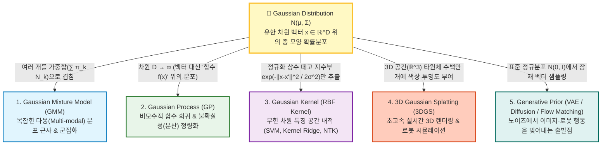

# Gaussian Distribution (가우시안 분포 / 정규분포)

> [!abstract] 핵심 개념 & 3줄 요약
> $$x \sim \mathcal{N}(\mu, \Sigma) \iff p(x) = \frac{1}{(2\pi)^{D/2} |\Sigma|^{1/2}} \exp\left( -\frac{1}{2}(x - \mu)^\top \Sigma^{-1} (x - \mu) \right)$$
> - **한 줄 정의**: 평균 벡터 $\mu$(중심 위치)와 공분산 행렬 $\Sigma$(퍼짐의 크기와 방향) **단 두 개의 파라미터(1차·2차 모멘트)만으로 완전히 결정**되는 연속 확률 분포의 제왕이다.
> - **왜 AI/수학은 온통 Gaussian인가?**: ① 독립적인 잡음들을 더하면 무조건 가우시안으로 수렴하고(**중심극한정리**), ② 평균과 분산만 알 때 가장 편견(가정)이 없는 분포이며(**최대 엔트로피 원리**), ③ 더하고·자르고·조건을 걸어도 여전히 가우시안으로 남는(**연산에 대한 닫힘 성질**) 유일무이한 수학적 축복을 받았기 때문이다.
> - **'Gaussian 어쩌구' 족보의 뿌리**: 이 분포 하나에서 차원을 무한대로 늘리면 **[[Gaussian Process]]**, 여러 개를 섞으면 **[[Gaussian Mixture Model]]**, 지수부만 떼어내 유사도로 쓰면 **[[Gaussian Kernel]]**, 3차원 공간에 색깔 입혀 뿌리면 **[[Gaussian Splatting]]** 이 된다.

---

## 1. 한눈에 보는 'Gaussian 어쩌구' 대백과 지도

머신러닝과 로보틱스 논문을 읽다 보면 온갖 곳에 `Gaussian`이라는 단어가 붙어 나온다. 이름은 비슷하지만 쓰임새가 완전히 다른 **5대 Gaussian 패밀리**의 관계를 먼저 정리하자.

---

## 2. 1차원에서 $D$차원 다변량 가우시안(MVN)으로의 확장

### 2.1. 단변량 정규분포 (Univariate Gaussian, $D=1$)
스칼라 확률변수 $x \in \mathbb{R}$가 평균 $\mu \in \mathbb{R}$, 분산 $\sigma^2 > 0$인 정규분포를 따를 때의 확률밀도함수(PDF)는 다음과 같다.
$$\mathcal{N}(x \mid \mu, \sigma^2) = \frac{1}{\sqrt{2\pi \sigma^2}} \exp\left( -\frac{(x - \mu)^2}{2\sigma^2} \right)$$
- 앞의 $\frac{1}{\sqrt{2\pi\sigma^2}}$는 전체 적분값 $\int_{-\infty}^\infty p(x)dx = 1$을 맞춰주기 위한 **정규화 상수(Normalizing Constant)** 다 (가우스 적분 $\int_{-\infty}^\infty e^{-z^2/2}dz = \sqrt{2\pi}$에서 유래).

### 2.2. 다변량 정규분포 (Multivariate Gaussian, $x \in \mathbb{R}^D$)
데이터가 $D$차원 열벡터 $x = [x_1, x_2, \dots, x_D]^\top \in \mathbb{R}^D$가 되면, 스칼라 평균은 평균 벡터 $\mu \in \mathbb{R}^D$로, 스칼라 분산 $\sigma^2$은 대칭 양의 정부호(Symmetric Positive Definite, SPD) **공분산 행렬 $\Sigma \in \mathbb{R}^{D \times D}$** 로 확장된다.

$$\mathcal{N}(x \mid \mu, \Sigma) = \frac{1}{(2\pi)^{D/2} |\Sigma|^{1/2}} \exp\left( -\frac{1}{2} \underbrace{(x - \mu)^\top \Sigma^{-1} (x - \mu)}_{\text{마할라노비스 거리의 제곱 } \Delta^2} \right)$$

- $\mu = \mathbb{E}[x] \in \mathbb{R}^D$: 분포의 중심 좌표.
- $\Sigma = \mathbb{E}[(x-\mu)(x-\mu)^\top] \in \mathbb{R}^{D \times D}$: 공분산 행렬. 대각 원소 $\Sigma_{ii} = \text{Var}(x_i)$는 각 축의 분산이고, 비대각 원소 $\Sigma_{ij} = \text{Cov}(x_i, x_j)$는 두 변수 간의 선형 상관관계다.
- $|\Sigma| = \det(\Sigma)$: 공분산 행렬의 행렬식(Determinant). 기하학적으로 분포가 차지하는 **부피(Volume)의 제곱**에 비례한다.
- $\Lambda = \Sigma^{-1}$: 공분산의 역행렬을 **정밀도 행렬(Precision Matrix)** 이라 부른다.

---

## 3. 기하학적 해부: 마할라노비스 거리와 타원체 등고선

다변량 가우시안 수식의 지수 어깨 위에 있는 이차형식(Quadratic Form) $\Delta^2 = (x - \mu)^\top \Sigma^{-1} (x - \mu)$는 단순한 유클리드 거리 $\|x - \mu\|_2^2$가 아니라 **마할라노비스 거리(Mahalanobis Distance)** 의 제곱이다.

### 3.1. 공분산 행렬의 고유값 분해 (Eigendecomposition)
$\Sigma$는 실수 대칭 양의 정부호 행렬이므로, 직교하는 고유벡터 행렬 $U = [u_1, \dots, u_D]$ ($U^\top U = I$)와 양수 고유값 대각행렬 $\Lambda_{\text{eig}} = \text{diag}(\lambda_1, \dots, \lambda_D)$로 분해된다.

$$\Sigma = U \Lambda_{\text{eig}} U^\top = \sum_{d=1}^{D} \lambda_d u_d u_d^\top \implies \Sigma^{-1} = U \Lambda_{\text{eig}}^{-1} U^\top = \sum_{d=1}^{D} \frac{1}{\lambda_d} u_d u_d^\top$$

이를 마할라노비스 거리 식에 대입하고, 새로운 좌표계 $y_d = u_d^\top (x - \mu)$ (고유벡터 축으로 회전 이동한 좌표)를 정의하면 놀라운 결과가 나온다.

$$\Delta^2 = (x - \mu)^\top \left( \sum_{d=1}^{D} \frac{1}{\lambda_d} u_d u_d^\top \right) (x - \mu) = \sum_{d=1}^{D} \frac{\big(u_d^\top (x - \mu)\big)^2}{\lambda_d} = \sum_{d=1}^{D} \frac{y_d^2}{\lambda_d}$$

> [!tip] 기하학적 직관 ([[주성분 분석 (PCA)]] 및 [[Gaussian Splatting]]과의 직결!)
> $\sum_{d=1}^D \frac{y_d^2}{\lambda_d} = \text{const}$는 정확히 **$D$차원 초타원체(Hyper-ellipsoid)의 방정식**이다!
> - **고유벡터 $u_d$**: 타원체가 기울어진 **회전축 방향(Principal Axes)**.
> - **고유값의 제곱근 $\sqrt{\lambda_d}$**: 해당 축 방향의 **반지름 길이(표준편차)**.
> 즉, 다변량 가우시안은 표준 정규분포 공($\mathcal{N}(0, I)$)을 각 축으로 $\sqrt{\lambda_d}$배 늘리고(Scaling), $U$만큼 회전(Rotation)시킨 뒤, $\mu$만큼 평행이동(Translation)한 것이다. **[[Gaussian Splatting]]** 에서 3D 가우시안의 공분산을 회전 $R$과 스케일 $S$로 쪼개는($\Sigma = R S S^\top R^\top$) 이유가 바로 이 수학적 구조 때문이다!

---

## 4. 왜 세상은 온통 가우시안인가? (3대 수학적 이유)

### 4.1. 중심극한정리 (Central Limit Theorem, CLT)
각 확률변수 $X_1, X_2, \dots, X_n$이 **어떤 괴상한 분포를 따르든 상관없이**(평균 $\mu$, 유한 분산 $\sigma^2$만 존재하면), 이들을 독립적으로 뽑아 평균 낸 값의 분포는 $n \to \infty$일 때 무조건 표준 정규분포로 수렴한다.
$$\frac{\bar{X}_n - \mu}{\sigma / \sqrt{n}} = \frac{\sum_{i=1}^n X_i - n\mu}{\sqrt{n}\sigma} \xrightarrow{d} \mathcal{N}(0, 1)$$
- 자연계의 오차(측정 노이즈, 열잡음 등)는 수많은 미세한 독립 요인들의 합이므로 필연적으로 가우시안 분포를 띠게 된다.

### 4.2. 최대 엔트로피 원리 (Maximum Entropy Principle)
우리가 어떤 미지의 데이터에 대해 **평균 $\mu$와 공분산 $\Sigma$ 딱 두 가지만 알고 있다**고 치자. 이 제약조건을 만족하는 무수히 많은 확률 분포 $p(x)$ 중에서 **정보 엔트로피 $H(p) = -\int p(x) \log p(x) dx$를 최대화하는 분포(즉, 우리가 모르는 것에 대해 가장 임의의 가정이나 편견을 덜 집어넣은 분포)** 를 라그랑주 승수법으로 구해보면 **유일한 해가 바로 가우시안 분포 $\mathcal{N}(\mu, \Sigma)$** 다!
$$H\big(\mathcal{N}(\mu, \Sigma)\big) = \frac{1}{2} \log \left( (2\pi e)^D |\Sigma| \right) \ge H(p) \quad (\forall p \text{ with same } \mu, \Sigma)$$

### 4.3. MSE ($L_2$ Loss)와 가우시안 최대우도추정(MLE)의 동치성
회귀 문제에서 타겟 $y$가 신경망 예측값 $f_\theta(x)$에 가우시안 노이즈 $\epsilon \sim \mathcal{N}(0, \sigma^2)$가 낀 것($y = f_\theta(x) + \epsilon$)이라고 가정해보자.
이때 조건부 확률 $p(y \mid x; \theta) = \mathcal{N}(y \mid f_\theta(x), \sigma^2)$의 음의 로그 우도(Negative Log-Likelihood)를 최소화하면:
$$-\log p(y \mid x; \theta) = \frac{1}{2\sigma^2} \| y - f_\theta(x) \|^2 + \frac{1}{2}\log(2\pi\sigma^2)$$
즉, **딥러닝에서 습관처럼 쓰는 MSE Loss($\|y - \hat{y}\|^2$)는 사실 "정답 분포가 등방성(Isotropic) 단일 가우시안 분포다"라고 암묵적으로 가정한 최대우도추정(MLE)** 과 100% 똑같다! ([[VLA]]에서 MSE Loss가 쌍봉 분포의 평균을 찍어 장애물에 박는 이유가 바로 단일 가우시안 가정 때문이다.)

---

## 5. 가우시안의 마법: 닫힘 성질 (Closure Properties)

가우시안이 수학자들과 엔지니어들에게 사랑받는 진짜 이유는 **아무리 지지고 볶아도 결과가 다시 가우시안으로 예쁘게 떨어지기 때문(Analytic Tractability)** 이다. 특히 다음 세 가지 공식은 **[[Gaussian Process]]**, 칼만 필터(Kalman Filter), 디퓨전(Diffusion) 유도의 핵심 공식이다.

### 5.1. 어파인(선형) 변환에 대한 닫힘
$x \sim \mathcal{N}(\mu, \Sigma)$일 때, 임의의 행렬 $A$와 벡터 $b$에 대해 $y = Ax + b$를 취하면 $y$ 역시 가우시안이다.
$$x \sim \mathcal{N}(\mu, \Sigma) \implies Ax + b \sim \mathcal{N}\big(A\mu + b, \; A\Sigma A^\top\big)$$

### 5.2. 결합 가우시안의 주변화(Marginal)와 조건부 분포(Conditional)
벡터 $x$를 두 부분 $x_A \in \mathbb{R}^{D_A}$ (예: 이미 관측한 데이터)와 $x_B \in \mathbb{R}^{D_B}$ (예: 예측하고 싶은 미지의 데이터)로 쪼개어 결합 가우시안 분포를 적자.

$$\begin{bmatrix} x_A \\ x_B \end{bmatrix} \sim \mathcal{N}\left( \begin{bmatrix} \mu_A \\ \mu_B \end{bmatrix}, \, \begin{bmatrix} \Sigma_{AA} & \Sigma_{AB} \\ \Sigma_{BA} & \Sigma_{BB} \end{bmatrix} \right)$$

1. **주변 분포 (Marginal Distribution)**: $x_B$를 적분해 없애버린 $x_A$만의 분포는 그냥 자기 블록만 그대로 떼어오면 끝이다!
   $$p(x_A) = \mathcal{N}(x_A \mid \mu_A, \Sigma_{AA})$$
2. **조건부 분포 (Conditional Distribution — Schur Complement 공식)**:
   $x_A$의 값을 관측했을 때, 미지의 $x_B$가 따르는 조건부 분포 $p(x_B \mid x_A)$ 역시 **정확히 가우시안**이며 평균과 공분산은 다음과 같다.
   $$p(x_B \mid x_A) = \mathcal{N}\big(x_B \mid \mu_{B|A}, \, \Sigma_{B|A}\big)$$
   $$\begin{aligned}
   \mu_{B|A} &= \mu_B + \Sigma_{BA} \Sigma_{AA}^{-1} (x_A - \mu_A) && \text{(관측 오차에 비례해 평균 보정)} \\
   \Sigma_{B|A} &= \Sigma_{BB} - \Sigma_{BA} \Sigma_{AA}^{-1} \Sigma_{AB} && \text{(관측을 통해 줄어든 불확실성!)}
   \end{aligned}$$

> [!important] 이 수식 하나가 [[Gaussian Process]]의 전부다!
> 위 조건부 공분산 $\Sigma_{B|A} = \Sigma_{BB} - \Sigma_{BA}\Sigma_{AA}^{-1}\Sigma_{AB}$를 자세히 보자. 원래 내가 모르던 불확실성 $\Sigma_{BB}$에서, 관측 데이터 $x_A$와의 상관관계($\Sigma_{BA}$)만큼의 양수 행렬을 **빼주어 분산(불확실성)이 감소**한다. 이 공식에서 유한 차원 행렬 $\Sigma$를 커널 행렬 $K$로 이름만 바꾸면 곧바로 **[[Gaussian Process]] 회귀 공식**이 된다!

---

## 6. 현대 딥러닝에서의 핵심 트릭: Reparameterization Trick

[[VAE]], Diffusion(DDPM), SAC([[강화학습]]) 등에서는 신경망이 가우시안 분포의 파라미터 $(\mu_\theta, \sigma_\theta)$를 출력하고, 그 분포에서 샘플 $z \sim \mathcal{N}(\mu_\theta, \sigma_\theta^2 I)$를 뽑아 다음 층에 넣어야 한다.
하지만 **확률적 샘플링 연산($\sim$)은 미분이 불가능해 역전파(Backpropagation)가 끊긴다!**

이를 해결하기 위해 가우시안의 **선형 변환 닫힘 성질(§5.1)** 을 역이용한 것이 **재매개변수화 트릭(Reparameterization Trick, [[Gradient Flow through Sampling]])** 이다.

$$\text{미분 불가: } z \sim \mathcal{N}(\mu_\theta, \sigma_\theta^2 I) \quad \xrightarrow{\text{Reparameterization}} \quad \text{미분 가능: } z = \mu_\theta + \sigma_\theta \odot \epsilon, \quad \epsilon \sim \mathcal{N}(0, I)$$

- 무작위성(Stochasticity)은 파라미터와 무관한 외부 상수 노이즈 $\epsilon \sim \mathcal{N}(0, I)$로 다 빼돌리고, 신경망 내부 경로는 단순 덧셈과 곱셈($\mu_\theta + \sigma_\theta \odot \epsilon$)이라는 결정론적 연산으로 바뀌어 $\nabla_\theta z$ 그래디언트가 물 흐르듯 흐르게 된다.

---

## 7. 한 줄 요약

> **Gaussian Distribution = "중심극한정리와 최대 엔트로피가 보증하는 자연계의 기본 분포이자, 선형변환·주변화·조건부 연산에 대해 완벽히 닫혀 있어 모든 확률적 AI 모델(GP, GMM, VAE, Diffusion, 3DGS)의 수학적 벽돌이 되는 분포"**

---
연관 노트: [[Gaussian Process]], [[Gaussian Mixture Model]], [[Gaussian Kernel]], [[Gaussian Splatting]], [[VAE]], [[Gradient Flow through Sampling]]

