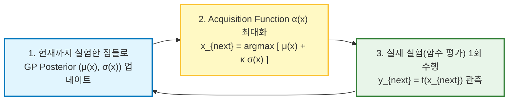

# Gaussian Process (가우시안 프로세스, GP)

> [!abstract] 핵심 개념 & 3줄 요약
> $$f(x) \sim \mathcal{GP}\big( m(x), \, k(x, x') \big)$$
> - **한 줄 정의**: 일반 [[Gaussian Distribution|가우시안 분포]]가 유한 차원 **'숫자 벡터'** 들의 확률 분포라면, 가우시안 프로세스(GP)는 이를 무한 차원으로 확장하여 **세상에 존재할 수 있는 무수히 많은 '연속 함수 $f(x)$ 전체' 위에 정의된 확률 분포(Distribution over Functions)** 다.
> - **핵심 매력**: 새로운 입력 $x_*$가 들어왔을 때 단순히 예측값 하나($\mu_*$, 점 추정)만 뱉는 것이 아니라, **"내가 지금 이 예측을 얼마나 확신하는가(불확실성 분산 $\sigma_*^2$)?"** 를 닫힌 수식(Closed-form) 한 방으로 동시에 계산해 주는 궁극의 베이지안 비모수(Non-parametric) 모델이다.
> - **현대적 위치**: 실험 한 번에 수백만 원이 드는 하이퍼파라미터 튜닝·신약 탐색·로봇 제어 파라미터 탐색의 **베이지안 최적화(Bayesian Optimization)** 엔진이자, 무한 너비 신경망([[NTK]] / NNGP)의 수학적 모체다.

---

## 1. 직관적 이해: 어떻게 '함수' 위에 확률 분포를 정의할까?

보통 회귀(Regression) 문제를 풀 때 우리는 함수 형태를 $f(x) = w_1 x + w_0$ 같은 직선으로 미리 고정(Parametric)해 두고 가중치 $w$를 찾는다.
반면 **Gaussian Process(GP)** 는 함수 형태를 아예 정해두지 않는다. 대신 이렇게 묻는다.

> *"만약 함수 $f(x)$라는 녀석을, 정의역의 모든 실수 $x \in \mathbb{R}$마다 그 함숫값 $f(x)$를 원소로 가지는 **무한히 긴 벡터 $\mathbf{f} = [\dots, f(0.01), f(0.02), \dots]^\top \in \mathbb{R}^\infty$** 로 본다면 어떨까?"*

하지만 무한 차원 벡터는 컴퓨터 메모리에 올릴 수 없다. 여기서 가우시안 분포의 기적 같은 성질인 **주변화 닫힘 성질(Marginalization Property)** 이 구원투수로 등장한다!

> [!important] 수학적 정의 (Gaussian Process)
> 확률 과정(Stochastic Process) $\{f(x)\}_{x \in \mathcal{X}}$에서 우리가 관심 있는 **임의의 유한한 $N$개의 입력 지점 $X = \{x_1, x_2, \dots, x_N\}$을 어떻게 골라 잡더라도**, 그 지점에서의 함숫값 벡터 $\mathbf{f} = [f(x_1), f(x_2), \dots, f(x_N)]^\top$가 항상 $N$차원 다변량 [[Gaussian Distribution|가우시안 분포]]를 따르면, 이 함수 $f$를 **가우시안 프로세스(Gaussian Process)** 라 부른다.
> $$\mathbf{f} = \begin{bmatrix} f(x_1) \\ \vdots \\ f(x_N) \end{bmatrix} \sim \mathcal{N}\left( \begin{bmatrix} m(x_1) \\ \vdots \\ m(x_N) \end{bmatrix}, \, \begin{bmatrix} k(x_1, x_1) & \cdots & k(x_1, x_N) \\ \vdots & \ddots & \vdots \\ k(x_N, x_1) & \cdots & k(x_N, x_N) \end{bmatrix} \right) = \mathcal{N}(\mathbf{m}, \mathbf{K})$$

즉, 무한 차원 함수 전체를 다룰 필요 없이 **내가 지금 계산하고 싶은 유한 개수의 데이터 점 $(x_1, \dots, x_N)$만 콕 집어내면**, 나머지 무한 개의 점들은 알아서 깔끔하게 적분되어 사라지고 평범한 $N$차원 행렬 연산으로 떨어진다!

---

## 2. GP를 결정하는 두 부품: 평균 함수와 커널(공분산) 함수

다변량 가우시안이 평균 벡터 $\mu$와 공분산 행렬 $\Sigma$로 결정되듯, GP는 **평균 함수 $m(x)$** 와 **공분산 함수(커널) $k(x, x')$** 두 개로 완전히 결정된다.

$$m(x) = \mathbb{E}[f(x)], \qquad k(x, x') = \mathbb{E}\Big[ \big(f(x) - m(x)\big)\big(f(x') - m(x')\big) \Big]$$

1. **평균 함수 $m(x)$**: 사전 정보가 없으면 계산 편의를 위해 보통 상수 0 함수(**$m(x) = 0$**)로 둔다. (데이터를 미리 정규화하면 충분하다.)
2. **커널 함수 $k(x, x')$ (GP의 영혼!)**:
   - **"두 입력 좌표 $x$와 $x'$가 가까울 때, 그 함숫값 $f(x)$와 $f(x')$는 얼마나 비슷해야 하는가?"** 를 정의한다.
   - 즉, 우리가 뽑아낼 함수의 **매끄러움(Smoothness), 주기성(Periodicity), 진폭(Amplitude)** 등 모든 기하학적 성질을 커널 함수가 지배한다.

### 대표적인 커널 함수 비교
| 커널 이름 | 수식 $k(x, x')$ | 생성되는 함수 $f(x)$의 모양과 특징 |
| :--- | :--- | :--- |
| **[[Gaussian Kernel\|RBF (Squared Exponential)]]** | $\sigma_f^2 \exp\left( -\frac{\|x - x'\|^2}{2\ell^2} \right)$ | **무한 번 미분 가능($C^\infty$)** 한 극도로 매끄러운 곡선. $\ell$(Length-scale)이 클수록 완만하고 작을수록 구불구불함. |
| **Matérn Kernel ($\nu=3/2, 5/2$)** | $\sigma_f^2 \frac{2^{1-\nu}}{\Gamma(\nu)}\left(\sqrt{2\nu}\frac{r}{\ell}\right)^\nu K_\nu\left(\sqrt{2\nu}\frac{r}{\ell}\right)$ | RBF가 현실 데이터에 비해 지나치게 매끄러운 단점을 보완. 딱 1번 또는 2번만 미분 가능한 **현실적인 거칠기**를 표현 (베이지안 최적화의 기본값). |
| **Periodic Kernel** | $\sigma_f^2 \exp\left( -\frac{2\sin^2(\pi \|x - x'\| / p)}{\ell^2} \right)$ | 주기가 $p$인 **반복적인 파동(계절성 시계열 등)** 을 모델링. |

---

## 3. 수식 완벽 유도: GP Regression (사전분포 $\to$ 사후분포)

이제 GP로 어떻게 회귀(Regression)를 푸는지 유도해보자.

### 3.1. 문제 세팅
- **관측한 학습 데이터**: 입력 $X = [x_1, \dots, x_N]^\top$와 노이즈가 섞인 관측 타겟 $\mathbf{y} = [y_1, \dots, y_N]^\top$.
  여기서 각 관측값은 실제 함숫값에 독립적인 가우시안 관측 노이즈 $\epsilon \sim \mathcal{N}(0, \sigma_n^2)$가 더해진 것이다:
  $$y_i = f(x_i) + \epsilon_i \implies \text{Cov}(\mathbf{y}) = \mathbf{K}(X, X) + \sigma_n^2 \mathbf{I}$$
- **예측할 테스트 입력**: 새로운 입력 지점들 $X_* = [x_{*1}, \dots, x_{*M}]^\top$에서의 진짜 함숫값 벡터 $\mathbf{f}_* = f(X_*)$의 분포를 알고 싶다!

### 3.2. 결합 가우시안 분포 (Joint Prior) 세우기
평균 함수 $m(x)=0$을 가정하면, 관측 타겟 $\mathbf{y}$와 미지의 테스트 함숫값 $\mathbf{f}_*$는 정의에 의해 다음과 같은 $(N+M)$차원 결합 가우시안 분포를 따른다.

$$\begin{bmatrix} \mathbf{y} \\ \mathbf{f}_* \end{bmatrix} \sim \mathcal{N}\left( \begin{bmatrix} \mathbf{0} \\ \mathbf{0} \end{bmatrix}, \, \begin{bmatrix} \mathbf{K} + \sigma_n^2 \mathbf{I} & \mathbf{K}_* \\ \mathbf{K}_*^\top & \mathbf{K}_{**} \end{bmatrix} \right)$$

- $\mathbf{K} = K(X, X) \in \mathbb{R}^{N \times N}$: 학습 데이터끼리의 커널 행렬.
- $\mathbf{K}_* = K(X, X_*) \in \mathbb{R}^{N \times M}$: 학습 데이터와 테스트 데이터 사이의 커널(유사도) 행렬.
- $\mathbf{K}_{**} = K(X_*, X_*) \in \mathbb{R}^{M \times M}$: 테스트 데이터끼리의 커널 행렬.

### 3.3. 조건부 가우시안 공식 대입 (Posterior 유도 완료!)
[[Gaussian Distribution]] §5.2에서 배운 **조건부 가우시안 공식(Schur Complement)** 에 위 블록 행렬을 그대로 대입하기만 하면, 학습 데이터 $(X, \mathbf{y})$를 관측한 뒤 테스트 함숫값 $\mathbf{f}_*$가 따르는 **사후 분포(Posterior Distribution)** 가 단 한 줄에 튀어나온다!

$$p(\mathbf{f}_* \mid X_*, X, \mathbf{y}) = \mathcal{N}\big(\mathbf{f}_* \mid \boldsymbol{\mu}_*, \, \boldsymbol{\Sigma}_*\big)$$

$$\begin{aligned}
\text{사후 평균 (예측값):} \quad \boldsymbol{\mu}_* &= \mathbf{K}_*^\top (\mathbf{K} + \sigma_n^2 \mathbf{I})^{-1} \mathbf{y} \\
\text{사후 공분산 (불확실성):} \quad \boldsymbol{\Sigma}_* &= \mathbf{K}_{**} - \mathbf{K}_*^\top (\mathbf{K} + \sigma_n^2 \mathbf{I})^{-1} \mathbf{K}_*
\end{aligned}$$

---

## 4. 수식의 물리적·기하학적 의미 해부

위 두 줄의 수식($\boldsymbol{\mu}_*, \boldsymbol{\Sigma}_*$)에는 머신러닝의 깊은 통찰이 담겨 있다. 테스트 점이 1개($x_*$)일 때로 줄여서 살펴보자.

### 4.1. 사후 평균 $\mu(x_*) = \mathbf{k}(x_*)^\top (\mathbf{K} + \sigma_n^2 \mathbf{I})^{-1} \mathbf{y}$
- 놀랍게도 이 식은 **[[Kernel Regression|Kernel Ridge Regression (KRR)]]** 의 최적해 수식($\lambda = \sigma_n^2$)과 토씨 하나 안 틀리고 **100% 똑같다!**
- 즉, $\boldsymbol{\alpha} = (\mathbf{K} + \sigma_n^2 \mathbf{I})^{-1} \mathbf{y}$라고 두면, 예측값은 각 학습 데이터와의 커널 유사도 $k(x_*, x_i)$의 선형 결합 $\sum_{i=1}^N \alpha_i k(x_*, x_i)$이다.

### 4.2. 사후 분산 $\sigma^2(x_*) = k(x_*, x_*) - \mathbf{k}(x_*)^\top (\mathbf{K} + \sigma_n^2 \mathbf{I})^{-1} \mathbf{k}(x_*)$
이 식이 바로 KRR에는 없는 **GP만의 필살기(불확실성 정량화, [[Uncertainty_Estimation]])** 다.
1. **첫 번째 항 $k(x_*, x_*)$**: 아무 데이터도 못 봤을 때 원래 가지고 있던 **사전 불확실성(Prior Variance)**.
2. **두 번째 항 $\mathbf{k}(x_*)^\top (\mathbf{K} + \sigma_n^2 \mathbf{I})^{-1} \mathbf{k}(x_*) \ge 0$**: 관측 데이터 $X$ 근처에 있어서 **깎여 나간 불확실성의 양(Information Gain)**.
   - 만약 새로운 점 $x_*$가 기존 학습 데이터 $x_i$와 **매우 가까우면**: $\mathbf{k}(x_*)$가 커져서 두 번째 항이 첫 번째 항을 거의 다 상쇄시켜 **$\sigma^2(x_*) \approx 0$ (확신에 찬 예측! 소시지처럼 잘록해짐)**.
   - 만약 새로운 점 $x_*$가 학습 데이터들과 **아주 멀리 떨어진 미지의 영역이면**: 유사도 $\mathbf{k}(x_*) \approx \mathbf{0}$이 되어 두 번째 항이 사라지고 **$\sigma^2(x_*) \approx k(x_*, x_*)$ (불확실성 최대! 신뢰구간이 풍선처럼 부풀어 오름)**.
   - 심지어 이 분산 식에는 **타겟 값 $\mathbf{y}$가 아예 들어있지 않다!** 오직 입력 데이터 $X$가 어디에 찍혀 있는지만 알아도 불확실성을 미리 계산할 수 있다.

---

## 5. 핵심 응용 1: 베이지안 최적화 (Bayesian Optimization)

함수 $f(x)$를 한 번 계산하는 데 엄청난 시간과 비용이 드는 **블랙박스 함수 최적화**(예: LLM 학습률 튜닝, 로봇 보행 제어기 게인 튜닝, 신약 분자 합성)에서는 경사하강법($\nabla f$)을 쓸 수 없다. 이때 GP를 대리 모델(Surrogate Model)로 쓰는 **베이지안 최적화**가 표준으로 쓰인다.

- **Acquisition Function (획득 함수, 예: GP-UCB, Expected Improvement)**:
  $$\alpha_{\text{UCB}}(x) = \underbrace{\mu(x)}_{\text{활용 (Exploitation: 평균이 높은 곳)}} + \kappa \underbrace{\sigma(x)}_{\text{탐색 (Exploration: 안 가봐서 분산이 큰 곳)}}$$
  GP가 평균 $\mu(x)$와 표준편차 $\sigma(x)$를 둘 다 주기 때문에, **"지금까지 성적이 좋았던 곳 근처를 더 파볼까($\mu \uparrow$), 아니면 아예 안 가본 미지의 영역을 찔러볼까($\sigma \uparrow$)?"** 의 딜레마를 수학적으로 가장 우아하게 해결한다.

---

## 6. 핵심 응용 2: 무한 너비 신경망과의 연결 (NNGP & [[NTK]])

신경망의 은닉층 뉴런 개수(Width $M$)를 무한대($M \to \infty$)로 보내면 무슨 일이 벌어질까?
1. **NNGP (Neural Network Gaussian Process, Neal 1996 / Lee et al. 2018)**:
   - 가중치 $W, b$를 가우시안 분포로 무작위 초기화한 상태에서 은닉층 너비를 무한대로 늘리면, 각 출력 뉴런은 무한히 많은 독립 항들의 합이 된다.
   - **중심극한정리(CLT)** 에 의해, **초기화된 무한 너비 신경망 함수 $f_\theta(x)$는 정확히 가우시안 프로세스 $\mathcal{GP}(0, K_{\text{NNGP}})$로 수렴**한다!
   - 이때 마지막 층만 베이지안 추론으로 학습시키는 것이 곧 GP Regression이다.
2. **[[NTK]] (Neural Tangent Kernel, Jacot et al. 2018)**:
   - 마지막 층만 학습시키는 대신 **모든 층을 경사하강법(Gradient Descent)으로 끝까지 학습**시키면, 그 수렴 결과 역시 커널이 $K_{\text{NTK}}(x, x') = \langle \nabla_\theta f(x), \nabla_\theta f(x') \rangle$인 가우시안 프로세스(커널 회귀)의 평균과 일치한다.

---

## 7. GP의 치명적 한계와 극복 (계산 복잡도 $\mathcal{O}(N^3)$)

GP가 이렇게 완벽한데 왜 수백만 장의 이미지나 대규모 데이터셋에서는 딥러닝에 밀렸을까?
- **원인**: 사후 분포 수식에 들어있는 **$N \times N$ 커널 행렬의 역행렬 $(\mathbf{K} + \sigma_n^2 \mathbf{I})^{-1}$ (실제 구현에서는 Cholesky 분해 $\mathbf{L}\mathbf{L}^\top$)** 을 구하는 데 **시간 복잡도 $\mathcal{O}(N^3)$, 메모리 복잡도 $\mathcal{O}(N^2)$** 가 든다.
- 데이터 개수 $N$이 $10,000$개만 넘어가도 역행렬 계산이 기하급수적으로 느려진다.
- **현대의 해결책 (Sparse GP / Inducing Points)**: 전체 데이터 $N$개를 다 쓰는 대신, 공간을 대표하는 소수의 **유도점(Inducing Points, $M \ll N$, 예: $M=500$)** 만 학습하여 복잡도를 $\mathcal{O}(N M^2)$로 낮추는 **SVGP(Stochastic Variational GP)** 등이 쓰인다.

---

## 8. 한 줄 요약

> **Gaussian Process = "무한 차원의 함수 공간 위에 가우시안 분포를 씌워, 커널 행렬의 조건부 공식 한 줄로 '가장 그럴듯한 예측 곡선($\mu_*$)'과 '그 예측의 신뢰 구간($\Sigma_*$)'을 동시에 뽑아내는 베이지안 머신러닝의 정수"**

---
연관 노트: [[Gaussian Distribution]], [[Gaussian Kernel]], [[Kernel Regression]], [[NTK]], [[Uncertainty_Estimation]]

