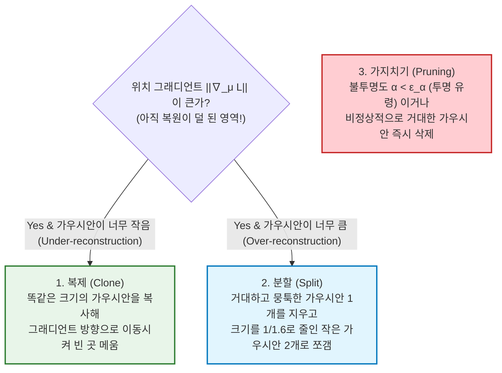

# 3D Gaussian Splatting (3DGS)

> [!abstract] 핵심 파이프라인 & 3줄 요약
> **Multi-view Images + SfM Point Cloud $\xrightarrow{\text{Initialize}}$ Millions of 3D Anisotropic Gaussians $(\mu, \Sigma, \alpha, \text{SH})$ $\xrightarrow{\text{Project }\Sigma' = J W \Sigma W^\top J^\top}$ Tile-based $\alpha$-Blending Rasterizer (100+ FPS)**
> - **한 줄 정의**: 3차원 공간을 수백만 개의 **반투명하고 색깔이 있는 3차원 타원체([[Gaussian Distribution|3D 가우시안 공]])** 들의 집합으로 명시적으로 표현하고, 이를 2D 카메라 화면에 눈뭉치 던지듯 납작하게 투영(Splatting)하여 **실시간(100+ FPS)으로 포토리얼리스틱한 3D 장면을 렌더링**하는 혁신 기술(SIGGRAPH 2023 Best Paper)이다.
> - **패러다임 전환 (NeRF $\to$ 3DGS)**: 픽셀마다 빛(Ray)을 쏘아 무거운 MLP 신경망을 수백 번씩 통과시키던 **NeRF의 느린 볼륨 레이마칭(Volume Ray-Marching)** 을 버리고, 신경망을 아예 제거한 채 **미분 가능한 타일 기반 래스터화(Differentiable Rasterization)** 로 문제를 뒤집어 학습 시간과 렌더링 속도를 수백 배 단축했다.
> - **로보틱스 & [[World Model]]에서의 위상**: 실제 방이나 공장을 스마트폰으로 1분만 찍으면 로봇이 그 안에서 수만 번 부딪히며 강화학습([[VLA]])을 돌릴 수 있는 **실사 수준(Real-to-Sim) 가상 훈련장**을 즉시 구축해 주는 현세대 공간 AI의 핵심 기둥이다.

---

## 1. 개요: 왜 NeRF는 느렸고, 3DGS는 어떻게 이를 뒤집었는가?

여러 각도에서 찍은 2D 사진 몇십 장만으로 3D 공간을 복원해, 안 찍은 새로운 각도에서 본 화면을 그려내는 문제를 **Novel View Synthesis (NVS)** 라 한다.

1. **과거의 주류 — NeRF (Neural Radiance Fields, 2020)**:
   - **암시적 표현 (Implicit Representation)**: 3D 공간 전체를 거대한 MLP 신경망 $F_\theta(x, y, z, \theta, \phi) \to (\text{RGB}, \sigma)$ 하나에 통째로 암기시킨다.
   - **치명적 병목**: 1920×1080 해상도 화면 1장을 그리려면 약 200만 개의 픽셀마다 광선(Ray)을 쏘고, 광선 위에서 128개의 점마다 MLP를 호출해야 한다. 즉, **화면 1장당 MLP를 2억 5천만 번 계산**해야 해서 고사양 GPU로도 1초에 1장(1 FPS) 그리기가 버거웠다.
2. **3DGS의 역발상 (Kerbl et al., 2023)**:
   - *"왜 텅 빈 허공에다 광선을 쏘며 무거운 신경망을 돌리는가? 차라리 물체가 있는 곳에만 **명시적인 3차원 가우시안 솜사탕(Ellipsoids)** 들을 수백만 개 띄워놓고, 그래픽스 카드가 가장 잘하는 **2D 투영(Rasterization)** 으로 한 방에 화면에 발라버리자(Splatting)!"*
   - **놀라운 사실**: 3DGS에는 **신경망(MLP, Transformer 등) 레이어가 단 한 개도 없다!** 오직 수백만 개 가우시안의 위치·모양·색깔 파라미터 자체를 경사하강법(PyTorch Autograd + CUDA 커널)으로 직접 최적화할 뿐이다.

---

## 2. 수학적 아키텍처: 3D 가우시안 원시 객체(Primitive)의 정의

3DGS에서 장면(Scene)은 $N$개(보통 50만~500만 개)의 3D 가우시안 집합으로 구성된다. $i$번째 가우시안 하나는 정확히 **4종류의 학습 가능한 파라미터(총 59개 실수)** 를 가진다.

| 파라미터 | 기호 및 차원 | 물리적·기하학적 역할 |
| :--- | :--- | :--- |
| **1. 중심 위치 (Mean)** | $\mu \in \mathbb{R}^3$ (3개) | 3D 월드 좌표계 $(x, y, z)$에서의 타원체 중심점. |
| **2. 공분산 (Covariance)** | $s \in \mathbb{R}^3, \, q \in \mathbb{R}^4$ (7개) | 타원체의 **3축 반지름 크기(Scale $s$)** 와 **3D 회전(Quaternion $q$)**. |
| **3. 불투명도 (Opacity)** | $\alpha \in [0, 1]$ (1개) | 빛이 이 가우시안을 통과할 때 얼마나 진하게 보이는가 (Sigmoid 통과). |
| **4. 방향별 색상 (Color)** | $\text{SH} \in \mathbb{R}^{48}$ (48개) | 보는 각도(시점)에 따라 달라지는 반사광/광택을 표현하는 **3차 구면 조화 함수(Spherical Harmonics)** 계수 ($16 \times 3\text{채널}$). |

### 2.1. 3D 가우시안 함수 수식
중심 $\mu \in \mathbb{R}^3$와 공분산 행렬 $\Sigma \in \mathbb{R}^{3 \times 3}$을 가진 3D 가우시안의 공간 밀도 함수 $G(x)$는 다음과 같다 (정규화 상수는 불투명도 $\alpha$에 흡수되므로 생략).

$$G(x) = \exp\left( -\frac{1}{2} (x - \mu)^\top \Sigma^{-1} (x - \mu) \right)$$

### 2.2. 핵심 수학 트릭 1: 공분산 행렬의 양의 정부호성(PSD) 보장 분해
만약 $3 \times 3$ 대칭 행렬 $\Sigma$의 6개 원소를 경사하강법으로 직접 업데이트하면 어떻게 될까? 학습 도중 고유값이 음수가 되면서 **공분산 행렬이 양의 정부호성(Positive Semi-Definiteness, $v^\top \Sigma v \ge 0$)을 잃어버려 타원체가 뒤집히고 수식이 폭발**한다!

이를 원천 차단하기 위해 3DGS는 [[Gaussian Distribution]] §3.1에서 다룬 타원체의 기하학적 구성을 이용해 $\Sigma$를 **스케일링 행렬 $S$** 와 **회전 행렬 $R$** 로 분해하여 파라미터화한다.

$$\Sigma = R S S^\top R^\top$$

- $S = \text{diag}(s_x, s_y, s_z) \in \mathbb{R}^{3 \times 3}$: 각 축으로 얼마나 늘릴지 결정하는 대각 스케일 행렬.
- $R \in SO(3)$: 단위 사원수(Unit Quaternion) $q = (q_w, q_x, q_y, q_z)$ ($\|q\|_2 = 1$)로부터 변환된 $3 \times 3$ 직교 회전 행렬.
- **왜 완벽한가?**: 임의의 실수 $s, q$가 경사하강법으로 어떻게 바뀌든, $R S S^\top R^\top = (RS)(RS)^\top$ 형태는 모든 벡터 $v$에 대해 $v^\top (RS)(RS)^\top v = \| (RS)^\top v \|_2^2 \ge 0$이므로 **수학적으로 항상 대칭 양의 반정부호(PSD) 행렬임이 100% 보장된다!**

---

## 3. 3D에서 2D 화면으로의 투영 (EWA Splatting과 야코비안 $J$)

3D 공간에 떠 있는 타원체 $G(x)$를 카메라 렌즈를 통해 2D 이미지 화면(픽셀 좌표계)에 그리려면, **3D 가우시안을 2D 가우시안으로 투영(Projection)** 해야 한다.

1. **월드 좌표 $\to$ 카메라 좌표 변환 (선형 변환)**:
   카메라 외부 파라미터(Viewing Transformation, 회전행렬 $W$)는 어파인(선형) 변환이므로, 3D 가우시안은 카메라 좌표계에서도 여전히 정확히 3D 가우시안이다 ($\Sigma_{\text{cam}} = W \Sigma W^\top$).
2. **카메라 좌표 $\to$ 2D 화면 투영 (원근 투영의 비선형성 문제!)**:
   문제는 원근 투영(Perspective Projection: $u = f_x \frac{X}{Z}, \, v = f_y \frac{Y}{Z}$)이 **$Z$(깊이)로 나누는 비선형 연산**이라는 점이다! 가우시안을 비선형 변환하면 더 이상 가우시안이 아니게 되어 적분이 불가능해진다.
3. **해결책 — Zwicker et al.(2001)의 EWA Splatting (1차 테일러 선형 근사)**:
   타원체의 중심점 $\mu_{\text{cam}} = (t_x, t_y, t_z)^\top$ 근처에서 원근 투영 변환 $\varphi(t)$를 **1차 테일러 급수(야코비안 행렬 $J$)로 선형 근사**한다!

$$\Sigma' = J W \Sigma W^\top J^\top \quad \text{where } J = \frac{\partial \varphi}{\partial t}\Bigg|_{t=\mu_{\text{cam}}} = \begin{bmatrix} \frac{f_x}{t_z} & 0 & -\frac{f_x t_x}{t_z^2} \\ 0 & \frac{f_y}{t_z} & -\frac{f_y t_y}{t_z^2} \end{bmatrix}$$

> [!tip] 2D Splatting 수식의 마법
> 위 식에서 나온 $2 \times 2$ 행렬 $\Sigma' \in \mathbb{R}^{2 \times 2}$가 바로 **2D 모니터 화면 위에 납작하게 눌린 2차원 가우시안 타원(Splat)의 공분산 행렬**이다!
> - 따라서 화면의 특정 2D 픽셀 좌표 $p \in \mathbb{R}^2$에서 $i$번째 가우시안이 미치는 유효 불투명도 $\alpha_i(p)$는 다음과 같이 초고속으로 계산된다.
> $$\alpha_i(p) = \alpha_i \cdot \exp\left( -\frac{1}{2} (p - \mu'_i)^\top {\Sigma'_i}^{-1} (p - \mu'_i) \right)$$

---

## 4. 미분 가능한 타일 기반 알파 블렌딩 ($\alpha$-Blending Rasterization)

이제 2D 화면 위에 수백만 개의 반투명한 가우시안 스티커들이 겹쳐져 있다. 특정 픽셀 $p$의 최종 색상 $C(p) \in \mathbb{R}^3$은 카메라에서 **가까운 순서대로(Depth Sorting, $i = 1, \dots, \mathcal{N}$)** 빛의 투과율을 누적하며 포개는 **알파 블렌딩(Alpha Compositing)** 수식으로 계산된다.

$$C(p) = \sum_{i=1}^{\mathcal{N}} c_i \, \alpha_i(p) \, \underbrace{\prod_{j=1}^{i-1} \big(1 - \alpha_j(p)\big)}_{T_i: \text{앞의 } i-1\text{개 가우시안을 뚫고 살아남은 투과율(Transmittance)}}$$

- $c_i \in \mathbb{R}^3$: 현재 카메라 시선 방향 벡터 $d_i$를 3차 **구면 조화 함수(Spherical Harmonics, SH)** 에 대입해 구한 $i$번째 가우시안의 RGB 색상. (푸리에 급수가 1D 주기 함수를 분해하듯, SH는 구 표면 $S^2$ 위의 방향별 색상 함수를 직교 기저로 분해하여 각도에 따라 변하는 금속 광택이나 유리 반사를 완벽히 표현한다!)
- **100+ FPS가 가능한 시스템 엔지니어링 비결**:
  픽셀마다 수백만 개를 따로 정렬하면 느리므로, 화면을 **$16 \times 16$ 픽셀 크기의 타일(Tile)** 로 쪼개고 타일 단위로 가우시안들을 GPU 공유 메모리(Shared Memory)에 올려 **병렬 기수 정렬(Radix Sort)** 을 딱 1번만 수행한다. 그리고 픽셀의 누적 투과율 $T_i$가 $0.0001$ 이하로 떨어지면(앞의 가우시안들이 이미 화면을 다 가렸으면) 뒤쪽 가우시안 계산을 즉시 조기 종료(Early Stopping)한다.

---

## 5. 학습 파이프라인과 적응형 밀도 제어 (Adaptive Density Control)

3DGS는 처음에 COLMAP(Structure-from-Motion, SfM)으로 뽑은 엉성한 점군(Sparse Point Cloud, 수만 개 점)에서 출발해, 렌더링 이미지 $\hat{I}$와 실제 사진 $I$ 사이의 **$L_1$ 손실 + D-SSIM(구조적 유사도) 손실**을 줄이며 가우시안들을 이동·변형시킨다.

$$\mathcal{L}_{\text{3DGS}} = (1 - \lambda) \| \hat{I} - I \|_1 + \lambda \, \mathcal{L}_{\text{D-SSIM}}(\hat{I}, I) \quad (\lambda = 0.2)$$

하지만 처음 점의 개수만으로는 빈 공간을 다 메울 수 없다. 그래서 매 100 스텝마다 **위치 그래디언트 크기 $\|\nabla_\mu \mathcal{L}\|$** 를 기준으로 가우시안 개수를 스스로 늘리고 줄이는 **세포 분열(Adaptive Density Control)** 을 수행한다.

---

## 6. NeRF vs 3D Gaussian Splatting 총정리 비교

| 비교 항목 | **NeRF (Neural Radiance Fields)** | **3D Gaussian Splatting (3DGS)** |
| :--- | :--- | :--- |
| **3D 표현 방식** | **암시적 (Implicit)** — 연속적인 MLP 가중치 | **명시적 (Explicit)** — 수백만 개의 3D 가우시안 타원체 |
| **렌더링 알고리즘** | 픽셀별 광선 추적 (Volume Ray-Marching) | **타일 기반 2D 투영 래스터화 (Splatting)** |
| **신경망 유무** | 있음 (렌더링마다 MLP 수억 번 호출) | **없음 (순수 수학적 투영 + 알파 블렌딩)** |
| **렌더링 속도 (1080p)** | 0.1 ~ 5 FPS (실시간 불가) | **100 ~ 300+ FPS (초고속 실시간)** |
| **장면 편집 및 물리 결합** | MLP 가중치 속에 섞여 있어 물체 이동/편집이 극도로 어려움 | **가우시안 점들을 마우스로 잡아서 옮기거나 물리 엔진에 바로 넣을 수 있음!** |
| **단점** | 너무 느림 | 수백만 개 가우시안을 저장해야 해서 파일 용량(수백 MB)이 큼 |

---

## 7. 최신 트렌드: 로보틱스([[VLA]])와 [[World Model]]에서의 활약

3DGS가 단순 컴퓨터 그래픽스를 넘어 로보틱스와 체화 AI 업계를 뒤집어 놓은 이유는 **"명시적인 기하학 구조 + 실시간 렌더링 + 물체 단위 조작 가능성"** 덕분이다.

1. **Real-to-Sim-to-Real 가상 훈련장 구축**:
   - 실제 주방이나 물류 창고를 스마트폰 영상으로 찍어 3DGS로 변환한 뒤, 그 안의 컵과 로봇 팔 가우시안 그룹에 물리 엔진(Isaac Sim, MuJoCo) 충돌 판정을 입힌다(PhysGaussian 등). 로봇은 실제 세상과 픽셀 단위로 똑같이 생긴 3DGS 가상 세계 속에서 초당 수백 프레임으로 강화학습을 수행할 수 있다.
2. **4D Gaussian Splatting (Dynamic 3DGS)**:
   - 가우시안의 위치와 회전이 시간 $t$에 따라 움직이도록 확장($\mu(t), q(t)$)하여, 움직이는 사람과 물체가 있는 동적 비디오 전체를 3D 공간으로 재구성한다.
3. **Semantic Gaussian Splatting (LangSplat / Feature 3DGS)**:
   - 각 3D 가우시안마다 RGB 색상뿐만 아니라 **[[CLIP]] / [[SigLIP]]이나 [[DINO]]v2의 특징 벡터**를 추가로 심어둔다! 그러면 3D 공간 전체에서 `"빨간색 머그컵 손잡이"`라고 텍스트로 검색했을 때 해당하는 3D 가우시안 좌표 $(x, y, z)$가 즉시 하이라이트되어 로봇이 바로 가서 집을 수 있다.

---

## 8. 한 줄 요약

> **3D Gaussian Splatting = "신경망 없이 수백만 개의 3차원 가우시안 타원체($\Sigma = R S S^\top R^\top$)를 공간에 띄우고 야코비안 투영($J W \Sigma W^\top J^\top$)으로 화면에 발라버림으로써, 실사 수준의 3D 세계를 100 FPS 이상으로 실시간 렌더링하고 조작할 수 있게 만든 3D 비전의 혁명"**

---
연관 노트: [[Gaussian Distribution]], [[VLA]], [[World Model]], [[CLIP]], [[DINO]]

