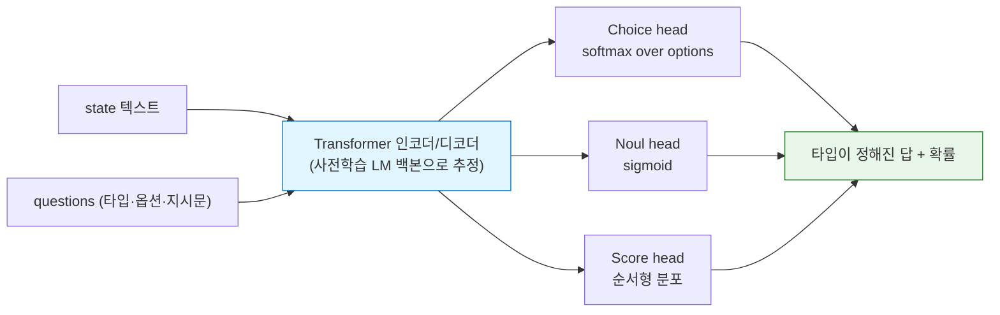
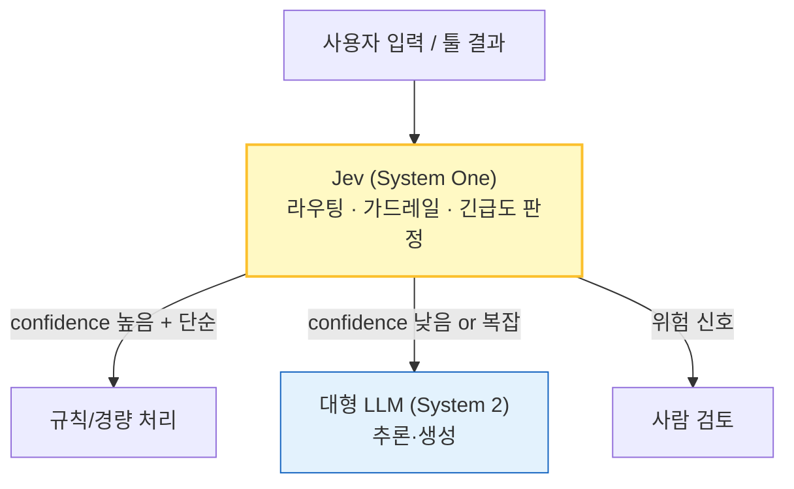

# Jev (TypeSafe AI의 System One 모델)

> [!warning] 정보의 신뢰도
> Jev는 2026-09 출시된 상용 API 모델이라 **내부 아키텍처·학습 수식은 공개되어 있지 않다.** 이 문서에서 `[공개]`는 공식/2차 자료로 확인된 내용, `[배경]`은 관련 일반 이론, `[추정]`은 공개 사실로부터의 합리적 추론이다. 정확한 수치(가격, 지연시간)는 바뀔 수 있으니 공식 문서로 재확인할 것.

> [!abstract] 3줄 요약
> - **한 줄 정의**: 텍스트를 *생성*하지 않고, 입력 상태(state)에 대한 **타입이 정해진 질문(Choice / Noul / Score)** 에 **확률이 보정된(calibrated) 답**을 한 번의 forward pass로 돌려주는 **판별형 의사결정 모델**. 제작사는 이를 **"System One 모델"** 이라 부른다. `[공개]`
> - **핵심 차별점**: LLM은 `토큰 생성 → JSON 파싱`을 거치지만 Jev는 스키마에 맞는 값과 확률을 직접 출력 → 파싱 오류·구조적 환각이 원천 제거되고, 지연시간·비용이 크게 낮다. `[공개]`
> - **용도**: 라우팅, 분류, 스팸/가드레일 필터, 에이전트 루프의 "빠른 게이트키퍼". 요약·대화·코드 생성에는 부적합. `[공개]`

---

## 1. 배경: 왜 "System One"인가?

[[VLA]] 문서의 System 2(느린 추론 VLM) + System 1(빠른 제어) 구분과 같은 계열의 발상이다. 에이전트 안에는 사실 **깊은 추론이 필요 없는 결정**이 대부분이다.

- "이 티켓은 결제 문제인가, 기술 문제인가?"
- "이 메시지는 긴급한가?"
- "이 툴 호출을 실행해도 안전한가?"

이런 결정을 매번 거대 [[GPT|LLM]]에게 자유 텍스트로 시키면 **느리고(자기회귀 생성), 비싸고, 출력 형식이 깨질 수 있다.** Jev는 이 층을 별도 모델로 분리한 것이다.

| | 일반 LLM 호출 | Jev |
|:--|:--|:--|
| 출력 | 자유 텍스트 → 파싱 | **타입이 있는 값 + 확률** |
| 생성 방식 | 자기회귀 (토큰 수만큼 step) | **단일 forward pass** `[공개]` |
| 지연시간 | 초 단위 | 약 70~500ms `[공개, 자료 간 수치 상이 가능]` |
| 신뢰도 | 보통 없음/언어적 표현 | **보정된 확률** |
| 형식 오류 | 가능 | 스키마로 고정되어 불가 |

---

## 2. 인터페이스: 세 가지 질문 타입 `[공개]`

요청은 하나의 `state`(공유 컨텍스트)와 여러 개의 `questions`로 구성된다. 모든 질문이 같은 state에 대해 **병렬로** 답해진다.

| 타입 | 의미 | 반환 |
|:--|:--|:--|
| `Choice` | 주어진 `options` 중 택1 (범주형) | 선택값 + 전 옵션 확률분포 + confidence |
| `Noul` | Yes/No 조건 판정 | 0~1 확률 |
| `Score` | 순서형 루브릭(`criteria`) 상 위치 | 점수 + 레벨별 확률 |

```python
# 공식 예시를 요약한 형태 (typesafe-sdk)
response = client.system_one(
    model="jev-latest",
    state="결제가 두 번 됐어요. 바로 환불해주세요.",
    questions={
        "intent": Choice(options=["billing", "technical", "cancellation", "other"]),
        "is_urgent": Noul(instructions="긴급성이 드러나는가?"),
        "severity": Score(criteria=["경미", "중간", "치명적"]),
    },
)
response.answers["intent"].choice
response.answers["is_urgent"].noul   # 0~1 확률
```

> [!tip] 하류 코드가 쉬워진다
> 반환이 타입 고정이므로 `if answers["is_urgent"].noul > 0.85: escalate()` 처럼 **임계값 분기**를 안전하게 짤 수 있다. 확률이 낮으면 사람 검토나 더 큰 모델로 넘기는 것이 전형적 사용법이다 → [[AI Fallback Strategy]], [[Uncertainty_Estimation]].

---

## 3. 아키텍처: 알려진 것과 추정

### 3.1. 공개된 사실 `[공개]`
- **비자기회귀(non-autoregressive)**: 모든 질문을 한 번의 forward pass에서 처리.
- **출력 공간이 스키마로 제한**: 자연어 vocabulary가 아니라 질문별 유한 출력(범주 / 이진 / 순서)만 가진다.
- **자유 텍스트 미생성**: 설명(reasoning)을 내놓지 않는다.

### 3.2. 추정 `[추정]`
비공개이므로 아래는 "이렇게 구현하면 위 특성이 자연스럽게 나온다"는 해석이다.



- 질문 자체(옵션, 지시문)가 입력 토큰의 일부로 들어가고, 출력은 **질문별 헤드의 로짓**에서 직접 확률이 되는 구조가 가장 단순한 해석이다. 이는 CLIP의 zero-shot 분류에서 "클래스 이름 텍스트가 분류기 가중치가 되는" 방식과 개념적으로 닮았다 → [[CLIP]].
- `Choice`는 softmax, `Noul`은 sigmoid로 보는 것이 자연스럽지만 **실제 헤드 구성은 확인되지 않았다.**

---

## 4. 학습: RLCD (Reinforcement Learning for Calibrated Decisions) `[공개: 이름과 목적만]`

제작사는 [[RLHF]]가 "사람이 선호하는 텍스트"를 최적화하는 데 비해, RLCD는 **확률적 정확도와 보정(calibration)** 을 최적화한다고 설명한다. **구체적 보상 함수는 공개되지 않았다.** 아래는 이 목표를 수식으로 풀 때의 표준 도구들이다 `[배경]`.

### 4.1. Calibration의 정의
모델이 예측 확률 $\hat p$를 냈을 때, 그 확률대의 실제 정답률이 $\hat p$와 같으면 보정된 것이다.

$$\mathbb{P}(Y = 1 \mid \hat p = p) = p \quad \forall p \in [0,1]$$

즉 "70%"라고 한 예측들 중 실제로 맞는 비율이 약 70%여야 한다.

### 4.2. 측정: ECE (Expected Calibration Error)
예측을 확률 구간 $B_m$ ($m=1..M$)으로 나눠 구간별 정확도와 평균 confidence의 차이를 가중 평균한다.

$$\text{ECE} = \sum_{m=1}^{M} \frac{|B_m|}{n} \left| \text{acc}(B_m) - \text{conf}(B_m) \right|$$

### 4.3. 학습 목표 후보: Proper Scoring Rule
보정된 확률을 내도록 유도하려면 **엄격한 proper scoring rule**을 보상/손실로 쓰는 것이 이론적으로 자연스럽다. 정답이 $y \in \{0,1\}$, 예측이 $\hat p$일 때

$$\text{Brier}(\hat p, y) = (\hat p - y)^2, \qquad \text{NLL}(\hat p, y) = -\big[y \log \hat p + (1-y)\log(1-\hat p)\big]$$

이 둘은 **참 확률을 정직하게 보고할 때 기대 손실이 최소**가 되는 성질(properness)을 갖는다. 반면 정확도(0/1 정답 여부)만 보상하면 모델은 항상 확신하는 쪽으로 쏠린다.

> [!note] 왜 SFT가 아니라 RL?
> `[추정]` 단순 [[Loss Functions|cross-entropy]] 지도학습으로도 어느 정도 보정이 되지만, 대규모 사전학습·fine-tuning 후에는 **과신(overconfidence)** 이 흔하다 ([[Uncertainty_Estimation]]의 MSP 한계 참고). 보정을 직접 보상으로 두는 RL 단계는 이를 교정하려는 시도로 해석할 수 있다. 다만 RLCD의 실제 알고리즘(정책 gradient 종류, 보상 설계)은 확인되지 않았다.

---

## 5. 한계와 주의점

- **생성 과제 불가**: 요약, 대화, 코드 생성, 이유 설명에는 쓸 수 없다. `[공개]`
- **질문 간 확률 일관성**: 겹치거나 보완적인 질문(예: "긴급한가" vs "긴급하지 않은가") 사이에서 확률 공리가 엄밀히 지켜지지 않는다는 외부 평가가 있다. `[공개, 2차 자료]` 여러 질문을 쓸 때는 질문을 직교하게 설계하는 편이 안전하다.
- **보정은 분포 의존적**: 학습 분포와 다른 도메인에서는 보정이 깨질 수 있다 `[배경]`. 도입 시 자체 라벨 데이터로 reliability diagram / ECE를 직접 측정할 것.
- **블랙박스 API**: 파인튜닝 여부, 모델 크기, 온프레미스 배포 가능성은 공식 문서 확인 필요.

---

## 6. 에이전트 시스템에서의 위치



비싼 추론 모델 호출 횟수를 줄이고, 불확실한 경우만 위로 올리는 **계층형 폴백**의 앞단 역할이다 → [[AI Fallback Strategy]], [[Agent AI 시스템 아키텍처 패턴 설계]], [[Agent는 어떻게 행동하는가]].

---

## 7. 비교 정리

| 모델 계열 | 출력 | 강점 | 약점 |
|:--|:--|:--|:--|
| 대형 LLM + JSON mode | 토큰 생성 | 범용, 설명 가능 | 느림, 비쌈, 과신 |
| [[CLIP]] zero-shot | 클래스별 유사도 | 이미지 분류 | 텍스트 의사결정엔 부적합 |
| 전통 분류기 (fine-tuned BERT 등) | 클래스 확률 | 빠름 | 스키마가 바뀔 때마다 재학습 |
| **Jev** | typed 값 + 보정 확률 | **스키마를 요청 시점에 지정 + 빠름 + 보정** | 생성 불가, 내부 비공개 |

---

## 8. 한 줄 요약

> **Jev = "에이전트의 빠른 직관(System 1)을 담당하도록, 텍스트를 만들지 않고 타입이 정해진 질문에 보정된 확률로 한 번에 답하는 판별형 의사결정 모델"**

---
연관 노트: [[Uncertainty_Estimation]], [[AI Fallback Strategy]], [[RLHF]], [[VLA]], [[Loss Functions]]

