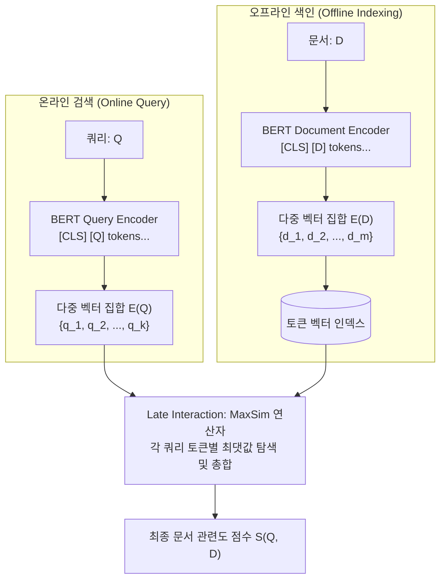
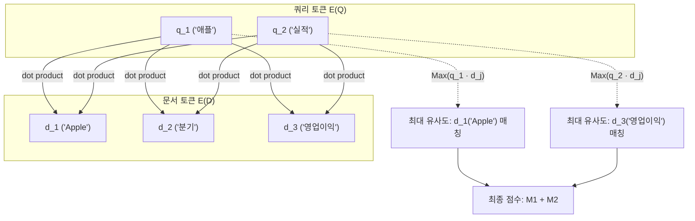

# 1. 개요: 상호작용 시점의 딜레마

정보 검색(Information Retrieval) 및 [[RAG]] 파이프라인에서 [[Dense Sparse Embedding|Bi-encoder]]와 [[Reranking|Cross-encoder]]는 속도와 정밀도의 양극단에 위치한다.

- **Bi-encoder (No Interaction)**: 쿼리와 문서를 각각 독립적으로 단일 벡터로 인코딩한 뒤 사후에 내적만 수행한다. 연산 속도는 극도로 빠르나, 긴 문서의 문맥이 단 하나의 고정 차원 벡터로 압축되는 과정에서 정보 병목(Information Bottleneck)이 발생한다.
- **Cross-encoder (Early Interaction)**: 입력 단계부터 쿼리와 문서를 결합해 트랜스포머의 전체 레이어에서 All-to-All Self-Attention을 수행한다. 정밀도는 가장 우수하나, 쿼리 인입 전 사전 색인이 불가능하여 대규모 코퍼스에 직접 적용할 수 없다.

**Late Interaction(후기 상호작용)**은 이 둘의 트레이드오프를 타파하기 위해 제안된 패러다임이다. 핵심 아이디어는 **"오프라인 문서 인코딩 시점에는 토큰 벡터를 개별 보존하고, 검색(온라인) 시점에 가벼운 토큰 간 최대 유사도(MaxSim) 연산만 교차 수행한다"**는 것이다. 이를 구체화한 대표적인 모델이 스탠퍼드 대학교에서 발표한 **ColBERT(Contextualized Late Interaction over BERT)**다.

# 2. ColBERT의 아키텍처

## 2.1. 다중 벡터 표현 (Multi-Vector Representation)

ColBERT는 문서를 단 하나의 임베딩 벡터로 풀링(Mean pooling 등)하지 않는다. 문서를 구성하는 각 토큰의 문맥화된 은닉 벡터(Contextualized token embeddings)를 그대로 유지한다.

- **기존 Bi-encoder**: 문서 $D \rightarrow \mathbf{e}_D \in \mathbb{R}^d$ (단일 벡터)
- **ColBERT**: 문서 $D \rightarrow E(D) = \{\mathbf{d}_1, \mathbf{d}_2, \dots, \mathbf{d}_m\} \subset \mathbb{R}^{d'}$ ($m$개의 토큰 벡터 리스트, 통상 $d'=128$)

단일 벡터 풀링 과정에서 생기는 의미 희석을 원천 차단하므로, 문서 내의 지엽적인 핵심 정보나 고유 명사, 구체적 수치 정보가 원형 그대로 벡터 공간에 보존된다.

또한 쿼리와 문서의 인코더가 분리되어 있으므로, **문서 코퍼스의 다중 벡터는 서비스 시작 전 오프라인에서 100% 미리 계산하여 인덱싱해 둘 수 있다.**

## 2.2. MaxSim (최대 유사도) 연산자

검색 시점에는 쿼리의 각 토큰 벡터와 문서의 모든 토큰 벡터 간의 코사인 유사도를 계산한 뒤, 각 쿼리 토큰 입장에서 **가장 높은 유사도 값을 취해 전부 합산**하는 **MaxSim** 연산을 수행한다.

$$S_{Q, D} = \sum_{i \in Q} \max_{j \in D} \left( E(q_i) \cdot E(d_j)^\top \right)$$

- $E(q_i)$: $L_2$ 정규화된 $i$번째 쿼리 토큰 임베딩
- $E(d_j)$: $L_2$ 정규화된 $j$번째 문서 토큰 임베딩
- $E(q_i) \cdot E(d_j)^\top$: 두 토큰 벡터 간의 코사인 유사도(Cosine Similarity)

이 연산의 장점은 다음과 같다.
1. **토큰 단위 정밀 정렬**: 쿼리의 '애플'은 문서의 'Apple'과, '실적'은 문서의 '영업이익'과 일대일로 가장 가까운 의미를 찾아 매핑된다.
2. **소프트 키워드 매칭**: 전통적인 BM25식 완전 일치 키워드 매칭을 넘어, 의미론적으로 유사한 단어 간의 토큰 매칭이 부드럽게 이뤄진다.
3. **병렬 연산 최적화**: 트랜스포머의 어텐션 레이어를 통과하는 것이 아니라, 이미 뽑혀 있는 벡터 간의 단순 행렬 곱(GEMM) 및 Reducer(Max, Sum) 연산에 불과하므로 GPU/SIMD 상에서 밀리초 단위로 병렬 연산된다.

# 3. 저장 공간 문제와 ColBERT v2 (PLAID)

## 3.1. 치명적 단점: 벡터 저장 용량 폭증

ColBERT v1의 가장 큰 병목은 **스토리지 비용**이었다.
- 일반 Bi-encoder: 100만 개 문서 $\times$ 1벡터 = 100만 개 벡터.
- ColBERT v1: 문서당 평균 200개 토큰이라 가정할 때, 100만 개 문서 $\times$ 200토큰 = **2억 개 벡터**.
- 벡터 차원을 128차원(FP16, 256바이트)으로 줄이더라도 2억 개면 순수 벡터 데이터만 **50GB 이상**의 RAM/NVMe 용량을 요구했다.

## 3.2. ColBERT v2의 극복: Residual Compression & PLAID

이 문제를 해결하기 위해 ColBERT v2 및 고속 검색 엔진 **PLAID**(Performance-optimized Late Interaction for Asymmetric Information Distribution)가 도입되었다.

1. **Centroid 기반 클러스터링**: 전체 토큰 벡터 공간을 수만~수십만 개의 $k$-means 군집 중심점(Centroid)으로 분할한다.
2. **잔차 양자화 (Residual Compression)**:
   - 각 토큰 벡터를 절대 좌표로 저장하는 대신, 가장 가까운 Centroid ID와 그 Centroid로부터의 오프셋(잔차 벡터, Residual vector)만 저장한다.
   - 잔차 벡터를 1~2비트로 극단적 양자화(Quantization)하여 토큰당 용량을 16~32바이트 수준으로 압축한다 (v1 대비 6~10배 절감).
3. **Centroid 가지치기(Pruning)를 통한 고속 필터링**:
   - 쿼리 토큰과 내적이 높은 소수의 Centroid를 먼저 탐색한 뒤, 해당 Centroid에 소속된 토큰을 가진 후보 문서군만 선별하여 MaxSim을 계산한다.
   - 이를 통해 전체 문서를 전수 조사하지 않고도 밀리초(ms) 단위의 초고속 검색 레이턴시를 달성한다.

# 4. 아키텍처 삼자 비교

| 비교 항목 | Bi-encoder | Cross-encoder | Late Interaction (ColBERT v2) |
| :--- | :--- | :--- | :--- |
| **토큰 상호작용** | 없음 (No Interaction) | 조기 상호작용 (Early Interaction) | **후기 상호작용 (Late Interaction)** |
| **문서 표현 벡터** | 문서당 단일 벡터 ($1 \times d$) | 별도 벡터 없음 (결합 후 직접 분류) | **문서당 다중 벡터 ($m \times d'$)** |
| **오프라인 사전 색인** | 완전 가능 (벡터 DB 적재) | **불가능** (사전 계산 불가) | **완전 가능** (다중 벡터 인덱싱) |
| **검색 레이턴시** | 수 ms | 수십 ms ~ 수 초 | **수십 ms (실시간 대응 가능)** |
| **저장 공간 부담** | 낮음 (GB 미만 단위) | 없음 (별도 인덱스 불필요) | 중간 (PLAID 압축 시 수십 GB 수준) |
| **검색 정밀도** | 중간 (정보 병목 존재) | **최상** (완전 Attention) | **상 (Cross-encoder의 95~99% 수준 달성)** |
| **실무 주 사용처** | 대규모 1차 검색 (Retrieval) | 2차 정밀 재순위화 (Reranking) | 단일 패스로 Retrieval+Reranking 동시 대체 |