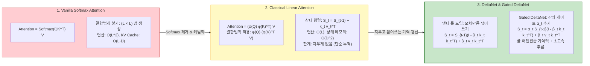
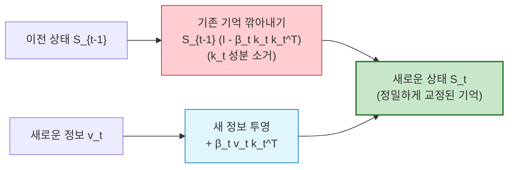
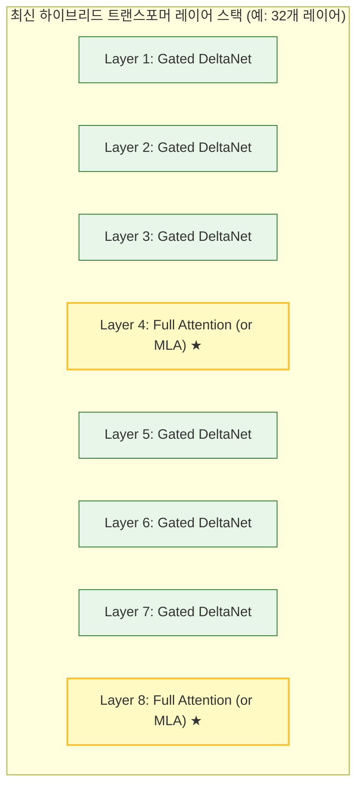

# Linear Attention and DeltaNet

> [!abstract] 핵심 개념 & 3줄 요약
> - **$\mathcal{O}(L^2)$ 병목의 선형화 ($\mathcal{O}(L)$)**: 트랜스포머의 $\operatorname{Softmax}$ 어텐션은 시퀀스 길이 $L$에 따라 연산량과 KV Cache가 제곱으로 폭증하지만, 유사도를 커널 함수 $\phi(\cdot)$로 근사하고 **행렬곱 결합법칙**을 적용하면 시퀀스 길이와 무관한 **고정 크기 상태($D \times D$)를 갖는 선형 복잡도 $\mathcal{O}(L)$ 모델**로 탈바꿈한다 (*Transformers are RNNs*, 2020).
> - **단순 가산의 한계와 델타 룰(Delta Rule)의 돌파구**: 기존 선형 어텐션은 상태를 단순 덧셈($S_t = S_{t-1} + k_t v_t^\top$)으로 누적하여 "지우개가 없는 기억장치"처럼 정보가 포화되는 문제가 있었으나, 1960년대 Widrow-Hoff의 **Delta Rule을 도입한 DeltaNet은 오차만큼 기존 기억을 지우고 덮어쓰는(Erase & Rewrite)** 기억 갱신 능력을 확보했다.
> - **Gated DeltaNet과 최신 하이브리드 LLM 레시피**: 시간 감쇠 게이트($\alpha_t$)와 덮어쓰기 게이트($\beta_t$)를 결합한 **Gated DeltaNet**은 풀 어텐션급 표현력을 달성했으며, 현대 초장문 LLM(Qwen, Kimi KDA 등)은 **초고속 Gated DeltaNet(대다수 레이어) + 정밀 Full Attention/MLA(소수 레이어)의 하이브리드 구조**로 1M+ 토큰 서빙 비용을 획기적으로 낮추고 있다.

---

## 1. 배경: 왜 Vanilla Softmax Attention은 한계에 부딪히는가?

표준 트랜스포머의 Scaled Dot-Product 어텐션([[Attention]])은 다음과 같다:

$$\operatorname{Attention}(Q, K, V) = \operatorname{Softmax}\left(\frac{Q K^\top}{\sqrt{d}}\right) V$$

- $Q, K, V \in \mathbb{R}^{L \times d}$ (시퀀스 길이 $L$, 특징 차원 $d$)
- $Q K^\top \in \mathbb{R}^{L \times L}$ (**어텐션 맵**)

### 문제점
1. **학습 및 Prefill 시 연산량 폭증**: $L \times L$ 행렬곱으로 인해 연산량과 활성화 메모리가 **$\mathcal{O}(L^2 d)$** 로 증가한다 ([[Long-sequence Handling]] 참조).
2. **디코딩(추론) 시 [[KV Cache Optimization|KV Cache]] 메모리 병목**: 이전 모든 토큰의 $K, V$ 벡터를 GPU HBM에 계속 보관해야 하므로, 컨텍스트가 100k, 1M으로 늘어나면 모델 파라미터보다 KV Cache가 GPU 메모리를 더 많이 잠식한다.
3. **결합법칙 불성립**: $\operatorname{Softmax}$라는 비선형 행렬 함수가 $Q K^\top$ 전체에 행(Row) 단위로 묶여 있어, 행렬곱의 결합법칙 $(A B) C = A (B C)$를 절대 적용할 수 없다!

---

## 2. Linear Attention의 기본 원리: 결합법칙의 마법

Katharopoulos et al. (ICML 2020, *Transformers are RNNs*)은 $\operatorname{Softmax}$를 적절한 비선형 커널 특징 매핑 $\phi(\cdot)$ (단, $\phi: \mathbb{R}^d \to \mathbb{R}_+^d$, 예: $\operatorname{ELU}(x) + 1$ 또는 $\operatorname{ReLU}(x)$)로 대체하는 아이디어를 제안했다.

$$q_i \text{와 } k_j \text{의 유사도 } \operatorname{Sim}(q_i, k_j) = \phi(q_i)^\top \phi(k_j)$$

이때 $i$번째 쿼리에 대한 어텐션 출력 $o_i \in \mathbb{R}^d$는 다음과 같이 전개된다:

$$o_i = \frac{\sum_{j=1}^L \phi(q_i)^\top \phi(k_j) \, v_j}{\sum_{j=1}^L \phi(q_i)^\top \phi(k_j)} = \frac{\phi(q_i)^\top \left( \sum_{j=1}^L \phi(k_j) v_j^\top \right)}{\phi(q_i)^\top \left( \sum_{j=1}^L \phi(k_j) \right)}$$

### 2.1. 행렬 곱의 순서 변경 (Associative Law)
전체 시퀀스를 행렬 형태로 보면 분자 항은 다음과 같다:

$$(\phi(Q) \phi(K)^\top) V = \phi(Q) \Big( \phi(K)^\top V \Big)$$

| 구분 | **Vanilla Softmax Attention** | **Linear Attention** |
| :--- | :--- | :--- |
| **행렬 연산 순서** | $\big( \operatorname{Softmax}(Q K^\top) \big) V$ | $\phi(Q) \big( \phi(K)^\top V \big)$ |
| **중간 행렬 크기** | $(L \times d) \times (d \times L) \to \mathbf{(L \times L)}$ | $(d \times L) \times (L \times d) \to \mathbf{(d \times d)}$ |
| **계산 복잡도** | $\mathcal{O}(L^2 d)$ | $\mathbf{\mathcal{O}(L d^2)}$ (시퀀스 길이 $L$에 선형!) |
| **추론 메모리** | 과거 모든 토큰 보관 ($\mathcal{O}(L d)$ KV Cache) | **고정된 $d \times d$ 상태 하나만 보관 ($\mathcal{O}(d^2)$)** |

### 2.2. 추론 시점의 RNN 뷰 (Recurrent View)
인과적(Causal) 마스킹 환경($j \le i$)에서 Linear Attention은 완벽한 **순환 신경망(RNN)** 형태로 1토큰씩 순차 갱신된다:

$$\begin{aligned}
S_t &= S_{t-1} + \phi(k_t) v_t^\top \qquad && (S_t \in \mathbb{R}^{d \times d}: \text{누적 상태 행렬}) \\
z_t &= z_{t-1} + \phi(k_t) && (z_t \in \mathbb{R}^d: \text{분모 정규화 벡터}) \\
o_t &= \frac{S_t^\top \phi(q_t)}{z_t^\top \phi(q_t)} && (o_t \in \mathbb{R}^d: \text{현재 시점 출력})
\end{aligned}$$

- **압도적인 추론 장점**: 아무리 문맥이 100만 토큰으로 길어져도, 이전 토큰들을 뒤적일 필요 없이 고정 크기의 $S_t \in \mathbb{R}^{d \times d}$에 새로운 $\phi(k_t) v_t^\top$만 더해주면 끝난다! (KV Cache 대역폭 병목 완전 해소)

---

## 3. 선형 어텐션의 치명적 결함: "지우개가 없는 기억 장치"

이론적으로 완벽해 보이는 Linear Attention은 실전 언어 모델링에서 풀 트랜스포머에 비해 심각한 성능 저하를 겪었다.

### 3.1. 단순 가산 갱신(Additive Update)의 용량 포화
상태 갱신 식을 다시 보자:
$$S_t = S_0 + \sum_{i=1}^t \phi(k_i) v_i^\top$$
- **기억 덮어쓰기(Overwrite / Erase) 불가능**: 새로운 정보가 들어올 때 기존 기억을 수정하지 못하고 **계속 더하기만** 한다.
- 마치 공책의 같은 페이지에 연필로 글씨를 계속 겹쳐 써서 결국 새카맣게 뭉개지는 것과 같다.
- 수학적으로 $d \times d$ 행렬의 랭크는 최대 $d$에 불과하므로, 수천~수만 토큰이 지나가면 상태 행렬 $S_t$가 잡음(Noise)으로 가득 차 **정보 포화(Saturation)** 가 일어난다.

### 3.2. 연상 기억 (Associative Recall)의 붕괴
언어 모델이 긴 글을 읽고 *"앞서 언급된 전화번호나 고유명사를 정확히 찾아내는 태스크(Needle In A Haystack, Multi-query Associative Recall)"* 에서, Vanilla Attention은 특정 위치의 Key에 높은 Softmax 스파이크를 때려 정밀 인출할 수 있지만, Linear Attention은 모든 벡터가 평균처럼 섞여 있어 특정 값을 핀셋으로 뽑아내는 능력이 현저히 떨어진다.

---

## 4. 해결책 1단계: 델타 룰(Delta Rule)과 DeltaNet

Schlag et al. (NeurIPS 2021, *Linear Transformers with Learnable Kernel Functions*) 및 이후 연구들은 1960년대 고전 머신러닝의 **Widrow-Hoff Delta Rule**(최소평균제곱 오차 수정 규칙)을 상태 갱신에 이식했다.

### 4.1. 델타 룰의 수학적 직관
새로운 키-값 쌍 $(k_t, v_t)$가 들어왔을 때, 단순 누적 대신 다음 질문을 던진다:
> **"현재 내 기억 $S_{t-1}$에 $k_t$를 쿼리로 넣었을 때 무엇이 인출되는가?"** $\to \hat{v}_t = S_{t-1} k_t$
> **"내가 이번에 진짜로 기억해야 할 값 $v_t$와의 오차(Delta)는 얼마인가?"** $\to e_t = v_t - S_{t-1} k_t$

오직 이 **오차 벡터 $e_t$만큼만 기억을 수정**해야 한다!

### 4.2. DeltaNet의 갱신 수식
(단위 벡터 $\|k_t\|_2 = 1$, 학습률/적응 파라미터 $\beta_t \in [0, 1]$ 가정)

$$\begin{aligned}
S_t &= S_{t-1} + \beta_t (v_t - S_{t-1} k_t) k_t^\top \\
&= S_{t-1} \big( I - \beta_t k_t k_t^\top \big) + \beta_t v_t k_t^\top
\end{aligned}$$

- **소거 항 (Erase Term, $I - \beta_t k_t k_t^\top$)**: 직교 여공간 사상 행렬로, 기존 상태 $S_{t-1}$에서 **새로운 키 $k_t$ 방향으로 투영되던 과거의 낡은 성분을 말끔히 지운다!**
- **쓰기 항 (Write Term, $\beta_t v_t k_t^\top$)**: 낡은 성분이 비워진 $k_t$ 방향에 **새로운 목표 값 $v_t$를 덮어쓴다!**
- **효과**: 만약 $\beta_t = 1$이면, $S_t k_t = S_{t-1}(I - k_t k_t^\top)k_t + v_t (k_t^\top k_t) = \mathbf{0} + v_t(1) = v_t$가 되어, **방금 들어온 키에 대해 과거의 오차 없이 정확한 값 $v_t$를 100% 인출**할 수 있게 된다!

---

## 5. 해결책 2단계: Gated DeltaNet (최종 진화형)

DeltaNet의 델타 룰에 더해, 시간의 흐름에 따른 망각(Decay)을 부여하기 위해 **게이팅 메커니즘(Gating Mechanism)** 을 결합한 아키텍처가 **Gated DeltaNet**이다 (Yang et al., 2024 / FlashLinearAttention 프로젝트).

### 5.1. 수식
$$\mathbf{S}_t = \alpha_t \mathbf{S}_{t-1} (\mathbf{I} - \beta_t \mathbf{k}_t \mathbf{k}_t^\top) + \beta_t \mathbf{v}_t \mathbf{k}_t^\top$$

여기서 $\alpha_t, \beta_t$는 모두 입력 토큰 $x_t$로부터 선형 투영 및 시그모이드/소프트플러스로 실시간 계산되는 **데이터 종속적(Data-dependent) 게이트**다:
1. **$\alpha_t \in (0, 1)$ (Decay / Forget Gate)**: 이전 상태 $\mathbf{S}_{t-1}$ 전체를 시간 경과에 따라 얼마나 감쇠시킬지 결정한다 ([[Mamba]]의 Selection $\Delta_t$와 유사한 역할).
2. **$\beta_t \in (0, 1)$ (Update / Write Rate)**: 현재 토큰의 정보를 얼마나 적극적으로 덮어쓸지 결정한다.

### 5.2. 하드웨어 친화적 청크 병렬화 (Chunk-wise Parallel Form)
순수한 $S_t = \dots$ RNN 점화식은 추론 때는 빠르지만 학습 시 GPU의 대규모 병렬성을 방해한다.
Gated DeltaNet은 긴 시퀀스를 크기 $C$ (보통 $64 \sim 128$)의 **청크(Chunk)** 단위로 쪼갠다:
- **청크 내부(Intra-chunk)**: $\beta_t k_t k_t^\top$ 전개식을 삼각 블록 행렬로 변환하여 GPU Tensor Core를 통한 행렬곱으로 고속 병렬 처리.
- **청크 간(Inter-chunk)**: 청크 간 상태 전이만 스캔(Parallel Associative Scan)으로 빠르게 넘김.
- 이를 고도로 최적화한 오픈소스 라이브러리가 **FLA (FlashLinearAttention)** 다.

---

## 6. 최신 프론티어 LLM의 실전 레시피: Hybrid Architecture

최근 알리바바(Qwen2.5 1M 모델군), 문샷 AI(Kimi k0-math, KDA), 딥시크(DeepSeek) 등의 연구에서 나타난 공통 결론은 **"어텐션을 100% 버릴 필요는 없다"**는 것이다.

### 왜 하이브리드인가?
- **Gated DeltaNet (약 75% ~ 85% 레이어)**: 대부분의 층을 차지하며, 로컬 문맥 요약과 스트리밍 정보 압축을 $\mathcal{O}(L)$ 속도와 제로 KV Cache 메모리로 처리한다.
- **Full Attention / MLA (약 15% ~ 25% 레이어)**: 3~4개 블록마다 한 번씩 배치되어, 전체 시퀀스를 망라하는 초정밀 전역 검색(Global Retrieval)과 Needle in a Haystack 능력을 완벽하게 보전한다.
- **결과**:
  - Full Attention 단독 모델 대비 **추론 처리량(Throughput) $2 \sim 4\times$ 증가**
  - 초장문(128k ~ 1M) 추론 시 **KV Cache 메모리 사용량 최대 80% 절감**
  - 벤치마크 평가 성능은 순수 트랜스포머와 **동등하거나 도리어 능가**!

---

## 7. 아키텍처 비교 총정리

| 모델 / 기법 | 연산 복잡도 | 추론 상태 크기 | 기억 갱신 방식 | 강점 | 취약점 |
| :--- | :--- | :--- | :--- | :--- | :--- |
| **Vanilla Transformer** | $\mathcal{O}(L^2)$ | $\mathcal{O}(L \cdot d)$ (KV Cache 계속 증가) | 전체 재참조 (Full Matrix) | 연상 기억 및 복잡한 추론 최강 | 롱컨텍스트 연산/메모리 한계 |
| **Classical Linear Attn** | $\mathcal{O}(L)$ | $\mathcal{O}(d^2)$ (고정) | 단순 누적 ($S + kv^\top$) | 선형 연산, 빠른 속도 | 덮어쓰기 불가, 기억력 급락 |
| **Mamba (SSM)** | $\mathcal{O}(L)$ | $\mathcal{O}(d \cdot n)$ (고정 벡터 상태) | 입력 의존적 지수 감쇠 ($\bar{A}_t$) | 하드웨어 스캔 최적화, 긴 문맥 처리 | Matrix 상태가 아닌 Vector 상태라 용량 제약 |
| **Gated DeltaNet** | $\mathcal{O}(L)$ | $\mathcal{O}(d^2)$ (고정 행렬 상태) | **감쇠($\alpha_t$) + 델타 룰($\beta_t$)** | 행렬 상태 기반 고용량 기억, 덮어쓰기 가능 | Softmax 스파이크 대비 정밀 인출은 소폭 열세 |
| **Hybrid (Delta + Full)** | $\mathcal{O}(L)$ 준선형 | 대폭 감소 (일부 레이어만 KV Cache) | **상태 압축 + 전역 검색 상호 보완** | **현재 초장문 서빙의 실전 최적해** | 복합 구조 설계 및 튜닝 복잡도 |

---

## 8. 한 줄 요약

> **Linear Attention은 행렬곱 결합법칙으로 트랜스포머의 제곱 복잡도를 선형으로 부쉈고, DeltaNet은 과거 기억을 지우고 덮어쓰는 델타 룰로 표현력의 날개를 달았으며, Gated DeltaNet과 Full Attention의 하이브리드 결합이 1M+ 토큰 시대를 여는 핵심 열쇠가 되고 있다.**

---
연관 노트: [[Attention]], [[Long-sequence Handling]], [[KV Cache Optimization]], [[Inference Acceleration]], [[Mamba]], [[Transformer Accounting]]
