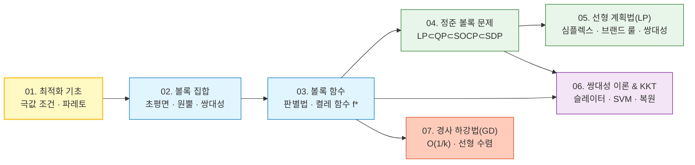
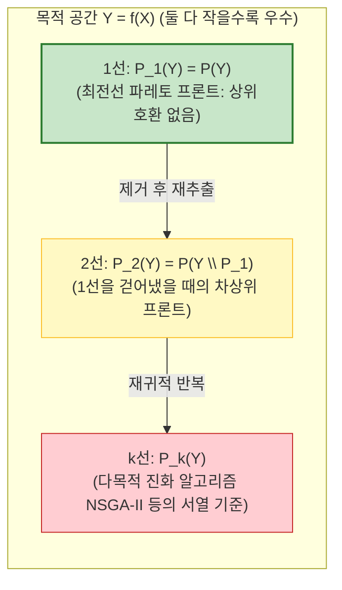

# 01. 최적화 기초, 최적성 조건 및 파레토 최적화

> [!abstract] 개요 & 시리즈 로드맵
> 본 시리즈는 **생새우초밥집 [최적화이론]** 과 **[모두를 위한 컨벡스 최적화 (CMU 10-725 / Stanford EE364a)]** 의 핵심 이론·수식·증명을 하나로 통합 재구성한 수리 최적화 노트다.
> - **한 줄 핵심**: 일반 비볼록(Non-convex) 최적화에서는 국소 최적해($\nabla f(x^*)=0, \nabla^2 f(x^*) \succeq 0$)를 구하는 것조차 버겁고 전역 최적성을 보장할 수 없으나, **볼록 최적화(Convex Optimization)** 문제로 정식화되는 순간 **"모든 국소 최적해 = 전역 최적해"** 가 성립하며, 목적함수가 벡터로 확장되면 **파레토 프론트(Pareto Front)** 위의 트레이드오프 문제로 귀결된다.

| 노트                                              | 통합 범위 (생새우초밥집 + 모두를 위한 컨벡스 최적화 `Ch 01~14`)                                                                                                |
| :---------------------------------------------- | :---------------------------------------------------------------------------------------------------------------------------------------- |
| **01. 본 노트**                                    | 최적화 기법, 1·2계 극값 조건, 교대 최적화, 파레토 최적화/프론트 + `Ch 01, 04` (볼록 최적화 기초·동치 변환)                                                                   |
| [[02. Convex Sets]]                             | `Ch 02` 아핀·볼록 집합, 볼록 원뿔($\mathbb{S}_+^n, \mathcal{Q}^{n+1}$), 분리·지지 초평면, 쌍대 원뿔과 일반화 부등식                                                   |
| [[03. Convex Functions]]                        | `Ch 03` 볼록 함수 판별법, 강볼록($m$)·매끄러움($L$), 연산 보존 법칙, 펜첼 켤레 함수($f^*$), 준볼록·로그오목                                                                |
| [[04. Canonical Convex Problems]]               | `Ch 05` 정준 볼록 계층 $\text{LP} \subset \text{QP} \subset \text{QCQP} \subset \text{SOCP} \subset \text{SDP} \subset \text{CP}$ 및 슈어 보수 매장 증명 |
| [[05. Linear Programming & Simplex Method]]     | 선형 계획법 전 범위(BFS 유일·존재성, 기본정리, 딕셔너리·심플렉스, Phase I, 브랜드 룰 증명, 약·강쌍대성 증명) + `Ch 10`                                                          |
| [[06. Duality Theory & KKT Conditions]]         | `Ch 11, 12, 13` 라그랑주 쌍대성, 슬레이터 조건, KKT 필요충분조건, 워터필링·SVM·Lasso 쌍대 및 $\ell_1$ 유일성                                                           |
| [[07. Gradient Descent & Convergence Analysis]] | `Ch 06` 경사 하강법, 백트래킹 선탐색, $\mathcal{O}(1/k)$ 및 강볼록 선형 수렴 $\mathcal{O}(c^k)$ 증명, 그래디언트 부스팅, SGD                                            |

---

## 1. 최적값($\min, \max$)과 최적해($\arg\min, \arg\max$)의 엄밀한 정의

일상적으로는 최대·최소를 직관적으로 쓰지만, 수학적으로 **최적값(Optimal Value)** 과 **최적해(Optimal Solution / Optimizer)** 는 공역 자체가 완전히 다른 사상이다.

### 1.1. 집합과 함수의 최적값
전순서집합 $(Y, \le)$ (보통 $Y = \mathbb{R} \cup \{\pm\infty\}$)과 정의역 $X$, 부분집합 $S \subseteq X$에 대해 함수 $f \in Y^X$ ($f: X \to Y$)의 상(Image)을 $f(S) := \{f(x) : x \in S\}$라 하자.
- **최소값과 최대값**: $\min_S, \max_S : Y^X \to Y$는 존재하는 경우 **유일한 스칼라 값**을 반환한다.
  $$\min_{x \in S} f(x) = y_* \in f(S) \quad \text{s.t.} \quad y_* \le y, \; \forall y \in f(S)$$
- 반개구간 $[0, 1)$에서의 최대값처럼 달성되지 않을 수 있으므로, 일반적인 최적화 이론에서는 항상 존재하는 **하한(Infimum, $\inf_S f$)** 과 **상한(Supremum, $\sup_S f$)** 을 표준 최적값 $p^*$로 정의한다.

### 1.2. 최적해: 왜 $\arg\min$의 공역은 멱집합($2^X$)인가?
최적값 $p^*$는 존재하면 유일하지만, 함수 $f$가 단사(Injective)가 아니라면 같은 최소값을 달성하는 점 $x_*$는 여러 개일 수도 있고 공집합($\emptyset$)일 수도 있다. 따라서 **최소인수($\arg\min$)와 최대인수($\arg\max$)의 공역은 $X$가 아니라 $X$의 멱집합(Power set) $2^X$** 다.

$$\arg\min_{x \in S} f(x) := \left\{ x_* \in S : f(x_*) \le f(x), \; \forall x \in S \right\} \in 2^X$$
$$\arg\max_{x \in S} f(x) := \left\{ x_* \in S : f(x_*) \ge f(x), \; \forall x \in S \right\} \in 2^X$$

- 예: $f(x) = |(x-a)(x-b)|$ ($a \neq b$)일 때, 최소값은 $\min_{\mathbb{R}} f = 0$ (유일한 실수)이지만 최소해 집합은 $\arg\min_{\mathbb{R}} f = \{a, b\}$다.
- **최소화와 최대화의 동치성**: $\max_{x \in S} f(x) = -\min_{x \in S} (-f(x))$이고 $\arg\max_{x \in S} f(x) = \arg\min_{x \in S} (-f(x))$이므로, 일반성을 잃지 않고 모든 최적화 이론은 **최소화(Minimization)** 기준으로 서술한다 (거리·노름·손실함수 등 하계가 $0$인 함수가 수학의 주류이기 때문이기도 하다).

### 1.3. 국소 최적해의 분류 (전역 · 국소 · 엄격 · 고립)
목적함수 $f : \mathbb{R}^n \to \mathbb{R}$에 대하여:
1. **전역 최적해 (Global Optimizer)**: 모든 $x \in \operatorname{dom} f$에 대해 $f(x^*) \le f(x)$.
2. **국소 최적해 (Local Optimizer)**: $x^*$의 어떤 열린 근방(Neighborhood) $\mathcal{N}$이 존재하여 모든 $x \in \mathcal{N}$에 대해 $f(x^*) \le f(x)$.
3. **엄격한 국소 최적해 (Strict Local Optimizer)**: 근방 $\mathcal{N}$ 내의 $x \neq x^*$에 대해 등호 없이 **$f(x^*) < f(x)$** (평평한 바닥을 불허).
4. **고립된 국소 최적해 (Isolated Local Optimizer)**: 근방 $\mathcal{N}$ 안에서 국소 최적해가 **오직 $x^*$ 하나뿐**인 경우. (엄격한 국소 최적해보다 더 강한 조건이다. 예컨대 $f(x) = x^4(2 + \sin(1/x))$는 $x=0$에서 엄격한 국소 최소점이지만, $0$으로 수렴하는 무수한 국소 최소점들에 둘러싸여 있어 고립되어 있지 않다.)

---

## 2. 무제약 다변수 최적화의 1계·2계 필요/충분 조건

제약이 없는 매끄러운 함수 $\min_{x \in \mathbb{R}^n} f(x)$에서 미적분학이 알려주는 극값 판별 정리와 그 엄밀한 증명이다.

### 2.1. 1계 필요조건 (First-Order Necessary Condition, FONC)

> [!attention] 정리 2.1 (1계 필요조건 — Fermat's Theorem)
> $x^* \in \mathbb{R}^n$가 $f$의 국소 최적해이고 $x^*$의 근방에서 $f \in C^1$ (그래디언트 $\nabla f$가 연속)이면,
> $$\nabla f(x^*) = \mathbf{0}$$

> [!note] 증명 (귀류법과 테일러 정리)
> $\nabla f(x^*) \neq \mathbf{0}$이라 가정하고, 하강 방향 벡터 $p := -\nabla f(x^*)$를 잡자. 그러면
> $$p^\top \nabla f(x^*) = -\|\nabla f(x^*)\|_2^2 < 0$$
> 이다. $\nabla f$가 연속이므로 어떤 양수 $s > 0$가 존재하여 모든 $\xi \in [0, s]$에 대해 $p^\top \nabla f(x^* + \xi p) < 0$을 유지한다.
> 이제 1차 테일러 정리(평균값 정리)를 적용하면 어떤 $\bar{\xi} \in (0, \xi)$에 대하여
> $$f(x^* + \xi p) = f(x^*) + \xi \, p^\top \nabla f(x^* + \bar{\xi} p) < f(x^*), \quad \forall \xi \in (0, s]$$
> 가 성립한다. 이는 아무리 작은 근방을 잡아도 $x^*$보다 함수값이 작은 점이 존재함을 뜻하므로, $x^*$가 국소 최소해라는 가정에 모순이다. 따라서 $\nabla f(x^*) = \mathbf{0}$이다. $\blacksquare$

### 2.2. 2계 필요조건 및 충분조건 (SONC & SOSC)

$\nabla f(x^*) = \mathbf{0}$인 점을 **정류점(Stationary Point)** 이라 한다. 정류점은 극소점, 극대점, 혹은 **안장점(Saddle Point)** 일 수 있으므로 헤시안 행렬 $\nabla^2 f(x^*) \in \mathbb{S}^n$의 부호성으로 곡률을 판별한다.

> [!attention] 정리 2.2 (2계 필요조건 및 2계 충분조건)
> $x^*$의 열린 근방에서 $f \in C^2$ ($\nabla^2 f$가 연속)라 하자.
> 1. **2계 필요조건 (SONC)**: $x^*$가 국소 최소해이면, $\nabla f(x^*) = \mathbf{0}$이고 헤시안은 **양의 반정부호(PSD)** 다:
>    $$\nabla^2 f(x^*) \succeq 0 \quad \left(\forall p \in \mathbb{R}^n, \; p^\top \nabla^2 f(x^*) p \ge 0\right)$$
> 2. **2계 충분조건 (SOSC)**: 만약 $\nabla f(x^*) = \mathbf{0}$이고 헤시안이 **양의 정부호(PD, $\nabla^2 f(x^*) \succ 0$)** 이면, $x^*$는 **엄격한 국소 최소해(Strict Local Minimizer)** 다.

> [!note] 증명
> **1. 필요조건 증명**: 정리 2.1에 의해 $\nabla f(x^*) = \mathbf{0}$이다. 귀류법으로 $\nabla^2 f(x^*) \nsucceq 0$이라 가정하면, 음의 곡률을 갖는 벡터 $p \in \mathbb{R}^n$ ($p^\top \nabla^2 f(x^*) p < 0$)가 존재한다. $\nabla^2 f$의 연속성에 의해 어떤 $s > 0$가 존재하여 모든 $\xi \in [0, s]$에서 $p^\top \nabla^2 f(x^* + \xi p) p < 0$이다. 2차 테일러 전개에 $\nabla f(x^*)=\mathbf{0}$을 대입하면 어떤 $\bar{\xi} \in (0, \xi)$에 대해
> $$f(x^* + \xi p) = f(x^*) + \underbrace{\xi p^\top \nabla f(x^*)}_{=0} + \frac{1}{2}\xi^2 \underbrace{p^\top \nabla^2 f(x^* + \bar{\xi}p) p}_{< 0} < f(x^*), \quad \forall \xi \in (0, s]$$
> 가 되어 국소 최소성에 모순이다. 따라서 $\nabla^2 f(x^*) \succeq 0$이다.
>
> **2. 충분조건 증명**: $\nabla^2 f(x^*) \succ 0$이고 $\nabla^2 f$가 연속이므로, 충분히 작은 반지름 $r > 0$의 열린 공 $B_r(x^*) = \{x : \|x - x^*\|_2 < r\}$ 안의 모든 $x$에서 여전히 $\nabla^2 f(x) \succ 0$이 유지된다. 이제 $0 < \|p\|_2 < r$인 임의의 영 아닌 변위 벡터 $p$를 잡으면, 어떤 $\xi \in (0, 1)$에 대해 $x^* + \xi p \in B_r(x^*)$이므로
> $$f(x^* + p) = f(x^*) + \frac{1}{2} p^\top \nabla^2 f(x^* + \xi p) p > f(x^*)$$
> 가 성립한다. 즉 근방 내 모든 $x \neq x^*$에 대해 $f(x) > f(x^*)$이므로 $x^*$는 엄격한 국소 최소해다. $\blacksquare$

> [!warning] 주의: 2계 충분조건의 역은 성립하지 않는다!
> $f(x) = x^4$는 $x^*=0$에서 엄격한 전역 최소해를 갖지만 $f''(0) = 0$ (양의 정부호가 아닌 양의 반정부호)이다. 즉 $\nabla^2 f(x^*) \succeq 0$이지만 $\nsucc 0$인 경계 케이스에서는 고차 도함수나 **볼록성(Convexity)** 이 필요하다.

---

## 3. 일반 최적화에서 볼록 최적화(Convex Optimization)로의 도약

### 3.1. 일반 최적화 문제와 볼록 최적화 문제의 표준 표기
일반적인 제약 최적화 문제(Optimization Problem)는 다음과 같이 기술한다.

$$\begin{aligned}
\min_{x \in D} \quad & f_0(x) \\
\text{subject to} \quad & f_i(x) \le 0, \quad i = 1, \dots, m \\
& h_j(x) = 0, \quad j = 1, \dots, p
\end{aligned}$$

- **공통 정의역 (Domain)**: $D = \left(\bigcap_{i=0}^m \operatorname{dom} f_i\right) \cap \left(\bigcap_{j=1}^p \operatorname{dom} h_j\right)$.
- **가능해 / 가용해 (Feasible Point)**: 모든 부등식·등식 제약을 만족하는 $x \in D$. 가능해 전체의 집합 $C$를 **가능 집합(Feasible Set)** 이라 한다. ($C = \emptyset$이면 **비가용 Infeasible**이라 하며 관례상 최적값 $p^* = +\infty$로 둔다. 반대로 목적함수가 아래로 끝없이 내려가면 **무한 Unbounded below**, $p^* = -\infty$로 둔다.)
- **$\epsilon$-준최적해 ($\epsilon$-suboptimal point)**: 가능해 $x$가 $f_0(x) \le p^* + \epsilon$을 만족할 때.
- **활성 제약 (Active Constraint)**: 가능해 $x$에서 $f_i(x) = 0$으로 등호가 딱 걸려 있는 부등식 제약 ($f_i(x) < 0$이면 비활성 Inactive).

위 문제에서 다음 두 조건이 추가되면 **볼록 최적화 문제(Convex Optimization Problem)** 가 된다!
1. 목적함수 $f_0$와 모든 부등식 제약 함수 $f_1, \dots, f_m$이 **[[03. Convex Functions|볼록 함수(Convex Function)]]** 이다.
2. 모든 등식 제약 함수 $h_1, \dots, h_p$가 **아핀 함수(Affine Function, 즉 $h_j(x) = a_j^\top x - b_j \iff Ax = b$)** 이다.

> [!tip] 왜 등식 제약 $h_j(x) = 0$은 반드시 선형(아핀)이어야 하는가?
> $h_j(x) = 0 \iff h_j(x) \le 0 \text{ 이고 } -h_j(x) \le 0$이다. $h_j$와 $-h_j$가 동시에 볼록 함수가 되려면 $h_j$는 볼록이면서 동시에 오목인 **아핀 함수**일 수밖에 없다! 덕분에 볼록 최적화 문제의 가능 집합 $C = \left(\bigcap_{i=1}^m \{x : f_i(x) \le 0\}\right) \cap \{x : Ax = b\}$는 볼록 하위레벨 집합들과 초평면들의 교집합이 되어 항상 **[[02. Convex Sets|볼록 집합]]** 을 이룬다.

---

### 3.2. 볼록 최적화의 황금 정리: 국소 최적해 = 전역 최적해

일반 비볼록 문제에는 "국소 최적해가 전역 최적해임을 보장하는 정리"가 존재하지 않는다. 그러나 볼록 최적화에서는 이 난제가 단번에 소멸한다.

> [!attention] 정리 3.1 (볼록 최적화의 기본 성질과 해집합의 볼록성)
> 볼록 최적화 문제 $\min_{x \in C} f_0(x)$에 대하여:
> 1. **국소 최적해는 곧 전역 최적해다.**
> 2. 전역 최적해들의 집합 $X_{\text{opt}} := \{x \in C : f_0(x) = p^*\}$는 **볼록 집합**이다.
> 3. 만약 목적함수 $f_0$가 **엄격 볼록(Strictly Convex)** 이고 $X_{\text{opt}} \neq \emptyset$이면, 최적해 $x^*$는 **유일(Unique)** 하다.

> [!note] 증명
> **1. 국소 = 전역 증명**: $x \in C$가 반지름 $R > 0$ 안에서 국소 최적해($\forall z \in C \cap B_R(x), \, f_0(x) \le f_0(z)$)인데 전역 최적해는 아니라고 귀류법으로 가정하자. 그러면 어떤 가능해 $y \in C$가 존재하여 $f_0(y) < f_0(x)$다.($\|y - x\|_2 > R$).
> 이제 두 점 $x, y$를 잇는 선분 위의 점 $z = (1-\theta)x + \theta y$를 잡되, $\theta = \frac{R}{2\|y-x\|_2} \in (0, 1)$로 선택하자.
> - 가능 집합 $C$가 볼록이므로 $z \in C$이다.
> - $\|z - x\|_2 = \theta \|y - x\|_2 = R/2 < R$이므로 $z$는 $x$의 국소 근방 안에 들어온다!
> - 한편 $f_0$의 볼록성(Jensen 부등식)에 의해
>   $$f_0(z) = f_0\big((1-\theta)x + \theta y\big) \le (1-\theta)f_0(x) + \theta f_0(y) < (1-\theta)f_0(x) + \theta f_0(x) = f_0(x)$$
> 가 되어 근방 내 최소성 $f_0(x) \le f_0(z)$에 정면 모순이다! 따라서 모든 국소 최적해는 전역 최적해다.
>
> **2 & 3. 해집합 볼록성 및 유일성**: $X_{\text{opt}} = C \cap \{x : f_0(x) \le p^*\}$는 볼록 집합들의 교집합이므로 볼록이다. 만약 $f_0$가 엄격 볼록인데 서로 다른 두 최적해 $x_1 \neq x_2$가 존재한다면, 중점 $\bar{x} = \frac{1}{2}x_1 + \frac{1}{2}x_2 \in C$에서 $f_0(\bar{x}) < \frac{1}{2}p^* + \frac{1}{2}p^* = p^*$가 되어 $p^*$가 최소값임에 모순이다. $\blacksquare$

---

### 3.3. 볼록 최적화의 1차 최적성 조건 (First-Order Optimality Condition)

제약이 있는 볼록 집합 $C$ 위에서 미분 가능한 볼록 함수 $f$를 최소화할 때는 $\nabla f(x^*) = \mathbf{0}$이 성립하지 않을 수 있다(경계에 부딪혀 더 못 내려가는 경우!). 이를 일반화한 필요충분조건은 다음과 같다.

> [!attention] 정리 3.2 (제약 볼록 최적화의 1차 필요충분조건)
> 볼록 집합 $C$ 위에서 미분 가능한 볼록 함수 $f$를 최소화할 때, 가능해 $x \in C$가 전역 최적해일 **필요충분조건**은 다음과 같다.
> $$\nabla f(x)^\top (y - x) \ge 0, \qquad \forall y \in C$$

- **기하학적 의미**: $-\nabla f(x)$는 함수값이 가장 가파르게 감소하는 방향이다. 위 부등식 $(-\nabla f(x))^\top (y - x) \le 0$은 **"가능 집합 $C$ 안의 어느 점 $y$를 향해 이동하더라도$(y-x)$, 감소 방향 $-\nabla f(x)$와 둔각($\ge 90^\circ$)을 이룬다(즉, $-\nabla f(x)$가 $x$에서 $C$의 법선 원뿔 Normal Cone $\mathcal{N}_C(x)$에 속한다)"** 는 뜻이다!
- **특수 사례 3가지 즉시 유도**:
  1. **무제약 ($C = \mathbb{R}^n$)**: 임의의 $v \in \mathbb{R}^n$에 대해 $y = x \pm v \in \mathbb{R}^n$을 대입하면 $\pm \nabla f(x)^\top v \ge 0 \implies \nabla f(x) = \mathbf{0}$ (고전 페르마 정리 복원!).
  2. **등식 제약 ($C = \{y : Ay = b\}$)**: 임의의 $v \in \operatorname{null}(A)$에 대해 $y = x + v \in C$이므로 $\nabla f(x)^\top v \ge 0$이고 $-v \in \operatorname{null}(A)$도 대입하면 $\nabla f(x) \perp \operatorname{null}(A) = \operatorname{row}(A)^\perp \implies \exists \nu \text{ s.t. } \nabla f(x) + A^\top \nu = \mathbf{0}$ (라그랑주 승수법 복원!).
  3. **비음 제약 ($C = \mathbb{R}_+^n = \{y \ge 0\}$)**:
     - 모든 $y \ge 0$에서 $\nabla f(x)^\top y \ge \nabla f(x)^\top x$. $y_i \to \infty$로 보내봐도 하계가 유지되려면 **$\nabla f(x) \ge \mathbf{0}$**.
     - $y = \mathbf{0}$을 대입하면 $\nabla f(x)^\top x \le 0$인데 $x \ge 0, \nabla f(x) \ge 0$이므로 각 성분별로 **$x_i [\nabla f(x)]_i = 0$** (상보적 여유성!).

---

## 4. 문제 변형 테크닉 (Equivalent Transformations)과 교대 최적화

겉보기에 비볼록이거나 다루기 까다로운 문제를 해를 잃지 않고 쉬운 동치 문제로 바꾸는 6가지 표준 도구다 (CMU Ch 04 & 생새우초밥집 통합).

1. **단조 증가 함수 합성 (Monotone Transformation)**:
   $\phi : \mathbb{R} \to \mathbb{R}$가 엄격 단조 증가 함수이면 $\arg\min_{x \in C} f_0(x) = \arg\min_{x \in C} \phi(f_0(x))$다. (예: 최대우도추정 $\max L(\theta)$에 $\log$를 씌워 $\min -\log L(\theta)$ 볼록 문제로 변환!)
2. **변수 치환 (Change of Variables)**:
   전단사 사상 $\phi : \tilde{D} \to D$에 대해 $x = \phi(\tilde{x})$로 치환한다. (예: 기하 계획법 Geometric Programming에서 양수 변수 $x_i = e^{y_i}$로 치환하면 비볼록 다항식 문제인 Posynomial이 볼록 Log-sum-exp 문제로 마법처럼 바뀐다!)
3. **등식 제약 소거 (Eliminating Equality Constraints)**:
   선형 등식 제약 $Ax = b$의 특수해 하나를 $x_0$ ($Ax_0 = b$), 영공간 $\operatorname{null}(A)$의 기저 행렬을 $F \in \mathbb{R}^{n \times k}$ ($\operatorname{col}(F) = \operatorname{null}(A)$)라 하면, 모든 가능해는 $x = Fz + x_0$ ($z \in \mathbb{R}^k$)로 매개화되어 **등식 제약 없는 무제약/부등식 문제** $\min_z f_0(Fz + x_0)$로 차원이 축소된다.
4. **슬랙 변수 도입 (Introducing Slack Variables)**:
   부등식 제약 $f_i(x) \le 0$에 여유분 변수 $s_i \ge 0$을 도입하여 $f_i(x) + s_i = 0, \, s_i \ge 0$으로 바꾼다. (단, 일반 볼록 $f_i$에 쓰면 비선형 등식이 되어 볼록성이 깨지므로 **오직 $f_i$가 아핀 함수인 선형 계획법 $a_i^\top x + s_i = b_i$에서 핵심적으로 사용**한다 $\to$ [[05. Linear Programming & Simplex Method]]).
5. **완화 / 이완 (Relaxation)**:
   비볼록 제약 집합 $C$를 그것을 감싸는 더 큰 볼록 집합 $\tilde{C} \supseteq C$로 넓혀 푸는 기법이다(예: 정수 제약 $x_i \in \{0, 1\} \to x_i \in [0, 1]$ 선형 이완, 비볼록 랭크 제약 $\to$ 핵 노름/SDP 이완). 이완 문제의 최적값은 항상 원문제 최적값의 **하한(Lower bound)** 을 제공한다!
6. **부분 최적화(Partial Optimization)와 교대 최적화(Alternating Optimization)**:
   - **부분 최적화**: $\min_{x, y} f_0(x, y) = \min_x \tilde{f}_0(x)$ ($\tilde{f}_0(x) := \inf_y f_0(x, y)$). 공동 볼록 함수에서 일부 변수를 먼저 최적화해 날려도 남은 함수 $\tilde{f}_0(x)$의 볼록성이 보존된다! (Schur complement 유도의 핵심 원리.)
   - **교대 최적화 (Alternating Optimization)**: 두 블록 변수 $(x, y)$에 대해 전체 문제 $\min_{x, y} H(x, y)$는 동시에 풀기 어렵거나 비볼록(예: 쌍선형 Biconvex)이지만, **한쪽을 고정하면 다른 쪽 부분 문제는 쉽게(종종 볼록하게!) 풀릴 때** 번갈아 갱신한다:
     $$\begin{cases} x^{(k+1)} \in \arg\min_{x} H\big(x, \, y^{(k)}\big) \\ y^{(k+1)} \in \arg\min_{y} H\big(x^{(k+1)}, \, y\big) \end{cases}$$
     매 스텝 $H(x^{(k+1)}, y^{(k+1)}) \le H(x^{(k+1)}, y^{(k)}) \le H(x^{(k)}, y^{(k)})$로 목적함수 값이 단조 감소한다. **[[군집 분석|K-means]]**(할당 $\leftrightarrow$ 중심점 이동), **[[Gaussian Mixture Model|EM 알고리즘]]**(E-step $\leftrightarrow$ M-step), 행렬 분해(ALS), 블록 좌표 하강법(Block Coordinate Descent)이 모두 교대 최적화의 대표적인 구현체다.

---

## 5. 다목적 최적화: 파레토 최적화와 파레토 프론트 (Pareto Optimization)

단일 스칼라 손실 $f : \mathbb{R}^n \to \mathbb{R}$이 아니라, 서로 상충하는 $m$개의 목적함수(예: 모델 정확도 $\uparrow$ vs 추론 지연시간 $\downarrow$ vs 메모리 사용량 $\downarrow$)를 동시에 최적화해야 하는 **다목적 최적화 문제(Multi-objective Optimization)** 를 살펴보자.

$$\mathbf{f}(\mathbf{x}) = \big(f_1(\mathbf{x}), f_2(\mathbf{x}), \dots, f_m(\mathbf{x})\big) : X \subseteq \mathbb{R}^n \to \mathbb{R}^m$$

$\mathbb{R}^m$ ($m \ge 2$)에는 실수 직선 같은 자연스러운 전순서(Total Order)가 존재하지 않는다. 따라서 **"누가 누구보다 명백히 우월한가(압도, Dominance)"** 라는 부분 순서(Partial Order)를 정의한다.

### 5.1. 파레토 지배(Dominance)와 파레토 프론트(Pareto Front)
설명의 편의를 위해 **최소화 기준**으로 통일하자 (최대화 기준에서는 부등호만 모두 뒤집으면 완전히 동일하다). 가용해 집합 $X$의 치역(목적함수 공간의 달성 가능한 점들의 집합)을 $Y = \mathbf{f}(X) \subseteq \mathbb{R}^m$이라 하자.

1. **지배 관계 (Pareto Dominance, $\mathbf{y}' \prec_P \mathbf{y}$)**:
   두 결과 벡터 $\mathbf{y}', \mathbf{y} \in Y$에 대하여, **모든 목적함수에서 $\mathbf{y}'$이 $\mathbf{y}$보다 나쁘지 않고($y'_k \le y_k$), 적어도 하나의 목적함수에서는 엄격히 더 좋을 때($\exists j, \, y'_j < y_j$)**, $\mathbf{y}'$이 $\mathbf{y}$를 **지배(압도, Dominate)** 한다고 말한다.
   $$\mathbf{y}' \prec_P \mathbf{y} \iff \big(\forall k \in \{1,\dots,m\}, \; y'_k \le y_k\big) \;\wedge\; \big(\exists j \in \{1,\dots,m\}, \; y'_j < y_j\big)$$
   *(참고: 문헌에 따라 모든 성분이 엄격히 좋은 $y'_k < y_k, \forall k$를 강한 지배 Strict Dominance로 구분하며, 강한 지배를 당하지 않는 점은 약한 파레토 최적 Weakly Pareto Optimal이라 부른다 $\to$ [[02. Convex Sets]] §5 일반화 부등식 참조.)*

2. **파레토 최적해 (Pareto Optimal Point)와 파레토 프론트 (Pareto Front, $P(Y)$)**:
   자신을 지배하는(즉, 아무런 희생 없이 다른 지표를 개선할 수 있는 **상위호환**) 다른 가능해가 **단 하나도 존재하지 않는** 해 $\mathbf{x}^* \in X$를 **파레토 최적해**라 하고, 이들의 함숫값 벡터들이 이루는 전선(경계면)을 **파레토 프론트 $P(Y)$** 라 한다.
   $$P(Y) := Y \setminus \left\{ \mathbf{y} \in Y : \exists \mathbf{y}' \in Y \text{ s.t. } \mathbf{y}' \prec_P \mathbf{y} \right\}$$

> [!tip] 파레토 프론트의 물리적·경제학적 의미
> - **파레토 개선 (Pareto Improvement)**: 누군가의 손해 없이 최소 한 명(한 지표)을 더 좋게 만드는 이동 (내부 점에서 프론트 쪽으로 이동).
> - **파레토 최적 = 순수 트레이드오프 영역**: 파레토 프론트 $P(Y)$ 위에 도달한 순간부터는 **"정확도를 1% 더 올리려면 반드시 지연시간을 희생해야만 하는"** 타협의 영역에 진입한다. 반대로 $P(Y)$ 바깥에 있는 열등해(Dominated solution)는 상위호환 해가 명백히 존재하므로 채택할 이유가 전혀 없다.

### 5.2. 1선, 2선, $k$선 비지배 정렬 (Non-dominated Sorting)
진화 연산(NSGA-II)이나 다목적 [[Bayesian Optimization]]에서는 해집합 전체에 서열을 매기기 위해 파레토 프론트를 재귀적으로 벗겨낸다. $P_1(Y) := P(Y)$를 **1선(First Front)** 이라 할 때, 이전 전선들을 제외한 나머지 집합의 파레토 프론트를 **$k$선($k$-th Front)** 으로 정의한다.
$$P_k(Y) := P\left( Y \setminus \bigcup_{j=1}^{k-1} P_j(Y) \right)$$

### 5.3. 스칼라화(Scalarization / 가중합)와 볼록성의 결정적 연결!
실무에서 다목적 최적화를 가장 쉽게 푸는 방법은 양수 가중치 벡터 $\boldsymbol{\lambda} = (\lambda_1, \dots, \lambda_m) \succ \mathbf{0}$를 곱해 단일 스칼라 목적함수로 합치는 **선형 스칼라화(Linear Scalarization)** 다.

$$\min_{\mathbf{x} \in X} \; L_0(\mathbf{x}) = \sum_{k=1}^{m} \lambda_k f_k(\mathbf{x}) = \boldsymbol{\lambda}^\top \mathbf{f}(\mathbf{x})$$

- **항상 성립하는 방향**: $\boldsymbol{\lambda} \succ \mathbf{0}$일 때, 위 가중합 문제의 최적해 $\mathbf{x}^*$는 **문제의 볼록성 여부와 무관하게 무조건 파레토 최적해**다! (만약 $\mathbf{x}^*$를 지배하는 $\mathbf{x}'$이 있다면 $\lambda_k > 0$이므로 $\boldsymbol{\lambda}^\top \mathbf{f}(\mathbf{x}') < \boldsymbol{\lambda}^\top \mathbf{f}(\mathbf{x}^*)$가 되어 모순이기 때문.)
- **역방향은 볼록할 때만 성립!**:
  - 모든 $f_k$와 $X$가 **볼록(Convex)** 이면, 분리 초평면 정리에 의해 가중치 $\boldsymbol{\lambda} \succeq \mathbf{0}$ ($\boldsymbol{\lambda} \neq \mathbf{0}$)를 바꿔가며 파레토 프론트의 **모든(약한) 파레토 최적해를 빠짐없이 찾아낼 수 있다.**
  - 그러나 치역 $Y$가 안쪽으로 움푹 파인 **비볼록(Non-convex) 파레토 프론트**를 가지면, 가중합 직선 $\boldsymbol{\lambda}^\top \mathbf{y} = c$는 양 끝점에만 닿을 뿐 **움푹 들어간 가운데 파레토 최적해들은 어떤 $\boldsymbol{\lambda}$를 넣어도 절대 찾을 수 없다!** (이때는 $\epsilon$-제약법이나 Tchebycheff 스칼라화, EHVI 획득 함수를 써야 한다.)

---

## 6. 한 줄 요약

> **일반 최적화에서는 $\nabla f = 0, \nabla^2 f \succ 0$으로도 기껏해야 국소 최소점만 판별할 수 있지만, 문제를 볼록 최적화로 빚어내는 순간 모든 국소 최적해가 곧 전역 최적해가 되며, 여러 목표가 충돌할 때는 파레토 프론트 위에서 가중치($\boldsymbol{\lambda}$)가 곧 트레이드오프의 접선 기울기가 된다.**

---
연관 노트: [[02. Convex Sets]], [[03. Convex Functions]], [[Bayesian Optimization]], [[군집 분석]], [[Gaussian Mixture Model]]
