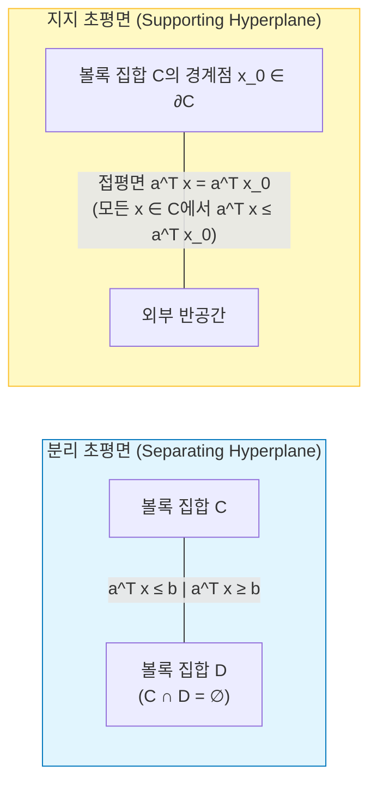

# 02. 볼록 집합 (Convex Sets)

> [!abstract] 핵심 개념 & 3줄 요약
> - **기하학적 위계**: **아핀 집합(직선 통과)** $\subsetneq$ **볼록 집합(선분 포함)**, 그리고 원점에서 뻗어 나가는 반직선 다발인 **볼록 원뿔(Convex Cone)** 이 최적화 공간의 기본 뼈대를 이룬다.
> - **핵심 정리**: 서로 만나지 않는 두 볼록 집합 사이에는 반드시 그 둘을 가르는 **분리 초평면(Separating Hyperplane)** 이 존재하며, 경계점에는 **지지 초평면(Supporting Hyperplane)** 이 접한다 — 이 기하학적 사실 하나가 라그랑주 쌍대성([[06. Duality Theory & KKT Conditions]])과 서브그래디언트의 모체다.
> - **원뿔과 일반화 부등식**: 고유 원뿔(Proper Cone $K$)을 도입하면 벡터와 행렬 공간 위에서도 부등호($\preceq_K$, 예: 양의 반정부호 순서 $\preceq_{\mathbb{S}_+^n}$)와 **쌍대 원뿔($K^*$)** 을 엄밀하게 정의할 수 있다.

---

## 1. 아핀 집합, 볼록 집합, 볼록 원뿔 (Affine, Convex, Conic Sets)

두 점 $x_1, x_2 \in \mathbb{R}^n$의 선형 결합 $\theta_1 x_1 + \theta_2 x_2$에 어떤 계수 제약을 거느냐에 따라 세 가지 핵심 기하 구조가 탄생한다.

| 구분 | 두 점 결합 조건 | 유한 개 점 결합 ($k$개) | 생성 껍질 (Hull, 최소 포함 집합) |
| :--- | :--- | :--- | :--- |
| **선형 부분공간 (Subspace)** | $\theta_1, \theta_2 \in \mathbb{R}$ | $\sum_{i=1}^k \theta_i x_i$ (제약 없음) | $\operatorname{span}(C)$ |
| **아핀 집합 (Affine Set)** | $\theta_1 + \theta_2 = 1$ ($\theta_i \in \mathbb{R}$) | $\sum_{i=1}^k \theta_i x_i, \; \sum \theta_i = 1$ | $\operatorname{aff}(C)$ (아핀 껍질) |
| **볼록 집합 (Convex Set)** | $\theta_1 + \theta_2 = 1, \; \theta_i \ge 0$ | $\sum_{i=1}^k \theta_i x_i, \; \sum \theta_i = 1, \; \theta_i \ge 0$ | $\operatorname{conv}(C)$ (볼록 껍질) |
| **볼록 원뿔 (Convex Cone)** | $\theta_1, \theta_2 \ge 0$ | $\sum_{i=1}^k \theta_i x_i, \; \theta_i \ge 0$ | $\operatorname{cone}(C)$ (원뿔 껍질) |

### 1.1. 직선, 선분, 반직선
$x_1 \neq x_2 \in \mathbb{R}^n$일 때 매개변수 $\theta$의 범위에 따라:
- **직선 (Line)**: $y = \theta x_1 + (1-\theta) x_2$ ($\theta \in \mathbb{R}$) $\implies$ 두 점을 지나는 무한 직선 전체를 포함하면 **아핀 집합**.
- **선분 (Line segment)**: $y = \theta x_1 + (1-\theta) x_2$ ($\theta \in [0, 1]$) $\implies$ 두 점을 잇는 선분만 포함하면 **볼록 집합**.
- **반직선 (Ray)**: $y = x_0 + \theta v$ ($\theta \ge 0$) $\implies$ 원점에서 나가는 모든 반직선($\theta x, \theta \ge 0$)을 포함하면 **원뿔(Cone)** 이며, 동시에 볼록이면 **볼록 원뿔(Convex Cone)**.

### 1.2. 아핀 집합과 선형 방정식의 동치성
임의의 아핀 집합 $C \neq \emptyset$과 임의의 한 점 $x_0 \in C$를 잡으면, 평행이동한 집합 $V := C - x_0 = \{x - x_0 : x \in C\}$는 항상 원점을 지나는 **선형 부분공간(Subspace)** 이다 ($\dim C := \dim V$).
따라서 모든 닫힌 아핀 집합은 어떤 행렬 $A \in \mathbb{R}^{m \times n}$와 벡터 $b \in \mathbb{R}^m$에 대한 **연립 선형방정식의 해집합**으로 표현된다:
$$C = \{x \in \mathbb{R}^n : Ax = b\}$$
*(참고: 상대적 내부 $\operatorname{relint}(C)$는 전체 공간 $\mathbb{R}^n$ 대신 아핀 껍질 $\operatorname{aff}(C)$ 위에서의 위상적 내부로 정의된다. 예컨대 3차원 공간에 떠 있는 2차원 원판의 일반 내부 $\operatorname{int}(C)$는 공집합이지만, $\operatorname{relint}(C)$는 테두리 원을 제외한 원판 안쪽 면 전체다 — 슬레이터 조건에서 핵심적으로 쓰인다!)*

---

## 2. 반드시 알아야 할 중요 볼록 집합과 볼록 원뿔 예시

### 2.1. 초평면, 반공간, 다면체 (선형 계열)
1. **초평면 (Hyperplane)**: $\{x : a^\top x = b\}$ ($a \neq \mathbf{0}$). 법선 벡터가 $a$인 $(n-1)$차원 아핀 집합(따라서 볼록).
2. **반공간 (Halfspace)**: $\{x : a^\top x \le b\}$ ($a \neq \mathbf{0}$). 초평면으로 잘린 한쪽 공간. 아핀은 아니지만 **볼록**이다.
3. **다면체 (Polyhedron)**: 유한 개수의 반공간과 초평면들의 교집합:
   $$\mathcal{P} = \{x \in \mathbb{R}^n : Ax \preceq b, \; Cx = d\}$$
   - 유계(Bounded)인 다면체를 특별히 **폴리토프(Polytope)** 라 부른다.
   - **심플렉스 (Simplex)**: 아핀 독립인 $k+1$개의 점 $v_0, \dots, v_k$의 볼록 껍질 $C = \operatorname{conv}\{v_0, \dots, v_k\}$. 가장 흔한 예가 **확률 심플렉스(Probability Simplex)** $\Delta_n = \{x \in \mathbb{R}^n : x \succeq \mathbf{0}, \, \mathbf{1}^\top x = 1\}$이다.

### 2.2. 공, 타원체, 노름 볼 (비선형 거리 계열)
1. **유클리드 공 (Euclidean Ball)**: $B(x_c, r) = \{x : \|x - x_c\|_2 \le r\} = \{x_c + r u : \|u\|_2 \le 1\}$.
2. **타원체 (Ellipsoid)**: 대칭 양의 정부호 행렬 $P \in \mathbb{S}_{++}^n$ ($P \succ 0$)에 대하여
   $$\mathcal{E} = \left\{ x : (x - x_c)^\top P^{-1} (x - x_c) \le 1 \right\} = \left\{ x_c + A u : \|u\|_2 \le 1 \right\} \quad (A = P^{1/2})$$
   $P$의 고유값 제곱근 $\sqrt{\lambda_i}$가 타원체의 각 반축 길이가 된다 ([[Gaussian Distribution]]의 마할라노비스 등고선과 정확히 동일!).
3. **노름 볼 (Norm Ball)**: 임의의 노름 $\|\cdot\|$ (삼각부등식과 동차성 만족)에 대해 $\{x : \|x - x_c\| \le r\}$는 항상 볼록 집합이다. ($\because \|\theta x + (1-\theta)y\| \le \theta\|x\| + (1-\theta)\|y\| \le r$). 단, $\ell_p$ 준노름에서 **$0 < p < 1$이면 삼각부등식이 깨져 별 모양의 비볼록 집합**이 된다!

### 2.3. 3대 핵심 볼록 원뿔 (Conic Optimization의 주인공들)
1. **비음 사분면 (Nonnegative Orthant)**: $\mathbb{R}_+^n = \{x \in \mathbb{R}^n : x_i \ge 0, \, \forall i\}$. (선형 계획법 LP의 원뿔)
2. **이차 원뿔 (Second-Order Cone / Lorentz Cone / Ice-cream Cone)**:
   $$\mathcal{Q}^{n+1} = \left\{ (x, t) \in \mathbb{R}^n \times \mathbb{R} : \|x\|_2 \le t \right\}$$
   아이스크림 콘 모양으로 생겼으며, 삼각부등식에 의해 즉시 볼록 원뿔임이 증명된다. (SOCP의 원뿔)
3. **양의 반정부호 행렬 원뿔 (Positive Semidefinite Cone)**:
   대칭 행렬 공간 $\mathbb{S}^n = \{X \in \mathbb{R}^{n \times n} : X = X^\top\}$ (차원 $\frac{n(n+1)}{2}$) 위에서 정의되는 원뿔:
   $$\mathbb{S}_+^n = \left\{ X \in \mathbb{S}^n : X \succeq 0 \right\} = \bigcap_{z \in \mathbb{R}^n} \left\{ X \in \mathbb{S}^n : z^\top X z \ge 0 \right\}$$
   고정된 $z$에 대해 $z^\top X z = \operatorname{tr}(zz^\top X) \ge 0$은 $X$에 대한 **선형 반공간**이다! 따라서 $\mathbb{S}_+^n$은 **무한히 많은 닫힌 반공간들의 교집합**이므로 무조건 닫힌 볼록 원뿔이다! (반정부호 계획법 SDP의 원뿔)

---

## 3. 볼록성을 보존하는 연산들 (Operations Preserving Convexity)

어떤 복잡한 집합이 볼록임을 증명할 때 정의($\theta x + (1-\theta)y \in C$)로 매번 돌아가는 대신, 아래의 보존 규칙들을 레고 블록처럼 조립한다.

1. **교집합 (Intersection)**: 볼록 집합들의 교집합 $\bigcap_{\alpha \in \mathcal{A}} C_\alpha$는 **유한 개든 무한 개든 항상 볼록**이다! (반면 합집합은 일반적으로 볼록이 아니다.)
2. **아핀 변환 (Affine Function)**: $f(x) = Ax + b$에 대하여:
   - $C$가 볼록 $\implies$ 상(Image) $f(C) = \{Ax + b : x \in C\}$도 볼록. (평행이동, 스케일링, 사영 Projection, 두 볼록 집합의 민코프스키 합 $C_1 + C_2$ 모두 포함!)
   - $D$가 볼록 $\implies$ 역상(Preimage) $f^{-1}(D) = \{x : Ax + b \in D\}$도 볼록.
     - *응용 (선형 행렬 부등식 LMI)*: $A(x) = x_1 A_1 + \dots + x_n A_n \preceq B \iff B - A(x) \in \mathbb{S}_+^m$. $\mathbb{S}_+^m$의 아핀 역상이므로 LMI의 해집합은 즉시 볼록 집합임이 증명된다!
3. **원근 함수 (Perspective Function)**:
   $P : \mathbb{R}^n \times \mathbb{R}_{++} \to \mathbb{R}^n, \; P(x, t) = \frac{x}{t}$ (핀홀 카메라가 3D 좌표 $(x, t)$를 $t=1$ 평면에 투영하는 연산!)는 볼록 집합의 상과 역상을 모두 볼록으로 보존한다.
4. **선형 분수 함수 (Linear-Fractional Function)**:
   아핀 변환 뒤에 원근 함수를 합성한 $g(x) = \frac{Ax + b}{c^\top x + d}$ ($\operatorname{dom} g = \{x : c^\top x + d > 0\}$) 역시 볼록 집합의 상과 역상을 모두 볼록으로 유지한다.

---

## 4. 분리 초평면 정리와 지지 초평면 정리

최적화 이론에서 기하학과 대수학을 이어주는 가장 강력한 다리다.

> [!attention] 정리 4.1 (분리 초평면 정리 — Separating Hyperplane Theorem)
> 공집합이 아닌 두 볼록 집합 $C, D \subseteq \mathbb{R}^n$가 서로소($C \cap D = \emptyset$)이면, 영벡터가 아닌 $a \in \mathbb{R}^n \setminus \{\mathbf{0}\}$와 $b \in \mathbb{R}$가 존재하여 다음을 만족한다:
> $$a^\top x \le b \; (\forall x \in C) \qquad \text{및} \qquad a^\top y \ge b \; (\forall y \in D)$$
> 더욱이 $C$가 닫혀 있고 $D$가 콤팩트(유계·닫힘)이면, 부등호가 엄격해지는 **엄격 분리(Strict Separation: $a^\top x < b < a^\top y$)** 가 가능하다.

- **핵심 증명 아이디어 (엄격 분리 케이스)**: 두 집합 사이의 최단 거리 쌍 $c \in C, d \in D$ ($\|c - d\|_2 = \operatorname{dist}(C, D) > 0$)를 잡는다. 법선 벡터를 $a = d - c \neq \mathbf{0}$, 절편을 두 점의 중점 지점 $b = \frac{\|d\|_2^2 - \|c\|_2^2}{2}$로 잡으면, $C, D$의 볼록성(1차 최적성 조건)에 의해 $a^\top x \le a^\top c < b < a^\top d \le a^\top y$가 성립한다!
- **대표적 귀결 — 파카스의 보조정리(Farkas' Lemma)**: 다면체 원뿔 $\{Ax : x \succeq 0\}$과 한 점 $\{b\}$에 엄격 분리 초평면 정리를 적용하면 **"연립계 $(Ax = b, x \succeq 0)$과 $(A^\top y \succeq 0, b^\top y < 0)$ 중 정확히 하나만 해를 갖는다"** 는 택일 정리(Theorem of Alternatives)가 즉시 튀어나오며, 이것이 선형 계획법 강한 쌍대성의 기하학적 증명이다!

> [!attention] 정리 4.2 (지지 초평면 정리 — Supporting Hyperplane Theorem)
> 볼록 집합 $C$와 그 경계 위의 임의의 점 $x_0 \in \operatorname{bd}(C) = \operatorname{cl}(C) \setminus \operatorname{int}(C)$에 대하여, $a \neq \mathbf{0}$가 존재하여 모든 $x \in C$에 대해 $a^\top x \le a^\top x_0$를 만족한다. 이때 초평면 $\{x : a^\top x = a^\top x_0\}$를 $x_0$에서의 **지지 초평면**이라 한다.

---

## 5. 일반화 부등식 ($\preceq_K$)과 쌍대 원뿔 ($K^*$)

### 5.1. 고유 원뿔 (Proper Cone)과 일반화 부등식
원뿔 $K \subseteq \mathbb{R}^n$가 다음 4가지 성질을 모두 만족하면 **고유 원뿔(Proper Cone)** 이라 한다:
1. **볼록 (Convex)**: $x, y \in K \implies x + y \in K$.
2. **닫힘 (Closed)**: 경계를 포함함 (등호 $\le$ 표현에 필수).
3. **속이 꽉 참 (Solid, $\operatorname{int}(K) \neq \emptyset$)**: 엄격 부등호($<$) 표현에 필수.
4. **뾰족함 (Pointed, $K \cap (-K) = \{\mathbf{0}\}$)**: 직선을 포함하지 않음 ($x \le y$이고 $y \le x \implies x = y$ 반대칭성에 필수!).

고유 원뿔 $K$는 벡터 공간 위에 부분 순서인 **일반화 부등식(Generalized Inequality)** 을 정의한다:
$$x \preceq_K y \iff y - x \in K, \qquad x \prec_K y \iff y - x \in \operatorname{int}(K)$$

- $K = \mathbb{R}_+^n \implies$ 성분별 부등식 ($x_i \le y_i$). (**[[01. Optimization Foundations & Pareto Optimality]]** 의 파레토 지배!)
- $K = \mathbb{S}_+^n \implies$ 행렬의 로에브너 순서 (Loewner order: $X \preceq Y \iff Y - X \succeq 0$).

### 5.2. 최소원소(Minimum) vs 극소원소(Minimal)
부분 순서 $(S, \preceq_K)$에서는 일반 실수와 달리 두 가지 다른 '최소' 개념이 존재한다!
- **$x \in S$가 최소원소 (Minimum Element)**: **모든** $y \in S$와 비교 가능하며 $x \preceq_K y$이다 ($\iff S \subseteq x + K$). 존재하면 유일하다!
- **$x \in S$가 극소원소 (Minimal Element)**: $S$ 안에 $x$보다 더 작은 원소가 없다 ($y \in S, y \preceq_K x \implies y = x$, 즉 $(x - K) \cap S = \{x\}$). **여러 개 존재할 수 있으며, $K = \mathbb{R}_+^m$일 때 극소원소들의 집합이 정확히 파레토 프론트(Pareto Front)다!**

### 5.3. 쌍대 원뿔 (Dual Cone $K^*$)
임의의 원뿔 $K$에 대하여, $K$의 모든 벡터와 예각 또는 직각(내적 $\ge 0$)을 이루는 벡터들의 모임을 **쌍대 원뿔(Dual Cone)** 이라 한다 (대칭 행렬 공간에서는 프로베니우스 내적 $\langle X, Y \rangle = \operatorname{tr}(XY)$ 사용).

$$K^* := \left\{ y \in \mathbb{R}^n : x^\top y \ge 0, \; \forall x \in K \right\}$$

- **성질**: 원래 $K$가 비볼록이더라도, $K^*$는 반공간 $\{y : x^\top y \ge 0\}$들의 무한 교집합이므로 **항상 닫힌 볼록 원뿔**이다! ($K$가 닫힌 볼록 원뿔이면 $K^{**} = K$.)
- **3대 원뿔은 모두 자기쌍대(Self-Dual, $K^* = K$)다!**:
  1. $(\mathbb{R}_+^n)^* = \mathbb{R}_+^n$.
  2. $(\mathcal{Q}^{n+1})^* = \mathcal{Q}^{n+1}$ (코시-슈바르츠 부등식 $x^\top u + t s \ge -\|x\|_2 \|u\|_2 + ts$에 의해 즉시 증명).
  3. **$({\mathbb{S}_+^n})^* = \mathbb{S}_+^n$ 증명**:
     - ($\supseteq$) $X \succeq 0, Y \succeq 0$이면 $X = \sum \lambda_i q_i q_i^\top$ ($\lambda_i \ge 0$)로 고유값 분해할 때 $\operatorname{tr}(XY) = \sum \lambda_i (q_i^\top Y q_i) \ge 0$이므로 $Y \in (\mathbb{S}_+^n)^*$.
     - ($\subseteq$) 만약 $Y \nsucceq 0$이면 어떤 벡터 $q$에 대해 $q^\top Y q < 0$이다. 이때 $X = qq^\top \succeq 0$을 대입하면 $\operatorname{tr}(XY) = q^\top Y q < 0$이므로 $Y \notin (\mathbb{S}_+^n)^*$. 따라서 $(\mathbb{S}_+^n)^* = \mathbb{S}_+^n$이다! $\blacksquare$
- **쌍대 일반화 부등식과 극소원소 스칼라화 정리**:
  - $x \preceq_K y \iff \forall \lambda \succeq_{K^*} 0, \; \lambda^\top x \le \lambda^\top y$.
  - $\lambda \succ_{K^*} 0$에 대해 $\lambda^\top x$를 $S$ 위에서 최소화하는 점 $x$는 항상 $S$의 $K$-극소원소(파레토 최적)이며, $S$가 볼록이면 역으로 임의의 극소원소에 대해 $0 \neq \lambda \succeq_{K^*} 0$가 존재한다.

---

## 6. 한 줄 요약

> **볼록 집합은 교집합·아핀 변환·원근 투영에 대해 닫혀 있는 기하학적 무대이며, 분리/지지 초평면 정리와 자기쌍대 원뿔($\mathbb{R}_+^n, \mathcal{Q}^{n+1}, \mathbb{S}_+^n$)이 현대 볼록 최적화와 쌍대성 이론의 모든 대수적 공식을 지탱한다.**

---
연관 노트: [[01. Optimization Foundations & Pareto Optimality]], [[03. Convex Functions]], [[04. Canonical Convex Problems]], [[06. Duality Theory & KKT Conditions]]

