# 04. 정준 볼록 최적화 문제 계층 (Canonical Convex Problems)

> [!abstract] 핵심 개념 & 3줄 요약
> - **정준 계층 구조 (Canonical Hierarchy)**: 현대 볼록 최적화에서 다루는 대부분의 정형 문제는 **$\text{LP} \subset \text{QP} \subset \text{QCQP} \subset \text{SOCP} \subset \text{SDP} \subset \text{CP}$** 라는 엄밀한 포함 사슬 위에 놓여 있다.
> - **계층 상승의 트레이드오프**: 사슬의 오른쪽(SOCP, SDP)으로 갈수록 비선형 타원체 불확실성·고유값·행렬 랭크 완화까지 포섭하는 **표현력(Expressiveness)** 이 비약적으로 커지지만, 내부점법(Interior-Point Method) 1회 반복당 연산 복잡도가 선형 시스템에서 거대 양의 반정부호 행렬 연산으로 무거워진다.
> - **대수적 매장(Embedding)의 두 기둥**: 이차식을 쌍곡 원뿔 노름으로 바꾸는 **제곱 완성 항등식**이 $\text{QCQP} \subset \text{SOCP}$를 증명하고, 블록 행렬의 양의 반정부호성을 판별하는 **슈어 보수(Schur Complement)** 가 $\text{SOCP} \subset \text{SDP}$를 증명한다.

```mermaid
%%{init: {'theme':'default'}}%%
flowchart LR
    LP["LP<br/>(선형 계획법)<br/>원뿔: R_+^n"] -->|"이차 목적함수<br/>Q ⪰ 0 추가"| QP["QP<br/>(이차 계획법)<br/>SVM · 마코위츠 · Lasso"]
    QP -->|"이차 부등식 제약<br/>Q_i ⪰ 0 추가"| QCQP["QCQP<br/>(이차 제약 이차 계획)"]
    QCQP -->|"쌍곡 이차 원뿔 변환<br/>||Dx+e||_2 ≤ g^T x+h"| SOCP["SOCP<br/>(이차 원뿔 계획법)<br/>강건(Robust) LP"]
    SOCP -->|"슈어 보수(Schur)<br/>선형 행렬 부등식(LMI)"| SDP["SDP<br/>(양의 반정부호 계획법)<br/>원뿔: S_+^n · 고유값"]
    SDP -->|"임의의 닫힌 볼록 원뿔<br/>K ⊆ R^n 일반화"| CP["CP<br/>(원뿔 계획법)<br/>Conic Programming"]

    style LP fill:#E8F5E9,stroke:#2E7D32
    style QP fill:#E8F5E9,stroke:#2E7D32
    style QCQP fill:#E1F5FE,stroke:#0277BD
    style SOCP fill:#E1F5FE,stroke:#0277BD,stroke-width:2px
    style SDP fill:#F3E5F5,stroke:#7B1FA2,stroke-width:2px
    style CP fill:#FFF9C4,stroke:#FBC02D
```

---

## 1. 선형 계획법 (Linear Programming, LP)

목적함수와 모든 부등식·등식 제약 함수가 **아핀(선형)** 인 가장 기초적이면서도 산업 전반에 가장 널리 쓰이는 볼록 최적화 문제다 (심플렉스 해법과 쌍대성 정리는 [[05. Linear Programming & Simplex Method]]에서 전담).

### 1.1. 일반형과 표준형 (Standard Form)
- **일반 부등식형 (Inequality Form)**:
  $$\begin{aligned}
  \min_{x \in \mathbb{R}^n} \quad & c^\top x \\
  \text{subject to} \quad & Dx \le e, \quad Ax = b
  \end{aligned}$$
- **표준형 (Standard / Equational Form)**: 여유 변수(Slack variable)와 양·음 분해 $x = x^+ - x^-$를 통해 모든 LP는 다음 표준형으로 동치 변환된다:
  $$\begin{aligned}
  \min_{x \in \mathbb{R}^n} \quad & c^\top x \\
  \text{subject to} \quad & Ax = b, \quad x \ge 0
  \end{aligned}$$
- **기하학적 직관**: 가용 영역은 반공간들의 유한 교집합인 **다면체(Polyhedron)** 이며, 등고선 초평면 $\{x : c^\top x = \alpha\}$을 법선 벡터 $-c$ 방향으로 끝까지 밀었을 때 마지막으로 다면체와 닿는 **꼭짓점(Extreme point / Vertex)** 에서 최적해가 달성된다.

### 1.2. 통계학·기계학습 속 숨은 LP 문제들 ($\ell_1, \ell_\infty$ 노름 변환 트릭!)
언뜻 절댓값이나 노름 때문에 비선형처럼 보이는 조각별 선형 볼록 문제들은 보조 변수 $t$를 도입하면 즉시 순수 LP로 바뀐다!

1. **기저 추적 (Basis Pursuit — 압축 센싱 Compressed Sensing)**:
   과소결정 연립방정식 $Ax = b$ ($m < n$)의 가장 희소한 해를 찾는 $\min \|x\|_1 \text{ s.t. } Ax = b$는 벡터 $z \in \mathbb{R}^n$로 절댓값을 감싸면($-z \le x \le z$) LP가 된다:
   $$\min_{x, z \in \mathbb{R}^n} \; \mathbf{1}^\top z \quad \text{s.t.} \quad Ax = b, \quad -z \le x \le z$$
2. **단치히 선택자 (Dantzig Selector — 고차원 통계학)**:
   잔차와 설명변수의 최대 상관도를 제한하면서 희소 회귀계수를 찾는 $\min \|\beta\|_1 \text{ s.t. } \|X^\top(y - X\beta)\|_\infty \le \lambda$ 역시 $-\lambda \mathbf{1} \le X^\top(y - X\beta) \le \lambda \mathbf{1}$과 $-z \le \beta \le z$로 풀면 순수 LP다!
3. **체비쇼프 근사 (Chebyshev / $\ell_\infty$ Approximation)**:
   최악 오차를 최소화하는 $\min_x \|Ax - b\|_\infty$는 스칼라 변수 $t \in \mathbb{R}$ 하나만 도입하면 $\min_{x, t} t \text{ s.t. } -t\mathbf{1} \le Ax - b \le t\mathbf{1}$인 LP가 된다.

---

## 2. 이차 계획법 (Quadratic Programming, QP)

선형 제약조건(다면체 가용 영역) 위에서 **볼록 이차 목적함수**를 최소화하는 문제다.

$$\begin{aligned}
\min_{x \in \mathbb{R}^n} \quad & \frac{1}{2} x^\top Q x + c^\top x \\
\text{subject to} \quad & Dx \le e, \quad Ax = b
\end{aligned}$$

> [!warning] 볼록성 필수 조건: $Q \succeq 0$!
> 대칭 행렬 $Q \in \mathbb{S}_+^n$ (**양의 반정부호**)일 때만 볼록 QP이며 다항 시간에 전역 최적해를 구할 수 있다! 만약 $Q$가 음의 고유값을 하나라도 가지면($Q \nsucceq 0$), 비볼록 QP가 되어 **일반적으로 NP-hard**가 된다. ($Q = 0$으로 두면 즉시 $\text{LP} \subset \text{QP}$가 확인된다.)

### 대표 응용 3선
1. **마코위츠 포트폴리오 최적화 (Markowitz Portfolio Optimization)**:
   기대수익률 벡터 $\mu \in \mathbb{R}^n$와 수익률 공분산 행렬 $\Sigma \succeq 0$, 위험 회피 계수 $\gamma > 0$에 대해 위험 조정 수익을 극대화한다:
   $$\min_{x \in \mathbb{R}^n} \; -\mu^\top x + \frac{\gamma}{2} x^\top \Sigma x \quad \text{s.t.} \quad \mathbf{1}^\top x = 1, \; x \ge 0$$
2. **서포트 벡터 머신 ([[SVM (Support Vector Machine)|SVM]])**:
   원문제 $\min_{\beta, \beta_0, \xi} \frac{1}{2}\|\beta\|_2^2 + C \sum_{i=1}^n \xi_i \text{ s.t. } y_i(x_i^\top \beta + \beta_0) \ge 1 - \xi_i, \; \xi_i \ge 0$와 라그랑주 쌍대 문제 모두 정준 볼록 QP다!
3. **라쏘 회귀 (Lasso — [[Regularization]] 참조)**:
   $$\min_{\beta \in \mathbb{R}^p} \; \frac{1}{2}\|y - X\beta\|_2^2 + \lambda \|\beta\|_1$$
   절댓값 때문에 미분 불가능하지만, $\beta = \beta^+ - \beta^-$ ($\beta^+, \beta^- \ge 0$) 또는 $-z \le \beta \le z$로 변수를 쪼개면 목적함수는 $\frac{1}{2}\beta^\top (X^\top X) \beta - y^\top X \beta + \lambda \mathbf{1}^\top z$ ($X^\top X \succeq 0$)가 되어 **완벽한 볼록 QP**로 변환된다!

---

## 3. 이차 제약 이차 계획법 (QCQP)

목적함수뿐만 아니라 **부등식 제약조건까지 볼록 이차함수**로 확장한 문제다:

$$\begin{aligned}
\min_{x \in \mathbb{R}^n} \quad & \frac{1}{2} x^\top Q_0 x + c_0^\top x \\
\text{subject to} \quad & \frac{1}{2} x^\top Q_i x + c_i^\top x + d_i \le 0, \quad i = 1, \dots, m \\
& Ax = b
\end{aligned}$$
*(단, 볼록성을 위해 $Q_0 \succeq 0$ 및 모든 $Q_i \succeq 0$ 가정. 모든 $Q_i = 0$으로 두면 $\text{QP} \subset \text{QCQP}$다.)*
- 기하학적으로 가용 영역은 **타원체(Ellipsoid)들과 포물면, 반공간들의 교집합**이다. 예컨대 능선 회귀(Ridge Regression)의 제약형 $\min \|y - X\beta\|_2^2 \text{ s.t. } \|\beta\|_2^2 \le t$나 신호처리 빔포밍 전력 제약 문제가 전형적인 QCQP다.

---

## 4. 이차 원뿔 계획법 (Second-Order Cone Programming, SOCP)

선형 목적함수를 **이차 원뿔(Lorentz / Ice-cream Cone, $\mathcal{Q}^{k+1} = \{(u, t) : \|u\|_2 \le t\}$)** 제약 아래에서 최소화하는 문제다 ([[02. Convex Sets]] §2.2 참조):

$$\begin{aligned}
\min_{x \in \mathbb{R}^n} \quad & c^\top x \\
\text{subject to} \quad & \|D_i x + e_i\|_2 \le g_i^\top x + h_i, \quad i = 1, \dots, m \\
& Ax = b
\end{aligned}$$

- $D_i = 0$으로 두면 부등식이 $0 \le g_i^\top x + h_i$ (선형 부등식)가 되어 $\text{LP} \subset \text{SOCP}$다.
- 반대로 $g_i = 0$으로 두면 $\|D_i x + e_i\|_2 \le h_i \iff \|D_i x + e_i\|_2^2 \le h_i^2$ ($h_i \ge 0$)이므로 타원체 제약(QCQP)이 된다. 그렇다면 **일반적인 모든 볼록 QCQP가 SOCP의 부분집합($\text{QCQP} \subset \text{SOCP}$)** 임은 어떻게 증명할까?

> [!note] 엄밀한 증명: $\text{QCQP} \subset \text{SOCP}$ (쌍곡 원뿔 제곱 완성 트릭!)
> 1. 먼저 QCQP의 이차 목적함수 $\frac{1}{2}x^\top Q_0 x + c_0^\top x$는 에피그래프 보조 변수 $t \in \mathbb{R}$를 도입해 목적함수를 $\min_{x, t} t$ (선형!)로 바꾸고 볼록 이차 제약 $\frac{1}{2}x^\top Q_0 x + c_0^\top x - t \le 0$으로 내릴 수 있다.
> 2. 이제 임의의 볼록 이차 제약 $\frac{1}{2}x^\top Q x + p^\top x + r \le 0$ ($Q \succeq 0$)을 SOCP 제약으로 바꾸자. $Q \succeq 0$이므로 제곱근 분해 $Q = R^\top R$가 존재하여 $\frac{1}{2}\|Rx\|_2^2 + p^\top x + r \le 0 \iff \| \frac{1}{\sqrt{2}} R x \|_2^2 \le -(p^\top x + r)$가 된다.
> 3. 실수 $u = \|\frac{1}{\sqrt{2}} R x\|_2$와 $v = -(p^\top x + r)$에 대해 다음의 **핵심 쌍곡 항등식**을 적용한다:
>    $$u^2 \le v, \; v \ge 0 \iff u^2 + \left(\frac{1 - v}{2}\right)^2 \le \left(\frac{1 + v}{2}\right)^2 \quad \text{and} \quad \frac{1+v}{2} \ge 0$$
> 4. 양변에 제곱근을 취하면 완벽한 유클리드 노름 원뿔 부등식(SOCP 제약)이 탄생한다!
>    $$\left\| \begin{bmatrix} \frac{1}{\sqrt{2}} R x \\ \frac{1 + p^\top x + r}{2} \end{bmatrix} \right\|_2 \le \frac{1 - p^\top x - r}{2} \qquad \blacksquare$$

### SOCP의 꽃: 강건 선형 계획법 (Robust LP)과 확률적 제약 (Chance Constraints)
현실 데이터에서는 제약 행렬의 행벡터 $a_i$가 정확한 상수가 아니라 노이즈나 불확실성에 흔들린다! 이 두 가지 대표 모델이 놀랍게도 모두 **정확히 SOCP**로 귀결된다.
1. **결정론적 타원체 불확실성 (Ellipsoidal Uncertainty — Worst-case Robust LP)**:
   $a_i$가 중심이 $\bar{a}_i$인 타원체 $\mathcal{E}_i = \{ \bar{a}_i + P_i u : \|u\|_2 \le 1 \}$ 안의 어떤 값을 갖더라도 제약 $a_i^\top x \le b_i$가 절대 깨지지 않아야 한다고 하자:
   $$\forall a_i \in \mathcal{E}_i, \; a_i^\top x \le b_i \iff \sup_{\|u\|_2 \le 1} (\bar{a}_i + P_i u)^\top x \le b_i \iff \bar{a}_i^\top x + \underbrace{\sup_{\|u\|_2 \le 1} u^\top (P_i^\top x)}_{= \|P_i^\top x\|_2 \text{ (코시-슈바르츠!)}} \le b_i$$
   즉 **$\|P_i^\top x\|_2 \le b_i - \bar{a}_i^\top x$** 가 되어 단번에 SOCP 제약이 된다!
2. **확률적 가우시안 불확실성 (Stochastic Chance-Constrained LP)**:
   $a_i \sim \mathcal{N}(\bar{a}_i, \Sigma_i)$일 때 제약이 신뢰수준 $\eta \ge 0.5$ 이상의 확률로 만족되기를 요구하자: $\mathbb{P}(a_i^\top x \le b_i) \ge \eta$.
   스칼라 확률변수 $a_i^\top x \sim \mathcal{N}(\bar{a}_i^\top x, x^\top \Sigma_i x)$를 표준화하면 표준정규 CDF $\Phi$에 대해
   $$\Phi\left(\frac{b_i - \bar{a}_i^\top x}{\|\Sigma_i^{1/2} x\|_2}\right) \ge \eta \iff \bar{a}_i^\top x + \Phi^{-1}(\eta) \|\Sigma_i^{1/2} x\|_2 \le b_i$$
   여기서 $\eta \ge 0.5 \implies \Phi^{-1}(\eta) \ge 0$이므로 노름 앞 계수가 양수가 되어 완벽한 **볼록 SOCP**가 된다! ($\eta < 0.5$이면 비볼록이 됨에 주목!)

---

## 5. 양의 반정부호 계획법 (Semidefinite Programming, SDP)

LP의 비음수 벡터 제약 $x \ge 0$ ($x \in \mathbb{R}_+^n$)을 대칭 행렬의 **양의 반정부호 원뿔 제약 $X \succeq 0$ ($X \in \mathbb{S}_+^n$)** 으로 끌어올린 "행렬 공간의 선형 계획법"이다!

### 5.1. 표준형과 선형 행렬 부등식 (LMI) 형
- **표준형 SDP** (행렬 내적 $\langle A, B \rangle = \operatorname{tr}(AB)$ 사용):
  $$\begin{aligned}
  \min_{X \in \mathbb{S}^n} \quad & \langle C, X \rangle = \operatorname{tr}(CX) \\
  \text{subject to} \quad & \langle A_i, X \rangle = b_i, \quad i = 1, \dots, m \\
  & X \succeq 0
  \end{aligned}$$
- **부등식형 SDP (Linear Matrix Inequality, LMI Form)**: 스칼라 변수 $x \in \mathbb{R}^n$와 대칭 행렬 $F_k, G \in \mathbb{S}^d$에 대하여:
  $$\begin{aligned}
  \min_{x \in \mathbb{R}^n} \quad & c^\top x \\
  \text{subject to} \quad & x_1 F_1 + x_2 F_2 + \dots + x_n F_n + G \preceq 0 \\
  & Ax = b
  \end{aligned}$$
  *(참고: 여러 개의 LMI $M_1(x) \succeq 0, M_2(x) \succeq 0$는 블록 대각 행렬 $\operatorname{diag}(M_1(x), M_2(x)) \succeq 0$ 하나로 합칠 수 있다! 특히 모든 $F_k, G$가 대각 행렬이면 LMI는 성분별 선형 부등식과 동치가 되어 즉시 $\text{LP} \subset \text{SDP}$가 확인된다.)*

### 5.2. $\text{SOCP} \subset \text{SDP}$ 증명: 슈어 보수 (Schur Complement)의 마법!

> [!attention] 보조정리 (슈어 보수 정리 — Schur Complement Lemma)
> 블록 대칭 행렬 $M = \begin{bmatrix} A & B \\ B^\top & C \end{bmatrix}$에서 $A \succ 0$일 때, 다음 동치가 성립한다:
> $$M = \begin{bmatrix} A & B \\ B^\top & C \end{bmatrix} \succeq 0 \iff C - B^\top A^{-1} B \succeq 0$$

> [!note] 증명: 임의의 SOCP 제약은 LMI(SDP)로 변환된다!
> SOCP 제약 $\|Dx + e\|_2 \le g^\top x + h$를 생각하자 ($u := Dx + e \in \mathbb{R}^k$, $t := g^\top x + h \in \mathbb{R}$라 표기).
> $t > 0$일 때 블록 행렬에 $A = t I_k \succ 0, B = u, C = t$를 대입하여 슈어 보수를 취하면:
> $$\begin{bmatrix} t I_k & u \\ u^\top & t \end{bmatrix} \succeq 0 \iff t - u^\top (t I_k)^{-1} u \ge 0 \iff t - \frac{\|u\|_2^2}{t} \ge 0 \iff \|u\|_2 \le t$$
> ($t = 0$인 경계에서도 좌변 $\succeq 0 \iff u = 0$이므로 완벽히 동치다!) 좌변의 행렬 $\begin{bmatrix} (g^\top x + h) I_k & Dx + e \\ (Dx + e)^\top & g^\top x + h \end{bmatrix} \succeq 0$은 변수 $x$에 대해 각 성분이 완벽히 아핀(선형)인 **선형 행렬 부등식(LMI)** 이므로, 모든 SOCP는 SDP의 특수한 경우다! $\blacksquare$

### 5.3. SDP의 핵심 응용 3선
1. **고유값 최적화 (Eigenvalue Minimization)**: 대칭 행렬 아핀 사상 $A(x) = A_0 + \sum x_i A_i \in \mathbb{S}^d$의 최대 고유값을 최소화하는 $\min_x \lambda_{\max}(A(x))$는 $\lambda_{\max}(A(x)) \le t \iff A(x) \preceq t I$이므로 $\min_{x, t} t \text{ s.t. } A(x) - t I \preceq 0$인 SDP다!
2. **핵 노름 최소화 (Nuclear Norm Minimization / 행렬 완성)**: 특이값들의 합 $\|X\|_* = \sum \sigma_i(X)$ 최소화는 $\min_{X, W_1, W_2} \frac{1}{2}(\operatorname{tr} W_1 + \operatorname{tr} W_2) \text{ s.t. } \begin{bmatrix} W_1 & X \\ X^\top & W_2 \end{bmatrix} \succeq 0$인 SDP로 변환된다.
3. **조합 최적화의 SDP 완화 (Goemans–Williamson Max-Cut Relaxation)**: 이산 변수 $x_i \in \{-1, +1\}$의 비볼록 이차 문제 $\max x^\top W x \text{ s.t. } x_i^2 = 1$에서 $X = x x^\top$으로 들어 올린(Lifting) 뒤 비볼록 제약 $\operatorname{rank}(X) = 1$만 떼어내면 $\max \operatorname{tr}(WX) \text{ s.t. } X_{ii} = 1, \; X \succeq 0$이라는 볼록 SDP 완화가 얻어진다 ($0.878$-근사비 보장!).

---

## 6. 원뿔 계획법 (Conic Programming, CP)과 정준 계층 총정리

지금까지의 모든 정준 문제를 단 하나의 수식으로 통합하는 최상위 프레임워크가 **원뿔 계획법(Conic Programming)** 이다. 닫힌 볼록 원뿔(Proper Cone) $K$에 대한 일반화 부등식 $\succeq_K$를 사용하면 ([[02. Convex Sets]] §5 참조):

$$\begin{aligned}
\min_{x \in \mathbb{R}^n} \quad & c^\top x \\
\text{subject to} \quad & Ax = b \\
& -(Dx + e) \in K \quad \big(\text{또는 표준형 } x \in K\big)
\end{aligned}$$

| 정준 클래스 | 기저 원뿔 $K$ | 목적함수 형태 | 부등식 제약 형태 | 대표 ML / 공학 문제 |
| :--- | :--- | :--- | :--- | :--- |
| **LP** | 비음수 사분면 $\mathbb{R}_+^m$ | 선형 $c^\top x$ | 선형 $Dx \le e$ | 기저 추적($\ell_1$), Dantzig 선택자, 최적 수송(OT), 네트워크 플로우 |
| **QP** | $\mathbb{R}_+^m$ (+ 이차 목적) | 볼록 이차 $\frac{1}{2}x^\top Q x + c^\top x$ | 선형 $Dx \le e$ | [[SVM (Support Vector Machine)\|SVM]], 마코위츠 포트폴리오, Lasso |
| **QCQP** | (쌍곡 원뿔로 귀결) | 볼록 이차 | 볼록 이차 $\frac{1}{2}x^\top Q_i x + \dots \le 0$ | 타원체 신뢰영역(Trust-region), 빔포밍 설계 |
| **SOCP** | 로렌츠 원뿔 $\mathcal{Q}^{k_1} \times \dots \times \mathcal{Q}^{k_m}$ | 선형 $c^\top x$ | 유클리드 노름 $\|D_i x + e_i\|_2 \le g_i^\top x + h_i$ | 강건(Robust) LP, 확률 제약 LP, 그룹 라쏘(Group Lasso) |
| **SDP** | 양의 반정부호 원뿔 $\mathbb{S}_+^d$ | 선형 $\operatorname{tr}(CX)$ | 선형 행렬 부등식(LMI) $\sum x_i F_i + G \preceq 0$ | 최대 고유값 최소화, 행렬 완성($\|X\|_*$), Max-Cut 완화, 제어기 리아푸노프 안정성 |
| **CP** | 일반 고유 원뿔 $K$ (지수 원뿔 등) | 선형 $c^\top x$ | 원뿔 포함 $-(Dx+e) \in K$ | 엔트로피/KL 발산 최적화(지수 원뿔 $K_{\exp}$), 기하 계획법(GP) |

---

## 7. 한 줄 요약

> **볼록 최적화의 정준 계층 $\text{LP} \subset \text{QP} \subset \text{QCQP} \subset \text{SOCP} \subset \text{SDP} \subset \text{CP}$는 "문제를 포섭하는 가장 왼쪽(단순한) 클래스로 정식화하라"는 실전 설계 지침이며, 쌍곡 제곱 완성과 슈어 보수가 이 계층 사이를 자유자재로 오가는 대수적 다리다.**

---
연관 노트: [[02. Convex Sets]], [[03. Convex Functions]], [[05. Linear Programming & Simplex Method]], [[06. Duality Theory & KKT Conditions]], [[SVM (Support Vector Machine)]], [[Regularization]]

