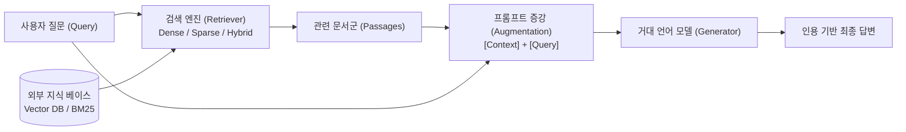
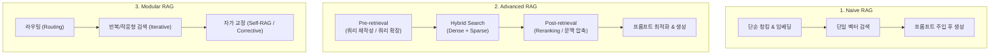
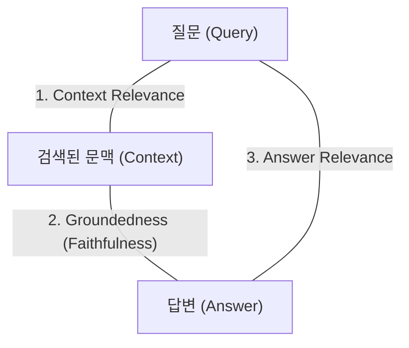

# Retrieval-Augmented Generation (RAG)

> [!abstract] 3줄 요약
> - **정의**: 거대 언어 모델(LLM)의 생성 과정에 외부 지식 베이스 검색(Retrieval)을 결합하여, 모델 파라미터 외부의 최신 사실이나 도메인 특화 데이터를 참조(Augmentation)해 답변을 생성하는 아키텍처다.
> - **해결 과제**: 사전학습 데이터의 지식 컷오프(Knowledge Cutoff) 한계를 극복하고, 모델이 거짓 정보를 사실처럼 지어내는 **환각(Hallucination)** 현상을 대폭 억제한다.
> - **진화 단계**: 단순 검색-주입 구조인 **Naive RAG**에서 시작하여, 사전·사후 검색 최적화를 거치는 **Advanced RAG**, 라우팅과 반복 검색을 모듈화한 **Modular RAG**로 발전했다.

---

## 1. 개요 및 동작 원리

RAG(검색 증강 생성)는 파인튜닝(Fine-Tuning)처럼 모델 가중치 자체를 수정하지 않고, **추론 시점(Inference Time)에 동적으로 신뢰할 수 있는 외부 문서를 검색해 프롬프트 컨텍스트에 삽입**하는 방식으로 작동한다. 모델에게 "외워서 답하라"고 요구하는 대신, "시험지를 열어 책을 보고 답하라(Open-book QA)"고 지시하는 구조에 가깝다.

### 파인튜닝(Fine-Tuning)과의 비교
- **파인튜닝**: 모델의 어조, 화법(Tone & Manner), 고정된 도메인 스타일 내재화에 적합하다. 그러나 최신 정보 반영을 위해 매번 재학습이 필요하며 환각을 완전히 제어하기 어렵다.
- **RAG**: 수시로 변경되는 사실 정보, 문서의 원문 출처(Citation) 표기, 즉각적인 데이터베이스 업데이트가 필수적인 비즈니스 환경에 압도적으로 유리하다.

---

## 2. RAG의 3대 발전 패러다임

### 2.1. Naive RAG (전통적 1세대)
- **과정**: 문서를 고정 길이로 청킹 $\to$ 임베딩 $\to$ 질문과 벡터 유사도 비교 $\to$ 상위 K개 문서를 프롬프트에 그대로 이어 붙여 생성.
- **한계점**:
  - **검색 실패(Low Precision/Recall)**: 엉뚱한 문맥이 유입되거나 핵심 정보가 누락된다.
  - **문맥 손실(Lost in the Middle)**: 검색된 문서가 길어질수록 LLM이 프롬프트 중간의 정보를 무시하는 현상이 발생한다.
  - **환각 전파**: 검색된 문서에 노이즈가 섞여 있을 경우 LLM이 이를 사실로 오인해 환각을 재생산한다.

### 2.2. Advanced RAG (전처리·후처리 최적화 2세대)
Naive RAG의 한계를 극복하기 위해 검색 전(Pre-retrieval)과 검색 후(Post-retrieval)에 정밀한 엔지니어링 모듈을 추가한 형태다.
- **Pre-retrieval (검색 전 최적화)**:
  - **Query Transformation**: 사용자의 모호한 질문을 명확한 검색용 쿼리로 재작성(Rewrite)하거나 다중 하위 쿼리로 분할(Sub-query Decomposition).
  - **HyDE (Hypothetical Document Embeddings)**: 질문에 대해 모델이 가상의 답변을 먼저 생성하고, 그 답변의 임베딩을 이용해 실제 문서를 검색하는 기법.
- **Post-retrieval (검색 후 최적화)**:
  - **[[Reranking|재순위화 (Reranking)]]**: 1차 검색된 후보군(Top-50~100)을 Cross-encoder를 통해 실제 질의 연관도 기준으로 정밀 재정렬.
  - **Contextual Compression**: 불필요한 문장을 제거하고 질문과 직접 관련된 핵심 단락만 압축해 프롬프트에 주입.

### 2.3. Modular RAG (동적 오케스트레이션 3세대)
단일 파이프라인에 얽매이지 않고, 독립된 기능 모듈들을 작업 성격에 맞게 동적으로 조합(Routing)하는 아키텍처다.
- **Adaptive RAG**: 질문의 복잡도를 먼저 분류하여, 단순 질문은 LLM 자체 지식으로 답하고 고난도 질문에만 다단계 검색을 수행.
- **Corrective RAG (CRAG)**: 검색된 문서의 신뢰도를 판별 모듈이 평가하여, 신뢰도가 낮으면 웹 검색(Google Search 등)으로 폴백(Fallback)하거나 수정을 거침.
- **Self-RAG**: 생성 과정 중에 '검색이 필요한가?', '검색된 내용이 적절한가?', '답변이 근거에 기반했는가?'를 특수 토큰(Reflection Token)으로 자체 검증.

---

## 3. 핵심 엔진: 검색(Retrieval) 기술 체계

RAG의 성패는 필요한 지식을 오차 없이 낚아채는 검색 엔진의 품질이 8할 이상을 결정한다.

### 3.1. 검색 메커니즘의 진화 (핵심 세부 노트)
- **[[Dense Sparse Embedding|1부: Keyword vs Semantic (Sparse & Dense)]]**
  - **BM25 (Sparse)**: 정확한 고유명사, 제품 일련번호 매칭에 강함 (Lexical Match).
  - **Bi-encoder (Dense)**: 임베딩 벡터 내적 기반의 동의어·문맥 파악에 강함 (Semantic Match).
  - **Hybrid Search**: 두 방식을 결합하고 RRF(Reciprocal Rank Fusion)로 순위를 통합하여 상호 보완.
- **[[Reranking|2부: Cross-encoder 기반 Reranking]]**
  - 속도가 빠른 Bi-encoder/BM25로 1차 후보군을 대량 선별한 뒤, 무겁지만 정확한 Cross-encoder로 정밀 재정렬하는 2-Stage 파이프라인.
- **[[Late Interaction|3부: Late Interaction (ColBERT)]]**
  - 단일 벡터 압축의 정보 병목을 피하기 위해 토큰별 다중 벡터를 유지하면서도, MaxSim 연산으로 고속 검색을 달성한 제3의 아키텍처.

### 3.2. 인덱싱(Indexing) 전략
- **청킹(Chunking)**:
  - **Fixed-size Chunking**: 고정된 토큰 수 단위로 분할 (단순하나 문맥 단절 발생).
  - **Recursive Character Chunking**: 문단, 문장, 구두점 단위로 점진적 분할.
  - **Semantic Chunking**: 임베딩 간의 유사도 변화 지점을 감지하여 의미 단위가 전환되는 위치에서 분절.
  - **Parent Document Retrieval / Hierarchical Chunking**: 작은 청크로 정밀하게 검색하되, LLM 프롬프트에는 해당 청크가 속한 더 큰 부모 문단(Parent Chunk)을 전달하는 기법.
- **Vector Database**: 대규모 고차원 벡터의 근사 최근접 이웃(ANN, Approximate Nearest Neighbor) 탐색을 지원하는 전문 저장소(Pinecone, Milvus, Qdrant, Chroma 등).

---

## 4. 증강 및 생성(Augmentation & Generation) 최적화

검색된 문서를 프롬프트에 조립하고 최종 텍스트를 산출하는 단계다.

- **Lost in the Middle 완화**: LLM은 입력 프롬프트의 맨 앞과 맨 뒤 정보에 강하게 주목하고 중간 정보는 간과하는 경향이 있다. 따라서 재순위화된 최고 관련성 문서를 프롬프트의 최상단과 최하단에 배치하는 정렬 최적화가 필수적이다.
- **엄격한 가드레일 프롬프팅**:
  > "제공된 [Context]에 명시된 사실만을 바탕으로 답변하라. 만약 문맥에서 답을 도출할 수 없다면 절대 추측하지 말고 '정보가 부족하여 확인할 수 없음'을 명확히 밝혀라."
- **실패 시 대응 전략**:
  - 검색된 청크의 유사도 점수가 기준치(Threshold) 미만일 경우, 환각을 생성하기 전에 정형화된 안내 메시지나 정적 FAQ로 우회하는 [[AI Fallback Strategy|대응 전략]]을 구성한다.

---

## 5. RAG 시스템 평가 체계: RAG Triad

RAG 파이프라인을 정량적으로 진단하기 위해 통용되는 RAGAS(RAG Assessment) 등의 표준 평가 3요소다.

1. **문맥 적합성 (Context Relevance)**: 사용자의 질문에 대해 검색된 문맥 문서가 실제로 관련이 있고 노이즈가 적은가? (검색 엔진 성능 평가)
2. **근거성 / 충실성 (Groundedness / Faithfulness)**: 최종 생성된 답변이 검색된 문맥 내용에 엄밀히 기반하고 있는가? (환각 발생 여부 검증)
3. **답변 적합성 (Answer Relevance)**: 생성된 답변이 원래 사용자가 의도한 질문의 핵심 요구사항을 정확히 충족하는가? (생성 품질 평가)