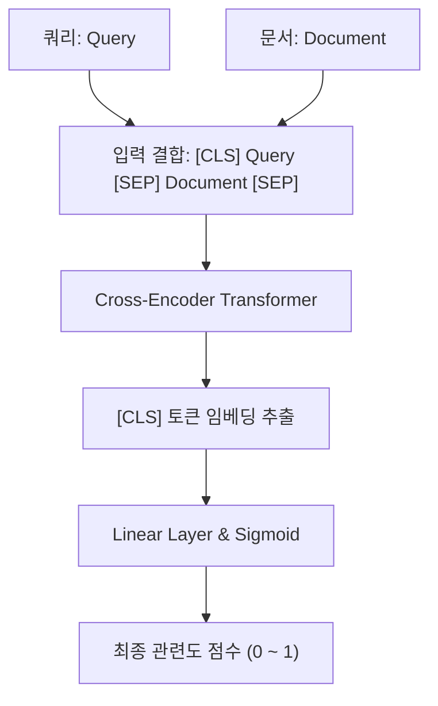
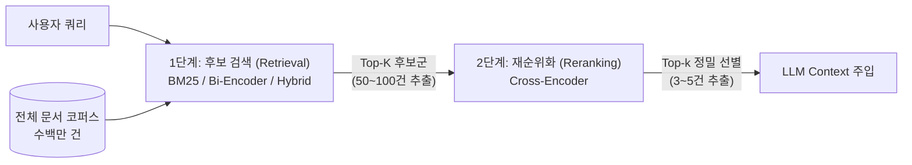

# 1. Bi-encoder의 한계: 정보 병목 (Information Bottleneck)

[[Dense Sparse Embedding#^f0d2cc|Bi-encoder]]는 쿼리와 문서를 각자의 인코더를 통해 **독립적인 고정 차원 벡터**로 매핑한다.

- **쿼리 ($q$)**: "애플 3분기 영업이익률" $\rightarrow \mathbf{e}_q \in \mathbb{R}^d$
- **문서 ($d$)**: (애플의 2024년 3분기 실적 공시 보고서 전문) $\rightarrow \mathbf{e}_d \in \mathbb{R}^d$

수백~수천 토큰에 달하는 긴 문서 전체를 768차원이나 1536차원 수준의 단일 벡터 하나로 압축하는 구조상, **문서 내 세부 정보와 미묘한 수치, 지시 대명사 간의 관계가 손실되는 정보 병목(Information Bottleneck)** 현상이 필연적으로 발생한다.

더 큰 문제는 **상호작용의 부재(No Token-Level Interaction)**다. Bi-encoder는 쿼리와 문서 토큰 간의 교차 주의집중(Cross-attention) 없이, 각각 독립적으로 산출된 풀링 벡터 간의 내적(Dot product) 또는 코사인 유사도($\cos(\mathbf{e}_q, \mathbf{e}_d)$)만으로 유사도를 판별한다. 이로 인해 쿼리의 특정 조건이 문서의 어느 문맥과 부합하는지 정밀하게 대조하지 못하며, 키워드가 일부 일치하더라도 전체 문맥상 엉뚱한 문서가 높은 점수를 받는 한계가 존재한다.

# 2. Cross-encoder

Cross-encoder는 Bi-encoder의 정보 병목과 토큰 상호작용 부재를 정면으로 해결하기 위해 고안된 아키텍처다.

> **Cross-encoder**: 쿼리와 문서를 분리하지 않고, 단일 입력 시퀀스로 결합(Concatenate)하여 트랜스포머 인코더에 통과시키는 방식.

## 2.1. 작동 원리

1. **입력 결합**: 쿼리와 문서를 `[CLS] 쿼리 [SEP] 문서 [SEP]` 형태로 결합해 모델에 주입한다.
2. **전체 토큰 상호작용 (Full All-to-All Attention)**: 트랜스포머의 Self-Attention 레이어를 통과하며, 쿼리의 모든 토큰 $q_i$와 문서의 모든 토큰 $d_j$가 모든 레이어에서 양방향으로 상호작용한다.
3. **분류 헤드(Classification Head)**: `[CLS]` 토큰의 최종 은닉 상태에 선형 변환과 시그모이드를 적용하여 단일 스칼라 점수(0~1 사이의 관련도 점수)를 직접 출력한다.

이 덕분에 "문맥상 정답과 조건이 정확히 일치하는지"를 극도로 높은 정밀도로 판정할 수 있다.

## 2.2. 치명적인 연산 비용과 색인 불가성

정확도 면에서는 단일 벡터 기반 Bi-encoder를 압도하지만, **실시간 대규모 검색 시스템에 단독으로 투입하는 것은 불가능에 가깝다.**

- **연산 복잡도 폭증**: Self-Attention의 시간 복잡도는 입력 시퀀스 길이 $L$의 제곱에 비례한다.
  - 쿼리 길이 $L_q$, 문서 길이 $L_d$, 전체 코퍼스 문서 수 $N$일 때:
  $$\text{Cross-encoder 온라인 추론 비용} \sim O\left(N \cdot (L_q + L_d)^2\right)$$
- **사전 색인(Pre-indexing) 불가능**:
  - Bi-encoder는 서비스 배포 전 오프라인에서 $N$개 문서의 임베딩을 미리 계산해 벡터 DB(HNSW 등)에 인덱싱해 둘 수 있다. 쿼리가 들어왔을 때는 쿼리 임베딩 1회 계산 후 ANN(Approximate Nearest Neighbor) 탐색을 수행하므로 수 밀리초(ms) 내에 완료된다.
  - 반면 Cross-encoder는 **쿼리와 문서가 합쳐진 상태에서만 연산이 가능**하다. 쿼리가 들어오기 전에는 문서 임베딩을 사전에 계산해 둘 수가 없다. 따라서 100만 건의 문서가 있다면 쿼리 1건당 100만 번의 무거운 트랜스포머 순전파(Forward pass)를 실시간으로 돌려야 하므로 검색 레이턴시가 수십 초에서 수 분으로 치솟는다.

# 3. 2-Stage Retrieval Pipeline (Reranking)

현대 RAG 및 정보 검색(IR) 시스템은 **속도(Bi-encoder/BM25)와 정밀도(Cross-encoder)의 트레이드오프**를 타협하기 위해 2단계 검색 파이프라인(2-Stage Retrieval)을 표준 아키텍처로 채택한다.

## 3.1. 파이프라인 세부 동작

1. **1단계: Retrieval (재현율 확보 단계)**
   - 전체 코퍼스(수십만~수백만 건)에서 **BM25**(키워드) 또는 **Dense Bi-encoder**(의미론) 기반으로 상위 $K \approx 50 \sim 100$개의 후보 문서를 고속 추출한다.
   - 목표: 정답 문서가 누락되지 않도록 **재현율(Recall)**을 극대화하는 것.
2. **2단계: Reranking (정밀도 극대화 단계)**
   - 1단계에서 걸러낸 50~100개의 후보 문서에 대해서만 **Cross-encoder**를 구동하여 쿼리와의 의미적 정합성을 정밀 채점한다.
   - 연산 대상이 100만 건에서 100건 이하로 줄어들었으므로, 실시간 서비스 허용 범위(수십~수백 ms) 내에서 무리 없이 연산이 완료된다.
3. **최종 주입 (Context Injection)**
   - 재순위화 결과 가장 점수가 높은 최상위 $k \approx 3 \sim 5$건만 선별하여 LLM의 프롬프트 컨텍스트에 주입한다.

## 3.2. 도입 효과 및 실무 모델군

- **평가 지표 개선**: Bi-encoder 단독 검색 대비 **MRR@10**(Mean Reciprocal Rank), **NDCG@10**(Normalized Discounted Cumulative Gain) 지표가 큰 폭으로 개선된다. 1단계에서 20~30위권에 밀려나 있던 실제 정답 문서가 2단계를 거치며 1~3위로 수직 상승하기 때문이다.
- **주요 Reranker 모델군**:
  - `bge-reranker-large` / `bge-reranker-v2-m3`: 다국어 및 한국어 검색에서 널리 활용되는 오픈소스 SOTA 리랭커.
  - `Cohere Rerank (v3)`: 상용 API 기반으로 긴 컨텍스트와 다국어를 안정적으로 지원하는 대표적 리랭커.
  - `jina-reranker-v2`: 긴 시퀀스(8K 토큰) 지원 및 경량화 구조를 채택한 고효율 리랭커.

# 4. Bi-encoder vs Cross-encoder 비교

| 비교 항목 | Bi-encoder (1단계 Retrieval) | Cross-encoder (2단계 Reranking) |
| :--- | :--- | :--- |
| **인코더 구조** | 듀얼 타워 (질문/문서 분리 인코딩) | 싱글 타워 (질문+문서 결합 인코딩) |
| **토큰 상호작용** | 없음 (최종 풀링 벡터 간 단순 내적) | **완전 상호작용 (All-to-All Cross Attention)** |
| **사전 색인 (Pre-indexing)** | **가능** (문서 벡터 사전 추출 및 캐싱) | **불가능** (쿼리 입력 전 사전 계산 불가) |
| **시간 복잡도** | 쿼리 인코딩 $O(L_q^2)$ + ANN 탐색 $O(\log N)$ | 후보군 $K$개에 대해 $O(K \cdot (L_q + L_d)^2)$ |
| **추론 레이턴시** | 극도로 빠름 (수 ms) | 상대적으로 무거움 (수십~수백 ms) |
| **검색 품질** | 상대적으로 거침 (정보 병목 존재) | **극도로 정밀함 (문맥적 일치도 완벽 포착)** |
| **파이프라인 내 역할** | 대규모 코퍼스 대상 1차 후보군 추출 (High Recall) | 소수 후보군 대상 최종 순위 재정렬 (High Precision) |
