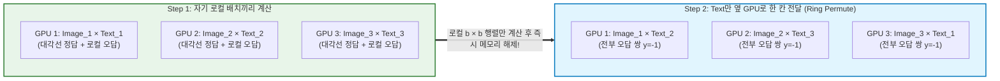

# SigLIP (Sigmoid Loss for Language Image Pre-Training)

> [!abstract] 핵심 파이프라인 & 3줄 요약
> **Image-Text Pairs $\xrightarrow{\text{Dual ViT/Transformer}}$ Cosine Similarity $\hat{v}_i^\top \hat{u}_j$ $\xrightarrow{\text{Element-wise Sigmoid}}$ Independent Binary Classification ($y_{ij} \in \{+1, -1\}$)**
> - **한 줄 정의**: [[CLIP]]의 대칭적 Softmax(InfoNCE) 손실 함수를 **쌍별 독립 시그모이드 이진 분류(Pairwise Sigmoid Binary Cross-Entropy) 손실**로 대체하여, 메모리 병목과 배치 사이즈 의존성을 동시에 깨부순 구글(2023)의 차세대 비전-언어 사전학습 모델이다.
> - **핵심 수식 변화**: "$N$개 후보 중 정답 1개 고르기(Softmax, 전체 분모 합산 필요)" $\to$ "각 $(i, j)$ 쌍을 따로 보고 둘이 짝꿍($+1$)인지 남남($-1$)인지 O/X 퀴즈 풀기(Sigmoid, 분모 합산 불필요)".
> - **현세대 위상**: PaliGemma, LLaVA-OneVision 등 최신 [[VLM]]은 물론, **OpenVLA, $\pi_0$ (Pi-Zero) 등 거의 모든 현대 [[VLA]] 모델의 기본 Vision Encoder**로 기존 CLIP을 밀어내고 표준 자리를 차지했다.

---

## 1. 개요: 왜 CLIP의 Softmax는 골칫거리였는가?

[[CLIP]]이 사용한 **InfoNCE (Softmax 기반 대조 손실)** 수식을 다시 보자.
$$\mathcal{L}_{\text{CLIP}} \propto -\sum_{i=1}^{N} \log \frac{\exp(S_{i,i})}{\underbrace{\sum_{j=1}^{N} \exp(S_{i,j})}_{\text{이미지→텍스트 전체 합}}} - \sum_{i=1}^{N} \log \frac{\exp(S_{i,i})}{\underbrace{\sum_{j=1}^{N} \exp(S_{j,i})}_{\text{텍스트→이미지 전체 합}}}$$

이 수식에는 대규모 분산 학습 시 엔지니어들을 고통스럽게 만드는 **세 가지 치명적인 문제**가 숨어 있다.

1. **전역 정규화(Global Normalization)와 통신 병목**:
   - 분모 $\sum_{j=1}^N \exp(S_{i,j})$를 구하려면, 현재 GPU에 있는 이미지 $I_i$와 **다른 모든 GPU에 흩어져 있는 $N$개의 텍스트 $T_1, \dots, T_N$** 의 내적값을 전부 알아야 한다.
   - 즉, 매 스텝마다 모든 GPU 간에 **All-Gather 통신**을 수행해 $N \times N$ 크기의 거대한 유사도 행렬 전체를 실체화(Materialize)해야 한다. 배치 크기 $N=32,768$이면 행렬 원소만 **10억 개($32768^2$)** 에 달해 VRAM이 터져나간다.
2. **수치적 불안정성 (Numerical Instability)**:
   - Softmax가 오버플로우 나지 않게 하려면 행 방향·열 방향으로 각각 최댓값($\max_j S_{i,j}$)을 찾아 빼주는 패스(Pass)를 한 번 더 돌아야 한다.
3. **비대칭성과 배치 크기 민감도**:
   - 정답 쌍 1개당 오답 쌍이 $N-1$개 묶여서 한꺼번에 확률 합이 1이 되도록 경쟁하기 때문에, 배치 크기 $N$이 변하면 손실 함수의 기울기(Gradient) 성질 자체가 달라진다. 특히 $N$이 작을 때는 학습 효율이 급락한다.

> [!tip] SigLIP의 해법: "객관식 $N$지선다(Softmax) 말고, 개별 O/X 퀴즈(Sigmoid)로 풀자!"
> 굳이 배치 전체를 줄 세워 확률 합을 1로 맞출 필요가 있을까? 임의의 이미지 $I_i$와 텍스트 $T_j$를 딱 둘만 데려다 놓고 **"너희 둘이 원래 짝꿍이니($y_{ij} = +1$), 아니면 남남이니($y_{ij} = -1$)?"** 를 묻는 독립적인 이진 분류(Logistic Regression) 문제 $N^2$개로 쪼개버리면, **전체 분모 합산($\sum_{j=1}^N \exp$) 자체가 수식에서 완전히 사라진다!**

---

## 2. 수식적 아키텍처와 완벽 유도

### 2.1. Pairwise Sigmoid Loss 수식
배치 내 $i$번째 이미지의 정규화된 임베딩을 $\hat{v}_i = \frac{f(I_i)}{\|f(I_i)\|_2}$, $j$번째 텍스트의 정규화된 임베딩을 $\hat{u}_j = \frac{g(T_j)}{\|g(T_j)\|_2}$라 하자.
라벨 $y_{ij}$를 다음과 같이 정의한다.
$$y_{ij} = \begin{cases} +1 & \text{if } i = j \quad (\text{Positive Pair: 정답 짝꿍}) \\ -1 & \text{if } i \neq j \quad (\text{Negative Pair: 오답 조합}) \end{cases}$$

이때 $(i, j)$ 쌍에 대한 로지스틱 로짓(Logit) $z_{ij}$를 다음과 같이 구성한다.
$$z_{ij} = t \cdot (\hat{v}_i^\top \hat{u}_j) + b \quad \text{where } t = \exp(t')$$
- $t = \exp(t') > 0$: 학습 가능한 온도 스케일 파라미터 (CLIP의 $1/\tau$ 역할).
- $b \in \mathbb{R}$: **학습 가능한 편향(Learnable Bias) 파라미터** (SigLIP만의 핵심 장치!).

시그모이드 함수 $\sigma(x) = \frac{1}{1 + e^{-x}}$를 사용하면, 각 쌍 $(i, j)$가 정답 라벨 $y_{ij} \in \{+1, -1\}$로 분류될 확률은 $\sigma(y_{ij} z_{ij}) = \frac{1}{1 + \exp(-y_{ij} z_{ij})}$이다. 따라서 배치 전체에 대한 **SigLIP의 최종 손실 함수**는 모든 $N^2$개 쌍에 대한 음의 로그 우도(Negative Log-Likelihood) 평균이다.

$$\mathcal{L}_{\text{SigLIP}} = \frac{1}{N} \sum_{i=1}^{N} \sum_{j=1}^{N} \log \left( 1 + \exp\big( -y_{ij} (t \cdot \hat{v}_i^\top \hat{u}_j + b) \big) \right)$$

> [!important] CLIP vs SigLIP 수식 구조 비교
> - **CLIP (Softmax)**: $\mathcal{L}_{i} = -\log \frac{e^{z_{ii}}}{\sum_{j=1}^N e^{z_{ij}}}$ $\implies$ **$\log$ 안에 $\sum_{j=1}^N$이 들어 있어서** 모든 $j$를 한 번에 모아 계산해야 함 (강한 결합).
> - **SigLIP (Sigmoid)**: $\mathcal{L} = \frac{1}{N} \sum_{i=1}^N \sum_{j=1}^N \ell(i, j)$ $\implies$ **$\sum$이 $\log$ 바깥에 있어서** 각 $(i, j)$ 쌍의 손실을 완전히 독립적으로 쪼개서 계산하고 나중에 더하기만 하면 됨!

---

### 2.2. 결정적 디테일: 왜 편향 파라미터 $b$를 $-10$으로 초기화해야 하는가?

SigLIP 논문에서 가장 중요한 수학적 트릭이 바로 **편향 $b$의 도입과 초기화($b_0 = -10$)** 다. 만약 $b=0$으로 두고 시작하면 학습 초기에 모델이 완전히 망가진다. 왜 그럴까?

1. **극심한 클래스 불균형 (Severe Class Imbalance)**:
   - 배치 크기가 $N=32,768$일 때, 정답 쌍($y_{ij}=+1$)은 겨우 **$N$개**뿐이지만, 오답 쌍($y_{ij}=-1$)은 **$N(N-1) \approx 10\text{억 개}$** 나 된다 ($1 : 32767$의 불균형).
2. **$b=0$일 때 발생하는 대참사**:
   - 학습 맨 처음(무작위 초기화 상태)에는 두 벡터의 내적 $\hat{v}_i^\top \hat{u}_j \approx 0$이다.
   - 만약 $b=0$이면 $z_{ij} \approx 0$이 되어, 모델은 모든 쌍에 대해 $\sigma(-z_{ij}) = \sigma(0) = 0.5$ (즉, "짝꿍일 확률 반반")라고 예측한다.
   - 이때 압도적으로 많은 10억 개의 오답 쌍($y_{ij}=-1$)에서 엄청난 양의 그래디언트가 쏟아져 나오며, **첫 몇 스텝 동안 모델이 특징을 배우는 대신 무조건 출력을 음수로 낮추는 데만 모든 에너지를 허비**한다.
3. **해결책 ($b_0 = -10, t' = \log 10$ 초기화)**:
   - 편향을 큰 음수($b = -10$)로 초기화하면, 초기 로짓이 $z_{ij} \approx -10$이 된다.
   - 그러면 오답 쌍($y_{ij} = -1$)에 대한 손실은 $\log(1 + e^{-(-1)(-10)}) = \log(1 + e^{-10}) \approx 0.000045$가 되어 **학습 시작 시점부터 이미 거의 모든 오답 쌍을 "남남이다(확률 99.995%)"라고 맞힌 상태(Prior 반영)** 로 출발한다!
   - 덕분에 초기 그래디언트가 10억 개의 흔한 오답에 휩쓸리지 않고, 소수의 정답 쌍($y_{ij}=+1$)을 끌어당기는 데 온전히 집중할 수 있다.

---

## 3. 분산 학습 아키텍처: Chunked Ring Communication

$\sum$이 $\log$ 밖으로 빠져나온 덕분에, SigLIP은 전체 $N \times N$ 행렬을 메모리에 한 번에 만들 필요가 없다. $D$개의 디바이스(GPU/TPU)가 각각 로컬 배치 크기 $b_{\text{local}} = N / D$개씩 데이터를 들고 있을 때 다음과 같이 **고리 모양(Ring)으로 텍스트 임베딩만 한 칸씩 옆 GPU로 넘기며** 조각(Chunk) 단위로 손실을 누적한다.

- **메모리 복잡도 혁신**: CLIP은 각 디바이스마다 $\mathcal{O}(N^2)$ 또는 $\mathcal{O}(N \cdot b_{\text{local}})$ 메모리가 필요했지만, SigLIP은 **전체 배치 크기 $N$이 100만 개로 늘어나도 각 GPU에는 오직 $\mathcal{O}(b_{\text{local}}^2)$ 크기의 작은 조각 행렬만 올라간다.**

---

## 4. 아키텍처 디테일: `[CLS]` 토큰 대신 MAP Head 사용

CLIP의 ViT는 맨 앞에 `[CLS]` 토큰을 붙여서 그 토큰 하나만 뽑아 썼지만, **SigLIP의 ViT 아키텍처(예: `SoViT-400m/14`)는 아예 `[CLS]` 토큰을 넣지 않는다.** 대신 마지막에 **MAP (Multihead Attention Pooling) Head**를 사용해 이미지 대표 벡터를 뽑는다.

1. ViT 인코더가 $M$개의 패치 토큰 $Z = [z_1, z_2, \dots, z_M] \in \mathbb{R}^{M \times D}$를 출력한다.
2. 학습 가능한 단 1개의 **Query 벡터 $q_{\text{pool}} \in \mathbb{R}^{1 \times D}$ (Probe)** 를 두고, 패치 토큰 $Z$를 Key와 Value로 삼아 **[[Cross Attention]]** 을 1회 수행한다.
$$\hat{v} = \text{MultiHeadAttention}(\text{Query}=q_{\text{pool}}, \, \text{Key}=Z, \, \text{Value}=Z)$$
3. **장점**: 모든 패치 토큰이 마지막 레이어까지 동등하게 공간적 특징을 유지하며 학습되고, 글로벌 요약이 필요할 때만 어텐션 풀링으로 깔끔하게 모아준다. [[VLM]]이나 [[VLA]]에서 패치 토큰 $Z$를 꺼내 쓸 때도 `[CLS]` 토큰에 정보가 쏠리는 현상(Token Artifact)이 적어 유리하다.

---

## 5. CLIP vs SigLIP 핵심 비교 요약

| 비교 항목 | **[[CLIP]] (OpenAI, 2021)** | **SigLIP (Google, 2023)** |
| :--- | :--- | :--- |
| **손실 함수 (Loss)** | 대칭적 Softmax (InfoNCE) | **쌍별 Sigmoid (Binary Cross-Entropy)** |
| **문제 정의** | $N$개 중 정답 1개 고르기 (다중 클래스 분류) | **각 $(i,j)$ 쌍마다 짝꿍 여부 판별 (이진 분류)** |
| **정규화 범위** | 배치 전체 합산 필요 ($\sum_{j=1}^N \exp$) | **정규화 불필요 (쌍별 완전 독립)** |
| **유사도 행렬 메모리** | $\mathcal{O}(N^2)$ (전체 행렬 실체화 필요) | **$\mathcal{O}(b_{\text{local}}^2)$ (Chunk 단위 순차 계산 가능)** |
| **적은 배치($N \le 4\text{k}$) 성능** | 배치 크기가 작으면 성능 급락 | **작은 배치에서도 매우 높은 성능 유지** |
| **초기화 트릭** | 온도 $\tau$ 클리핑 ($\le 100$) | **편향 $b = -10$ 초기화로 클래스 불균형 해결** |
| **비전 풀링 방식** | `[CLS]` 토큰 추출 | **MAP (Multihead Attention Pooling)** |
| **대표 채택 모델** | LLaVA-1.5, Stable Diffusion 1.5/XL | **PaliGemma, OpenVLA, $\pi_0$, LLaVA-OneVision** |

> [!note] 후속작: SigLIP 2 (2025)
> 2025년 발표된 **SigLIP 2**는 기존 SigLIP의 Sigmoid Loss 위에 (1) 캡션 생성 손실(LocCa), (2) **[[DINO]] 스타일의 자기지도 증류 손실(Self-Distillation)과 마스크 예측**을 한꺼번에 결합하여, CLIP 계열의 약점이었던 픽셀 단위의 밀집 공간 표현(Dense Spatial Representation) 능력까지 크게 끌어올렸다.

---

## 6. 한 줄 요약

> **SigLIP = "CLIP의 무거운 Softmax 객관식 시험을 가벼운 Sigmoid O/X 퀴즈로 바꾸고 편향($b=-10$) 트릭을 더해, 적은 메모리와 배치로도 압도적인 시각-언어 정렬 성능을 달성한 현세대 VLM/VLA의 표준 눈"**

---
연관 노트: [[CLIP]], [[DINO]], [[ViT]], [[VLM]], [[VLA]]

