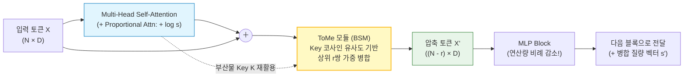
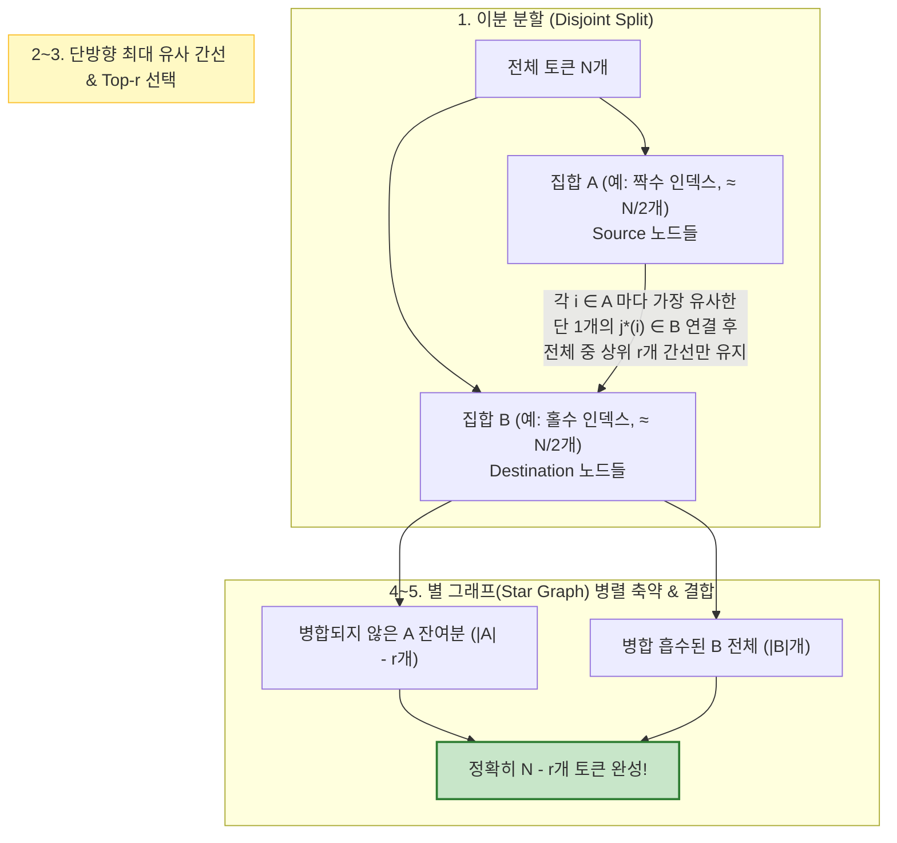

# Token Merging (ToMe)

> [!abstract] 핵심 개념 & 3줄 요약
> - **패러다임 전환 (Drop $\to$ Merge)**: [[Transformer]]의 $\mathcal{O}(N^2)$ 연산 병목을 줄일 때 중요도가 낮은 토큰을 버리는 **토큰 가지치기(Token Pruning)** 대신, 의미적으로 중복된 유사 토큰들을 하나로 합치는 **재학습 불필요(Training-free) 시퀀스 압축 기법**이다 (Bolya et al., ICLR 2023 Oral).
> - **Bipartite Soft Matching (BSM)**: 클러스터링($k$-means)의 반복 루프 병목을 피하기 위해 토큰을 두 집합 $(\mathcal{A}, \mathcal{B})$로 나눈 이분 그래프에서 $\mathcal{A} \to \mathcal{B}$ 단방향 상위 $r$개 간선만 병렬 축약하여, 전이적 사슬(Transitive chain) 없이 $\mathcal{O}(1)$ 단계 텐서 연산만으로 배치를 균일하게 $N - r$개로 줄인다.
> - **수학적 질량 보존 (Proportional Attention)**: 병합된 토큰이 원본 패치 $s_j$개만큼의 질량을 대표하도록 가중 평균으로 병합하고 어텐션 로짓에 **$\log s_j$** 를 더함으로써, 동일 토큰 병합 시 원본 Softmax 분포와 **대수적으로 100% 일치**하는 근사 안정성을 확보한다.

---

## 1. 등장 배경: 왜 Token Pruning이 아니라 Token Merging인가?

[[ViT]](Vision Transformer), 고해상도 [[VLM]], 비디오 및 Diffusion 모델에서 입력 토큰 수 $N$이 커지면 Self-Attention 연산량 $\mathcal{O}(N^2 d)$와 활성화 메모리가 제곱으로 폭증한다. 가중치 행렬 $W$를 깎는 [[Pruning|Weight Pruning]]과 달리, **토큰 축소(Token Reduction)** 는 가중치는 그대로 둔 채 **시퀀스 길이 $N$ 자체를 동적으로 줄여** 별도 희소 커널 없이 일반 GPU에서 즉각적인 가속을 얻는다.

기존 주류였던 **Token Pruning**(DynamicViT, EViT 등)은 어텐션 점수가 낮은 배경 토큰을 **삭제(Drop)** 했지만 두 가지 구조적 한계가 있었다.

| 비교 항목 | **Token Pruning (토큰 삭제)** | **Token Merging (ToMe, 토큰 병합)** |
| :--- | :--- | :--- |
| **핵심 연산** | 중요도 하위 $r$개 토큰 제거 | **유사도 상위 $r$쌍 토큰 가중 평균 결합** |
| **전경(Foreground) 비중이 큰 입력** | 버릴 배경이 부족해 **핵심 객체 패치까지 강제 삭제** $\to$ 급격한 성능 붕괴 | 전경 패치끼리(예: 강아지 털 패치들), 배경끼리(하늘 패치들) 각각 요약 병합되어 **정보 손실 최소화** |
| **재학습(Fine-tuning) 필요 여부** | 대부분 마스크/스위칭 적응을 위한 **재학습 필수** | **완전 Training-free(플러그 앤 플레이)** 적용 가능 (학습 시 적용하면 학습 속도도 ~2배 가속) |
| **배치 연산 정형성 (GPU 효율)** | 임계값(Threshold) 기반 삭제 시 샘플마다 길이가 달라져 패딩 낭비 발생 | 레이어당 고정 개수 $r$개 병합 시 배치 내 모든 샘플이 **정확히 $(B, N-r, D)$ 정형 텐서** 유지 |

---

## 2. 어디서, 무엇으로 유사도를 잴 것인가?

ToMe 모듈은 각 Transformer 블록 내부의 **Self-Attention 직후, MLP 직전**에 삽입되어 레이어마다 $r$개씩 점진적으로(예: 12-layer ViT에서 $r=16$이면 $197 \to \dots \to 21$개) 토큰을 줄여 나간다.

### 왜 피처 $X$가 아니라 Attention Key($K$)의 코사인 유사도인가?
토큰 $i$와 $j$가 "합쳐도 될 만큼 같은 정보를 담고 있는가?"를 판별할 때 은닉 상태 $X \in \mathbb{R}^{N \times D}$ 대신 **어텐션에서 이미 계산된 Key 벡터의 헤드 평균 $\bar{k}_i = \frac{1}{H}\sum_{h=1}^H k_i^{(h)} \in \mathbb{R}^{d_k}$** 간 코사인 유사도를 쓴다.

$$\operatorname{sim}(i, j) = \frac{\bar{k}_i^\top \bar{k}_j}{\|\bar{k}_i\|_2 \, \|\bar{k}_j\|_2}$$

1. **표현 공간의 정합성**: [[Attention]]에서 Key $K$는 본래 내적 $q^\top k / \sqrt{d_k}$을 통해 *"내가 다른 토큰들에게 어떤 정보를 제공할 것인가"* 를 요약하도록 학습된 선형 사상이다. 실제 실험(Ablation)에서도 $X, Q, V$보다 **$K$를 쓸 때 정확도 보존율이 압도적으로 높다.**
2. **연산 비용 절감**: 은닉 차원 $D$(예: $768$) 대신 헤드당 차원 $d_k = D / H$(예: $64$)에서 내적을 수행하므로 유사도 행렬 계산이 $H$배 가볍고 추가 투영 행렬이 전혀 필요 없다.

---

## 3. 핵심 알고리즘: Bipartite Soft Matching (BSM)

유사한 토큰을 묶는 가장 직관적인 방법은 [[군집 분석|$k$-means 클러스터링]]이나 탐욕적 순차 매칭이지만, 두 방법 모두 **반복 루프(Iterative loop)** 가 필요해 GPU 병렬성을 깨뜨리고 오히려 추론 시간(Wall-clock latency)이 느려진다. 반대로 전체 $N \times N$ 유사도 행렬에서 단순히 상위 $r$개 쌍을 동시에 이으면 $A - B - C - D$ 형태의 **전이적 연결 요소(Connected components)** 가 생겨 순차적인 그래프 탐색(Union-Find)이 강제된다.

**Bipartite Soft Matching (BSM)** 은 **이분 그래프의 방향성 제약** 하나로 이 문제를 단숨에 해결한다.

### 알고리즘 5단계와 그래프 이론적 보장
1. **이분 분할**: $N$개 토큰을 서로소인 두 집합 $\mathcal{A}$와 $\mathcal{B}$로 나눈다 (ViT에서는 짝수/홀수 인덱스로 균등 분할; `[CLS]` 토큰은 병합 손실을 막기 위해 제외).
2. **단방향 최선 간선 추출 ($\mathcal{A} \to \mathcal{B}$)**: 각 $i \in \mathcal{A}$마다 $\mathcal{B}$ 내에서 가장 코사인 유사도가 높은 **단 하나의 대상 토큰** $j^*(i) = \arg\max_{j \in \mathcal{B}} \operatorname{sim}(i, j)$와 최대 점수 $s_i = \operatorname{sim}(i, j^*(i))$를 찾는다 (`max` 연산 1회).
3. **상위 $r$개 간선 필터링**: $|\mathcal{A}|$개의 후보 간선 중 유사도 점수 $s_i$가 가장 큰 **상위 $r$개 간선**만 남기고 나머지는 끊는다 (`topk` 연산 1회, 단 $r \le |\mathcal{A}|$).
4. **병렬 가중 평균 병합 (`scatter_reduce`)**: 살아남은 간선을 따라 $\mathcal{A}$의 토큰들을 $\mathcal{B}$의 대상 토큰에 합친다.
5. **재결합**: 살아남은 $\mathcal{A}$의 미병합 토큰 $(|\mathcal{A}| - r)$개와 갱신된 $\mathcal{B}$ 토큰 $|\mathcal{B}|$개를 이어붙여 정확히 **$N - r$개** 토큰을 출력한다.

> [!tip] 왜 전이적 사슬(Chain)이 절대 생기지 않는가?
> 모든 간선이 오직 $\mathcal{A} \to \mathcal{B}$ 방향으로만 향하고, 모든 $i \in \mathcal{A}$의 진출 차수(Out-degree)가 최대 $1$이며 $\mathcal{B}$의 진출 차수는 $0$이다! 따라서 그래프에 길이 $2$ 이상인 경로($u \to v \to w$)가 원천적으로 존재할 수 없으며, 모든 연결 요소는 중심이 $j \in \mathcal{B}$인 서로소 **별 그래프(Disjoint Star Graphs)** 가 된다. 덕분에 루프 없는 단일 GPU `scatter_add` 커널 한 번으로 병합이 끝난다!

---

## 4. 수학적 정확성 복원: 질량 가중 평균과 Proportional Attention

단순히 두 벡터를 $\frac{x_1 + x_2}{2}$로 평균 내고 끝내면 레이어가 깊어질수록 심각한 수학적 왜곡이 발생한다. 이를 교정하는 두 가지 불변량 보존 장치가 ToMe의 핵심이다.

### 4.1. 패치 질량 보존 가중 평균 (Size-Weighted Merging)
각 토큰 $u$가 현재 몇 개의 원본 이미지 패치가 합쳐진 결과인지를 나타내는 **질량(크기) 스칼라 $s_u \in \mathbb{N}$** 을 함께 추적한다 (초기값 $s_u = 1$).
이미 4개의 패치가 합쳐진 토큰($s_u = 4$)과 단일 패치 토큰($s_j = 1$)이 병합될 때 단순 산술평균을 취하면 단일 패치가 4배 과대 대표된다. 따라서 연결 요소 $M_j \subseteq \mathcal{A} \cup \{j\}$가 하나로 합쳐질 때 반드시 **질량 가중 평균**을 취한다.

$$s_j^{\text{new}} = \sum_{u \in M_j} s_u, \qquad x_j^{\text{new}} = \frac{\sum_{u \in M_j} s_u \, x_u}{\sum_{u \in M_j} s_u}$$

이로써 몇 번의 레이어를 거쳐 다단계로 병합되더라도, 결과 벡터는 항상 **자신에게 흡수된 모든 원본 토큰들의 정확한 무게중심**을 유지한다.

### 4.2. 비례 어텐션 (Proportional Attention)의 대수적 유도
병합된 토큰 $x_j$ ($s_j$개의 동일 토큰을 대표)가 다음 블록의 Self-Attention에 들어간다고 하자. 만약 병합하지 않았다면 임의의 Query $q_i$가 이 $s_j$개의 동일한 Key $k_j$, Value $v_j$ 그룹으로부터 받아왔을 총 어텐션 기여분은 다음과 같다.

$$\sum_{m=1}^{s_j} \frac{\exp\!\left(\frac{q_i^\top k_j}{\sqrt{d_k}}\right)}{Z_i} v_j = \frac{s_j \exp\!\left(\frac{q_i^\top k_j}{\sqrt{d_k}}\right)}{Z_i} v_j = \frac{\exp\!\left(\frac{q_i^\top k_j}{\sqrt{d_k}} + \log s_j\right)}{Z_i} v_j$$

> [!important] 항등식 $s_j e^{z_{ij}} = e^{z_{ij} + \log s_j}$의 위력!
> 만약 $s_j$개 토큰을 1개로 합친 뒤 일반 Softmax Attention을 그대로 돌리면 분자의 가중치 $s_j$가 $1$로 쪼그라들어, 넓게 병합된 영역(예: 큰 물체나 넓은 배경)이 어텐션에서 무시당하는 분포 왜곡이 일어난다!
> 이를 완벽히 상쇄하는 해법이 어텐션 행렬에 **질량 벡터 $\mathbf{s} = (s_1, \dots, s_{N'})^\top$의 로그를 열 방향으로 더해주는 Proportional Attention** 이다:
> $$A = \operatorname{softmax}\!\left( \frac{Q K^\top}{\sqrt{d_k}} + \mathbf{1} (\log \mathbf{s})^\top \right)$$
> - **근사 오차 관점**: 그룹 $M_j$ 내부 토큰들의 Key/Value 편차가 $\|k_u - k_j\| \le \epsilon_k, \, \|v_u - v_j\| \le \epsilon_v$일 때, 일반 어텐션은 중복도 손실로 인해 $\mathcal{O}(1)$의 영차(0th-order) 오차를 내지만, Proportional Attention은 영차 오차를 **정확히 $0$으로 소거**하고 오차를 군집 내 분산에 비례하는 **1차 립시츠 오차 $\mathcal{O}(\epsilon_k + \epsilon_v)$** 로 묶어둔다!

---

## 5. 밀집 예측과 생성 모델로의 확장: Unmerging & ToMeSD

이미지 분류는 마지막에 `[CLS]` 토큰이나 전역 평균만 쓰므로 토큰 수가 줄어든 채 끝나도 무방하지만, **세그멘테이션, 객체 탐지, Diffusion 생성 모델(U-Net / DiT)** 은 출력이 원래의 2D 공간 해상도 $H \times W$($N$개 토큰)를 그대로 복원해야 한다.

### 5.1. 병합-연산-복원 (Merge $\to$ Compute $\to$ Unmerge)
ToMeSD(*Token Merging for Fast Stable Diffusion*, Bolya & Hoffman, CVPR 2023)는 각 블록에서 **무거운 연산(Self-Attention, Cross-Attention, MLP) 직전에만 일시적으로 병합했다가 블록 출력에서 원래 자리로 되돌리는(Unmerge)** 방식을 도입했다.
1. BSM 수행 시 각 원본 인덱스 $u \in \{1, \dots, N\}$가 어느 병합 인덱스 $\pi(u) \in \{1, \dots, N-r\}$로 흡수되었는지 매핑 테이블 $\pi$를 저장한다.
2. 압축된 $N - r$개 토큰으로 어텐션($\mathcal{O}((N-r)^2)$)을 빠르게 계산해 출력 $\tilde{Y} \in \mathbb{R}^{(N-r) \times D}$를 얻는다.
3. **Unmerging**: 저장해 둔 $\pi$를 따라 각 위치에 값을 그대로 복사 브로드캐스트($y_u \leftarrow \tilde{y}_{\pi(u)}$)하여 원래 크기 $Y \in \mathbb{R}^{N \times D}$로 복원한 뒤 Residual Connection과 합친다!

### 5.2. 2D 격자 아티팩트 방지: $2 \times 2$ 공간 계층 분할
생성 모델에서 1차원 짝수/홀수 인덱스로 $(\mathcal{A}, \mathcal{B})$를 나누면 가로 폭 $W$가 짝수일 때 모든 $\mathcal{B}$(기준점)가 홀수 열에만 몰려 세로 줄무늬 아티팩트가 생기거나 특정 영역이 통째로 빨려 들어간다.
- **해결책**: 2D 특징 맵을 **$2 \times 2$ 타일**로 나눈 뒤, 매 디노이징 스텝마다 각 타일 안에서 **무작위로 1개 픽셀($25\%$)을 뽑아 목적지 집합 $\mathcal{B}$** 로 두고 나머지 3개($75\%$)를 $\mathcal{A}$로 둔다. 기준점이 이미지 전 영역에 균일하게 박혀 공간 구조가 무너지지 않으면서도 최대 $60\%$의 토큰을 병합해 Stable Diffusion 추론을 재학습 없이 최대 약 $2\times$ 가속한다.

---

## 6. 모달리티별 확장 지형과 한계점

### 6.1. 최신 멀티모달·비디오 확장
- **[[VLM]] 시각 토큰 압축 (PruMerge, VisionZip 등)**: 고해상도 VLM(`LLaVA-NeXT`, `Qwen2-VL`)에서는 이미지 한 장이 수천 개의 시각 토큰을 만들어 LLM Prefill 지연시간(TTFT)과 [[KV Cache Optimization|KV Cache]] 메모리를 잠식한다. Connector 앞단에서 `[CLS]` 어텐션 점수로 핵심 토큰을 고르고(Pruning), 버려질 주변 토큰들을 버리지 않고 핵심 토큰으로 **Key 유사도 기반 ToMe 병합**하여 LLM 입력 길이를 $1/4 \sim 1/10$로 줄이는 하이브리드 전략이 널리 쓰인다.
- **비디오 모델 (VidToMe 등)**: 연속된 비디오 프레임 간에는 정적인 배경 패치가 $80\%$ 이상 중복된다. 시공간(Spatio-temporal) 토큰들에 BSM을 적용해 여러 프레임의 중복 토큰을 단일 대표 토큰으로 합치면 긴 비디오 이해 및 생성의 메모리 장벽을 크게 낮출 수 있다.

### 6.2. 한계와 자기회귀 LLM 적용이 까다로운 수학적 이유
1. **고주파 세부 정보 손실 (OCR · 미세 경계)**: 병합 예산 $r$을 실제 이미지 내 중복량보다 과도하게 키우면 유사하지 않은 토큰($\epsilon_k$가 큰 쌍)까지 억지로 평균화되어, 작은 글자를 읽어야 하는 문서 OCR이나 가는 외곽선 세그멘테이션에서 해상도 저하가 나타난다 (이를 보완하기 위해 코사인 유사도 하한 임계값이나 동적 $r$ 스케줄을 쓰면 배치 정형성과의 트레이드오프가 발생한다).
2. **자기회귀 디코더([[GPT|LLM]])에서의 인과성 제약과 RoPE 간섭**:
   - **인과적 마스킹(Causal Mask)**: 인코더(양방향 어텐션)와 달리 디코더에서는 미래 시점 $t_2 > t_1$의 토큰이 과거 $t_1$으로 병합되면 미래 정보 누수(Causality violation)가 일어나며, 디코딩 단계에서는 토큰이 한 번에 하나씩 순차 생성되므로 전체 시퀀스 이분 매칭 대신 **과거 KV Cache 병합(CaM, D2O 등)** 형태로 변형해야 한다.
   - **위치 인코딩 결합(RoPE)과 정보 밀도**: 픽셀 패치와 달리 자연어 토큰은 인접 단어라도 의미가 판이하게 다르고, [[Long-sequence Handling|RoPE]]가 토큰 위치 각도를 Key 벡터에 직접 회전 결합시키므로 멀리 떨어진 유사 의미 토큰끼리 단순 평균 병합하면 상대 위치 위상이 뭉개지는 문제가 생긴다.

---

## 7. 한 줄 요약

> **Token Merging(ToMe)은 "중요하지 않은 토큰을 버리지 말고 중복된 토큰을 합치자"는 발상을 이분 그래프 단방향 매칭(BSM)과 소프트맥스 질량 보정($+\log s$)이라는 정교한 수학적 장치로 구현해, 재학습 없이도 하드웨어 친화적인 가속을 달성한 대표적 시퀀스 압축 기법이다.**

---
연관 노트: [[ViT]], [[Attention]], [[VLM]], [[Pruning]], [[Inference Acceleration]], [[KV Cache Optimization]], [[Long-sequence Handling]], [[군집 분석]]

