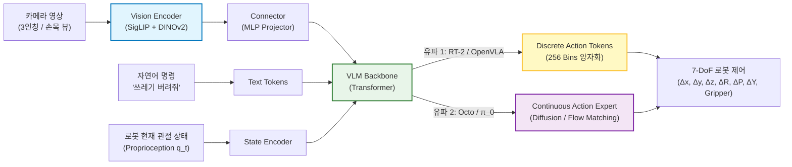
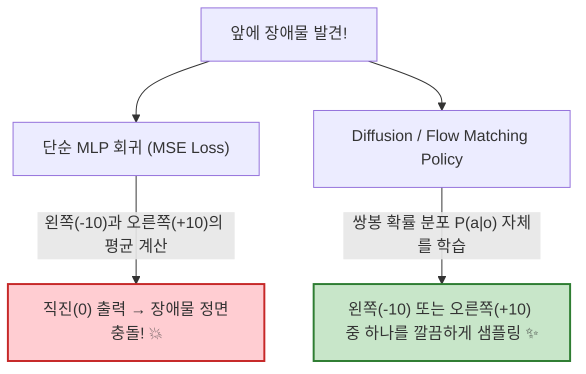
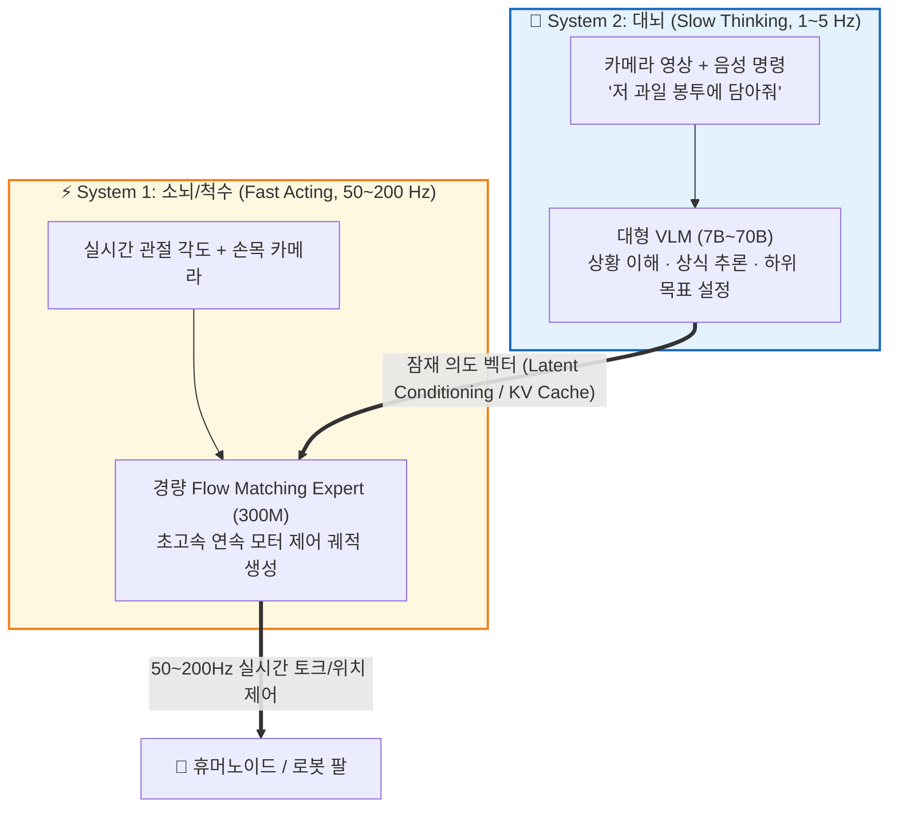

# VLA Architecture (Vision-Language-Action Model)

> [!abstract] 핵심 파이프라인 & 3줄 요약
> **Camera Image + Text Prompt $\xrightarrow{\text{Vision Encoder}}$ Multimodal Tokens $\xrightarrow{\text{VLM Backbone}}$ Action Head $\xrightarrow{\text{Control}}$ Robot ($\Delta x, \Delta y, \Delta z, \text{Gripper}$)**
> - **한 줄 정의**: 텍스트만 알던 [[GPT|LLM]]에 '눈'을 달아준 것이 **[[VLM]]** 이라면, 거기에 **'손과 발(로봇 제어)'** 까지 달아주어 시각 정보와 사람의 말귀를 알아듣고 물리적 행동을 직접 출력하는 **체화 인공지능(Embodied AI) 모델**이다.
> - **핵심 패러다임**: 과거 로봇 공학처럼 인지(Perception) $\to$ 경로 계획(Planning) $\to$ 제어(Control) 모듈을 따로 짜서 이어 붙이는 대신, 인터넷 스케일의 상식을 가진 VLM 하나가 **시각-언어-행동을 End-to-End로 통합 처리**한다.
> - **최신 트렌드**: 초기에는 로봇 제어 숫자를 단순 텍스트 토큰으로 바꿔 찍어내는 방식(RT-2, OpenVLA)이 주류였으나, 최근에는 **System 2(느린 추론 VLM) + System 1(빠른 연속 제어 Diffusion/Flow Matching)** 결합 구조($\pi_0$, Helix, GR00T)로 빠르게 천하통일 중이다.

---

## 1. 개요: 왜 기존 로봇은 바보였고, VLA는 무엇이 다른가?

고전 로보틱스(Classical Robotics)에서 로봇 팔 하나를 움직이려면 총 3단계의 분업이 필요했다.
1. **인지(Perception)**: 카메라 영상에서 사과 좌표를 찾는다 (YOLO 등).
2. **계획(Planning)**: 사과까지 팔을 어떻게 뻗을지 궤적을 짠다.
3. **제어(Control)**: 각 관절 모터에 줄 토크와 각도를 미분방정식(역기구학, PID 제어)으로 계산한다.

이 방식은 공장에서 똑같은 나사만 조일 때는 완벽했지만, 일상생활로 나오면 즉시 바보가 되었다. 예를 들어 로봇에게 **"책상 위에서 밤새 코딩할 때 마시면 좋은 음료를 집어서 테일러 스위프트 사진 옆에 놔줘"** 라고 명령했다고 쳐보자. 기존 로봇 비전 모듈에는 '밤새 코딩할 때 좋은 음료(=에너지 드링크/커피)'라는 클래스도 없고, 누가 테일러 스위프트인지 알아보는 상식(Common Sense)도 없기 때문에 그 자리에서 멈춰버린다.

> [!tip] VLA의 발상: "이미 세상 물정을 다 아는 VLM에게 로봇 조종간을 쥐여주자!"
> 웹상의 수십억 개 이미지와 텍스트를 학습한 **[[VLM]]** 은 이미 레드불이 뭔지, 테일러 스위프트가 누구인지 다 알고 있다. 그렇다면 VLM이 마지막에 텍스트 답변(`"레드불입니다"`)을 뱉는 대신, **로봇 팔 이동 명령(`"앞으로 10cm, 아래로 5cm, 집게 닫기"`)을 바로 뱉도록** 만들면 상식 추론과 물리 제어가 한 방에 해결되지 않을까? 이것이 바로 **VLA(Vision-Language-Action)** 의 출발점이다.

---

## 2. 메인 아키텍처: VLM은 어떻게 로봇 팔을 움직이는가?

표준적인 VLA 아키텍처는 기존 [[VLM]]의 구조를 그대로 물려받되, 입력단에 **로봇의 현재 자세(Proprioception)** 를 추가하고 출력단에 **행동 디코더(Action Head)** 를 장착한 형태다.



### 2.1. 핵심 구성 요소
1. **듀얼 비전 인코더 ([[SigLIP]] + [[DINO|DINOv2]])**:
   - 일반 VLM은 [[ViT]]나 [[CLIP]]/[[SigLIP]] 하나만 써도 충분하지만, 로봇은 **"이게 사과다(의미 파악)"** 뿐만 아니라 **"사과 꼭지가 몇 cm 앞에 어떤 각도로 기울어져 있다(3D 공간/기하학 파악)"** 가 생명이다.
   - 그래서 최근 VLA(OpenVLA 등)는 의미 파악에 강한 **[[SigLIP]]** 특징 벡터와 픽셀 단위의 공간 감각이 뛰어난 **[[DINO|DINOv2]]** 특징 벡터를 채널 방향으로 이어 붙여(Concat) 쓰는 것이 국룰로 자리 잡았다.
2. **고유수용성 감각 (Proprioception, $q_t$)**:
   - 인간이 눈을 감고도 내 손이 지금 허공 어디쯤 있는지 아는 감각이다. 현재 로봇 팔의 각 관절 각도(Joint Angles), 손끝(End-Effector)의 좌표, 그리퍼가 열려 있는지 닫혀 있는지를 숫자로 넣어준다.
3. **7-DoF 행동 출력 (Action Space)**:
   - 일반적인 단일 로봇 팔 기준, 한 스텝의 행동 $a_t \in \mathbb{R}^7$은 총 7개의 숫자로 구성된다.
   $$a_t = [\underbrace{\Delta x, \Delta y, \Delta z}_{\text{3차원 위치 이동}}, \underbrace{\Delta \text{roll}, \Delta \text{pitch}, \Delta \text{yaw}}_{\text{3차원 손목 회전}}, \underbrace{g}_{\text{집게 개폐 (0~1)}}]$$

### 2.2. 구체적 텐서/토큰 흐름 추적 (OpenVLA 7B 기준)
실제로 카메라 이미지 한 장이 어떻게 로봇 팔을 움직이는 7개의 숫자로 변하는지 텐서 shape를 따라가 보자.

```text
Input Image [224, 224, 3]
    ↓ DINOv2 [256, 1024] + SigLIP [256, 1152] 추출 후 채널 결합
Fused Visual Features [256, 2176]
    ↓ MLP Projector (LLM 차원 4096으로 매핑)
Visual Tokens [256, 4096]
    ↓ 텍스트 명령 "Pick up the can" 토큰 [N, 4096]과 결합
Full Input Sequence [256 + N, 4096]
    ↓ Llama-2 7B Backbone (Auto-regressive 생성)
Output Action Token IDs: [31800, 31912, 31750, 31888, 31888, 31901, 31999] (총 7개 토큰)
    ↓ De-tokenization (256개 구간 역변환)
Robot Control Vector: [+0.02m, -0.05m, -0.10m, 0.0rad, 0.0rad, +0.1rad, Gripper=Close(1.0)]
```

---

## 3. 행동(Action)을 뽑아내는 2가지 유파

LLM은 본래 이산적인(Discrete) 단어 번호를 고르는 기계인데, 로봇 모터 제어값은 연속적인(Continuous) 실수(Float)다. **"글자 뽑는 기계한테 어떻게 정밀한 실수 제어값을 뽑게 할 것인가?"** 를 두고 두 가지 접근법이 대립한다.

### 3.1. 유파 1: 이산 토큰화 (Discrete Action Tokenization — RT-2, OpenVLA)
가장 무식해 보이지만 놀라울 정도로 잘 작동해서 초기 VLA 붐을 일으킨 방식이다.

- **작동 원리**:
  1. 로봇 팔이 한 번에 움직일 수 있는 연속 구간 $[a_{\min}, a_{\max}]$ (예: $[-1.0, +1.0]$)을 **256개의 균등한 칸(Bin)** 으로 쪼갠다.
  2. LLM의 전체 단어장(보통 32,000개 토큰)에서 거의 쓰이지 않는 **맨 뒤쪽 256개 토큰(ID 31744 ~ 31999)** 을 강제로 징발(?)하여 각각 `0번 칸`부터 `255번 칸`이라는 의미를 덮어씌운다.
  $$a_{\text{bin}} = \left\lfloor \frac{a - a_{\min}}{a_{\max} - a_{\min}} \times 255 \right\rfloor \in \{0, 1, \dots, 255\}$$
- **장점**: **[[VLM]] 코드와 학습 방식을 단 1줄도 바꿀 필요가 없다!** 그냥 로봇 행동을 '외국어 단어 7개'라고 치고 기존의 Next-Token Prediction(Cross-Entropy Loss)으로 똑같이 학습시키면 끝난다.
- **치명적 단점**:
  1. **양자화 오차(Quantization Error)**: 세상의 모든 움직임을 256칸으로 퉁치다 보니, 바늘구멍에 실을 꿰거나 커넥터를 꽂는 0.1mm 단위의 초정밀 작업에서는 손이 부들부들 떨린다.
  2. **거북이 추론 속도**: 7개의 행동 토큰을 Auto-regressive하게 한 글자씩 차례대로 뽑아야 한다. 7B 모델을 7번 거쳐야 겨우 행동 1번이 나오니 제어 주기가 **3~5Hz(1초에 3~5번 명령)** 밖에 안 나와서 날아오는 공을 잡는 식의 민첩한 동작이 불가능하다.

> [!note] 보완책: FAST (Frequency-space Action Sequence Tokenization)
> 최근 Physical Intelligence 팀은 시계열 행동 데이터를 **이산 코사인 변환(DCT, JPEG 이미지 압축 원리)** 으로 주파수 영역으로 바꾼 뒤 BPE(Byte-Pair Encoding)로 압축하는 **FAST 토크나이저**를 제안했다. 이렇게 하면 1초 치의 고주파 행동 수십 스텝을 단 몇 개의 토큰으로 손실 없이 압축할 수 있어 이산 토큰 방식의 한계를 크게 줄였다.

---

### 3.2. 유파 2: 연속 생성 헤드 (Diffusion / Flow Matching — Octo, $\pi_0$)
"언어 모델한테 억지로 숫자를 글자로 찍게 하지 말고, 행동 출력만 전담하는 **연속 생성 모델(Action Expert)** 을 옆에 붙이자!"는 현재의 주류 방식이다.

#### 왜 그냥 MLP($L_2$ Loss)로 숫자를 바로 예측하면 안 될까? (다중 모달리티의 저주)
로봇 눈앞에 컵이 하나 놓여 있고, 그 컵을 피해서 지나가야 한다고 해보자. 인간 시연 데이터에는 **왼쪽으로 피한 데이터($a = -10$)** 가 절반, **오른쪽으로 피한 데이터($a = +10$)** 가 절반 들어있다.
만약 이걸 평범한 회귀 모델(MSE / $L_2$ Loss)로 학습시키면 어떻게 될까? 모델은 두 정답의 오차를 동시에 줄이기 위해 **평균값인 $a = 0$(직진!)을 출력해 컵을 그대로 박살 내버린다.**



#### 해법: Action Chunking + Flow Matching ($\pi_0$ 아키텍처)
이 문제를 해결하기 위해 이미지 생성에 쓰이던 **Diffusion**이나 **Flow Matching**을 행동 생성에 도입했다(Diffusion Policy).
1. **Action Chunking**: 한 번에 다음 1스텝($a_t$)만 예측하는 게 아니라, 앞으로 1초 동안 움직일 **행동 궤적 묶음 $\mathbf{A}_t = [a_t, a_{t+1}, \dots, a_{t+H-1}]$ (보통 $H=50$ 스텝)** 을 통째로 한 번에 생성한다. 덕분에 움직임이 끊기지 않고 유려하다.
2. **Flow Matching 수식**: 가우시안 노이즈 $\epsilon \sim \mathcal{N}(0, I)$에서 출발해 실제 정답 행동 궤적 $\mathbf{A}_t$로 향하는 직선 속도장(Vector Field) $v_\theta$를 학습한다.
$$\mathcal{L}_{\text{FM}}(\theta) = \mathbb{E}_{\tau \sim U(0,1), \, \epsilon \sim \mathcal{N}(0, I)} \left[ \left\| v_\theta(\mathbf{A}_t^\tau, o_t) - (\mathbf{A}_t - \epsilon) \right\|^2 \right] \quad \text{where } \mathbf{A}_t^\tau = \tau \mathbf{A}_t + (1-\tau)\epsilon$$

---

## 4. 최신 표준: System 2 (대뇌) + System 1 (소뇌) 이원화 구조

노벨 경제학상 수상자 대니얼 카너먼의 저서 『생각에 관한 생각』에 나오는 **System 1(빠르고 직관적인 반사신경)** 과 **System 2(느리고 논리적인 깊은 사고)** 개념을 로보틱스에 그대로 이식한 아키텍처다. 2024년 말~2026년 기준 Physical Intelligence의 **$\pi_0$**, Figure AI의 **Helix**, NVIDIA의 **GR00T** 등 최전선 모델들이 모두 이 구조를 채택하고 있다.



- **왜 쪼갰을까?**: 70억 개(7B) 파라미터짜리 무거운 VLM은 똑똑하지만 1초에 겨우 서너 번밖에 생각을 못 한다. 반면 로봇이 넘어지지 않고 빨래를 개려면 1초에 최소 50~200번(50~200Hz) 모터를 미세 조정해야 한다.
- **분업의 묘미**:
  - **System 2 (대뇌)**: 느긋하게 돌아가면서 "아, 식탁 위에 사과가 쓰러졌네. 사과를 집어서 바구니로 옮겨야겠다"라는 **고차원 의도(Latent Token / KV Cache)** 만 갱신해 준다.
  - **System 1 (소뇌)**: 파라미터 수억 개짜리 가벼운 트랜스포머(Flow Matching Action Expert)로, 대뇌가 내려준 의도를 받아 실시간 센서 값에 맞춰 **0.005초마다 손가락 관절 각도를 매끄럽게 뿜어낸다.**

---

## 5. 로보틱스의 최대 병목: '데이터 가뭄'과 3단계 학습법

ChatGPT가 탄생할 수 있었던 건 인터넷에 인류가 쌓아둔 수조 개의 텍스트가 널려 있었기 때문이다. 하지만 로보틱스에는 치명적인 문제가 있다. **"인터넷 어디에도 '로봇 팔로 수건을 개는 7축 모터 회전각 데이터'는 올라와 있지 않다!"** (이를 **The Robotics Data Wall**이라 부른다.)

이 데이터 기근을 돌파하기 위해 현대 VLA는 영리한 **3단계 피라미드 학습 파이프라인**을 사용한다.

1. **Stage 1 — 인터넷 스케일 VLM 사전학습 (Web Data)**:
   - 로봇 데이터는 1도 안 쓰고, 일반 웹 이미지-텍스트 수십억 장으로 VLM 백본을 먼저 학습시킨다. 여기서 세상 만물의 이름, 물리적 상식, 공간 감각을 공짜로 얻는다.
2. **Stage 2 — 범용 로봇 사전학습 (Cross-Embodiment Pre-training)**:
   - 전 세계 수십 개 대학 연구실이 각자 다른 로봇(단팔, 양팔, 바퀴 달린 로봇 등)으로 모은 데이터를 하나로 긁어모은 **Open X-Embodiment (OXE)** 같은 대규모 통합 데이터셋으로 사전학습한다. 로봇 생김새가 달라도 "물체를 향해 다가가서 집는다"는 보편적인 물리 감각을 배우는 단계다.
3. **Stage 3 — 사후 학습 (Post-training: Teleoperation + RL)**:
   - 사람이 VR 기기나 리더 암(Leader Arm)을 끼고 실제 타겟 로봇을 직접 원격 조종(Teleoperation)하여 수집한 **고품질 시연 데이터(수십~수백 시간)** 로 파인튜닝(모방학습, Behavior Cloning)한다.
   - 최근에는 여기서 그치지 않고 **[[World Model]]** 시뮬레이터나 **[[강화학습]]** 을 결합해, 사람이 시연할 때 실수한 부분까지 스스로 교정하게 만든다.

---

## 6. 주요 VLA 모델 계보 및 한눈에 비교

| 모델명 | 연도 / 주체 | 기반 백본 | 행동 출력 방식 | 핵심 특징 및 로봇사적 의의 |
| :--- | :--- | :--- | :--- | :--- |
| **RT-1** | 2022 (Google) | EfficientNet + Transformer | Discrete (256 Bins) | 대규모 실제 로봇 데이터 기반 Transformer 제어의 시작 |
| **RT-2** | 2023 (Google DeepMind) | PaLI-X (55B) / PaLM-E | Discrete (텍스트 토큰) | **최초의 진정한 VLA**. 웹 지식이 로봇 제어로 전이(Emergent Skill)됨을 증명 |
| **Octo** | 2024 (UC Berkeley 등) | Transformer (Scratch) | Diffusion Head | 다양한 센서와 로봇 형태(Cross-Embodiment)를 지원하는 오픈소스 범용 정책 |
| **OpenVLA** | 2024 (Stanford 등) | Prismatic VLM (Llama-2 7B) | Discrete (256 Bins) | SigLIP+DINOv2 결합. 파라미터가 7배 작은(7B) 오픈소스로 RT-2(55B)를 격파 |
| **$\pi_0$ (Pi-Zero)** | 2024–2025 (Physical Intelligence) | PaliGemma (3B) + Action Expert | **Flow Matching** (50Hz) | 빨래 개기, 상자 조립 등 극악의 손재주(Dexterous) 작업을 해낸 현세대 표준 |
| **Helix / GR00T** | 2025–2026 (Figure / NVIDIA) | Dual-System (VLM + DiT) | Flow Matching / Diffusion | 상반신 전체와 다섯 손가락(고자유도 휴머노이드)을 실시간 제어하는 상용급 VLA |

---

## 7. 자주 헷갈리는 개념: VLA와 World Model은 무슨 관계인가?

체화 AI(Embodied AI) 논문을 읽다 보면 **VLA**와 **[[World Model]]** 이 항상 세트로 등장해서 헷갈리기 쉽다. 한 문장으로 정리하면 **VLA는 '운전자(Policy)'이고, World Model은 '운전면허 시뮬레이터(Environment Dynamics)'다.**

| 구분 | **VLA (Vision-Language-Action)** | **[[World Model]] (월드 모델)** |
| :--- | :--- | :--- |
| **핵심 질문** | **"지금 내가 무슨 행동을 해야 하지?"** | **"내가 이 행동을 하면 세상이 어떻게 바뀔까?"** |
| **수학적 정의** | 정책 함수 $\pi_\theta(a_t \mid o_t, l)$ | 상태 전이 함수 $P_\phi(o_{t+1} \mid o_t, a_t)$ |
| **입력 $\to$ 출력** | 현재 화면($o_t$) + 명령($l$) $\to$ **행동($a_t$)** | 현재 화면($o_t$) + 행동($a_t$) $\to$ **미래 화면($o_{t+1}$)** |
| **비유** | 프로게이머의 뇌와 손가락 | 게임 그래픽/물리 엔진 |

> [!tip] 최신 융합 트렌드: 둘이 합쳐지고 있다!
> 1. **World Model을 훈련장으로 쓰는 VLA**: 실제 로봇으로 학습하면 위험하고 느리니까, NVIDIA Cosmos나 Genie 같은 월드 모델이 만들어낸 **가상 세계 속에서 VLA를 수백만 번 강화학습**시킨다.
> 2. **내부 World Model을 품은 VLA (Unified World-Action Model)**: VLA가 행동을 바로 지르기 전에, 자기 머릿속으로 **"내가 컵을 이렇게 잡으면 안 미끄러지겠지?" 하고 1초 뒤 미래 이미지를 먼저 그려본(Sub-goal Image Generation) 다음**에 행동을 출력하여 성공률을 극적으로 높인다.

---

## 8. 한 줄 요약

> **VLA = "세상 물정을 아는 VLM(눈+뇌)에 정밀 모터 제어기(손발)를 직결하여, '저기 있는 콜라 캔 좀 치워줘'라는 말 한마디를 실제 로봇 관절의 움직임으로 번역해 내는 피지컬 AI의 심장"**

---
연관 노트: [[World Model]], [[VLM]], [[CLIP]], [[SigLIP]], [[DINO]], [[강화학습]], [[Generative Model]], [[Agent는 어떻게 행동하는가]]

