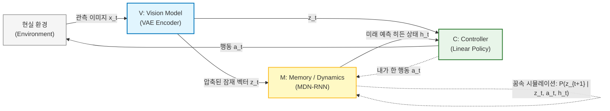

# World Model (월드 모델)

> [!abstract] 핵심 개념 & 3줄 요약
> - **한 줄 정의**: AI가 현실 세계에 직접 몸을 던지기 전에, 머릿속으로 **"내가 지금 이 행동($a_t$)을 하면 다음 순간 세상($s_{t+1}$)이 어떻게 바뀔까?"** 를 시뮬레이션해 보는 **내부 정신 모델(Internal Mental Model)** 이다.
> - **등장 배경**: 현실 세계(로봇, 자율주행 등)에서 기존 [[강화학습]]처럼 수백만 번 맨땅에 헤딩하며 배우는 건 비용과 안전 문제로 불가능에 가깝다. 그래서 **"현실 대신 AI의 꿈(잠재 공간 시뮬레이션) 속에서 연습시키자"** 는 아이디어에서 출발했다.
> - **패러다임 진화**: Ha & Schmidhuber(2018)와 Dreamer 시리즈 같은 **강화학습용 잠재 동역학 모델**에서 시작해, Sora·Genie·Cosmos 같은 **비디오 생성 기반 물리 시뮬레이터**, 그리고 Yann LeCun의 **JEPA(픽셀 대신 추상 표현 예측)** 로 진화하며 체화 AI([[VLA]])의 핵심 축을 담당하고 있다.

---

## 1. 개요: 왜 '월드 모델'이 필요한가?

야구 타자가 시속 150km로 날아오는 공을 칠 때, 시신경에서 뇌까지 시각 정보가 전달되는 데만 약 0.1초가 걸린다. 공이 홈플레이트까지 오는 시간은 고작 0.4초 남짓인데, 인간은 어떻게 배트를 제때 휘두를 수 있을까? 정답은 인간의 뇌 속에 이미 **'공이 날아오는 물리 법칙을 예측하는 내부 시뮬레이터(World Model)'** 가 내장되어 있어, 미래의 공 위치를 미리 그려보고 몸을 움직이기 때문이다.

반면 기존의 AI 모델들은 이 능력이 결여되어 있거나 극도로 비효율적이었다.

1. **[[GPT|LLM]]과 [[VLM]]의 한계 (책상물림 천재)**: 인터넷의 텍스트와 이미지를 달달 외워서 양자역학 시험은 만점을 받지만, 정작 "물이 가득 찬 컵을 테이블 끝에서 5cm 더 밀면 어떻게 될까?" 같은 물리적 인과관계(Causality)와 시간적 동역학(Dynamics)은 직접 겪어보지 못해 엉뚱한 소리(환각)를 하곤 한다.
2. **기존 [[강화학습]](Model-free RL)의 극악한 효율**: 아타리 벽돌깨기 게임 하나를 마스터하려고 수천만 프레임을 플레이하며 죽어봐야 한다. 게임이니까 망정이지, 대당 수천만 원짜리 로봇 팔이나 자율주행차를 도로에 내보내 "수만 번 사고 내면서 배워라"라고 할 수는 없는 노릇이다.

> [!tip] 해결책: 세상이 돌아가는 법칙을 먼저 배우자!
> 환경과 상호작용하며 **세상의 상태 전이 법칙 $P(s_{t+1} \mid s_t, a_t)$** 자체를 신경망으로 모델링한다. 일단 머릿속에 그럴듯한 '가상 지구(World Model)'가 세워지면, 실제 로봇을 움직이지 않고도 **뇌 속의 상상(Imagination / Dreaming)** 만으로 수백만 번 예행연습을 돌려 최적의 정책(Policy)을 찾을 수 있다.

---

## 2. 기본 아키텍처 (Ha & Schmidhuber, 2018)

현대 딥러닝 기반 월드 모델의 신호탄을 쏜 것은 David Ha와 Jürgen Schmidhuber의 2018년 논문(*World Models*)이다. 인간의 인지 과정(눈 $\to$ 뇌의 기억/예측 $\to$ 손발)을 그대로 본뜬 **V-M-C 3단 구조**를 제시했다.

### 구성 요소와 역할 분담
1. **V (Vision Model — [[VAE]])**:
   - **역할**: 매 순간 들어오는 고해상도 관측 이미지($x_t \in \mathbb{R}^{64 \times 64 \times 3}$)를 아주 작은 차원의 잠재 벡터($z_t \in \mathbb{R}^{32}$)로 압축한다.
   - **이유**: 픽셀 수만 개를 일일이 다 기억하고 예측하는 건 연산량 낭비다. "내 앞에 차가 있다, 길이 왼쪽으로 굽었다" 같은 핵심 엑기스만 요약하는 **'눈'** 역할이다.
2. **M (Memory / Dynamics Model — MDN-RNN)**:
   - **역할**: 과거의 기억($h_{t-1}$), 현재 요약본($z_t$), 그리고 내가 방금 취한 행동($a_t$)을 입력받아 **다음 순간의 상태 분포 $P(z_{t+1} \mid a_t, z_t, h_t)$** 를 예측한다.
   - **왜 MDN(Mixture Density Network)인가?**: 세상은 결정론적이지 않다. 내가 핸들을 똑같이 꺾어도 빙판길일 수도 있고 앞차가 급정거할 수도 있다. 그래서 미래를 단일 숫자로 찍는 대신 **여러 개의 가우시안 분포 혼합(Mixture of Gaussians)** 으로 예측해 세상의 불확실성을 담아낸다.
3. **C (Controller — Policy)**:
   - **역할**: $z_t$(현재 눈앞 요약)와 $h_t$(뇌가 예측한 미래 맥락)를 보고 실제 행동 $a_t$를 결정한다.
   - **특징**: V와 M이 세상 돌아가는 복잡한 계산을 다 떠안았기 때문에, 정작 행동을 결정하는 C는 $a_t = W_c [z_t; h_t] + b_c$ 수준의 **초경량 선형 레이어(파라미터 수백 개)** 만으로도 레이싱 게임을 완벽히 클리어할 수 있었다. 심지어 V와 M이 만든 **'꿈(가상 환경)'** 속에서도 C를 학습시킬 수 있음을 증명했다.

---

## 3. 핵심 수식과 작동 원리: Dreamer와 RSSM

Ha & Schmidhuber 이후 강화학습 계열 월드 모델의 표준으로 자리 잡은 것은 Danijar Hafner 팀의 **Dreamer (v1 $\to$ v2 $\to$ v3)** 시리즈다. Dreamer의 심장부에는 **RSSM (Recurrent State-Space Model)** 이라는 구조가 들어있다.

### 3.1. RSSM: 결정론적 기억과 확률적 상상의 결합
세상의 변화에는 **결정론적 법칙**(공을 던지면 포물선을 그린다)과 **확률적 변수**(바람이 불거나 바닥이 울퉁불퉁하다)가 섞여 있다. RSSM은 이를 동시에 잡기 위해 잠재 상태를 **결정론적 히든 상태($h_t$)** 와 **확률적 상태($z_t$)** 로 분리한다.

$$
\begin{aligned}
\text{1. 순환 기억 (Recurrent Model):} \quad & h_t = f_\phi(h_{t-1}, z_{t-1}, a_{t-1}) \\
\text{2. 현실 인코딩 (Posterior / 눈 떴을 때):} \quad & z_t \sim q_\phi(z_t \mid h_t, x_t) \\
\text{3. 미래 상상 (Prior / 눈 감았을 때):} \quad & \hat{z}_t \sim p_\phi(\hat{z}_t \mid h_t) \\
\text{4. 보상 및 종료 예측 (Predictor):} \quad & \hat{r}_t \sim p_\phi(\hat{r}_t \mid h_t, z_t), \quad \hat{c}_t \sim p_\phi(\hat{c}_t \mid h_t, z_t)
\end{aligned}
$$

- **눈을 뜨고 있을 때(학습)**: 실제 카메라 영상 $x_t$가 들어오므로 사후 분포(Posterior) $q_\phi$를 통해 정확한 잠재 상태 $z_t$를 파악한다.
- **눈을 감고 꿈을 꿀 때(Imagination)**: 영상 $x_t$가 없다! 오직 과거 기억 $h_t$만 가지고 사전 분포(Prior) $p_\phi$에서 가상의 상태 $\hat{z}_t$를 샘플링하며 미래를 머릿속으로 굴려본다(Rollout).

### 3.2. KL Balancing: 상상이 현실을 닮아가도록 강제하기
눈을 감고 상상한 분포($p_\phi$)가 눈을 뜨고 본 현실 분포($q_\phi$)와 똑같아져야 제대로 된 월드 모델이다. 이를 위해 두 분포 사이의 **[[Information Theory|KL Divergence]]** 를 줄이는 손실 함수를 쓴다.

$$
\mathcal{L}_{\text{KL}}(\phi) = \beta_{\text{pred}} D_{\text{KL}}\left[\text{sg}(q_\phi(z_t \mid h_t, x_t)) \;\|\; p_\phi(z_t \mid h_t)\right] + \beta_{\text{reg}} D_{\text{KL}}\left[q_\phi(z_t \mid h_t, x_t) \;\|\; \text{sg}(p_\phi(z_t \mid h_t))\right]
$$

> [!warning] 왜 `sg`(Stop-Gradient)로 쪼개서 학습할까?
> KL Divergence를 그냥 줄이라고 하면 신경망이 잔머리를 굴린다. 상상 모델($p_\phi$)이 똑똑해져서 현실($q_\phi$)을 맞추는 대신, 현실 인코더($q_\phi$)가 **"상상 모델이 맞추기 쉽게 애초에 현실 정보를 다 버리고 멍청하게 인코딩해 주자!"** 라며 난이도를 낮춰버리는 **표현 붕괴(Representation Collapse)** 가 일어난다.
> 이를 막기 위해 `sg`(그래디언트 차단)를 걸어 **"기본적으로는 상상($p_\phi$)이 현실($q_\phi$)을 따라가되($\beta_{\text{pred}}$ 크게), 현실 인코더도 상상하기 너무 어렵지 않게 적당히만 배려해라($\beta_{\text{reg}}$ 작게)"** 라고 비대칭 가중치(KL Balancing)를 주는 것이다.

---

## 4. 월드 모델의 3대 천하삼분지계 (2024–2026 트렌드)

최근 AI 학계에서 '월드 모델'이라고 부르는 기술은 연구 집단마다 정의가 조금씩 다르다. 크게 **3가지 유파**가 치열하게 패권 다툼을 벌이고 있다.

```mermaid
%%{init: {'theme':'default'}}%%
graph TD
    subgraph TypeA["제1유파: 잠재 공간 RL (Dreamer 계열)"]
        A1["관측 x_t + 행동 a_t"] --> A2["저차원 잠재 공간 z_t"]
        A2 --> A3["보상 r_t 예측 & 정책 학습"]
    end

    subgraph TypeB["제2유파: 비디오 생성 시뮬레이터 (Sora / Genie / Cosmos)"]
        B1["프롬프트 / 행동 a_t + 현재 프레임"] --> B2["Diffusion / Auto-regressive"]
        B2 --> B3["미래 픽셀 영상 x_{t+1} 직접 생성"]
    end

    subgraph TypeC["제3유파: 추상 표현 예측 (Yann LeCun의 JEPA)"]
        C1["현재 영상 x_t"] --> C2["인코더 s_t"]
        C2 --> C3["잠재 표현 s_{t+1}만 예측<br/>(픽셀 복원 안 함!)"]
    end

    style TypeA fill:#E8F5E9,stroke:#2E7D32
    style TypeB fill:#FFF3E0,stroke:#EF6C00
    style TypeC fill:#F3E5F5,stroke:#7B1FA2
```

### 4.1. 제1유파: 강화학습용 잠재 동역학 (DreamerV3, TD-MPC2)
- **핵심 철학**: "월드 모델의 존재 이유는 결국 **에이전트가 행동을 잘하게 만드는 것(Control)** 이다."
- **특징**: 마인크래프트 게임에 아무런 사전 지식 없이 던져놓아도, 스스로 월드 모델을 구축해 꿈속에서 연습한 끝에 최종 테크트리인 '다이아몬드 채굴'에 세계 최초로 성공한 **DreamerV3**가 대표작이다. 최근에는 로봇 보행이나 조작(TD-MPC2 등)에 직접 쓰인다.

### 4.2. 제2유파: 비디오 생성 모델 = 물리 엔진 (Sora, Genie, Cosmos)
- **핵심 철학**: "수백만 시간의 비디오를 학습해 다음 프레임을 기가 막히게 그릴 수 있다면, 그 모델은 이미 세상의 물리 법칙(빛의 반사, 유체 역학, 물체 영속성)을 통달한 월드 모델이다!"
- **진화 과정**:
  - **1단계 (관찰자 시뮬레이터 — OpenAI Sora)**: 텍스트만 주면 물리적으로 그럴듯한 영상을 생성하지만, 중간에 사용자가 개입(행동 $a_t$)할 수는 없는 '관상용' 월드 모델에 가까웠다.
  - **2단계 (인터랙티브 월드 모델 — Google Genie 1/2/3, NVIDIA Cosmos, Wayve GAIA-1)**: 드디어 **행동 조건부(Action-Conditioned)** 생성이 결합되었다. 키보드 방향키나 로봇 팔 제어 명령($a_t$)을 입력하면, 그 행동으로 인해 변화된 1초 뒤의 미래 영상을 실시간으로 렌더링해 준다.
- **활용**: 실제 로봇을 굴리기 전에 **[[VLA]] 모델을 훈련시키고 테스트하는 무한 가상 체육관(Synthetic Gym)** 으로 폭발적인 각광을 받고 있다.

### 4.3. 제3유파: "픽셀 생성은 낭비다!" — JEPA (Yann LeCun 학파)
- **핵심 철학**: 튜링상 수상자 얀 르쿤(Yann LeCun, Meta) 교수는 Sora 같은 비디오 생성 모델을 두고 **"픽셀 단위 생성(Pixel-level Generation)은 월드 모델로서 완전히 틀린 길"** 이라고 맹비난한다.
- **왜 픽셀을 버려야 하는가?**: 자율주행차가 도로를 달릴 때 중요한 건 '앞차와의 거리와 상대 속도'다. 그런데 비디오 생성 모델은 가로수의 나뭇잎 수천 개가 바람에 흔들리는 픽셀 위치와 아스팔트의 자갈 무늬까지 복원하느라 모델 용량의 90% 이상을 낭비한다.
- **해법 (Joint-Embedding Predictive Architecture — I-JEPA, V-JEPA)**:
  - 이미지를 픽셀로 다시 디코딩(복원)하는 과정을 아예 없애버렸다!
  - 입력 영상 $x_t$와 미래 영상 $x_{t+1}$을 모두 추상적인 임베딩 공간($s_t, s_{t+1}$)으로 보낸 뒤, **오직 추상 표현 공간 안에서만 미래($s_t \xrightarrow{a_t} \hat{s}_{t+1}$)를 예측**한다. 불필요한 디테일(나뭇잎 흔들림)은 인코더가 알아서 무시하고 본질적인 동역학만 배우게 만드는 지극히 실용적인 접근이다.

---

## 5. 주요 월드 모델 아키텍처 비교

| 모델 | 연도 / 주체 | 예측 공간 | 행동 개입 ($a_t$) | 픽셀 복원(Decoder) | 핵심 특징 및 의의 |
| :--- | :--- | :--- | :--- | :--- | :--- |
| **World Models** | 2018 (Ha & Schmidhuber) | Latent ($z_t$) | O | O (VAE) | V-M-C 3단 구조 정립, '꿈속 강화학습'의 시초 |
| **DreamerV3** | 2023 (Danijar Hafner 등) | Latent (RSSM) | O | O (학습 보조용) | 하이퍼파라미터 튜닝 없이 마인크래프트 다이아몬드 채굴 성공 |
| **Sora** | 2024 (OpenAI) | Latent Patch | X (텍스트만) | O (Diffusion) | 스케일링 법칙을 통한 물리 시뮬레이터 가능성 제시 |
| **V-JEPA / V-JEPA 2** | 2024–2025 (Meta) | Abstract Feature | O (후속 확장) | **X (복원 안 함)** | 픽셀 생성 없이 순수 잠재 표현만 예측해 연산 효율 극대화 |
| **Genie 2 / 3** | 2024–2025 (DeepMind) | Latent Token | O (키보드/마우스) | O | 사진 한 장만 주면 조작 가능한 3D 가상 세계로 즉시 변환 |
| **NVIDIA Cosmos** | 2025 (NVIDIA) | Token / Diffusion | O (로봇/주행 제어) | O | 피지컬 AI(로봇·자율주행) 훈련에 특화된 오픈 월드 파운데이션 모델 |

---

## 6. 고질적 한계와 해결 과제

월드 모델이 만능열쇠처럼 보이지만, 현업에 투입하기엔 아직 골치 아픈 난제들이 남아있다.

1. **누적 오차 (Compounding Error / Rollout Drift)**:
   - 상상은 결국 '내가 예측한 미래($\hat{s}_{t+1}$)를 발판 삼아 그다음 미래($\hat{s}_{t+2}$)를 또 예측'하는 자기회귀(Auto-regressive) 과정이다. 1스텝에서 발생한 1%의 미세한 오차가 50스텝 뒤에는 눈덩이처럼 불어나, 꿈속 세상이 기괴하게 찌그러지거나 물리 법칙이 붕괴한다.
2. **물리적 환각 (Physical Hallucination)**:
   - 특히 제2유파(비디오 생성 계열)에서 심각하다. 겉보기엔 헐리우드 CG처럼 매끈한데, 자세히 보면 로봇 팔이 컵을 통과해 버리거나(충돌 무시), 시야에서 잠깐 가려진 물체가 증발해 버리는(대상 영속성 결여) 등 '눈속임 물리학'에 그치는 경우가 많다.
3. **월드 모델 착취 (Model Exploitation / Adversarial Policy)**:
   - 에이전트를 월드 모델의 꿈속에서만 너무 오래 학습시키면, 에이전트가 실제 물리 법칙을 배우는 게 아니라 **월드 모델 신경망의 버그(취약점)를 해킹**하는 법을 배운다. 마치 게임의 벽 뚫기 버그를 찾아내어 꿈속에서는 만점을 받는데, 정작 현실 로봇에 이식하면 첫 발자국에 고꾸라지는 현상이다.

---

## 7. 한 줄 요약

> **World Model = "몸이 고생하기 전에 뇌 속에서 '내가 이렇게 행동하면 세상이 어떻게 바뀔지' 미리 시뮬레이션(꿈)해 보고 최적의 수를 찾는 AI의 내부 물리 엔진"**

---
연관 노트: [[VLA]], [[VLM]], [[강화학습]], [[VAE]], [[Generative Model]]

